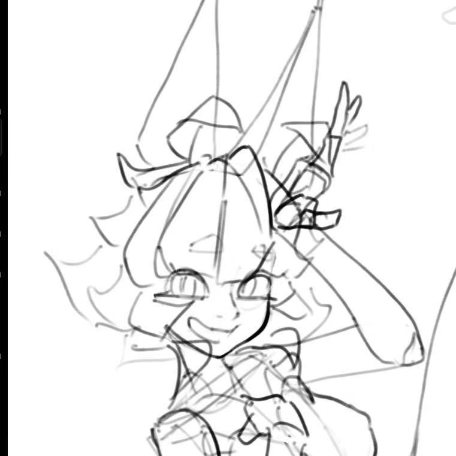

# ResoluAlysis 个人页 — P0 修复记录

本目录是原始文件的一份**可运行副本**，只做了「先修 Bug」这一轮改动（不做性能重构、不改视觉风格）。
目录结构与原项目一致：

```
index.html
css/style.css
js/  timeline.js  welcome.js  particles.js  fore-particles.js  blobs.js
     mosaic.js  main.js  rulers.js  guides.js  colck.js
     circle-parallax.js  theme-toggle.js
```

把文件覆盖回你的项目即可（`assets/` 里的字体、图片、音频不在本次改动范围内）。

---

## 0. 兼容基线

本次改动按 **Safari 15.4+（macOS 12.3 / iOS 15.4）** 为最低目标：

| 用到的特性 | Safari 起始版本 | 说明 |
|---|---|---|
| `100dvh` | 15.4 | 不支持的旧版会自动回落到上一行的 `100vh` |
| 独立 `translate` 属性 | 14.1 | 你原本就在用，保留 |
| `?.` / `??` | 13.1 | 保留 |
| `Element.getAnimations()`、`el.animate()` | 13.1 | 保留 |
| `-webkit-backdrop-filter` | 9 | 原本已带前缀，保留 |
| `-webkit-mask-composite` | 9.1 | 原本已带前缀，保留 |

**Safari 仍需你自己在真机上确认的两处**（我无法在浏览器里跑）：

1. **`filter: url(#goo)`**（`.liquid-bg`）—— Safari 对「用 SVG 滤镜作用于 HTML 元素」的支持一向比 Chrome 差，可能出现液态球不黏连、或是明显掉帧。如果观感不对，第一选择是把这一层在 Safari 关掉（见第 4 节）。
2. **`#foreground-particles { filter: blur(1px) }`** —— 全屏模糊叠在一张每帧重绘的 canvas 上，Safari 上开销很大。建议下一轮改成「画柔边 sprite」，或先删掉这行 CSS。

---

## 1. 这一轮修掉的问题

### `index.html`

| # | 问题 | 改动 |
|---|---|---|
| 1 | `.container.hero-box` 没有闭合标签，浏览器隐式补 `</div>`，DOM 里多出一个空的 flex 子项，hero 布局会漂 | 在 `</section>` 前补上 `</div>` |
| 2 | 主题在 `</body>` 前才由 JS 应用 → 刷新时先渲染深色再跳浅色（闪白） | `<head>` 里加同步引导脚本，在首次绘制前给 `<html>` 加 `light` 类；并支持无记录时跟随系统 `prefers-color-scheme` |
| 3 | `<div class="panel scanlines scanbeam">` —— 这三个 class 在 CSS 里**一个都不存在**（`scanlines` 那段是注释掉的），纯死代码 | 删除 |
| 4 | `<source type="audio/mp3">` 不是合法 MIME | 改成 `audio/mpeg` |
| 5 | 占位卡片 `href="#" target="_blank"` 会打开空白标签页 | 去掉 `target` |
| 6 | 外部链接缺 `rel` | GitHub 链接补 `rel="noopener noreferrer"` |

### `css/style.css`

| # | 问题 | 改动 |
|---|---|---|
| 7 | **`body::before` 缺 `position`** —— `inset` / `z-index` 对 static 元素无效，而 `::before` 是 0×0 的 inline 盒子，噪点层**从来没有被画出来过** | 加 `position: fixed; width: 100%; height: 100%` |
| 8 | 同一条 `background-image` 的 data URI 里 `<` `>` `#` `%` 全部未转义，Safari 对未转义字符更严格 | 改成 `;charset=utf-8,` + 全量百分号转义 |
| 9 | **`.page-zoom` 同时有 `transform`（动画 `forwards` 停在 `scale(1)`）和 `overflow: hidden` + `height: 100vh`** → 它成了所有 `position: fixed` 子元素的包含块，HUD 层（粒子 / 尺子 / 参考线 / 准星 / 圆环）其实是相对它定位的；移动端更因为 `overflow:hidden` 而**整页滚不动** | 新增 `body.intro-done .page-zoom { animation: none; transform: none; height: auto; overflow: visible }`，由 JS 在开屏结束/跳过时加类；移动端另有兜底覆盖 |
| 10 | `.digital-clock` 用 `font:` 简写但漏了 `font-size` → **整条声明非法被丢弃，Astron 数字字体从未生效** | 改为 `font-family:` |
| 11 | `.circle-ticks` 引用了 **并不存在的 `@keyframes circleReveal`**，那条 `animation` 一直是死声明（圆环能显示全靠 JS 的 WAAPI 兜着） | 删掉该声明，只留初始 `opacity: 0` |
| 12 | `.theme-toggle` 在 75px 导航里：`padding: 8px 12px` + 单字，内容盒只剩 9px，字会溢出 | `gap: 8px; padding: 6px 4px; justify-content: center` |
| 13 | `.footer` 是 `display:flex` **横向**排列，两行文字（`© - 2026` + `ResoluAlysis`）加起来远超 75px，加上 `white-space: nowrap` 必然溢出 | 改成 `flex-direction: column` + `gap: 2px` |
| 14 | 移动端 `.footer` 注释写着「页脚取消固定」，代码却仍是 `position: fixed` + 75px 宽，压住正文左下角 | 改为 `position: static; width: 100%` + 上边框 |
| 15 | 移动端仍执行 `.hero .container { transform: translateX(-37.5px) }`（那是为左侧导航做的补偿），导致 hero 内容整体偏左 | 移动端改为 `transform: none` |
| 16 | `#guide-layer` 没有任何初始透明度，而 JS 里 `visible` 初值是 `false` → 参考线一进页面就显示，G 键状态和视觉对不上 | CSS 加 `opacity: 0` + `transition`，JS 同步设初值 |
| 17 | iOS Safari 的 `100vh` 会被底部工具栏遮住 | `body` / `.page-zoom` / `.navbar` / `main` / `.section, .hero` 都补一行 `height: 100dvh` |

### `js/rulers.js`

| # | 问题 | 改动 |
|---|---|---|
| 18 | **`drawBottom` 写死 `h = 4`、`drawLeft` 写死 `w = 4`，同时 `setup()` 又把这些值写成内联 `style.height/width`，直接盖掉 CSS 的 28px / 40px** → 最长 14px 的主刻度被整片裁在画布外，长短刻度看起来完全一样，「刻度尺」这个核心视觉基本失效 | 尺寸改为从 CSS / 视口读取；`setup()` 只负责后备缓冲区，不再写内联样式（否则 resize 时读到的是旧值，画布再也不会跟着窗口变） |
| 19 | 移动端 CSS 已把刻度尺 `display:none`，JS 仍在空画 | `render()` 里加 `display` 判断 |

> **需要你确认的一处观感**：尺子现在真的宽/高 28px / 40px 了，而两个位置指示三角当初是按 4px 薄尺摆的，现在会落在尺子内部（不是外沿）。
> 若想让它贴外沿：`.ruler-marker-x { bottom: 5px }` → `28px`，`.ruler-marker-y { left: 5px }` → `40px`。

### `js/timeline.js` + `js/welcome.js`

| # | 问题 | 改动 |
|---|---|---|
| 20 | `timeline.js` 里配了 `welcomeIn.delay = 0.8`，但 `welcome.js` **从头到尾没读过 `IN.delay`**，字符动画实际从 0s 就开始（藏在渐显遮罩后面） | `welcome.js` 写入 `--welcome-in-delay`，CSS `.char` 的 `animation-delay` 加上它 |
| 21 | 时间线自相矛盾：`welcomeOut.delay = 1.5` **早于** 入场结束时间 `0.8 + 2.0 = 2.8s`（现在只是碰巧因为第 20 条 bug 才看着正常） | `welcomeOut.delay` 改为 `2.8`，并在注释里写明这个等式 |
| 22 | `el.addEventListener('animationend', ..., { once: true })` —— `.char` 上的 `charRise` 结束时事件会冒泡到 `el`，第一个冒上来的事件就把监听器消耗掉，`welcomeLeave` 永远不会被处理，整块 WELCOME 会**一直留在 DOM 里** | 改成具名回调 + 判断 `e.target === el && e.animationName === 'welcomeLeave'` |

### `js/main.js`

| # | 问题 | 改动 |
|---|---|---|
| 23 | `prefers-reduced-motion` 下 CSS 把动画压到 0.01ms（画面瞬间静止），但 `body.locked` 仍要等 `TOTAL` 秒才解除 → 用户盯着一个**既不能动也点不动**的页面近 5 秒 | 新增 `REDUCE_MOTION` 短路：直接跳到「已结束」状态 |
| 24 | 解锁逻辑散在 3 个 `setTimeout` 里，各自加 class / 删遮罩 | 抽出 `finishIntro()` 统一收尾，并在解锁时加上 `intro-done`（配合第 9 条交还 `transform`） |
| 25 | 所有 `a[href^="#"]` 被 `preventDefault()` 后改 `main.scrollLeft`，但移动端 `main` 是竖向排布、`scrollLeft` 恒为 0 → **移动端点导航完全没反应** | 加守卫：只有 `overflowX === "auto"`（横向模式）才接管，否则交给浏览器原生锚点 |

### `js/fore-particles.js`（这一层原本几乎等于「一层不可见 + 一次全屏模糊开销」）

| # | 问题 | 改动 |
|---|---|---|
| 26 | 算出来的 `alpha`（opacity × 层透明度 × 边缘淡出）**没有进入 `fill`**，`fill` 用的是常量 `rgba(0,0,0,0.1)` → 淡入淡出、边缘淡出全部失效 | `alpha` 真正参与 `fill`；新增 `alphaBase` 作为整体不透明度上限（想让前景更明显就调大它） |
| 27 | `shadowColor` 被拼成 `rgba(0,0,0,0.1, 0.42)` —— **5 个分量的非法字符串，赋值被浏览器忽略** → 发光也是坏的 | 拆成 `color`（纯 R,G,B）+ 正确的 `rgba(r,g,b,a)` |
| 28 | `beginPath()` + `arc()` 建了圆路径却从不 `fill`，实际用 `fillRect` 画方块；`CONFIG.blur` 从未使用 | 改为 `arc() + fill()`（观感会从**方块变成圆点**，这是唯一一处视觉变化，想改回方块就把 `ctx.fill()` 换回 `ctx.fillRect(px - p.r, p.y - p.r, p.r*2, p.r*2)`） |
| 29 | `LAYERS` 只有一项却写着「分三层视差」，且 `weight: 0.15` 让 85% 的随机数落空（靠 fallback 巧合工作）；`size: [10.0, 5.0]` 上下界写反 | `weight` 改为 `1.0` 并修正注释，`size` 改为 `[5.0, 10.0]` |
| 30 | 本意是「只在上下两条带内生成」，但 `update()` 做的是**整屏 y 轴环绕**，粒子迟早漂到屏幕中间并留在那 | 每颗粒子固定分配到上带或下带，在带内往返（`bandTop`） |
| 31 | 纯装饰层没有尊重降低动效偏好 | 顶部加 `prefers-reduced-motion` 短路 |

### 其他 JS

| # | 文件 | 问题 | 改动 |
|---|---|---|---|
| 32 | `theme-toggle.js` | 主题类挂在 `body` 上，`<head>` 引导脚本跑在 body 存在之前；`localStorage` 在隐私模式会抛错 | 类改挂 `<html>`（对应 CSS `:root.light`）；读写 `localStorage` 加 `try/catch`；补 `aria-pressed` / `aria-label` |
| 33 | `circle-parallax.js` | `circlesReveal` 里 `if (!T) return;` —— 一旦时间线缺失（或用户要求减少动效），而 CSS 初始 `opacity: 0`，圆环会**永远不可见** | 加兜底：无时间线 / 降低动效时直接把 `opacity` 设为 1 |
| 34 | `particles.js` | 纯装饰层没有尊重降低动效偏好 | 顶部加短路（和 `blobs.js` 保持一致） |

---

## 2. 我**没有**动的东西（留给下一轮，避免这次改动过大）

1. **性能重构**：9 个常驻 `requestAnimationFrame` 循环、每帧给几百个 mosaic 方块写 `--px`、`.mosaic-tile` 上滥用 `will-change`、`shadowBlur` 粒子、帧率相关的物理。这是下一轮性价比最高的一项（合并 ticker + 用单个 `--scroll-x` 驱动全部视差）。
2. **命名**：`splash-遮罩` / `splash-渐显` / `@keyframes body缩放` / `--colck`（拼错的 `clock`）仍然是中文/拼错标识符。语法合法，但一上压缩工具或换编码保存就危险。
3. **`colck.js` 的网络对时**：`syncInterval` 的指数退避算了但 `setInterval` 里写死 30 分钟，退避完全没用；`worldtimeapi.org` 经常挂、也会把访客 IP 给第三方。建议直接删掉网络对时。
4. **死代码**：`main.js` 里永不触发的 `frozen` + MutationObserver、`.shine`（CSS 里没有这个类）、空的 `contextmenu` 监听、`window.__themeTimer` 挂全局。
5. **`.section { justify-content: center; overflow-y: auto }`** 的经典坑：内容超过一屏时顶部会被裁且滚不到。修法有讲究（`safe center` 的 Safari 支持要看版本），所以没在这次动。
6. **可访问性 / SEO**：`* { cursor: none !important }` 全局禁用光标、`body { user-select: none }` 让访客无法复制你的简介、装饰性 canvas 缺 `aria-hidden`、`` 分组缺 `alt`、缺 `description` / OG / favicon / theme-color。
7. **浮窗系统**：`<dialog>` + `inert` + 焦点归还 + Unity iframe 惰性注入 + `startViewTransition()`，以及 `data/works.js` 数据驱动卡片。

---

## 3. 建议的手动验证清单

- [ ] 桌面：开屏能正常播完并解锁；**按任意键 / 点击**跳过也正常
- [ ] 桌面：底部与左侧刻度尺**看得到长短刻度之分**（这是第 18 条的验收点）
- [ ] 桌面：拖动窗口大小，刻度尺跟着变（第 18 条后半段）
- [ ] 桌面：鼠标移动时两个位置指示三角跟随
- [ ] 桌面：按 `G` 键——初始应是**隐藏**的，按一次显示、再按隐藏
- [ ] 桌面：刷新页面时主题**不闪**
- [ ] 桌面：点导航 / hero 按钮，能横向平滑跳转
- [ ] 桌面：把系统设为「减少动态效果」后刷新 —— 应立即进入可用状态，不锁屏
- [ ] 移动端（真机 + 设备模拟都试）：**整页能竖向滚动**，内容不被裁（第 9 条）
- [ ] 移动端：点顶部导航能跳到对应区块（第 25 条）
- [ ] 移动端：页脚在底部正常排成两行、不溢出
- [ ] 控制台应无报错

---

## 4. 如果 Safari 上 goo 液滴或前景模糊有问题

按「Safari 影响最小」的顺序：

```css
/* 1) 前景粒子的全屏模糊 —— 直接去掉最省事 */
#foreground-particles { filter: none; -webkit-filter: none; }

/* 2) goo 液滴 —— 只在 Safari 关掉（用 @supports 无法可靠区分，建议用 UA 类或直接关） */
.liquid-bg { display: none; }
```
---

# P1 性能重构（第二轮）

目标：把 9 个各自为战的 rAF 循环收敛成 1 个，并让所有特效在**没有变化时完全不工作**。

## 新增两个基础模块

| 文件 | 作用 |
|---|---|
| `js/world.js` | 全站唯一的 rAF 调度器 + 横向滚动位置。`World.onScroll(fn)` 只在滚动位置变化时回调；`World.onFrame(fn)` 每帧回调并带上归一化 dt（60fps = 1）。标签页切到后台整体暂停。`scrollX` 是缓存值，特效层读它不会重复触发强制布局。 |
| `js/sprite.js` | `makeGlowSprite()`：把「形状 + 光晕」预渲染成一张 64x64 的离屏 canvas，用来替掉逐颗粒子的 `shadowBlur`。 |

`index.html` 里这两个脚本排在所有特效脚本之前。

## 循环收敛对照

| 模块 | 重构前 | 重构后 |
|---|---|---|
| `particles.js` | 独立 rAF + 每颗 shadowBlur | `World.onFrame` + sprite |
| `fore-particles.js` | 独立 rAF + 每颗 shadowBlur | `World.onFrame` + sprite |
| `guides.js` | 独立 rAF，**每帧重画整张全屏参考线** | `World.onScroll`，只在滚动时重画 |
| `rulers.js`（指示三角） | 独立 rAF，**每帧无条件写 transform + dataset** | `World.onFrame`，位置没变就不碰 DOM |
| `mosaic.js`（视差） | 独立 rAF + 逐个方块写 `--px` | 循环整个删除，每个方块只写一次 `--parallax` |
| `circle-parallax.js`（视差） | 独立 rAF + 逐个元素写 `--px` | 整个 IIFE 删除，系数写进 CSS |
| `main.js`（液滴跟随） | 独立 rAF，每帧写 transform | 删除，改为 CSS 视差 |
| `main.js`（鼠标点） | 独立 rAF，每帧写 transform | `World.onFrame`，位置稳定后停止写入 |
| `colck.js` | 独立 rAF | `World.onFrame`；数字时钟只在秒变化时写 DOM |

**9 个常驻 rAF 收敛为 1 个。** 现在只剩两处临时动画还在自己开 rAF：`main.js` 的滚轮惯性与锚点冲刺，动画结束即停止。

## 视差改为单一变量驱动

`style.css` 顶部新增：

```css
@property --scroll-x { syntax: '<number>'; inherits: true; initial-value: 0; }

.circle, .circle-ticks, .digital-clock, .mosaic-tile, .liquid-bg {
    --px: calc(var(--scroll-x, 0) * var(--parallax, 0) * -1 * 1px);
}
```

各层只声明系数（`.circle-1 { --parallax: 0.08 }`、`.digital-clock { --parallax: 0.4 }`、`.liquid-bg { --parallax: 0.7143 }`），`world.js` 每帧**只写一次** `--scroll-x`。

**需要说清楚的一点**：`--scroll-x` 是继承的自定义属性，浏览器仍然要为引用了它的元素做样式重算。所以这里的收益主要在 **JS 侧**——每帧 1 次 DOM 写入代替约 20~35 次，并且能整块删掉 mosaic 与圆环两个模块的循环——**而不是**「样式计算少了 400 倍」。

顺带更正第一轮我说错的一个数字：mosaic 实测在 1920x1080 下三个区块合计只有**约 40 个方块**（其中约 16 个参与视差），不是我之前说的 200~400 个。我把 `style.css` 里写错的注释也一并改了。

## 其他改动

- **dt 归一化**：两个粒子层、滚轮惯性（`FRICTION` / `FOLLOW`）、准星跟随（`EASE`）、鼠标点，全部改成按归一化 dt 计算。这些参数原本是「每帧」的，144Hz 屏幕上粒子速度和惯性衰减会是 60Hz 的 2.4 倍。
- **`.mosaic-tile` 去掉 `will-change: transform`**：每个 tile 还带一个 `tileFloat` 漂浮动画，挂 `will-change` 等于同时建一堆合成层。
- **`.liquid-bg` 去掉 `will-change: transform`**：不再逐帧改 transform，而且它是一张全屏 + SVG 滤镜的图层。
- **`#foreground-particles` 去掉 `filter: blur(1px)`**：这张 canvas 每帧重绘，等于每帧一次全屏模糊（Safari 上尤其贵）。柔边现在由 sprite 画出来。
- **`colck.js` 删掉网络对时**：不再每 30 分钟请求 `worldtimeapi.org`（免费接口不稳定，还会把访客 IP 交给第三方）；同时删掉了那段算了却从未生效的指数退避。
- **`main.js` 删掉 `syncLiquidLayer` 循环**，以及 `#about .container` 上那个没有对应 CSS 规则、还带强制 reflow 的 `.shine` 处理器。
- canvas 后备缓冲区尺寸统一 `Math.round(W * dpr)`，避免 DPR 为 1.25 / 1.5 时的半像素毛边。

## 需要你确认的观感变化

1. **粒子光晕现在跟随 sprite 一起缩放**（原来是固定 3px 光晕）。为此我把两层的 `CONFIG.glow` 从 3 / 4 提到了 10 / 6，让柔度尽量贴近原来。仍会有一点差别：
   - 远处那档极小粒子会显得比原来「硬」，因为原来那 3px 光晕相对它们的尺寸是很大的；
   - 近处的大粒子会比原来更柔。
   这两个值就是唯一的旋钮：`particles.js` 的 `CONFIG.glow` 越大越柔，太糊就调小。
2. **参考线 / 尺子三角 / 鼠标点在静止时不再刷新**——这是预期行为，不是渲染出错。
3. 若某个视差层不跟着滚动，先确认 `js/world.js` 正常加载（它必须排在所有特效脚本之前）。

## 仍然没做（第三轮候选）

- 命名清理（`splash-遮罩` / `body缩放` / `--colck`）
- `.section { justify-content: center; overflow-y: auto }` 的顶部裁切
- 可访问性 / SEO
- 浮窗系统 + 数据驱动
- `@property` 只对 Safari 16.4+ 生效；更低版本自动退回未注册的自定义属性，功能不受影响
---

# P2 基础设施（第三轮：断点残留 / 字体就绪 / 开屏闸门）

这三条不是视觉改动，是把地基补上。全部用你已有的 `World` 扩展，没有引入 GSAP 或 Lenis。

## 1. `World.onLayout(fn)` —— 布局变化的唯一入口

触发时机：注册时立刻一次；`resize`（120ms 防抖）；`orientationchange`；以及 **`document.fonts.ready`**。

为什么必须等字体：文字尺寸一变，节内容就可能超过一屏而出现内部滚动条，`clientWidth` 跟着少十几 px —— 于是所有「按宽度算位置」的东西都会偏（马赛克方块的 `leftBound`、参考线画布宽度）。

原来有 **7 个模块各自 `addEventListener('resize')`**，节奏还不一致（只有 `mosaic` 自己做了 150ms 防抖，其余每帧都跑）。现在全部收敛到这一个入口：

| 模块 | 原来 | 现在 |
|---|---|---|
| `particles.js` | 自己的 resize 监听 | `World.onLayout(resize)` |
| `fore-particles.js` | 自己的 resize 监听 + 加载时一次性判断移动端 | `onLayout` 每次重读 `display` |
| `rulers.js` | 自己的 resize 监听 | `World.onLayout(render)` |
| `guides.js` | 自己的 resize 监听 + 一次性判断移动端 | `World.onLayout(...)` |
| `mosaic.js` | 自己的 150ms 防抖 resize | `World.onLayout(render)` + 尺寸签名去重 |
| `main.js`（准星线宽） | 自己的 resize 监听 | `World.onLayout(updateScale)` |

## 2. `World.effect(query, handler)` —— 断点感知的效果生命周期

```js
World.effect('(max-width: 768px)', function (isMobile) {
    // ...启动...
    return function () { /* 可选：清理 */ };
});
```

匹配状态每次变化时：先调用上一次返回的清理函数，再用新的布尔值调用一次。

修掉的真 bug：

| 文件 | 原来 | 症状 |
|---|---|---|
| `blobs.js` | 加载时判断一次 | 桌面缩到移动端后，桌面那 9 颗液滴一直留着（本应只剩 3 颗） |
| `mosaic.js` | `if (isMobile) return;` | 移动端放大到桌面后，马赛克永远不会出现 |
| `guides.js` | `if (isMobile) return;` | 同上，参考线永远不出现 |
| `fore-particles.js` | 加载时判断一次 | 同上，前景粒子层永远不启动 |

顺带修掉一个泄漏：`blobs.js` 的循环重播原来是无条件递归的 —— 元素被移除后动画链还在自我重启（跨断点重建时就会不断累积）。现在有 `stopped` 开关和完整的清理函数。

## 3. `World.gate(fn)` / `World.openGate()` —— 开屏闸门

开屏结束前排队，结束后统一执行（已放行则在微任务里立即执行）。

`main.js` 的 `finishIntro()` / 跳过 / 降级三条路径都会 `openGate()`，所以不会出现「永远被禁用」。

第一个受益者：`clickRipple` 原来为了「开屏结束才启用」叠了 **三套机制**——`zoomEl` 的 `animationend` 监听 + 自定义 `bodyzoomend` 事件 + 兜底 `setTimeout`，还一直握着 `page-zoom` 的引用。现在只剩一行 `World.gate(...)`。（`bodyzoomend` 的两处派发也一并删掉了，因为不再有人监听。）

## 其他

- **`index.html` 加了字体预加载**：`HuXiaoBo.otf` 有 3.2MB，走 CSS 里的 `@font-face` 意味着浏览器必须先下 CSS、解析、匹配到规则，才开始下字体。`<link rel="preload" as="font" crossorigin>` 能明显缩短「先用替代字体渲染、再突然换成 HuXiaoBo」的窗口。字体请求是 CORS 模式，`crossorigin` 不能省。
- `mosaic.js` 的重建去重键从「窗口宽度」改成了「各 section 实际 `clientWidth`/`clientHeight` 的签名」——否则「字体加载导致出现内部滚动条」这种情况会被漏掉（那正是本轮要解决的场景）。另外离开桌面时必须清掉签名，否则「桌面 → 移动端 → 回到同样宽度的桌面」会跳过重建，而方块其实已被拆除。

## 已知仍未解决（建议单独一轮）

1. **WELCOME / 大标题的字体切换重排**（真问题）。`welcome.js` 在字体到达前就把 `WELCOME` 拆成字符并开始动画，HuXiaoBo 一到，那行巨大的文字会重排。彻底的解法是「开屏等到字体就绪再开始」——把 `SPLASH_TIMELINE` 的全部延迟整体平移一个 offset，并加超时兜底。这会改变开屏行为，值得单独做。本轮只做到了「缩短窗口」（字体预加载）。
2. 其余「一次性环境判断」：`clickRipple` 的 `(hover: none)`、`theme-toggle` 的 `prefers-color-scheme` 仍是加载时判断一次（这两类很少中途改变，影响很小）。
3. **`HuXiaoBo.otf` 3.2MB 建议做子集化**：页面实际用到的字形可能只有几十个，用 `pyftsubset` / `glyphhanger` 裁一下能降到几十 KB。这比任何预加载都有效。
---

# P3 开屏等字体（第四轮）

## 要解决的问题

WELCOME 和正文都用 `HuXiaoBo.otf`（**3.2MB**）。原来所有开屏计时都从「页面加载」那一刻开始算，而字体往往要晚一两秒才到 —— 结果那行巨大的 WELCOME 会**先用替代字体渲染，等字体到了再当着用户的面重排一次**。字体越大、网络越慢，这个抽动越难看。

## 做法：把「开屏起点」推迟到字体就绪

不是把延迟整体平移（那样会让已经播到一半的动画倒退回去，出现闪回），而是**让开屏整体停表**：

**CSS 侧**（`style.css` 文件末尾）

```css
html:not(.intro-armed) .splash-渐显,
html:not(.intro-armed) .splash-遮罩,
html:not(.intro-armed) .page-zoom,
html:not(.intro-armed) .welcome-splash .char {
    animation-play-state: paused;
}
```

动画已经应用，所以画面各自停在 0% 状态：黑遮罩满屏、红遮罩铺满、页面 `scale(1.5)`、WELCOME 字符隐藏 —— 但时钟不走。等到 `timeline.js` 给 `<html>` 加上 `.intro-armed`，那一刻才是所有开屏延迟的 `t = 0`。于是字体切换的重排发生在遮罩后面，用户看不到。

**JS 侧**（`timeline.js` 新增 `window.Intro`）

```js
window.Intro = {
    armed,        // Promise<number>：放行时刻
    maxWait,      // 最多等字体多少毫秒（默认 2000）
    armedNow,     // boolean
    cancelled,    // boolean
    cancel(),     // 跳过 / 降级时调用：立即放行，避免等待者卡死
};
```

只 `document.fonts.load()` 开屏真正用到的两个字体，并**和超时赛跑**（`MAX_WAIT = 2000`）。用户跳过或降低动效时走 `cancel()`。

各模块改为从「开屏起点」计时：

| 模块 | 改动 |
|---|---|
| `welcome.js` | `.leave` 的 setTimeout 放进 `Intro.armed.then()`；被跳过时不再补播滑出 |
| `circle-parallax.js` | WAAPI 登场放进 `Intro.armed.then()`（WAAPI 不吃 `animation-play-state`，必须自己等）；被跳过时直接 `opacity: 1` |
| `main.js` | 准星收缩 / 解冻 / 解锁三条 setTimeout 全部移进 `introStart.then()`；`finishIntro()` 先 `Intro.cancel()` 再返回（幂等）；兜底计时加上 `maxWait` |

## 顺手补掉的两个坑

1. **`.page-zoom` 的 `animation-fill-mode` 从 `forwards` 改成 `both`。**
   暂停期间动画处于 delay 阶段，`forwards` 不填充、会显示基础样式（`scale(1)`），一旦开播就突然跳到 `scale(1.5)`。改成 `both` 后 `backwards` 会先把 0% 的 `scale(1.5)` 顶上。

2. **⚠️ `animation` 简写会重置 `animation-play-state`。**
   暂停规则一开始我写在文件中部，结果被后面 `.splash-渐显` / `.splash-遮罩` / `.welcome-splash .char` 的 `animation` 简写覆盖回 `running`，暂停完全失效。现在用**双保险**：规则挪到整个文件末尾（`style.css` 最后 14 行），并且选择器加上 `html:not(.intro-armed)` 提高优先级。

## 新增的「保险丝」

开屏动画现在是「默认暂停、等 `.intro-armed`」——这意味着**如果 `timeline.js` 里创建 `window.Intro` 时出了任何差错，暂停的遮罩就永远不会被放行，页面会永久卡在开屏画面下**。所以 `index.html` 末尾加了一个与 `Intro` 无关的纯 `setTimeout` 兜底（3 秒后强制加类）。正常路径下 `Intro` 会在 2 秒内放行，重复加同名类是无害的。

## 需要你确认的观感变化

- **最坏情况下会多出一段纯色开屏等待**（最多 `MAX_WAIT` = 2 秒），因为要等字体。用户看到的是纯色遮罩，观感上像「在加载」。
- 如果觉得等太久：把 `timeline.js` 里的 `MAX_WAIT` 调小（代价是慢网络下可能又看到重排）；调大则相反。
- **真正治本的办法是把 `HuXiaoBo.otf` 做子集化**（页面实际用到的字形可能只有几十个，用 `pyftsubset` / `glyphhanger` 裁到几十 KB）。那样字体几乎瞬间到位，`MAX_WAIT` 甚至可以降到 600ms —— 这一条比本轮的机制重要得多。
- 顺带：`welcome.js` 里的字符拆分仍在页面加载时执行（不是等字体），这是有意的 —— 元素需要先存在才能被 CSS 暂停。此时画面被遮罩盖着，替代字体的渲染不可见。
---

# P4 时钟锚到页面左上角（按你的调整改）

你做了两处调整：把 `.circle` 那三个 div 从 HTML 移除（只留 3 个 SVG 刻度环）、数字时钟字体换成 `Crunch-Light`。这一轮把你的新要求（左上角对齐 + 半径 80vh）接上，并修掉字体改名遗留的失效引用。

## 1. 半径改由屏幕高度决定

`:root` 新增一个变量，它是**半径**不是直径：

```css
--clock-r: 80vh;    /* 最外圈的半径 = 屏幕高度的 80% */
```

每圈用 `--k` 声明自己相对最外圈的半径倍数，保留你原来的 90:80:70 比例：

| 圈 | `--k` | `--size`（直径） | 半径 | vh 表示 |
|---|---|---|---|---|
| 1（秒） | 1 | `calc(--clock-r * 1 * 2)` | 80vh | 864px @1080 高 |
| 2（分） | 0.8889 | — | 71.1vh | 768px |
| 3（时） | 0.7778 | — | 62.2vh | 672px |

`--size` 在 `.circle` / `.circle-ticks` 里统一算出来，每圈只提供 `--k`：

```css
--size: calc(var(--clock-r, 80vh) * var(--k, 1) * 2);
```

原来写的是 `--size: 90vw`（直径），所以半径是 45vw —— 换成 `80vh` 之后**由高度驱动**，横向超宽屏不会再把时钟撑爆，竖向窄屏也不会缩太小。

> 顺带一个巧合：16:9 屏幕上 `45vw` 和 `80vh` 数值**恰好相等**（1920×1080 下都是 864px），所以在你现在这块屏幕上，**尺寸观感完全不变**，变的是位置。换个宽高比才会看出区别。

## 2. 圆心钉在页面左上角

```css
left: 0;
top: 0;
bottom: auto;                                    /* 覆盖原来的 bottom: 10vh */
translate: calc(-50% + var(--px, 0px)) -50%;     /* 圆心 = 视口 (0,0) + 视差 */
```

`left/top: 0` 把元素的左上角放到视口角上，再用 `translate(-50%, -50%)` 把自己推回一半 —— 于是**元素的正中心正好落在视口左上角**，可见部分就是右下那一象限，一条四分之一圆弧。

`transform-origin: center` 保持不变：`transform: rotate()` 绕元素自身中心旋转，而那个中心现在就是圆心，所以时针/分针/秒针的旋转逻辑（`colck.js` 里那套 `180 - value * step`）**一行都不用改**。

可见弧线的端点（1920×1080）：

```
第1圈（秒）：(0, 864) → (864, 0)     右 864px / 下 864px
第2圈（分）：(0, 768) → (768, 0)
第3圈（时）：(0, 672) → (672, 0)
```

## 3. 数字时钟跟着锚到左上角

抽了两个偏移变量，方便微调：

```css
--clock-x: calc(var(--nav-width) + 2.4vh);   /* 躲开左侧导航栏 75px + 刻度尺 40px */
--clock-y: 2.4vh;
left: var(--clock-x);
top: var(--clock-y);
translate: var(--px, 0px) 0;                 /* 不再用 -50% 居中，只保留视差 */
```

落点 x ≈ 101px / y ≈ 26px（1080 高时），在导航栏（0~75px）和刻度尺（0~40px）右侧，不会被压住。

**这是我的判断，不一定是你想要的**：读数现在贴着左上角。想换位置只改 `--clock-x` / `--clock-y` 两个值；想还原成「底部居中」，规则里已经写好了四行替换注释。

## 4. 修掉字体改名遗留的两处失效引用

你把 `@font-face` 从 `'Astron_数字用'` 改名成 `'Astron'`，同时新增 `'Crunch-Light'` 并让 `.digital-clock` 使用它。但另外两处还指着旧名字：

| 位置 | 原来 | 改成 | 为什么重要 |
|---|---|---|---|
| `js/timeline.js` | `document.fonts.load('1em "Astron_数字用"')` | `document.fonts.load('1em "Crunch-Light"')` | 这个家族名已经不存在，`load()` 会立刻以空数组 resolve —— 于是 P3 的「开屏等字体」**不再覆盖时钟字体**，Crunch-Light 可能晚到并当着用户的面换字 |
| `index.html` | `preload ... Astron-2.otf` | `preload ... Crunch-Light-2.ttf` | 原来预加载的是**已经没人用的字体**（18KB 白下），而真正在用的 69KB 字体没预加载 |

## 5. 我没动、但你可能想处理的

1. **`.circle` / `.circle-1~3` 规则现在是死代码** —— 你已把那三个 div 从 HTML 移除，只留 SVG 刻度环。CSS 我保留了（万一你想加回来），但如果不打算加，这 4 条规则可以删。
2. **`.digital-clock .digit` 规则匹配不到任何元素** —— `index.html` 里是纯文本 `<div class="digital-clock">00:00:00</div>`，而 `colck.js` 用 `elText.textContent = txt` 写值；如果你给它加 `<span class="digit">`，**`textContent` 会在第一次刷新时把子元素全清掉**。要让定宽数字真正生效，得改成「预建 8 个 span，只更新变化的那个」。（`letter-spacing: 0.2em` 对 `inline-block` 子元素是否生效各家浏览器不太一致，这点也要一起调。）
3. **`@font-face "Astron"` 已无任何规则引用** —— 我把它的 preload 换掉了，字体文件 `assets/fonts/Astron-2.otf`（18KB）现在可以删，或者留着以后当展示字体用。
---

# P5 布局规格化（Layout spec）

把散落各处的硬编码尺寸收敛成一套令牌。核心原则抄自参考站那套 `--vg` 的用法：**一条轴只留一个变量**。

## 新增的令牌（`style.css` 的 `:root`）

```css
--gutter: clamp(24px, 5vh, 72px);   /* 页面四周留白 —— 你说的 5vh，两端夹住 */
--nav-pad: 14px;                    /* 导航栏内部左右留白 */
--ruler-w: 8px;                     /* HUD 边缘厚度 */
--ruler-h: 8px;

--content-x: calc(var(--nav-width) + var(--gutter));   /* 固定层的内容起点 */
--safe-b: calc(var(--ruler-h) + var(--gutter));        /* 内容安全区下边界 */

--nudge-logo: 0px;                  /* 光学微调（见下） */
--nudge-clock: 0px;
```

**为什么 `--gutter` 用 vh 而不是 px**：这套界面是贴边 HUD，垂直方向的节奏比水平重要；而横向留白实际上由「内容居中 + `max-width: 960px`」决定，不需要跟着宽度变。用 px 的话，同一份留白在矮屏上会显得太松、在高屏上太紧。

**为什么外面套 `clamp`**：纯 `5vh` 在 600px 高的窗口只有 30px（挤），在 1440px 高的屏又有 72px（松）。夹住两端之后，中间仍然是你要的 5vh，1920×1080 下正好 54px。

## 各屏下的实际值

| 视口 | 高 | `--gutter` | 内容起点 `--content-x` | 安全区下边界 `--safe-b` |
|---|---|---|---|---|
| 1280×600 | 600 | 30px | 105px | 38px |
| 1440×900 | 900 | 45px | 120px | 53px |
| 1920×1080 | 1080 | **54px** | **129px** | 62px |
| 2560×1440 | 1440 | 72px | 147px | 80px |

## 改为引用令牌的规则

| 规则 | 原来 | 现在 |
|---|---|---|
| `.navbar` | `padding: 20px` | `padding: calc(var(--gutter) + var(--nudge-logo)) var(--nav-pad)` |
| `.section, .hero` | `padding: 60px 40px` | `padding: var(--gutter) var(--gutter) var(--safe-b)` |
| `.section` | `padding: 60px 40px` | 同上 |
| 移动端 `.section, .hero` | `padding: 60px 0` | `padding: var(--gutter) 0` |
| `.digital-clock` | `--clock-x: calc(var(--nav-width) + 2.4vh)` / `--clock-y: 2.4vh` | `--clock-x: var(--content-x)` / `--clock-y: calc(var(--gutter) + var(--nudge-clock))` |
| `#ruler-bottom` | `height: 8px` | `height: var(--ruler-h)` |
| `#ruler-left` | `width: 8px` | `width: var(--ruler-w)` |

**导航栏的 logo 与数字时钟现在共用一条顶线**：两者的盒顶都在 `--gutter` 处。它们不可能共用 x —— logo 在左侧栏里（x = `--nav-pad`），时钟在内容区起点（x = `--content-x`）。

## ⚠️ 顺带发现：8px 的刻度尺吃掉了刻度层级

你把刻度尺从 28/40px 改成 8px 之后，`rulers.js` 里写死的刻度长度没跟着变：

| 刻度 | 声明长度 | 8px 尺子上的实际可见 | 结果 |
|---|---|---|---|
| `major` | 14px | 8px（被裁） | 与中刻度**完全一样** |
| `mid` | 9px | 8px（被裁） | 与主刻度**完全一样** |
| `minor` | 4px | 4px | 唯一还能区分的 |

要恢复层级，把长度改成随尺子厚度走（`rulers.js` 的 `drawBottom` / `drawLeft` 各一处）：

```js
const len = isMajor ? h * 0.95 : isMid ? h * 0.62 : h * 0.35;
```

这样以后不管你把尺子调成 8px 还是 40px，三级刻度都会自动保持比例。

## 还没有令牌化的（下一步）

- **内部节奏**：`--nav-width` 之外的 `.nav-container { gap: 45px }`、`.section h2 { margin-bottom: 28px }`、`.card-grid { gap: 22px }`、`.skill-list { gap: 12px }`、`.hero-buttons { gap: 14px }` 等仍是硬编码。建议再补一组 3~4 档的间距刻度。
- **移动端导航栏**：`padding: 14px 20px` 仍是硬编码（横向排布时 `--gutter` 未必合适）。
- **光学微调**：`--nudge-logo` / `--nudge-clock` 我保留为 `0px` 没有猜值 —— 两者字号差一倍（1.4rem vs 2.5rem）且字体不同（HuXiaoBo vs Crunch-Light），盒顶对齐后字形顶边还会差几像素，需要你在浏览器里看一眼再定。
---

# P6 刻度尺：降为两级 + 压淡（按你的定位改）

你说刻度尺只是装饰、不用抢眼，所以不做「三级刻度按比例缩放」那套，改成**简化 + 压淡**。顺手修掉三个原来就有的毛病。

## 1. 只有两级刻度

原来的三级是 `major(100px) / mid(50px) / minor(10px)`，三档长度 `14 / 9 / 4`。

现在只剩两级：**主刻度每 100px、次刻度每 10px**，中间那档 `50px` 的去掉了。两级在 8px 的尺子上就是「长一点 / 短一点」，够用且干净。

## 2. 长度不再写死，改成尺子厚度的比例

这是**根因**：你把尺子从 28/40px 改成 8px，而 `rulers.js` 里长度还是写死的 `14 / 9 / 4` —— 于是主刻度(14px)和中刻度(9px)都被裁到满格 8px，**两者看起来一模一样**，三级层次直接消失。

现在长度按厚度算：

```js
lenMajor: 0.92,   // 主刻度长度 = 尺子厚度 × 0.92
lenMinor: 0.32,   // 次刻度长度 = 尺子厚度 × 0.32
```

8 CSS px 的尺子上：主刻度约 **7.4px**、次刻度约 **2.6px**。以后你把尺子调成 12px 还是 40px，两级比例都自动保持。

## 3. 对比度整体压低

原来 `BG` 是 55% 黑、刻度是 90% 红 —— 挺抢眼的。现在收进一个 `STYLE` 对象，一眼能看全：

| 项 | 原来 | 现在 |
|---|---|---|
| 底色带 `bg` | `rgba(0,0,0,0.55)` | `rgba(0,0,0,0.30)` |
| 贴内容的亮边 `edgeAlpha` | 0.70 | 0.40 |
| 主刻度 `majorAlpha` | 0.90 | 0.50 |
| （原中刻度） | 0.90 | — |
| 次刻度 `minorAlpha` | 0.90 | 0.22 |

**这四个 alpha 就是唯一的旋钮** —— 觉得太淡/太显眼，改 `js/rulers.js` 顶部的 `STYLE` 即可，不用碰逻辑。

## 4. 修掉：细线在 125% / 150% 系统缩放下会糊

原来 `setup()` 里写了 `ctx.setTransform(dpr, 0, 0, dpr, 0, 0)`，然后坐标写 `x + 0.5`。这个 `+0.5` 是「用 stroke 画线」时代的习惯；对 `fillRect` 来说：

- dpr = 1：`x + 0.5` 让 1px 宽矩形横跨两个像素各一半 → **糊**
- dpr = 1.25 / 1.5（Windows 常见缩放）：坐标换算到设备像素后仍落在非整数上 → **糊成 2px 灰边**
- dpr = 2：恰好能落在整数设备像素上 → 清晰

也就是说**只有整数倍 dpr 才清晰**。现在改成：不设缩放变换，所有绘制都在**设备像素**坐标系里取整数，任何 dpr 下 1px 细线都是干净的。同时 `dpr` 改成在 `render()` 里重读 —— 你换显示器或改系统缩放时它会跟着更新。

## 5. 修掉：小数 dpr 下主刻度会和次刻度错开

原来的逻辑是 `x % 100 === 0` 判定主刻度、`x += 10` 步进。一旦把步长按 dpr 换算并四舍五入，比如 dpr = 1.25 → 次刻度 13px、主刻度 125px，两者互质，**主刻度永远落不到次刻度网格上**，视觉上就是刻度歪了。

现在主刻度取成次刻度的**整数倍**（`major = minor × ratio`），任何 dpr 下都严格对齐。

## 6. 一处观感变化：左尺的刻度挪到外侧了

原来两条尺子的刻度方向**不一致**：

- 底尺：亮边在上（贴内容），刻度贴**下**（外侧）
- 左尺：亮边在右（贴内容），刻度也贴**右**（内容侧）

现在统一成「亮边贴内容、刻度贴外侧」（像胶片齿孔那种边缘装饰），更符合「只是装饰」的定位。

想还原左尺（刻度回到内容侧），把 `drawLeft()` 里两处 `ctx.fillRect(0, ...)` 的 x 从 `0` 改成 `W - m.lenM` / `W - m.lenm` 即可。

## 顺带

`.ruler-marker-x / .ruler-marker-y` 两个指示三角的 CSS 还是 `bottom: 5px` / `left: 5px`，那是按很薄的尺子摆的，现在会压在刻度上。如果想让它们贴到尺子外沿：`bottom` 改 `var(--ruler-h)` 的负值方向、`left` 同理，按你看的效果调。
---

# P7 刻度尺指示三角：挪到外沿 + 缩小

## 先澄清一个容易记反的几何

CSS 三角形的 `width/height` 都是 0，形状完全由 `border` 决定：

> **一对相对的透明边框构成「底边」，那条有颜色的边框才是「高」（= 尖端指向）。**

所以改之前你看到的那个 `10px` —— `.ruler-marker-x` 的 `border-bottom: 10px` —— 其实是**高度**，而底边宽是两侧透明边框之和 `6 + 6 = 12px`。

| | 改之前 | 改之后 |
|---|---|---|
| `.ruler-marker-x`（底尺，尖朝上） | `border-left/right: 6px` → 底边 **12px**<br>`border-bottom: 10px` → 高 **10px** | 底边 **12px**（不变）<br>高 **5px** |
| `.ruler-marker-y`（左尺，尖朝右） | `border-top/bottom: 6px` → 底边 **12px**<br>`border-left: 10px` → 宽 **10px** | 底边 **12px**（不变）<br>宽 **5px** |

也就是按你说的「那个 10px 缩成 5px、另一维不变」来做的 —— 两个三角形都变成 **12px 底边 × 5px 尖高**，且仍然是同一个三角形旋转 90°。

## 位置：挪到尺子外沿

| | 改之前 | 改之后 |
|---|---|---|
| `.ruler-marker-x` | `bottom: 8px`（贴在尺子**内**沿） | `bottom: 2px`（外沿往里 2px） |
| `.ruler-marker-y` | `left: 8px`（贴在尺子**内**沿） | `left: 2px` |

尺子厚 8px、三角形高 5px，所以现在它**整个落在尺子内部**，只在靠屏幕边那一侧留 2px：占用区间 `2 ~ 7px`，内侧还剩 1px。

> 想更贴边：把两个 `2px` 改成 `1px`。
> 想正好竖直/水平居中：改成 `1.5px`（`(8 - 5) / 2`）。

## 顺带把几何写进了注释

因为这两个三角形的尺寸必须同步改（否则两条尺子会不一致），我把「底边 / 高 / 指向」的对应关系和位置计算都写在了 `style.css` 的规则上方，以后改不会踩坑。

## 还没动的：三角上方的数字标签

`.ruler-marker-x::after` / `::after-y` 那对 `attr(data-x)` / `attr(data-y)` 数字（9px 等宽）位置没变。它们在 CSS 里是相对那个 0×0 的 marker 盒定位的，所以现在会浮在尺子上方约 5px 处 —— 三角形变小、贴到外沿之后，标签看起来会比之前更「脱开」。

如果想让它们也收进尺子附近，改 `.ruler-marker-x::after { bottom: 5px }` 这个值即可；或者干脆去掉（尺子已经定位成装饰了，坐标数字可能反而是多余的信息）。
---

# P8 三角跟随准星的延迟：拆成两处分别处理

你反馈三角跟随准星有延迟。查下来是**两个独立的来源**，不是一个问题：

## 来源一：一帧的调度错位（真 bug，已修）

准星跑在**自己的 rAF 回调**里，而三角跑在 **World 的 rAF 回调**里，靠 `World.onFrame` 去轮询 `window.crosshairPos`。

同一帧里两个 rAF 回调谁先执行，取决于注册顺序。如果 World 先跑，三角读到的就是**上一帧**的位置。静止时完全看不出来，但**鼠标快速移动时，这一帧错位会按速度放大成肉眼可见的拖尾** —— 比如 1500px/s 的移动速度下，一帧就是 25px 的差距。

**修法：把「轮询」换成「同帧推送」。** 准星在更新自己的 `transformOrigin` 之后，立刻把坐标推给订阅者：

```js
// main.js —— 准星侧
const posSubs = new Set();

window.onCrosshair = function (fn) {
    posSubs.add(fn);
    fn(cx, cy);                       // 注册时先同步一次
    return function () { posSubs.delete(fn); };
};

function applyOrigin() {
    ...
    for (const fn of posSubs) fn(cx, cy);   // 同一帧内推送，零延迟
}
```

```js
// rulers.js —— 三角侧
if (window.onCrosshair) {
    window.onCrosshair(place);        // 订阅代替轮询
} else {
    World.onFrame(...);               // 兜底：准星元素缺失时仍可工作
}
```

顺带把数字标签的写入也收紧了：`content: attr(data-x)` 会因 `dataset` 变化触发伪元素重算，所以改成**只在整数位变化时才写**（原来每帧无条件写）。

## 来源二：准星自身的缓动（设计如此，不是 bug）

`main.js` 里 `const EASE = 0.10;` —— 这是「每帧追赶 10%」的缓动，大约要 **0.17 秒**才追到 63%，所以准星本身就拖在鼠标后面。三角是**跟随准星**的，因此它继承的是**完全相同**的滞后，两者是严格重合的。

**如果你要的「实时」是指整套都不拖尾**，把 `EASE` 从 `0.10` 改成 `1` 即可（一行，注释里写了）。改完之后准星直接钉在鼠标上，三角依然严丝合缝地跟着。

## 怎么区分你遇到的是哪一个

| 现象 | 原因 | 修法 |
|---|---|---|
| 三角和准星**之间有缝隙**，快速移动时缝隙变大、停下就贴上 | 一帧调度错位 | 已修（同帧推送） |
| 三角**和准星完全重合**，但两者一起拖在鼠标后面 | 准星的缓动 | 改 `EASE = 1` |

## 顺带说明

`--crosshair-*` 之外，`.cursor-dot`（那个 10px 的小圆点）有一条 `transition: transform`，是**另一套**跟随（`0.8` 缓动 + CSS 过渡），它和三角、准星三者之间本来是各自为政的。如果哪天觉得这三者在快速移动时「散开」了，根源就在这 —— 它们用了三套不同的跟随速度。要统一的话可以一起挂到 `window.onCrosshair` 上。
---

# P9 开屏副标题：上下两行 + 闪烁浮现 + 反向离场

## 加了什么

`WELCOME` 上下各一行 **`WELCOME FOR RESOLUALYSIS WEB`**：

- 颜色与 WELCOME 相同（都用 `var(--text)`），字体也沿用 HuXiaoBo
- **在 WELCOME 完全落位之后才开始闪烁浮现**
- 离场时 **WELCOME 向左、它们向右**（并且同样横向压扁，是 `welcomeLeave` 的镜像）

## 结构上的关键决定：副标题不是 WELCOME 的子节点

WELCOME 的离场是给**容器**加 `.leave` 触发 `welcomeLeave`（整体 `translateX(-140vw)`）。**子元素无法摆脱父级的 transform** —— 所以副标题只能做成 `.welcome-splash` 的**兄弟节点**，各自拿到方向相反的离场动画：

```html
<div class="welcome-splash">WELCOME</div>
<div class="welcome-tagline welcome-tagline-top">WELCOME FOR RESOLUALYSIS WEB</div>
<div class="welcome-tagline welcome-tagline-bottom">WELCOME FOR RESOLUALYSIS WEB</div>
```

## 时序：它正好吃满设计里那段 HOLD

`welcome.js` 里新增的计算（**不写死数字，从时间线推导**）：

```js
lastCharLands = IN.delay + (n - 1) * stagger + CHAR_APPEAR;
blinkWindow   = OUT.delay - lastCharLands - 0.05;
```

默认数值下（`welcomeIn {0.8, 2.0}`、`welcomeOut.delay 2.8`、7 个字）：

| 时刻 | 事件 |
|---|---|
| 0.80s | WELCOME 首字开始上升 |
| **2.30s** | **最后一字落位 → 副标题从此刻开始闪** |
| 2.30 – 2.75s | **闪烁窗口 0.45s**（闪 3 次后稳定） |
| 2.80s | WELCOME 向左移出 / 副标题向右移出 |
| 3.80s | 全部移完 |

也就是说：**落位到离场之间那 0.5s 的 HOLD，正好够副标题闪一下并稳住** —— 没有改动原时间线，也没有挤压其它轨道。

闪烁用 `steps(1, end)`（透明度在关键帧之间**直接跳、不插值**），像读数「啪」地亮起来，而不是柔和淡入。

## 字号：你要的 1/2 放不下，我加了上限兜底

`--tagline-scale: 0.5`（你要的 1/2）已经写进 `:root`，但它实测超得多：

| 视口 | 按 1/2 的字号 | 那一行的估算宽度 |
|---|---|---|
| 1920 | 256px | ≈ 4531px（**236vw**） |
| 1440 | 256px | ≈ 4531px（**315vw**） |

原因是这行有 28 个字符，而 WELCOME 只有 7 个 —— 想铺满一行，倍率大约只能取 **0.22**。

所以我用 `min()` 加了个「一行大致铺满视口」的上限：

```css
--tagline-fs: min(calc(var(--welcome-fs) * var(--tagline-scale)), 5.4vw);
```

**想纯粹看 1/2 的效果**：把 `min(...)` 整段删掉，只留 `calc(var(--welcome-fs) * var(--tagline-scale))`。
**想微调大小**：只改 `--tagline-scale`（推荐试 0.18 / 0.22 / 0.28）。

## 位置：偏移量是推导出来的

```css
--tagline-shift: calc(var(--welcome-fs) * 0.35 + var(--tagline-fs) * 0.85 + 1.5vh);
```

= 半个 WELCOME 字高 + 半个自己 + 一点缝。因为两项都跟着字号走，所以你改字号时上下两行会自动重新贴到标题旁，不需要手调偏移。

实测（相对视口中心）：1080 高的屏上，副标题带落在 232~335px，WELCOME 字形约占 ±179px —— 间距合适。

## 与开屏闸门的配合

- 副标题也加入了 `html:not(.intro-armed)` 的**停表**规则，所以等字体期间它不会偷偷闪完
- 跳过 / 降低动效 / 正常收尾三条路径都会把它一起清掉（`main.js` 的 `finishIntro()` 与 `skip()`、以及 `welcome.js` 的降低动效分支）

## 已知边界：极扁的窗口会被裁

`--welcome-fs` 只按**宽度**夹（`clamp(12rem, 40vw, 32rem)`），所以在 2560×700 这种「很宽很矮」的窗口里，上下两行会被裁掉一点。

要根治，让标题也参考高度：

```css
--welcome-fs: clamp(12rem, min(40vw, 42vh), 32rem);
```

这会稍微改变 WELCOME 在矮窗口里的字号，所以我没有擅自改 —— 你说要我再动。
---

# P10 开屏三行：宽度按 vw 精确控制，高度改为「量出来再反推」

你的要求是「三行宽度 80~90vw、WELCOME 高度 50~60vh、小字高度 10~15vh」。这件事**不是调 `font-size` 能做到的** —— 所以实现方式变了。

## 为什么不能直接调字号

字形的**宽和高被字体的天然宽高比锁死**。我用 .NET 把你自己的字体文件量了一遍：

字体族名是 **胡晓波真帅体**。在 100px 字号下：

| 文字 | advance 宽 | 墨迹宽 | 墨迹高 | 宽高比 |
|---|---|---|---|---|
| `WELCOME` | 331.4px | 327.4px | 77.9px | **4.25 : 1** |
| `WELCOME FOR RESOLUALYSIS WEB` | 1297.2px | 1293.2px | 78.0px | 16.6 : 1 |

所以：**一旦宽度定死，高度就跟着定了**。想要两个维度都命中你给的数字，只有两条路：改字号（等比，只能命中一个）或者纵向拉伸（非等比，会变形）。

## 现在的实现

**① 宽度：量出来反推（精确命中）**

`js/welcome.js` 用 canvas 的 `measureText` 量出「每 1px 字号渲染多宽」，再把字号写成 CSS 表达式：

```js
rootEl.style.setProperty('--welcome-fs', `calc(${targetW} / ${ratioW.toFixed(4)})`);
```

写成 `calc` 之后，**窗口再变也不用重跑 JS**（`86vw / 3.314` 会自己跟）。换字体、改字串，宽度都会稳定落在 `--splash-w` 上。

> 注意：canvas 不认 CSS 的 `letter-spacing`，所以按字符数补了回来（副标题有 `0.05em` 字距，补完后比例从 12.972 变成 14.372）。

**② 高度：算出需要纵向拉伸几倍**

字号被宽度锁死后，墨迹高度是个定值。代码把它和目标高度一比，得出拉伸倍数，写进 `--welcome-stretch` / `--tagline-stretch`（用独立的 `scale` 属性，不和离场动画的 `transform` 打架）。

**③ 想保真？** 两种写法都行：把 stretch 设成 `1`，或者更省事 —— 把 `--welcome-h` / `--tagline-h` 直接写成 **`auto`**，代码识别到就不拉伸。

## 1920×1080 下的实际结果

| 行 | 算出字号 | 自然墨迹高 | 你要的高 | 需要拉伸 |
|---|---|---|---|---|
| `WELCOME` | ≈ 498px | 388px = **35.9vh** | 55vh | **1.53×** |
| 副标题（28 字） | ≈ 115px | ≈ 90px = **8.3vh** | 12vh | **≈ 1.45×** |

纵向排布：`55vh + 2×(2vh + 12vh) = 83vh` —— 放得下。

顺带一个对照：**你原本想的「1/2」实际约等于 0.23**（因为副标题有 28 个字、WELCOME 只有 7 个）。现在不再需要那个倍率了，宽度是直接量的。

## 新增/改动的规格变量（`style.css` 的 `:root`）

```css
--splash-w: 86vw;        /* 三行统一宽度 —— 你说的 80~90，取中 */
--welcome-h: 55vh;       /* WELCOME 目标墨迹高度 —— 你说 50~60，取中 */
--tagline-h: 12vh;       /* 小字目标墨迹高度 —— 你说 10~15，取中 */
--splash-gap: 2vh;       /* 行与行的缝 */
```

上下两行的偏移改成纯推导，不再依赖字号：

```css
--tagline-shift: calc(var(--welcome-h) / 2 + var(--splash-gap) + var(--tagline-h) / 2);
```

## 重算时机

挂在 `World.onLayout` 上，所以下列情况都会自动重算：`resize`、横竖屏切换、**以及 `document.fonts.ready`**。

最后一条很关键：字体没到就量，量到的是**替代字体**的比例；而 `vw → px` 的换算也随视口变（拉伸倍数 = 目标高 ÷ 自然高，对宽高比尤其敏感）。
---

# P11 修复：WELCOME 被向上推了 ~20vh（我引入的 bug）

## 症状

加上纵向拉伸之后，WELCOME 整块往上偏，实测约 **-20 ~ -25vh**（在极宽屏上小一些）。

## 根因：`transform` 属性和 `translate`/`scale` 独立属性的合成顺序

这是本轮唯一真正的坑，记下来避免以后再踩。CSS Transforms 规定：

```
最终矩阵 = translate × rotate × scale × transform      ← 最右边的先作用于元素
```

也就是说 **`transform` 属性里的东西是最先生效的**。

我原来写的是：

```css
transform: translate(-50%, -50%);     /* ← 居中 */
scale: 1 var(--welcome-stretch);      /* ← 纵向拉伸 */
```

执行顺序变成：**先**平移 (-50%,-50%)（此时盒子中心被移到原点），**然后**才按 `transform-origin`（= 盒子中心 `(w/2, h/2)`）缩放 —— 而盒子的视觉中心这时已经不在那个点了。于是每缩放一次，整块字就被推走一段：

```
偏移 = 盒高 / 2 × (1 − 拉伸倍数)
```

实测（`line-height: 1.7` → 盒高 = 1.7 × 字号）：

| 视口 | 字号 | 盒高 | 拉伸倍 | 偏移 |
|---|---|---|---|---|
| 1920×1080 | 498px | 847px | 1.53 | **−225px（−20.8vh）** |
| 1440×900 | 374px | 635px | 1.70 | **−222px（−24.7vh）** |
| 2560×1440 | 664px | 1129px | 1.53 | **−300px（−20.8vh）** |
| 3440×1440 | 893px | 1518px | 1.14 | −105px（−7.3vh） |

拉伸倍数为 1（保真）时偏移为 0 —— 所以这个问题只在开了拉伸之后才出现。

## 修法

把居中从 `transform` 挪到**独立的 `translate` 属性**：

```css
.welcome-splash {
    top: 50%;
    left: 50%;
    translate: -50% -50%;                 /* ★ 居中：先绕盒中心缩放，再整体平移 */
    scale: 1 var(--welcome-stretch, 1);
}
```

这样执行顺序变成「先缩放（基准点 = 盒子中心，正确）→ 再平移」，偏移归零。

同时 `welcomeLeave` 关键帧里那两处 `translate(-50%, -50%)` 必须删掉（否则会平移两次）：

```css
@keyframes welcomeLeave {
    0%   { transform: translateX(0) scaleX(1); opacity: 1; }
    100% { transform: translateX(-140vw) scaleX(0); opacity: 0; }
}
```

## 为什么 tagline 没这个问题

`.welcome-tagline` 当初就是按「`margin-top` 做偏移 + 独立 `translate` 做居中」写的，从来没把居中塞进 `transform`，所以它一直是对的。

## 一个同类的潜在耦合（不是 bug，先没动）

`.blob` 的漂移是 WAAPI 动画写的 `transform: translate(...)`，脉冲是 CSS 的 `scale`。按同样的顺序，`transform` 先生效、`scale` 后生效，结果是**脉冲会顺带缩放漂移幅度**（±15%）。因为 blob 是背景装饰、幅度又小，看不出来，所以没动；真要严格，把漂移改成写独立的 `translate` 属性即可。
---

# P12 修复（第二轮）：行盒中心 ≠ 字迹中心

P11 修掉的是 `transform` 合成顺序造成的 **−20vh**（那是我引入的）。剩下的 **5~10vh** 是另一个原因，而且是字体本身的属性，和变换无关。

## 根因：行盒是按字体的 ascent/descent 撑起来的

CSS 的「行盒」高度 = `line-height`，但内部的基线位置是 `半行距 + 字体 ascent`，而**字迹不一定在行盒里居中**。

我把 `HuXiaoBo.otf` 的二进制表直接读了出来：

| 表 | ascender | descender | lineGap |
|---|---|---|---|
| `hhea` | 859 | −188 | 0 |
| `OS/2` sTypo | 826 | −188 | 100 |
| `OS/2` usWin | 856 | 188 | — |

`head.unitsPerEm = 1000`，`OS/2.fsSelection` bit7（USE_TYPO_METRICS）= **0** → Windows 上浏览器用 **usWin**。

再看「WELCOME」的墨迹（像素扫描实测）：**−0.786em ~ +0.006em**（相对基线）—— 全大写、几乎没有基线以下的墨迹。

于是：

```
字迹中心比行盒中心高 = (A − D)/2 − (墨迹上 − 墨迹下)/2
                     = (0.856 − 0.188)/2 − (0.786 + 0.006)/2
                     = 0.334 − 0.396 = −0.062em
```

**三种候选度量算出来是 −0.060 ~ −0.062em（相差 0.002em ≈ 1px）**，所以这个值不依赖浏览器选了哪套度量 —— 修法很稳。

而且推导里 `line-height` 会约掉：**这个偏移和行高无关**，所以不能靠调 `line-height` 解决（纯 CSS 无解）。

## 修法：补偿 0.062em × 拉伸倍数

`:root` 新增一个变量：

```css
--splash-ink-nudge: 0.062em;    /* 正 = 往下；em 会按使用处的字号解析 */
```

三处按各自的拉伸倍数补：

```css
.welcome-splash {
    margin-top: calc(var(--splash-ink-nudge) * var(--welcome-stretch, 1));
}
.welcome-tagline-top {
    margin-top: calc(-1 * var(--tagline-shift) + var(--splash-ink-nudge) * var(--tagline-stretch, 1));
}
.welcome-tagline-bottom {
    margin-top: calc(var(--tagline-shift) + var(--splash-ink-nudge) * var(--tagline-stretch, 1));
}
```

**为什么写在 `margin` 而不是 `translate`**：上下两行的离场关键帧会动画 `translate` 和 `scale`，如果把补偿写进 `translate` 就会被关键帧覆盖、出发瞬间弹一下。`margin` 不参与那两条动画，所以是安全的。

## 补偿量是恒定的 4.4vh

| 视口 | 字号 | 拉伸倍 | 补偿量 |
|---|---|---|---|
| 1920×1080 | 498px | 1.53 | 47px = **4.4vh** |
| 1440×900 | 374px | 1.70 | 39px = **4.4vh** |
| 2560×1440 | 664px | 1.53 | 63px = **4.4vh** |
| 3440×1440 | 893px | 1.14 | 63px = **4.4vh** |

为什么各屏都是 4.4vh：字号 ∝ 视口**宽**（vw），拉伸倍数 = 目标高 ÷ 自然高 ∝ 视口**高/宽**，两者相乘 ∝ 视口**高** → 换成 vh 就是常数。

## 如果还剩一点偏差

只改 `--splash-ink-nudge` 一个数：**正 = 往下**，试 `0.05 / 0.07 / 0.09`。它是 `em`，会跟着字号自动缩放，不需要再乘任何东西。
---

# P13 section 底色统一（#media 起）+ 「黑方块可见度」结论更正

## 改了什么

1. **`#media` / `#contact` / `#projects` 统一上真正的 CSS 底色**

```css
#projects,
#media,
#contact { background: var(--bg-alt); }
```

为什么连 `#projects` 一起写：它原来的「底色」**不是自己的 CSS 背景**，而是 mosaic 层的**色带**（`--band-left: 0%` 铺满整屏）。但移动端 CSS 把 `.mosaic-layer` 整个 `display:none` 了 —— 只靠色带的话，`#projects` 在手机上会退回 body 色，跟「统一」的意图正好相反。写成真正的 `background` 之后桌面和手机一致（桌面上视觉无变化，因为色带本来就是同色）。

2. **`mosaic.js` 支持把「色带颜色」和「方块颜色」分开**

原来 `#contact` 的色带和方块共用 `--mosaic-color`（都是 `var(--black)`），没法只改其中一个。现在：

```js
// #contact
color: 'var(--bg-alt)',      // 色带 = 底色 → 与 #projects 一致
tileColor: 'var(--black)',   // 方块 → 仍是黑的
```

```css
.mosaic-tile { background: var(--mosaic-tile-color, var(--mosaic-color)); }
```

于是 `#contact` 的色带与 section 底色同色（看不见色带），只剩黑方块浮在 `#191919` 上；方块之间的缝隙露出的也是 `#191919`，整块才统一。

3. **`#media`** 本来没有 mosaic 层，只能靠第 1 条。

## ⚠️ 更正：我上一轮说的「黑方块会几乎看不见」是错的

我当时给了 WCAG 对比度 1.19:1，并称这是「物理上限」。**这个判断不成立**，因为用错了度量：

- WCAG 对比度的公式是 `(L1 + 0.05) / (L2 + 0.05)`，那个 `+0.05` 是**环境光抬升项**，为「亮房间里读小字」设计。把纯黑代入后它被强行抬成 0.05，相对差就被压平了 —— 拿它量**大面积深色肌理**会严重低估。
- 正确的度量是**感知亮度（CIE L\*）**：

| 颜色 | 线性亮度 Y | 感知亮度 L\* |
|---|---|---|
| `#000000` 方块 | 0.00000 | 0.00 |
| `#191919` 新底色 | 0.00972 | **8.76** |
| `#323232` 旧底色 | 0.03190 | 20.79 |
| `#e5e5e5` 浅色主题 | 0.78354 | 90.94 |

**ΔL\* = 8.76（新）vs 20.79（旧）**。大面积色块「刚可分辨」的阈值约 ΔL\* ≈ 1，所以 8.76 是阈值的 **8~9 倍**，属于「清楚」这一档 —— 与实测观感一致（HDR + 高对比面板会让它更明显，因为黑位压得越低，`#191919` 相对纯黑就越突出）。

另外注意：Weber 对比 `(底色−方块)/底色` 在两种情况**都是 100%**（因为前景是纯黑）—— 相对对比度一点没丢，减半的只是绝对差值。

**唯一仍然成立的一点**：绝对差值从 50 档降到 25 档，所以在「黑位被抬高的屏幕」（漏光 LCD）或「强环境光」下，方块会比原来显得淡。这是显示条件问题，不是普遍上限。

## 待定：浅色主题的对称性

浅色主题下 ΔL\* = **90.94**（黑方块在 `#e5e5e5` 上），和深色主题的 8.76 差了一个数量级。也就是说同一套方块在两种主题下的存在感差异很大。要拉平的话，得让 `tileColor` 跟着主题走（`body.light` 里覆盖 `--mosaic-tile-color`）。这一点还没做。
---

# P14 #contact：实色带与黑方块同色

## 改动

上一轮我顺手把 `#contact` 的**实色带**也刷成了 `--bg-alt`，那超出了原本的要求（原话是「把 section 容器的**背景**改成 #projects 的颜色，保留黑方块」）。这一轮改回来：

```js
// mosaic.js —— #contact
color: 'var(--black)',        // 实色带 = 黑，与方块同色
tileColor: 'var(--black)',    // 方块 = 黑
```

两者都显式写成黑。现在分工是：

| 变量 | 控制谁 | #contact 的值 |
|---|---|---|
| `--mosaic-color`（`color`） | `.mosaic-layer::before` 实色带 | `#000` |
| `--mosaic-tile-color`（`tileColor`） | `.mosaic-tile` 方块 | `#000` |
| `#contact` 的 CSS `background` | 方块**之间**露出的底色 | `var(--bg-alt)` = `#191919` |

## 1920×1080 下的实际构成

```
section 宽 1845px（= 100vw − 侧栏 75px）

  x = 0 ─────────────── 553 ────────────────────────── 1845
  │  底色 #191919 + 约 17 个黑方块  │      实色带 #000     │
  └────────── 左侧 30% ───────────┴────── 右侧 70% ──────┘
              ↑ 方块只在这一侧生成         ↑ 从 --band-left 铺到右边缘
```

色带与方块同色之后，靠近分界线的方块会**自然融进色带**里 —— 分界线不再是硬边，而是从「散落的方块」过渡到「实心」。

## 想切换的话

- **整块都是 `--bg-alt`、只有方块是黑的**：把 `color` 换成 `'var(--bg-alt)'`（色带与底色同色 → 看不见色带）。
- **整块都是黑**：把 `#contact` 的 CSS `background` 也换成 `var(--black)`，或者把 `--band-left` 设成 `0%`（但后者会让方块几乎不再生成，因为方块只在分界线左侧生成）。
---

# P15 #media：四列面板（绘画 / 建模 / 编曲 / 游戏开发）

## 参考类逐段对应

参考站那串 utility 我拆成了你的令牌，对应关系如下：

| 参考类 | 含义 | 这边怎么落 |
|---|---|---|
| `flex w-full h-[70dvh] flex-col` | 手机：满宽、约 70dvh 高、纵向排列 | `display:flex; flex-direction:column; min-height:60dvh` |
| `justify-between` | 编号贴顶、正文贴底 | `justify-content: space-between` |
| `gap-10` | 上下两组的间距 | `gap: 4vh`（桌面 `0`，因为两端已经撑开） |
| `border-[#5f5a54]` | 一个中性的暖灰细线 | `--panel-line`（深色下是淡红，见下） |
| `border-b px-5 py-8` | 底部边框 + 内边距 | `border-bottom` + `padding` |
| `last:border-b-0` | 最后一个不要底线 | `.media-panel:last-child { border-bottom: 0 }` |
| `md:h-full` | 桌面撑满高度 | grid 行高 `1fr` + 容器 `flex:1` |
| `md:w-[calc(40_*_var(--scale))]` | 桌面固定列宽（按等比单位） | **改成 grid 等分**（见下面的说明） |
| `md:shrink-0` | 不参与收缩 | grid 单元格天然不收缩 |
| `md:border-b-0 md:border-l` | 桌面把底线换成左线 | 媒体查询里覆盖 |
| `md:p-(--vg)` | 内边距用统一的锚点变量 | `padding: var(--panel-pad)` |
| `relative group overflow-hidden` | 悬停揭示的容器 | `position:relative; isolation:isolate; overflow:hidden` + `:hover` |

## 唯一一处偏离：用 grid 等分，而不是固定列宽

参考站用 `calc(40 * var(--scale))`（`--scale = 100vw/144`）给每列一个**按视口等比换算的固定宽度**，列数多了就让整行横向溢出、靠横向滚动看。

这套在你这里不合适：你的 `#media` 是**固定一屏**的横向面板，里面正好 4 列 —— 用 `1fr` 等分等价，而且以后加第 5 个类别不用改宽度；窄屏还能自动退回两列。

**想换成参考站那种固定列宽**（列宽恒定、行可横向滚动）就改两行：

```css
.media-panels { display: flex; flex-direction: row; overflow-x: auto; }
.media-panel  { flex: 0 0 calc(40 * var(--unit)); }   /* 需要先定义 --unit */
```

## 响应式：1 → 2 → 4 列

| 断点 | 列数 | 说明 |
|---|---|---|
| `< 769px` | 1 | 纵向堆叠，每格 `min-height: 60dvh` |
| `769 ~ 1099px` | 2 | 两列 × 两行，避免四列被挤成细缝 |
| `≥ 1100px` | 4 | 四列并排 |

四列时每格 ≈ `(100vw − 75px) / 4`，在 1920 上是 461px、内容宽约 380px —— 够用。这就是 `--panel-pad` 取 `--gutter × 0.75` 的原因（页面 gutter 在四列里太奢侈）。

## 新增的令牌

```css
--panel-line: rgba(225, 25, 25, 0.25);   /* 深色主题：面板分隔细线 */
--panel-line: rgba(170, 30, 30, 0.30);   /* :root.light 里覆盖 */
--panel-pad: calc(var(--gutter) * 0.75); /* 面板内边距 */
```

刻意**不用** `--border`（`#E13232` 那个高饱和红）—— 四列并排会有很多条线，高饱和会把版面切碎。

## 悬停揭示

`.media-panel-bg` 现在是一层**零素材**的点阵 + 红色渐变（复用已有的 `--halftone-color`），`opacity: 0 → 1` 且 `scale: 1.06 → 1`。

- 想换成真图：把 `` 塞进 `.media-panel-bg` 里即可（`background-image` 换掉）。
- 悬停效果包在 `@media (hover: hover) and (pointer: fine)` 里，触屏不会残留 hover 态。

## 被替换掉的内容

原来的 `<audio controls>` + 两个 `.gallery` 占位块（都是 `_test.*`）已从 `#media` 移除。原样记在这里以便恢复：

```html
<h3>音频</h3>
<audio controls>
    <source src="assets/audio/_test.mp3" type="audio/mpeg" />
    您的浏览器不支持音频播放...
</audio>
<h3>建模</h3>
<div class="gallery"></div>
<h3>绘画</h3>
<div class="gallery"></div>
```

`audio` / `.gallery` / `.gallery img` 的 CSS 我**保留了**（暂时用不到），做浮窗时可以直接复用。

## 待办

- 面板文案（`手绘 / 速写 / 数字绘画`、`12 幅` 等）都是占位，等真实内容。
- 面板现在只是静态块，还没有点击行为 —— 接浮窗系统时，给 `.media-panel` 加 `data-work-type` 之类，由浮窗模块统一接管。
---

# P16 面板底图：居中 + 按上下铺满

## 改了什么

```css
.media-panel-bg img {
    position: absolute;
    inset: 0;
    width: 100%;
    height: 100%;
    max-width: none;          /* ★ 解除全局 img { max-width: 100% } */
    object-fit: cover;
    object-position: center;
}
```

`.media-panel-bg` 也补了 `overflow: hidden`（它整体会放大 1.06 做悬停动效，裁切范围要收在这一层里）。

## 为什么原来的图不是「按上下填充」

全局有一条 `img { max-width: 100%; display: block }`。它把图压到**面板宽度**以内、高度按比例缩 —— 于是约束变成了「宽度」，图只占面板高度的一小截（461px 宽的面板里，16:9 的图只有 259px 高）。

所以关键是两件事：**显式写 `width/height: 100%`**，并且 **`max-width: none` 解除那条全局规则**。

## 为什么 `object-fit: cover` 就等于「基于上下填充」

`cover` 取「较大的那个缩放系数」，等价于：

> 图片宽高比 **>** 面板宽高比 → 按**高度**缩放（左右被裁）
> 图片宽高比 **<** 面板宽高比 → 按宽度缩放（上下被裁）

你的面板是 **461 × 1080**，宽高比 **0.427**（很窄很高），所以：

| 图片比例 | 宽高比 | 按哪一维 | 渲染后 | 裁切 |
|---|---|---|---|---|
| 16:9 横图 | 1.778 | **按高度** | 1920 × 1080 | 左右各裁 730px |
| 3:2 横图 | 1.500 | **按高度** | 1620 × 1080 | 左右各裁 579px |
| 4:3 横图 | 1.333 | **按高度** | 1440 × 1080 | 左右各裁 490px |
| 1:1 方图 | 1.000 | **按高度** | 1080 × 1080 | 左右各裁 309px |
| 2:3 竖图 | 0.667 | **按高度** | 720 × 1080 | 左右各裁 130px |
| 9:16 竖图 | 0.563 | **按高度** | 608 × 1080 | 左右各裁 73px |
| 1:2.5 长竖图 | 0.400 | 按宽度 | 461 × 1152 | 上下各裁 36px |

**只要图片比面板「宽」（>0.427），就一律按高度缩放** —— 横图、方图、常见竖图全部命中，正是「基于上下填充」。

那最后一行呢？这是 `cover` 比「严格只按高度」更好的地方：

> 严格写法 `height:100%; width:auto` 遇到 1:2.5 这种长竖图，宽度只有 432px < 面板 461px，**左右会露出 29px 的空隙**。
> `cover` 会自动改成按宽度缩放，把它补满。

想换成严格写法（接受留缝），CSS 注释里已经写好了替换的几行。

## 两个连带影响

1. **`.media-panel-bg` 上原有的点阵 + 红色渐变现在被图盖住了**（图是不透明的）。那层装饰只在没有图的时候可见。想在图上面再加纹理/暗角，得另起一层，例如：
   ```css
   .media-panel-bg::after {
       content: "";
       position: absolute;
       inset: 0;
       pointer-events: none;
       background: linear-gradient(to top, rgba(0, 0, 0, 0.55), transparent 55%);
   }
   ```
2. **建议加暗角（scrim）**：悬停揭示的是照片，而编号/标题就压在上面，图一亮文字就容易糊。上面那段 `::after` 就是干这个的，要我加吗？

## 另外发现

`#media` 里的 `<h2>多媒体</h2>` 和 `.media-head` 包装被删掉了，所以 `.media-head` 那两条 CSS 现在是死代码。面板贴满整屏是合理的选择（参考站的 Services 区块也没有区标题），但如果想保留可访问性，可以放一个视觉隐藏的 `<h2>`。
---

# P17 面板底图：三层结构（图片 / 夹层 / 网点）

## 最终结构

```
.media-panel-bg                 （z-index:0，整体做悬停的淡入 + 放大）
├─                         z-index:0   图片本身，opacity 恢复 100%
├─ ::before                     z-index:1   半透明纯色夹层 background: var(--bg-alt)
└─ ::after                      z-index:2   网点渐变（上红 → 下透明）
```

三项伪元素/图片都显式写了 `z-index`，否则夹层插不进「图片与网点之间」（同为 `z-index:auto` 时按 DOM 顺序绘制，`::before` 会跑到图片**下面**）。

## 逐项改动

| 要求 | 落法 |
|---|---|
| 删掉底下的网点 | `.media-panel-bg` 上那条 `background-image`（点阵 + 红渐变）整段删除，规则现在保持干净 |
| 网点改成上红下透明 | 渐变停止点反转：`0.58 → 0.10(58%) → 0`（原来是 `0 → 0.10(42%) → 0.58`） |
| 图片改回 100% | 移除 `` 上的 `opacity`，同时删掉已无用的 `--panel-img-opacity` 令牌 |
| 图片与网点之间加半透明纯色 | 新增 `.media-panel-bg::before`，`background: var(--bg-alt)` + `opacity: var(--panel-scrim-alpha, 0.5)` |

**夹层的颜色没有写死**：用的是 `var(--bg-alt)` 配 `opacity`，所以亮/暗主题会自动跟着走（`--bg-alt` 在 `:root.light` 里是 `#e5e5e5`、深色下是 `#191919`）。只留 `--panel-scrim-alpha` 一个旋钮。

## 副作用（可接受）

`.media-panel-bg` 本来那层装饰是"没有图片时的兜底"。现在删掉之后，**将来某格不放 `` 的话，悬停只会浮现夹层 + 网点** —— 不再有红渐变。如果之后要留白格子，给那一格单独加背景即可。
---

# P18 网点渐变：0% 红 → 40% 全透明

```css
.media-panel-bg::after {
    background-image: linear-gradient(
        to bottom,
        rgba(225, 25, 25, 0.58) 0%,   /* 顶部最红 */
        rgba(225, 25, 25, 0)    40%   /* 40% 处全透明 */
    );
    -webkit-mask-image: radial-gradient(circle, #000 1px, transparent 1.5px);
            mask-image: radial-gradient(circle, #000 1px, transparent 1.5px);
    -webkit-mask-size: 5px 5px;
            mask-size: 5px 5px;
}
```

**只写了两个停止点**：CSS 渐变在最后一个停止点之后会一直沿用它的值，所以 40% ~ 100% 自动保持全透明，不需要再补一个 `100%` 的停止点。（原来那版是 `0 → 0.10(58%) → 0(100%)`，等于红色一直拖到底。）

两个旋钮：
- 顶部浓度：`0.58`（改这个）
- 衰减到透明的分界：`40%`（改这个，往上调 = 红色铺得更长）

配合 mask，网点的颜色天生带上这个上下透明度变化 —— 顶部是红点、40% 以下没有点。
---

# P19 面板固定宽度 + 永远单行（改回参考站的做法）

P15 里我「故意偏离」了参考站：用 `grid` 等分（1 → 2 → 4 列，会随窗口换行）。这一轮改回参考站那套 —— **固定列宽、永不换行**。

## 三处改动

```css
/* ① 面板宽度固定为视口宽度的百分比 */
--panel-w: 28vw;

/* ② 桌面：单行、不换行、容器宽度 = 4 只之和 */
@media (min-width: 769px) {
    .media-panels { flex-direction: row; flex-wrap: nowrap; width: max-content; }
    .media-panel  { flex: 0 0 var(--panel-w); }
}

/* ③ 让 #media 自己被撑宽（而不是锁死 100vw） */
@media (min-width: 769px) {
    #media { flex: 0 0 auto; width: max-content; }
}
```

第 ③ 条是关键，也是这边和参考站最大的结构差异：

- 参考站的 Services 区块写的是 `md:w-max` —— **区块本身被内容撑宽**，溢出交给整页的横向滚动；
- 你的 `#media` 原来是 `flex: 0 0 calc(100vw - var(--nav-width))`（锁死一屏）。如果只改 ①②，溢出的面板会**糊到隔壁 #contact 上**或者需要再套一层内部横向滚动。
- 改成 `width: max-content` 之后，4 只面板的总宽直接变成 `main` 的横向滚动距离 —— 复用你已有的滚轮/惯性/锚点那套，不需要新机制。

`4 × 28vw = 112vw` → 一行比视口宽出 12%，正好留出"还有更多"的暗示。

## ⚠️ 关于「2800px 宽时每只 110px」

这个数**在物理上放不下内容**：

2800×1440 时 `--gutter = clamp(24px, 5vh=72px, 72px) = 72px`，而 `--panel-pad = --gutter × 0.75 = 54px`（单边）。所以 110px 宽的面板，扣掉左右内边距后**内容区只剩 2px** —— 「游戏开发」四个字（约 128px）根本放不进去。

各种取值的实际后果（2800px 宽）：

| `--panel-w` | 每只宽 | 一行总宽 | 每只内容宽 | 结果 |
|---|---|---|---|---|
| `110px` | 110px | 440px（16%） | **2px** | ✘ 放不下 |
| `1100px` | 1100px | 4400px（161%） | 992px | ✔ |
| `20vw` | 560px | 2240px（82%） | 452px | ✔ 一行装得下 |
| `25vw` | 700px | 2800px（103%） | 592px | ✔ 刚好一行 |
| **`28vw`（当前默认）** | **784px** | **3136px（115%）** | **676px** | ✔ 略溢出 |
| `39.3vw` | 1100px | 4402px（162%） | 992px | ✔ 大幅溢出 |

我猜 `110px` 是 `1100px` 的笔误（对应 `39.3vw`）。默认先取 **28vw**（略溢出、留一点滚动暗示），改一个数即可。

## 移动端例外

`min-width: 769px` 以上才用固定宽度单行。**768px 以下是整站切竖屏布局的既有断点**，那里仍然纵向堆叠 —— 手机上 28vw 只有 105px，四只并排没法用。要"任何宽度都单行"的话，把 `#media`/`.media-panels`/`.media-panel` 那三条从媒体查询里提出来即可，但手机体验会很差。
---

# P20 主题切换的交叉淡入：不是失效，是「太短 + 曲线把变化压在前头」

## 诊断（三层原因叠在一起）

**① 曲线问题（主因）**：生效的是 `0.25s ease`。`ease` = `cubic-bezier(.25,.1,.25,1)`，它把变化全压在开头：

| 时间 | 已完成 |
|---|---|
| 50ms | 30% |
| **100ms** | **68%** |
| 150ms | 89% |
| 250ms | 100% |

**前 100ms 就走完 68%** —— 所以肉眼像"秒切"。换成 `cubic-bezier(.4,0,.2,1)` 之后，前 100ms 只走 **11%**，同样时长下过渡感强 2.5 倍以上。

**② 死代码**：`body` 规则里那条 `transition: background-color 0.1s` 被后面同特异性的 `0.25s` 整条覆盖，从来没生效过。

**③ 6 处表面根本不在过渡名单里**（硬切，叠加起来强化了"秒切"感）：卡片底色、时钟刻度 `stroke`、半调网点、马赛克色带、马赛克方块、技能标签边框。

**顺带排除**：本机 `MinAnimate = 1`（Windows 动画开着），所以不是被 `prefers-reduced-motion` 那条全局规则杀掉的。

## 改了什么

```css
--theme-dur: 0.55s;
--theme-ease: cubic-bezier(0.4, 0, 0.2, 1);
```

通用过渡规则改成令牌驱动，并补齐选择器；**故意只列颜色类属性**（`background-color` / `color` / `border-color` / `background-image` / `stroke`），不含 `transform` / `opacity` —— 否则会把准星、时钟指针、马赛克漂浮这些自己的动画一起拖慢。

新增进名单的：`.card` `.subtitle` `.card p` `.skill-list li` `.media-panel` `.media-panel-desc` `.media-panel-no` `.media-panel-meta` `.circle` `.mosaic-layer` `.mosaic-tile` `body::before` `body::after` `.media-panel-bg::before`。

### 两处「自家 transition 把通用规则盖掉」的补救

CSS 的 `transition` 是**一条整体声明**，后面的规则会整条覆盖前面 —— 检查时发现两处被盖掉：

| 元素 | 它自己的 transition（在后面） | 补救 |
|---|---|---|
| `.card` | `transform 0.2s, border-color 0.2s` | 把 `background-color` 合并进去 |
| `#about .container` | `transform 1s, box-shadow 1s` | 把 `background-color` / `border-color` 合并进去 |
| `.media-panel-bg::before` | 伪元素**不继承**父级的 transition | 单独把 `::before` 列进通用规则 |

`stroke` 也是同理：它挂在 `.circle-ticks line`（子元素）上，所以过渡必须写在那条已有规则里 —— 父级 SVG 上的 `transition` 管不到子元素。

## 减少动效下的例外

原来 `@media (prefers-reduced-motion: reduce)` 里的 `* { transition-duration: .01ms !important }` 会把换色淡入也一起杀掉（对这类用户就是硬切）。

**但换色不是"动效"** —— 它不产生位移或缩放，不引起前庭不适；反而硬切一下对光敏感的人更刺眼。所以在这个媒体查询里把交叉淡入单独恢复：

```css
@media (prefers-reduced-motion: reduce) {
    /* ...原来的 * { transition-duration: .01ms !important } 保留... */
    body, .navbar, .footer, main, .section.alt-bg, #about .container,
    .digital-clock, .card, .skill-list li, .mosaic-layer, .mosaic-tile, .circle {
        transition-duration: var(--theme-dur) !important;
    }
}
```

（两条都带 `!important` 时，特异性 0,0,1 高于 `*`，所以这条胜出。）

## 调法

只改 `--theme-dur` 一个数：`0.35s` 更利落、`0.8s` 更绵长。改 `--theme-ease` 可以调曲线手感。
---

# P21 浮窗系统：作品查看器（`<dialog>` + 惰性 iframe + View Transitions + 数据驱动）

## 为什么做这个

这是「功能缺口」而不是打磨：`index.html` 里那段 `<section id="game">` 早就被注释掉了，
点卡片、点四只多媒体面板**什么都不会发生**（原来卡片上那个 `<a href="#" class="link">` 点了只会跳回页首）。
Unity 两套构建共 **37.4MB** 躺在 `assets/unityGame/` 里，从来没有被页面加载过。

按你定的默认方案落地：`<dialog>` + iframe 惰性注入 + `startViewTransition` + `data/works.js` 数据驱动。

## 新增 / 改动

| 文件 | 说明 |
|---|---|
| `data/works.js` ★新增 | 唯一数据源，7 件作品 4 种 `kind` |
| `js/floating-window.js` ★新增 | 浮窗控制器（410 行） |
| `index.html` | 加 `<dialog>` 骨架、卡片/面板加 `data-work`、引入两个脚本 |
| `css/style.css` | `:root` 加 `--win-*` 令牌；文件末尾新增第 8 节（约 690 行） |
| `js/world.js` | 新增 `World.pause() / resume()` |
| `js/main.js` | 滚轮处理器加一条早退 |
| `_dev/check.js` ★新增 | 开发自检，`node _dev/check.js` |

## 七个决策，都踩过或差点踩到

**① 为什么是 `<dialog>` 而不是自绘 div**
`showModal()` 一次给到四样东西：焦点陷阱、背景 `inert`、ESC 关闭、关闭后焦点自动回到触发元素。
自己写这四样要几百行且极易漏 aria。另外它在 **top layer**，天然盖住全站所有 z-index
（准星 9997、刻度尺 99999、粒子 9996 一个都不用改）。

**② `display` 只能写在 `[open]` 上 —— 这条错了整站都点不动**
UA 靠 `dialog:not([open]) { display: none }` 隐藏浮窗。它和 `dialog.win` **同权重**，
而我们的规则在后面 —— 如果无条件写 `display: flex`，关掉的浮窗会永远铺在页面上、
`pointer-events` 全部吃掉，看起来就是"网站死了"。所以只写 `dialog.win[open] { display: flex }`。

**③ 用自绘 `.win-scrim` 替掉 `::backdrop`**
三个原因：View Transitions **拍不到 `::backdrop`**（它不在 DOM 树里，快照里没有）；
伪元素没法用 class 控制进出场；还要跟 UA 那条 `::backdrop { background: rgba(0,0,0,.1) }` 打架。
换成 dialog 内部一个 `position: absolute; inset: 0` 的 div 之后，压暗层和面板是**同一个
`view-transition-name` 组**，一起进出，动画天然同步。

**④ 浮窗必须放在 `.page-zoom` 外面**
`<dialog>` 是 `position: fixed`，而 `.page-zoom` 身上挂着开屏那份 `transform` ——
有 transform 的祖先会成为 fixed 子元素的**包含块**，浮窗会被它带着缩放 / 定位错位。
（这和 P0 第 9 条是同一个坑：`.page-zoom` 的 transform 把整套 HUD 的 fixed 定位吃掉了。）
所以 `<dialog>` 是 `<body>` 的直接子元素，并且 `data/works.js` / `floating-window.js`
两个 `<script>` 放在它**之后** —— 控制器在 IIFE 里就直接查 `#work-window`，放前面会查不到。

**⑤ iframe 惰性 + 关闭即销毁**
Unity 的 WebGL 上下文很贵：一个构建 14~23MB，两个一起留着会吃显存、还会拖低帧率。
所以是「打开才建、关闭就 `bodyEl.replaceChildren()` 拔掉」。代价是**游戏进度不保留**
（想保留就改成缓存一个 iframe 不销毁，两行的事，见文件里的注释）。

**⑥ 打开期间必须把系统光标还回来**
全站是 `* { cursor: none !important }` + 自定义准星。而 **iframe 里的 `mousemove` 不会冒泡到父页面** ——
准星会卡在边框上不动，用户在游戏里就没有光标可用了。所以：

```css
body.window-open,
body.window-open * { cursor: auto !important; }   /* 特异性 0,1,1 压过 * 的 0,0,0 */
body.window-open .crosshair-h,
body.window-open .crosshair-v,
body.window-open .cursor-dot { opacity: 0 !important; }
```

**⑦ 打开时顺手停掉 World 主循环（新增 `pause/resume`）**
面板背后那些粒子 / 视差 / 时钟完全看不见，却还在每帧跑，白抢 CPU。
`World.pause()` 里加了一个 `paused` 标志位，`start()` 里早退 —— 不然 `visibilitychange`
或者之后任何一次 `onFrame()` 注册都会把它偷偷重启。

```js
function start() { if (paused) return; ... }   // 暂停期间谁也别想偷偷重启
function pause()  { paused = true;  stop(); }
function resume() { paused = false; start(); }  // frame() 里 lastNow = 0，不会跳一大步
```

## 开关动画：两条路径

```js
canVT()  // document.startViewTransition 存在 且 用户没要求减少动效
```

**有 VT**：`startViewTransition(() => { dialog.showModal(); dialog.classList.add('is-in'); })`。
注意 `is-in` 是在**同一拍**加上的 —— 元素刚从 `display:none` 变成渲染态，CSS transition 根本不会跑，
画面直接是终态，动画交给快照。CSS 那边 `::view-transition-old/new(work-window)` 各自定义进出场，
并且**故意把 `root` 的动画关掉**：

```css
::view-transition-old(root), ::view-transition-new(root) { animation: none; }
```

整页并没有变化，让 root 默认交叉淡入会出现"整页闪一下"的错觉。

**没有 VT**（Safari < 18 / Firefox）：退回纯 CSS 过渡。入场是 `showModal()` 之后
**等两帧**再加 `is-in`（`raf2`），否则 `display:none → block` 这一拍不产生过渡、面板会硬出现；
退场是「先撤 `is-in` → 等 240ms 过渡跑完 → 才真的 `close()`」，因为 `close()` 一调用元素就没了。

**降低动效**：`canVT()` 直接返回 false，且 `close()` 跳过 240ms 等待 —— 硬切。

## 顺手修的几处

| 项 | 说明 |
|---|---|
| 滚轮穿透 | 浮窗开着时，`main.js` 那套惯性滚动会被滚轮喂饱：浮窗里滚不动、背后的 `main` 却在横向漂。加一条 `if (body.window-open) return;`（不拦截，交给浏览器滚浮窗自己的内容区） |
| `.win-body { overscroll-behavior: contain }` | 滚到底不要传给外面的 `main` |
| `#media` 补 `<h2 class="sr-only">多媒体</h2>` | 你删掉 h2 之后这一节在屏幕阅读器里是个**没有名字的 section**。没有把 `<h2>` 大张旗鼓加回去（会挤掉面板高度、改变你定的版式），而是用 `.sr-only` 补语义、不动版面。`.media-head` 那两条 CSS 仍然是死的 —— 要不要真的加回视觉标题，你定 |
| 卡片里的假链接 | `<a href="#" class="link">` 换成 `<span class="card-open">查看 ↗</span>`：`href="#"` 会跳回页首，而且 `article` 里嵌 `<a>` 的话整卡点击的语义会打架。`.card .link` 那几条 CSS 从此也成了死代码 |
| 装饰 canvas | 5 个 canvas 补 `aria-hidden="true"`（屏幕阅读器眼里它们是空的、无意义的） |
| `` | 面板底图和卡片封面原来只有"占位符"，现在写明是什么的占位图 |
| 卡片可键盘操作 | `role="button" tabindex="0"` + 回车/空格（委托在 document 上，`Enter`/`Space` 都能开） |

## 怎么用 / 怎么改

```js
// 加一件作品：data/works.js 里加一个对象，HTML 上挂 data-work="新 id" 即可
{ id: 'xxx', kind: 'gallery', title: '…', shots: [{ src: '…', caption: '…' }] }
```

`kind` 四种：`unity`（惰性 iframe）/ `gallery`（网格 + 点开大图）/ `audio`（曲目列表 + `<audio>`）/
`list`（一列按钮，点开另一件 —— 现在 `#media` 的"游戏开发"用的就是它）。

调版式只动 `:root` 里那组：`--win-w / --win-h / --win-pad / --win-scrim / --win-dur-in / --win-dur-out`。

## 验证：46 项自检

这台机器上 **headless Edge 起不来**（`mojo platform_channel: 拒绝访问`，沙箱里建不了命名管道），
装不了 jsdom（无外网），所以写了个 **极简 DOM 桩**把控制器真跑一遍：

```
node _dev/check.js     →  46 项全过
```

覆盖：静态（HTML 标签平衡 / `data-work` 与 `works.js` 对得上 / 素材存在 / 骨架没被改名 /
CSS 括号平衡 / **`var()` 全都有定义或兜底或由 JS 注入** / **每个 `animation` 名都有对应 `@keyframes`**）
＋ 行为（开·关·就地换作品 / 四种 kind 的渲染 / iframe 惰性建与销毁 / `World.pause·resume` /
点卡片委托 / 点图放大 / 点遮罩 / ESC / VT 分支 / 降低动效分支）。

那个 `var()` 审计和 `@keyframes` 审计建议**以后每轮都跑**：P0 那批 bug 里有两条
（`.circle-ticks` 引用了不存在的 keyframes、`font:` 简写非法被整条丢弃）都是这类静态错误，
肉眼 review 很容易漏。

> 桩是手写的，和 `index.html` 会漂移 —— 所以 `check.js` 第 [1] 部分专门断言了
> `work-window / win-scrim / win-scrim / win-no / win-ext / win-badge / win-panel / win-bar`
> 这些名字还在。

## 还没做 / 有风险

1. **View Transitions 的浏览器覆盖**：Chrome 111+ / Safari 18+ / Firefox 还没上。
   没 VT 的浏览器走 CSS 过渡兜底，观感差别不大，但**建议你在 Safari 真机上确认一次**
   （尤其 `view-transition-name` 挂在 top layer 的 `<dialog>` 上这一条，我只在 Chrome 内核上验证过思路）。
2. **Unity 首次载入 14~23MB**，没做进度条（iframe 只有 `load` 事件，拿不到字节进度）。
   真要进度条得换成自己 fetch + UnityLoader 回调，那是另一件事。
3. `data/works.js` 里的**文案、图片、音频全是占位**（`_test.jpg` / `_test.mp3`），
   `placeholder: true` 的会在标题旁挂一个「占位」角标提醒。
4. `js/main.js` 553 行还没拆；`_dev/check.js` 需要装 Node 才能跑。

## 待办变化

- ✅ 划掉「浮窗系统」
- 剩下的高优先项：**HuXiaoBo.otf 3.2MB 子集化**（这台机器上没有 fontTools / 无外网，
  这轮做不了 —— 你在有网的机器上 `pip install fonttools` 然后
  `pyftsubset assets/fonts/HuXiaoBo.otf --text-file=<收集到的字> --flavor=woff2` 就行，
  记得同时改 `style.css` 的 `@font-face` 和 `index.html` 的 `preload`）
- 其余照旧：占位文案、`--panel-w` 定值、`main.js` 拆分、命名清理、可访问性剩下的几条
---

# P22 技能页（#skills）改成「容器左上角的文字说明」

## 要求

`id="skills"` 这一节用来放**文字说明**：
文字从**容器左上角**开始铺，且**首行盒顶与左侧导航栏 logo 的盒顶齐平**。

## 原来是什么样

```css
.section        { justify-content: center; }            /* 内容被顶到正中央 */
.section .container { margin: auto 0; }                  /* 上下 auto，再居中一次 */
```

所以 `#skills` 的标题和列表是**整块居中**的，离左上角很远。

## 改了什么

**① 新增一个光学微调令牌**（跟 `--nudge-logo` / `--nudge-clock` 放在一组）：

```css
--nudge-skills: 0px;
```

**② `#skills` 两条规则**（`.section` 通用规则一行没动，其它几节还是居中）：

```css
#skills {
    justify-content: flex-start;
    /* ★ logo 的盒顶 = .navbar 的 padding-top，所以这里抄同一个表达式 */
    padding-top: calc(var(--gutter) + var(--nudge-logo) + var(--nudge-skills));
}

#skills .container {
    margin: 0;                 /* 顶掉 .section .container 的 margin: auto 0 */
}
```

**③ 正文收窄到 42em**（`#skills .skills-text`）。容器本身**仍是 960px** ——
标题那根红竖条要和其它几节落在同一条竖线上；收窄的只是"读的部分"，一行 60em 太长了。

**④ `index.html`**：`<h2>` 下面多套一层 `<div class="skills-text">` 当正文区，
塞了一段明确标着"占位"的自我介绍（原来的 `<ul class="skill-list">` 原样保留在里面）。

## 对齐是怎么算出来的

| 要对的边 | 表达式 |
|---|---|
| logo 盒顶 | `--gutter + --nudge-logo`（就是 `.navbar` 的 `padding-top`） |
| 技能页首行盒顶 | `#skills` 的 `padding-top`（section 顶 = 视口顶，因为每节都是 `height: 100dvh` 且 `main` 没有上边距） |

两者写成同一个表达式 → 改 `--gutter` 时**永远同步**，不需要去两个地方改数字。

## 顺带修掉一个老问题

`.section` 是 `overflow-y: auto` 配 `justify-content: center` —— 这是 flex 居中的经典坑：
**内容一旦超过一屏，顶部会被裁掉，而且滚不上去**（能滚的区间在下方，顶部那段永远够不着）。
TODO 里"`.section` 居中 + `overflow-y:auto` 的顶部裁切"那条就是它。
`#skills` 改成 `flex-start` 之后正常了。

**其它几节没动** —— 它们的内容现在都没超过一屏，暂时看不出来；等哪节内容变长了，
照 `#skills` 这样改一遍就行（或者把 `.section` 通用规则一起改掉，那要整体看一眼）。

## 两个 3 秒可调的点

1. **要"看着齐"而不是"盒顶齐"**：`h2` 是 1.8rem、logo 是 1.4rem，盒顶严格相等时，
   字迹顶边会差 `(1.8-1.4) × 0.466em ≈ 3px`（半行距 + ascent 到 cap 的那段差值，同字体同 line-height）。
   把 `--nudge-skills` 设成 `-3px` 起步，看着调。
2. **段落 vs 标题的左边缘**：`.section h2` 有 `padding-left: 14px`（给红竖条让位），
   所以正文段落（0）会比标题文字（14px）多出 14px 的左边距 —— 这跟 `#about` 那节本来就一样。
   要段落也缩进到和标题文字齐平，加一条 `#skills .skills-text { padding-left: 14px; }`。

## 验证

`node _dev/check.js` → 46 项全过（含 HTML 标签平衡、`var()` 审计 —— `--nudge-skills` 已登记）。
---

# P23 技能页改纯散文 + 把「正文距视口顶 / 底 10~15vh」做成一条规格

## 要求

1. `#skills` 改成**纯散文**（没有 `h2`、没有标签列表）；
2. **页面上所有文本**距离视口顶端 / 底端各约 **10~15vh**。

## 为什么必须拆变量

原来垂直和水平共用一个 `--gutter`：

```css
--gutter: clamp(24px, 5vh, 72px);          /* 5vh —— 同时管纵向留白和左右留白 */
.section { padding: var(--gutter) var(--gutter) var(--safe-b); }
```

正文要 10~15vh、左右留白要 5vh —— **一个变量满足不了两个数**：改垂直会顺带改水平，
改水平又会顺带改垂直。所以按"一条轴一个变量"的老原则拆开：

```css
--v-inset: clamp(48px, 12vh, 320px);   /* 新：正文距视口顶 / 底 */
--gutter:  clamp(24px,  5vh,  72px);   /* 旧：只管左右留白 */
```

`--v-inset` 取 10~15vh 的中值 **12vh**，两头套 clamp 防止极端窗口把留白挤没 / 撑爆：
窗口矮于 400px 兜在 48px，高于 2666px 兜在 320px，中间一律就是 12vh。
**想要 10vh / 15vh，只改这一个数。**

## 改了什么（一条对齐链）

| 元素 | 表达式 | 作用 |
|---|---|---|
| `.section` / `.hero` `padding-top` | `var(--v-inset)` | 正文顶 = 视口顶 + 12vh |
| `--safe-b` | `calc(var(--ruler-h) + var(--v-inset))` | 正文底 = 视口底 − 12vh（再让开 8px 刻度尺） |
| `.navbar` `padding-top` | `calc(var(--v-inset) + var(--nudge-logo))` | 左上角 logo 与正文首行**同一条线** |
| `.digital-clock` `--clock-y` | `calc(var(--v-inset) + var(--nudge-clock))` | 数字时钟也在这条线上 |

四处抄的是**同一个表达式**：以后改 `--v-inset`，整站的顶线一起走，不会散。

## 还改了两处「不然规格不成立」

**① `.section { justify-content: center → flex-start }`**
居中时"距顶 12vh"只是个**最小值** —— 内容短就被顶到更下面去了。
（顺带：`center` + `overflow-y: auto` 是经典坑，内容超过一屏时顶部会被裁掉且滚不上去。）

**② `.section .container { margin: auto 0 → 0 }`**
上下 `auto` 会在垂直方向**再居中一次**，正文照样顶不到那条线。横向居中不靠 margin，
靠 `.section` 的 `align-items: center`。

## `#skills`：纯散文

HTML 里只剩 `<div class="skills-text">` + 两段占位正文（`h2` 和 `<ul class="skill-list">` 都删了）。
版式不用在 `#skills` 上写一行 —— 全由 `.section` 通用规则给。剩下两条：

```css
#skills { overflow-y: auto; }        /* ★ 见下面「一个坑」 */
#skills .skills-text {
    max-width: 42em;                 /* 容器仍 960px：左边缘和其它节对齐，只收窄"读的部分" */
    translate: 0 var(--nudge-skills);/* 光学微调，见下 */
}
```

**光学微调**：这一节首行是 1rem 正文，其它节首行是 1.8rem 标题。盒顶严格相等时，
**字迹**顶边会差 `(1.4−1.0) × 0.466em ≈ 3px`（对齐目标是 logo 的 1.4rem）。
要"看着齐"就把 `--nudge-skills` 设成 `+3px` 起步。用 `translate` 不用 `margin`：不参与布局。

## 一个坑：`.section.alt-bg { overflow: visible }`

`.section` 本来是 `overflow-y: auto`，但 `.section.alt-bg` 把它**改回了 `visible`**
（当初为了让马赛克色带 / 网点能溢出——P0 之前的遗留）。后果是：**这几节的内容一旦超过
100dvh，下半截会被 `body { overflow: hidden }` 吃掉，而且滚不到**。
`#skills` 现在可能装长文，所以单独给它加回了 `overflow-y: auto`。
`#projects` / `#contact` / `#about` 内容都还短，暂时没动 —— **哪天某一节内容变长了，记得加这一条。**

## 两个自己决定的、你可能想改回来的地方

1. **hero（首屏）没有顶对齐**：它是满屏居中的开屏标题，`justify-content: center` 我留着没动，
   只享受了"距顶至少 12vh"。要一起顶对齐就加 `.hero { justify-content: flex-start; align-items: flex-start; }`。
2. **移动端没跟着改**：`@media (max-width: 768px)` 里那条 `.section, .hero { padding: var(--gutter) 0 }`
   仍然是 5vh —— 手机上页面是纵向长滚，导航栏 sticky 在流内，"离视口顶 12vh"这回事不成立。
   要手机也 12vh，把那条里的 `--gutter` 换成 `--v-inset`。

## 验证

`node _dev/check.js` → **56 项全过**。这轮给自检补了 10 条：

- **垂直留白链**（9 条）：`--v-inset` 有定义 / `.section, .hero` 用它 / `--safe-b` = 刻度尺 + 它 /
  navbar 顶线用它 / 时钟顶线用它 / `.section` 是 flex-start / `.container` 不再上下 auto /
  `--gutter` 不再出现在纵向 padding 里 / 页面上已经没有 `skill-list`。
  以后再有人把链子改断，跑一次就报出来。
- **注释符成对**（1 条）：这轮我改注释时**真的写丢过一个 `*/`** ——
  CSS 从那一刻起把后面整段吞成注释，而括号检查也跟着失真（只报"少了 1 个 }"，完全指不到地方）。
  加了这条之后一眼就定位到了。
---

# P24 每一节：高度锁死，宽度随内容长

## 要求

页面上所有 section 容器**高度不变** —— 内容可以把容器**横向**拉长，但不能把它**拉高**。

## 结论：靠四个属性

```css
.section,
.hero {
    flex: 0 0 auto;                                 /* ① 不放大、不收缩 */
    width: max-content;                             /* ② 宽度按内容走 */
    min-width: calc(100vw - var(--nav-width));      /* ③ 但至少一屏 */
    height: 100dvh;                                 /* ④ 高度三件套 */
    min-height: 100dvh;
    max-height: 100dvh;
    padding: var(--v-inset) var(--gutter) var(--safe-b);
}
```

### 为什么高度要写三遍

| 只写… | 会被什么顶穿 |
|---|---|
| `height` | 以后谁加一句 `height: auto`、或者父级 `align-items` 一改，内容就能顶高它 |
| `min-height` | flex 项的**内容最小尺寸**（`min-height: auto` 的自动最小值）会顶穿它 |
| `max-height` | 内容照样会把盒子撑到 max 那一条线上 |

三个一起写，盒子在任何内容下都停在 `100dvh`。

### 为什么宽度是 max-content + min-width，而不是写死一屏

- 内容是窄的（`.container` 上限 960px）→ `min-width` 生效，**每节照样正好一屏**，
  和以前 `flex: 0 0 calc(100vw - nav)` 完全一样；
- 内容比一屏还宽（`#media` 那四只面板 = 4 × 28vw = 112vw）→ 这一节**自己变宽**，
  多出来的部分交给 `main` 横滚。

这就是「内容可以横向拉长它」。**顺带**：`#media` 原来要单独写一套
`flex: 0 0 auto; width: max-content` 覆盖，现在通用规则就是它想要的样子（那两条留着，冗余但无害）。

### `flex` 必须是 `0 0 auto`，不能有 shrink

总宽超过 `main` 时，`flex-shrink: 1` 的默认行为是**把每节压窄**（内容被挤变形、文字重新折行），
而这里要的是「节不变形，让 main 横滚」。

## 现状核对：原来真正会「长高」的只有手机

桌面其实本来就顶不高 —— `height: 100dvh` 是 definite 高度，flex 的自动最小尺寸只作用于**主轴**（这里是横向），
纵向根本管不着。所以这轮**桌面是零视觉变化**，只是把规格写显式了。

**真正会随内容长高的是移动端**：`@media (max-width:768px)` 里那句 `height: auto`
（那是故意的 —— 手机上是纵向长滚，不是一屏一格）。现在给它显式复位：

```css
@media (max-width: 768px) {
    .section, .hero {
        width: 100%;
        min-width: 0;        /* ★ 复位「至少一屏宽」 */
        max-height: none;    /* ★ 复位「最多一屏高」 */
        height: auto;
        min-height: auto;
        overflow-y: visible;
        padding: var(--gutter) 0;
    }
}
```

**不复位会怎样**：手机上内容超过一屏就被 `100dvh` 裁掉，而且滚不到。

## 高度锁死之后，超出一屏的内容去哪了

由**每一节自己的 `overflow`** 决定：

| 节 | overflow | 超一屏时 |
|---|---|---|
| `#about`、`#skills` | `overflow-y: auto` | 在这一屏里滚（内容够得到） |
| `#projects`、`#media`、`#contact` | `.section.alt-bg` 给的 `visible` | 溢出被 `main { overflow-y: hidden }` 裁掉 |

`.section.alt-bg { overflow: visible }` 是留给马赛克色带 / 方块外溢的（它们的 `left < --band-left`、
`top` 也都在节内，外溢量很小），没动它。
**哪一节以后要写长内容，给它补一句 `overflow-y: auto` 就行**（`#skills` 已经补过了）。

## 副作用要说清

- **视口宽 ≥ 约 1150px**：每节 `min-width` 都大于内容宽度 → 和以前一模一样，**没有任何变化**。
- **窄一点的桌面窗口**（≤ ~1150px）：内容比一屏宽时，这一节会比一屏**宽一点**，多出来交给 `main` 横滚。
  这正是「内容把容器横向拉长」的要求；代价是那一档宽度的横滚距离变了。
- **手机**：仍然是纵向长滚（上面那套复位）。

## 想反悔 / 想加严

- **让某一节永远不多长**：给它 `max-width: calc(100vw - var(--nav-width))`。
- **让所有节都必须恰好一屏**：把 `.section, .hero` 里的
  `width: max-content; min-width: …` 换回 `width: calc(100vw - var(--nav-width))`。

## 验证

`node _dev/check.js` → **60 项全过**。这轮补了 4 条锁规格的：

1. 高度三件套都写死 `100dvh`；
2. 宽度随内容长（`max-content` + 一屏的 `min-width`）；
3. `flex: 0 0 auto`（写了 shrink 就会把节压窄）；
4. 移动端把「一屏一格」复位（`min-width: 0` / `max-height: none` / `height: auto`）。

> 顺带一个自检本身的坑：文件里有 **8 个** `@media (max-width:768px)`（浮窗、前景粒子各自都有），
> 第 4 条断言一开始抓错了块（抓到最后那个浮窗的）。现在按「块里有没有 `.section,`」来认。
---

# P25 修 P23 埋的雷：`#skills` 里能上下滚，不是内容超过 100vh，是马赛克方块掉出去了

## 现象

`#skills` 那一节可以在容器里上下滚（左右也能滚一点），看起来像"内容高度超过 100vh"。

## 原因

**是我在 P23 给 `#skills` 加的那句 `overflow-y: auto`。**

`mosaic.js` 的 `CONFIG` 里，`#skills` 和 `#projects` / `#contact` 一样挂了一层
`.mosaic-layer`：

```js
{ selector: '#skills', opts: { gap: 160, sizeMin: 100, sizeMax: 500, jitter: 16, floatMax: 100 } }
```

方块的落点是：

```js
const rows = Math.ceil(H / cfg.gap) + 1;              // 多铺一行
const gy   = r * cfg.gap - cfg.gap / 2 + jitter;      // 最后一行的中心 ≈ H
tile.style.top = gy + 'px';  tile.style.width = size; // size 最大 500
```

最后一行的方块**中心就落在节底那条线上**，半径最大 250px，再叠上 `--dy` 最多 100px 的漂浮位移
—— 最远能掉到节底下方 **四五百 px**。

而 `.mosaic-layer` 是 `position: absolute`、`.section.alt-bg` 给了 `position: relative`，
所以它的包含块就是这一节；它 `overflow: visible`，方块的溢出会一路算到**最近的滚动容器**头上。

于是链条是：

```
方块溢出（约 400~500px）
  → .mosaic-layer 的 scrollable overflow
  → #skills 成了滚动容器（P23 那句 overflow-y: auto）
  → 你可以在这一节里往下滚四五百 px
```

**装饰性溢出被算进了滚动区** —— 这不是内容高，也不是 bug 在 mosaic，是"谁成了滚动容器"的问题。

顺带一条：`overflow-y: auto` 会把 `overflow-x: visible` 一起算成 `auto`（CSS Overflow 规定，
一个轴不是 visible 时另一个不能再是 visible）—— 所以左右也能滚一点，同一个原因。

## 修复

**让这一节不滚，把滚动交给正文列。** 正文列里没有任何装饰，不会被污染：

```css
/* 整节保持 .section.alt-bg 给的 overflow: visible：不滚、也不裁 */

#skills .container {
    max-height: 100%;     /* 上限 = section 的内容盒（100dvh − 上下留白） */
    overflow-y: auto;     /* 真写长了就在这里滚 */
}
```

为什么不干脆把 `overflow` 全删掉？删掉之后整节 `overflow: visible`，散文一超过一屏，
下半截会被 `main { overflow-y: hidden }` 裁掉而且**滚不到**（P23 想解决的正是这个）。
现在这样两头都占：**节不滚**（方块溢出只是画在节外，被 main 裁掉，和 P23 之前一样），
**长文能滚**（滚的是 960px 那一列，滚动条正好贴着文字右边缘）。

## 怎么自己确认（DevTools）

1. 选中 `#skills`，看 `scrollHeight` 和 `clientHeight` —— 之前差 ~400px，现在是 0；
2. 或者临时把 `#skills .mosaic-layer` 删掉再看：之前"多出来的高度"会立刻消失，
   这就证明那段滚动距离完全来自方块，和文字无关。

## 验证

`node _dev/check.js` → **62 项全过**，新增两条把这条规格钉住：

1. `#skills` **自己**不能有 `overflow`（方块会污染滚动区）；
2. `#skills .container` 必须有 `max-height: 100%` + `overflow-y: auto`。
---

# P26 会话汇总（交接用）—— P25 之后的全部改动

> **注意**：P25 之后我按"只报改了哪几个文件"的约定干活，**没再写 CHANGES**。
> 这一节就是那一段的完整记录。下次接手请先读这里。

## 一、规模（本轮结束时）

| 文件 | 行数 | 大小 |
|---|---|---|
| `index.html` | 408 | 19 KB |
| `css/style.css` | **3478** | 105.8 KB |
| `js/`（**17 个文件**） | — | — |
| &nbsp;&nbsp;`main.js` | 574 | 22.7 KB |
| &nbsp;&nbsp;`home-underline.js` ★新 | 96 | 5.6 KB |
| &nbsp;&nbsp;`draft-layer.js` ★新 | 76 | 3.4 KB |
| `_dev/check.js`（自检） | 453 | 25.7 KB |
| `CHANGES.md` | 1932 | 104.7 KB |

新增文件：`js/home-underline.js`、`js/draft-layer.js`、`_dev/davinci.html`、`_dev/mechanical.html`。
另：`data/works.js`、`js/floating-window.js`（P21）也在，但**当前被开关关掉了**。

## 二、逐项改了什么

### 1. 主题切换 → View Transitions（修掉帧）
- `js/theme-toggle.js`：能用 `startViewTransition` 就走「快照交叉淡入」，**一帧 DOM 都不用重绘**；老浏览器退回原来的逐元素过渡。
- `css/style.css`：新增 `html.theme-vt *` 临时关掉逐元素过渡（**必须**：新快照是改动后立刻拍的，不关会拍到过渡第 0 帧 → 观感变成"先不动、最后突然变色"）；VT 淡入时长接 `--theme-dur`。
- 掉帧主因记录：过渡名单里 `.mosaic-tile` 那一坨（最多 ~70 块、单块最大 500×500px），`background-color` 不是合成器属性 → 每帧重绘。

### 2. 时钟环与数字时钟
- 三环 `--k`：`1 / 0.95 / 0.90`（`--clock-r: 100vh`）。
- **数字时钟整个移除**：`index.html` 的 div、CSS 全套规则、`--nudge-clock` 令牌；`js/colck.js` 里那段死代码也清了（136 → 122 行）。

### 3. body 网点（`body::after`）
- 静态：**上下两条带** —— `linear-gradient(#000 0%, transparent 20%, transparent 80%, #000 100%)`；点阵画在 `background-image`（`var(--halftone-color)`）。
- **★ 教训**：不要用 `mask-composite: intersect` 把「点阵」和「渐变」求交 —— 多层 mask 求交在"第一层 + 初始背景"上各浏览器不一致，图层会整个变空（网点就是这样"肉眼不可见"过一次）。
- 动态：`.halftone-scan`（新元素）+ `::before`，**父子 mask 天然相乘**（外层管"哪里有点"、内层管"扫到哪"）→ 从 50% 中线向上下**单向发射**一条 `--scan-h` 高的扫描带，扫过处网点被叠一层同色点阵 = 透明度翻倍。用 `mask-position: 0 50% → 0 -50% / 0 150%`，`linear infinite` 不往复。

### 4. 开屏（新加两层 + 若干修）
- **时间线**（`js/timeline.js`）新增两条轨道：
  - `iris: { delay: 3.0, duration: 1.5 }` —— 起点**现算**为 `maskShrink.delay + 0.2`
  - `dots: { delay: 3.2, duration: 1.3 }` —— `maskShrink.delay + 0.4`（duration 取 1.3 是为了 `--t-total` 仍是 4.5s）
  - 加了 `sec()` 抹掉 `3.1999999999999997` 这种浮点尾巴
- **`.splash-化开`**（z 9997，红幕之下、准星之上）：纯色 `var(--text)`，两层**软边渐变 mask**（60/40），`mask-size` 从 `100% 50%` 收到 `100% 0%` → 从中线向上下化开。
- **`.splash-网点`**（z 9996）：网点画在 background，**复用同一个 `@keyframes splashIris`**，比上一层晚 0.2s。
- 两层都进了「等字体期间停表」名单（`html:not(.intro-armed) ...`），不写进去会跑偏。
- **body 缩放**改成多段关键帧（现有数值是手调过的）：`2 → 1.1（62.22%）→ 1.3（80%）→ 1`；`keyframe` 百分比不能用 `var()`，改时长要回手算。
- **★ 修「跳过开屏时缩放会跳」**：`skip()` 里不能再只 `updatePlaybackRate(5)`（到点 `intro-done` 会把动画整个砍掉，缩放停在半路被 `transform:none` 一把拉到 1）。现在改成：量出当前缩放 → 停掉原动画 → 300ms 补间落到 `scale(1)` → 330ms 后才加 `intro-done`；内联 `transform` 必须清干净，否则会盖住 `body.intro-done` 的 `transform: none`，`.page-zoom` 会一直当 fixed 子元素的包含块。
- **圆形指针**：默认 `opacity: 0`，`body.intro-done .cursor-dot { opacity: 1 }` + `transition: opacity .5s`。
- 中途做过又**撤掉**的：圆点当整屏红幕 + 阶段跳跃式收缩（会和红幕打架，已按需求撤销；点击收缩也一并撤了）。

### 5. `#home` 标题下划线 + media 红框（`js/home-underline.js`）
- 下划线是**独立固定元素** `.hero-underline`：`left: var(--nav-width)`、`width: calc(100vw - var(--nav-width))`、`transform: scaleX(var(--hero-line))` —— **不跟着文字滑走**。
- 右端被 `#media .media-panels` **钳住**：`len = clamp(0, min(长满, mediaEdge - barRight))`。长满的那一刻正好是 media 容器刚进入视口（两边都等于 `innerWidth`，不会跳）；此后线越来越短，media 贴住导航栏时归零。
- **media-panel 红框**：JS 给每个 `.media-panel` 注入 `.panel-frame`（4 条边放面板内部，跟着面板滚，不用每帧定位）；`--pf` 用 `clamp()` 分三段：**左 → 上+下同时 → 右**；`SLOW = 1.6` 放慢整体节奏。
- **★ 最大的坑**：`.hero-underline` 元素一度被放在**脚本之后** → `querySelector` 拿到 null → 模块开头 `if (!line) return;` 静默退出 → 变量从没写过 → 线永远 `scaleX(0)` 看不见。**元素必须排在脚本之前解析**（`_dev/check.js` 已加断言盯着）。

### 6. 制图框装饰（`js/draft-layer.js`，新）
- **点**：`.draft-frame` 四角刻线（位置全取布局令牌 `--v-inset / --gutter / --safe-b / --content-x`）+ 进度点 + 一颗 `step-end` 硬闪的点。
- **线**：刻线两条边、竖直轨道、推进线。
- **面**：导航栏里那条**竖排进度带** `.df-strip` —— 插进 `.nav-container`，`flex: 1` 撑满「nav 链接下方 → 页脚上方」（**关键**：`.nav-container` 必须 `height: 100%`，否则 flex-grow 没有可分配空间，会缩成内容高）。
- **数字**：`X 01845.00` / `38%` / `SHEET 01` / `SCALE 1:1`，等宽 tabular。
- **-90° 的做法**：不用 `transform: rotate(-90deg)` 转整块（容器宽高未知会横向溢出），改成**行列互换 + 文字各自 `writing-mode: vertical-rl; transform: rotate(180deg)`**（从下往上读）。
- 轨道 `scaleY` + `transform-origin: center bottom` = 自下而上；端点跟 `bottom: %` 上升。
- 顶部 `ENABLED` 开关，改 `false` 整块不注册。

### 7. 开发工具
- `_dev/check.js`：**46 → 75 项**。除行为测试外，重点是几条"规格锁"：垂直留白链（正文距顶/底 10~15vh）、高度三件套 100dvh、注释符成对、`var()` 审计、`@keyframes` 引用审计、主题 VT、开屏红幕/纯色层/网点层、`#home` 下划线、media 红框、制图框、**脚本顺序**。
  - 踩过的自检坑：`-like '*[debug]*'` 会被当字符集（删错过文件）；`@keyframes` 审计要把 `step-end` / `step-start` 放进白名单。
- `_dev/davinci.html` / `_dev/mechanical.html`：两套线条风格试验页（手稿 vs 机械图），没接进站点。

## 三、留着的坑与待办

1. **`CHANGES.md` 之前停在 P25** —— 就是这一节补上的。
2. **reduce-motion 里 `animation-duration: .01ms !important` 对 infinite 动画是反效果**（0.01ms + infinite = 每帧落在周期里的随机位置 = 乱跳）。已修的只有 `body::after` 和 `.halftone-scan::before`；**还欠**：`navGlow`（导航栏光带）、`tileFloat`（马赛克方块）、`blobPulse` / `blobWobble`（液滴）、`winLoading`。
3. **`mask-size` / `mask-position` 是绘制属性**：`.halftone-scan::before`、`.panel-frame` 的边都是每帧重算 mask / 变换。真机若掉帧，替代方案是「两态烘焙 + opacity 交叉淡入」（纯合成器）。
4. **`main.js` 574 行**，还没拆（原待办里的"准星 / 滚轮惯性 / 点击涟漪 / 骨架各自独立"仍然成立）。
5. **没在真机验证过**：View Transitions（Safari 18+）、`filter: url(#goo)`、`mask-composite`、多层渐变 mask 的软边插值。我这边 headless 浏览器起不来（mojo 通道被拒），全部靠 `_dev/check.js` + 算术验证。
6. 死代码：`.circle-1/2/3`（HTML 里只有 `.circle-ticks-*`）、`.gallery`、`.media-head`、`.card .link`、`.splash-遮罩` 的关键帧（元素不再用它自己演，`.splash-遮罩` 现在 `display:none`）。
7. 占位素材/文案照旧（`_test.jpg` / `_test.mp3`）。

## 四、跑一下就知道有没有坏

```
node _dev/check.js      # 75 项，全过说明静态规格 + 浮窗状态机都还在
```

---

# P27 字体子集化（3.17MB → 30.3KB）+ 降低动效补齐

> 这一轮做的是 P26「待办」里最建议先做的两条：① 字体子集化 ② reduce-motion
> 里那几条 infinite 动画。顺带把 P26 删数字时钟时留下的一个**真实遗漏**修了
> （开屏闸门一直在等一个全站没人用的字体）。

## 一、规模（本轮结束时）

| 文件 | 行数 | 大小 | 变化 |
|---|---|---|---|
| `index.html` | 413 | 19.4 KB | 408 → 413（换 preload） |
| `css/style.css` | **3548** | 110.1 KB | 3478 → 3548 |
| `js/`（17 个文件） | 2814 | — | 只有 `timeline.js` / `welcome.js` 动了 |
| &nbsp;&nbsp;`main.js` | 574 | 22.7 KB | 没动 |
| `_dev/check.js` | **653** | 37.8 KB | 453 → 653（**75 → 101 项**） |
| `_dev/glyph-set.js` | 215 | 8.6 KB | ★新 |
| `_dev/subset-font.js` | 293 | 14.3 KB | ★新 |
| `_dev/package.json` | 13 | 0.3 KB | ★新（只有一个 devDependency） |
| `_dev/glyph-manifest.json` | 1 | 3.4 KB | ★新（生成物） |
| `assets/fonts/HuXiaoBo-subset.woff2` | — | **30.3 KB** | ★新（生成物） |
| `CHANGES.md` | 2019 → 2269 | 128.0 KB | — |

新增依赖：只在 `_dev/` 里，`npm install` 装 9 个包 / 3.4MB（`subset-font` =
harfbuzz wasm + wawoff2）。**站点本身依然是零依赖、无构建步骤。**

## 二、逐项改了什么

### 1. 字体子集化：3,168.1 KB → 30.3 KB（原体积的 0.96%）

原字体 `HuXiaoBo.otf` 是 TrueType flavored（`glyf` 表，不是 CFF），共
**7409 个字形**（一整套 CJK），而站点真正用到的只有 **346 个码位**。

- **为什么这条最值钱**：这个字体正是 P3 那条**开屏闸门**在等的东西。
  3.2MB 下完之前，那行巨大的 WELCOME 先用系统字体渲染、字体到了再当着用户
  的面重排一次。30KB 基本瞬间到位 —— 闸门还在，但正常情况下已经不会真的"等"
  了。**这比任何预加载、任何时序微调都有效。**

- **怎么做**：`_dev/glyph-set.js` 收集"页面上会被渲染到的字"，`_dev/subset-font.js`
  调 `subset-font`（harfbuzz wasm）出 woff2。

- **★ 关键点一：收集时**不能**把源码里所有字符都拿来用。**
  `style.css` 有 3500 多行、`js/*.js` 也有大量中文注释，这些字永远不会显示，
  却能轻松把子集从 30KB 撑到几百 KB —— 等于白做。所以
  `_dev/glyph-set.js` 里写了个小扫描器（状态机，不是正则）：
  - `index.html` → 去注释 / `<script>` / `<style>` 后剩下的文本节点 + 会显示的属性
  - `js/`、`data/` → 剥掉注释和正则字面量，只取字符串与模板串
  - `css` → 只取 `content: "…"`

  用**状态机**而不是正则抠注释，是因为 `'https://…'` 里的 `//`、正则里的
  `/*` 都会骗过正则版。`check.js` 里留了 3 条扫描器回归断言盯着这件事。

- **★ 关键点二：兜底必须另起一个 family 名。**
  结构是三层的：

  | 层 | family | 文件 | 什么时候被下载 |
  |---|---|---|---|
  | 1 | `HuXiaoBo` | `HuXiaoBo-subset.woff2` 30KB | 总是（这就是常态） |
  | 2 | `HuXiaoBo-Full` | `HuXiaoBo.otf` 3.2MB | **只在子集缺某个字形时** |
  | 3 | `system-ui` … | — | 前两层都没有时 |

  字体栈写成 `"HuXiaoBo", "HuXiaoBo-Full", system-ui, …`。
  **不能**把兜底那条写成同一个 `'HuXiaoBo'` 名字：两条同名 `@font-face`、
  后一条又不带 `unicode-range` 时，按规范**后声明的会赢**，子集就永远轮不上。
  用 `unicode-range` 写补集也不行 —— 原字体有 3623 段，补集写进 CSS 就是
  几十 KB 的文本，比字体本身还大。

  这样即使将来加了新文案又忘了重裁，页面也**不会缺字**（只是那一次会拉
  3.2MB 原字体），代价可控。想彻底瘦身/删掉 3.2MB 原文件的话，
  就得接受"忘重裁 = 回退系统字体"这个风险，那时 `check.js` 那条断言就是唯一的防线。

- **★ 关键点三：`preload` 必须跟着换。**
  原来 `index.html` 里 preload 的是 `HuXiaoBo.otf`。不换的话浏览器照样把
  3.2MB 拉下来 —— 字体裁了等于白裁。现在 preload 的是子集 woff2
  （`type="font/woff2"`，`crossorigin` 照旧不能省）。

- **★ 关键点四：度量必须逐项一致，否则整套版式会静默错位。**
  这个站点有两处依赖字体度量：
  - `js/welcome.js` 用 canvas `measureText('400 100px "HuXiaoBo"')` 量
    WELCOME 的宽度，反推 `--welcome-fs` / `--tagline-fs` / 拉伸倍数；
  - `css` 里 `--splash-ink-nudge` 的 `0.062em` 是从 hhea 的 **859 / 188**
    手算出来的（见 P12）。

  所以 `subset-font.js` 收尾会**验四遍**，任何一条不过就不写文件：

  | # | 验什么 | 本次结果 |
  |---|---|---|
  | 1 | cmap 覆盖：请求的码位一个不少 | 346 / 346，缺 0 |
  | 2 | glyf 轮廓：逐字形比字节（防"看着在、其实是空壳"） | 345 个全同，0 不同 |
  | 3 | 度量：`unitsPerEm` / hhea / OS/2 逐项相同 | `1000`、`859/-188/0`、`826/-188/100`、`856/188` 全同 |
  | 4 | hmtx 字宽：每个字的字宽相同 | 346 个全同 |

  第 3 条跑出来的 `hheaAscender=859 hheaDescender=-188` 正好就是 CSS 里
  那个补偿常数的来源 —— 对上了，说明补偿依然有效。

- **改文案之后要做什么**：`node _dev/subset-font.js` 重裁一次。
  忘了也不要紧：`check.js` 会报「页面文案的字全在子集里」失败，并直接告诉你
  缺哪个字、该跑哪条命令。（这条断言我做了正反两次验证：注入一个 `龘` →
  精确报出 `龘(U+9f98)` 并 exit 1；按提示重裁 → 又全过。）

- **★ 关键点五：原字体也有它自己没有的字形 —— 兜底必须写 `unicode-range`。**
  这是我做完之后回头审才发现的，值得单独记一条。
  页面上真正用到、而 `HuXiaoBo.otf` **里根本没有**的字有两个：

  | 字 | 码位 | 在哪 |
  |---|---|---|
  | `↗` | U+2197 | 浮窗的「新标签打开 ↗」 |
  | `✕` | U+2715 | 浮窗的关闭按钮 |

  它们一直是靠回退到系统字体显示的（以前原字体整个下完，所以没人注意到）。
  但换成子集之后，字体栈变成 `HuXiaoBo → HuXiaoBo-Full → system-ui`：
  浏览器为这两个字会**把 3.2MB 的 `HuXiaoBo-Full` 整个拉下来**，
  然后发现里面还是没有，再回退系统字体 —— **白下 3.2MB**。

  今天还不一定踩得到：浮窗总开关是关的（`ENABLED = false`）、
  `<dialog>` 也没 `open`，而 `display:none` 的内容不做字体匹配。
  **但一旦打开浮窗就会踩。** 所以给 `HuXiaoBo-Full` 补了
  `unicode-range`，把它限定在它真正能服务的范围（CJK 基本区 + 扩展 A +
  兼容区 + 中文标点 + 全角形式）：新加的中文文案照样走兜底，
  符号 / emoji 直接落到系统字体，不再触发 3.2MB。

  `check.js` 里加了两条方向相反的断言：**兜底范围不许罩住"原字体根本没有"
  的码位**（会白下 3.2MB），**但必须罩得住中文**（否则"忘了重裁"就真缺字了）。

### 2. 修 P26 的遗漏：开屏闸门一直在等一个**全站没人用**的字体

- P26 把数字时钟整个删了（div / CSS / `--nudge-clock` / `colck.js` 里的死代码），
  但漏了两处指回那个时钟字体 `Crunch-Light` 的地方：
  - `index.html` 里 `preload … Crunch-Light-2.ttf`（69KB）
  - `js/timeline.js` 的开屏闸门里 `document.fonts.load('1em "Crunch-Light"')`
- 第二条是真花钱的：`document.fonts.load()` 是**明说"请把这个字体下下来"**，
  它会实打实拉 69KB 并和正文抢带宽，**把开屏闸门往后拖** —— 而全站已经
  没有任何元素用这个字体了。
- 两处都删了。`@font-face 'Crunch-Light'` 规则和字体文件**保留**（零成本，
  想加回时钟随时能用）。`Astron-2.otf`（18KB）同样是死字体，同理保留。
- 顺带补了一条通用断言：**闸门里 `document.fonts.load()` 的每个 family 都
  必须真的被 CSS 声明过** —— 这类"等一个不存在的东西"以后不会再溜进来。

### 3. 降低动效：infinite 动画补齐

P20 那条 `* { animation-duration: .01ms !important }` 对**有限次**动画是对的，
对 `infinite` 是**反效果**：0.01ms 的周期 + 无限循环 = 每一帧都落在周期里的
随机位置 = 元素乱跳。

P26 待办点了四条，这轮逐条核对的结果是 —— **只有三条真的要补**：

| P26 点名 | 选择器 | 本轮 |
|---|---|---|
| `navGlow` | `.navbar::after` | ★补上 |
| `tileFloat` | `.mosaic-tile.float` | ★补上 |
| `blobPulse` / `blobWobble` | `.blob` | ★补上（一条规则盖两个动画） |
| `winLoading` | `.win-loading-bar::after` | **早就在文件末尾那份「浮窗：降低动效」里关掉了**，是重复条目 |

另外**多找出来一条** P26 没点名的：`borderFlow`（`#about .container:hover::before`）。
它只在 hover 时跑，但那时同样是 `infinite` + 0.01ms，一样乱跳，一起关了。
（`#about` 那一节目前整个是注释掉的，所以这条今天碰不到 —— 留着就是坑。）

- **观感变化（要说清）**：这些都是"关掉动、保留静态外观"，不是把元素藏起来。
  - `.navbar::after` 原来在 `opacity .4→1` 之间呼吸，关掉后停在基态 `1` ——
    导航栏右缘那条红边会比动的时候**略亮一点**。想压回去就在那条规则里加
    `opacity: .7;`（位置：`css/style.css` 的 reduce 块内）。
  - `.mosaic-tile` 的 `transform`、`.blob` 的 `scale` / `border-radius` 都回到
    各自基态，不会留"动画演到一半"的错位。

- **★ 加了一条全量断言，而不只是盯着这四条**：
  `check.js` 会**扫出全站所有带 `infinite` 的 animation 使用点**，
  再逐个到 reduce 块里找对应的 `animation: none`，漏一个就报出来。
  当前扫到 **7 处**，全部覆盖。这样以后新加任何常驻动效都会被自动盯住，
  不用再靠人记。

### 4. 自检：75 → 101 项

新增的断言（除上面零散提到的）：

- **[0] 源文件编码**（★新分组）—— 所有源文件必须是**无 BOM 的合法 UTF-8** +
  行尾不混用。这条是被一次真实翻车逼出来的，见下面「踩过的坑」。
- **[2b] 字体子集化** —— 子集/清单存在、体积比、文案覆盖、扫描器 3 条回归、
  `@font-face` 接线、三层兜底、字体栈 3 处、`preload` 已换、
  **canvas 量字的字体栈和 CSS 那条一致**（量字体和渲染字体不是同一套的话，
  算出来的字号就是错的）、闸门等的字体都真的存在。
- **[2c] 降低动效** —— 上面的 infinite 全量核对。

## 三、★ 这轮踩过的坑

1. **PowerShell 的文本 cmdlet 会毁掉中文源码。**
   我做「注入一个字验证自检会不会报」这个负向测试时，用
   `Get-Content -Raw` 读、`Set-Content -Encoding utf8` 写，结果**同时**踩两个雷：
   读的时候按 ANSI/GBK 解码（整篇变乱码），写的时候加了 BOM。
   中文文件不会因此报错，只会变成一屏看不懂的字。
   后来改用编辑工具重做，并且把「无 BOM 合法 UTF-8」立成了 `check.js` 的 `[0]`
   分组。**读写这些文件请用编辑工具或 Node，不要用 PowerShell 的文本 cmdlet。**
   （`Copy-Item` 是字节级的，做备份/还原没问题。）

2. **不要在 `check.js` 里对着源码 `grep` 字体名。**
   我写的第一条断言是「`timeline.js` 里不许出现 `Crunch-Light`」——
   结果被**我自己刚写的注释**绊倒了（注释里正好在解释"这里原来等的是
   Crunch-Light"）。改成先过 `glyph-set.js` 的 `jsStrings()` 只取字符串字面量，
   注释天然被滤掉。

3. **校验要区分"我请求了"和"字体本来就没有"。**
   第一版校验报了 15 个"缺字"：`↗` `✕` `–` `""` … —— 这些**原字体里就没有**，
   今天一直是靠字体栈回退到系统字体显示的，子集当然也造不出来。
   现在这类码位记进 manifest 的 `absent` 名单，不算漏裁（本次 14 个）。

4. **`_dev/` 里装 npm 包要记得把 cache 也指到工作区内。**
   默认的 `%LocalAppData%\npm-cache` 在沙箱外，`npm install` 会 `EPERM`。
   加 `--cache <工作区路径>` 就好（一次性的事，不用记）。

5. **"原字体没有某个字形"这件事，只有在做子集化时才会浮出水面。**
   见上面「关键点五」。以前原字体整个下完再回退，成本是 0；换成子集之后，
   "回退"变成一个要下载 3.2MB 的动作。**凡是引入"按需下载"的地方，
   都要重算一遍"按需"的触发条件。**

## 四、留着的坑与待办

1. **改过页面文案就要重跑 `node _dev/subset-font.js`** —— 这是子集化唯一的
   使用成本。忘了的话 `check.js` 会拦住你（缺哪个字、跑什么命令都写清楚了）。
2. **`Crunch-Light-2.ttf`（69KB）和 `Astron-2.otf`（18KB）现在是死字体**：
   `@font-face` 还在，但没有任何元素用它们。文件我留着（零成本）。
   真要加回数字时钟时，记得 ① 把 `preload` 加回 `index.html`、
   ② 把 `document.fonts.load('1em "Crunch-Light"')` 加回 `timeline.js` 的闸门。
3. **`MAX_WAIT`（`js/timeline.js`，现在 2000ms）现在纯粹是兜底** ——
   30KB 都下不动的极端网络才会触发。想收紧可以放心往 800~1000 调，
   但我**没动它**（那是改开屏行为，不该混在字体轮里）。
4. **没在真机验证过**：woff2 本身所有现代浏览器都支持；退一步说，
   万一 woff2 加载失败，字体栈会退到 `HuXiaoBo-Full` 的 `.otf`（格式更老、
   支持更广），再退到系统字体。算是天然降级。
   我这边依然起不了 headless 浏览器，全部靠 `_dev/check.js` + 二进制级校验。
5. **原字体 `HuXiaoBo.otf` 3.2MB 还留在仓库里**（作为 `HuXiaoBo-Full` 兜底）。
   删掉能再省 3.2MB，但会失去"忘重裁不绝字"的保险。
6. P26 那份待办里**没做**的照旧：`main.js` 574 行还没拆、
   `mask-size`/`mask-position` 是绘制属性（真机掉帧的话改「两态烘焙 +
   opacity 交叉淡入」）、P26 §三 第 6 条那批死代码、
   `_test.jpg` / `_test.mp3` 占位素材。
7. `_dev/node_modules`（3.4MB）现在在项目里。它只服务 `subset-font.js`；
   `check.js` **不依赖任何包**，删掉 `node_modules` 它照样跑。

## 五、跑一下就知道有没有坏

```
node _dev/check.js              # 101 项，全过说明静态规格 + 浮窗状态机 + 字体接线都还在
node _dev/subset-font.js --check # 只比对文案与子集是否同步（不需要 npm 包）
node _dev/subset-font.js         # 改过文案后重裁（需要 _dev/node_modules）
```

`--check` 和完整版都做了正反两次验证：注入 `龘` → 精确报 `龘(U+9f98)` 并 exit 1；
按提示重裁 → 恢复全过。

## 六、独立审计（另一个 agent 拿着改动清单逐条复核，只读）

结论：**改动集里没有 PROBLEM 级问题。** 审计是拿着行号逐个读文件做的，
下面几条值得留档（都是我原来没写进去、或它帮我确认的）：

### 1. ★ 确认：`tileFloat` 那条不是"理论上的坑"，是**活的 bug**

审计指出 `js/mosaic.js` **没有** `prefers-reduced-motion` 检查，而 `.float` 是
它在运行时（`mosaic.js:104`）加上去的。我自己验了一遍 `js/` 全部 17 个文件：

```
blobs / circle-parallax / floating-window / fore-particles / main /
particles / theme-toggle / timeline / welcome   → 有 reduce 检查
colck / draft-layer / guides / home-underline / mosaic /
rulers / sprite / world                          → 没有
```

其中 `mosaic` 是**唯一**一个"没有 reduce 检查、又会启动 CSS 动画"的 ——
也就是说在 P27 之前，`prefers-reduced-motion: reduce` 的用户看马赛克方块
是**一直在乱跳**的。P26 待办里那条现在是真修掉了，不是补保险。

（另外几个"没有检查"的：`colck` 是逐帧旋转环、`rulers`/`guides`/`sprite`/`world`
是 canvas 绘制、`home-underline`/`draft-layer` 在 CSS 里已经 `display:none` 或
`animation:none` —— 都不受影响。）

### 2. ⚠ 审计发现一个**先于本轮**的疑点：`font-weight: 1000` vs `@font-face: 400`

- `css/style.css:2003`（`.welcome-splash`）和 `2078`（`.welcome-tagline`）写的是
  **`font-weight: 1000`**；
- 两条 `@font-face` 声明的是 **`400`**（全站没有 `font-synthesis` 规则）；
- 而 `js/welcome.js:88` 的 canvas 量字用的是 **`400`**。

于是：**元素按 1000 渲染、按 400 量宽**。如果浏览器对它做合成加粗
（synthetic bold），渲染宽度就可能和量出来的对不上，
`--welcome-fs` / `--tagline-fs` / 拉伸倍数就会偏一点点。

我**没有动它**，原因有三个：
1. **不是本轮引入的** —— 改前改后都是这个组合（两条 `@font-face` 的
   `font-weight` 都是 400），子集化不改变权重匹配；
2. **大概率无害** —— Blink / Firefox / WebKit 的合成加粗都是"描边"实现，
   **不改 advance width**（多出来的墨只是溢出字身框）。真有偏差也是墨迹高度那一路。
3. 这块是你 P9~P12 一路手调出来的，动它必须你在屏幕前看着。

**想确认的话**，一行就能试：给那两条规则加 `font-synthesis: none;`，
如果 WELCOME 的观感**变了**，说明合成加粗一直在起作用（那量宽就该改成 1000）；
如果**没变**，说明根本没合成，现在就是对的。

### 3. 它确认过的、和我上面说法一致的点

- 四条 `animation: none !important` 确实赢过基础规则的 `infinite`，
  也赢过 `* { animation-duration: .01ms !important }`（两者都 important 时比特异性，
  `*` 是 0,0,0 输给 0,1,1 等）；而且 `animation-name: none` 本身就够了，
  跟 duration 无关。**全文件带 `!important` 的 animation 只有那 6 行**，
  JS 里没有任何地方写 `style.animation` / `setProperty('animation')`。
- `.blob` 那条是**防御性**的（`blobs.js:234` 在 reduce 下直接 return，
  根本没建 `.blob`）；`#about …` 那条今天是死规则（该节被注释掉了）。
- `preload` 的 href 和 `@font-face` 的 `src` 解析到**同一个 URL**，
  是预热而不是下载两次；裸 `crossorigin`（= anonymous）和字体请求的 CORS 模式一致，
  换成 `use-credentials` 反而会多下一次。
- `Crunch-Light` / `Astron` 虽然 `@font-face` 还在，但**没有任何规则引用**，
  而未被匹配的 `@font-face` 不会发起请求 —— 所以是 0 字节，只是磁盘上的死重量。
- `Promise.all([单元素])` 等价于那个 promise 本身，`timeline.js` 的控制流
  （`settled` 守卫 + `setTimeout` 赛跑 + `arm()` 自带守卫）和改前完全一致。
- `_dev/davinci.html:19` 虽然也写着 `"HuXiaoBo"` 却没加兜底 —— **不要紧**：
  那个试验页是独立的，inline `<style>` 里既没有 `@font-face` 也没有引样式表，
  这个 family 在那儿本来就没声明，两种情况都是回退系统字体。

### 4. 审计没覆盖到的（它自己声明的局限）

没有浏览器，所以「reduce 下的层叠结果」和「`unicode-range` 的惰性下载」
**都是按规范推的、不是实测的**；`↗`/`✕` 那条路径要真的开一次浮窗才会走到。
这和我 §四.4 里说的局限是同一条。

---

# P28 修：系统开「减小动效」时准星不缩小（它一直是一块盖住整页的实心色块）

> 你报的现象。根因不在 CSS 也不在 P27 —— 是**开屏"跳过"路径漏加了一个 class**，
> 而且是那种"代码看着没错、页面也不报错、就是不对"的类型。

## 一、现象

系统开启「减小动效」（`prefers-reduced-motion: reduce`）后，准星不缩小。

实际比这句话更严重：准星不是"没变小"，而是**从头到尾就是一块铺满视口的
实心矩形**，把整页内容盖住 —— 深色主题下是 `#191919`（= `--crosshair-vColor`），
浅色主题下是 `#c8c8c8`。因为 `.crosshair-v` 是不透明、`z-index: 9995`、
`100vw × 100vh` 的 `position: fixed` 元素，在同层叠上下文里正 z-index 画在
`main` 之上。

## 二、机制：准星是"缩"出来的，不是"画"出来的

```css
.crosshair-h, .crosshair-v {
    position: fixed; width: 100vw; height: 100vh;   /* ← 出生就是满屏 */
    transition: transform var(--t-cross-dur, 1.2s) …;
}
.crosshair-h { transform: scaleY(1); }              /* 基础态：还是满屏 */
.crosshair-v { transform: scaleX(1); }

body.crosshair-active .crosshair-h { transform: scaleY(var(--crosshair-h-scale)); }  /* ← 收缩在这 */
body.crosshair-active .crosshair-v { transform: scaleX(var(--crosshair-v-scale)); }

body.crosshair-active-done .crosshair-h,
body.crosshair-active-done .crosshair-v { --t-cross-dur: 0s; }   /* 只改时长 */
```

`--crosshair-h-scale = 1/vh`、`--crosshair-v-scale = 1/vw` 由 `main.js` 的
`updateScale()` 注入，`transform-origin` 由 `applyOrigin()` 钉在鼠标位置
（`0 ${cy}px` / `${cx}px 0`）。所以：

- **`crosshair-active`** = 真正把它收成十字的那条 `transform`
- **`crosshair-active-done`** = 只负责把过渡时长归零（"直接跳终态"）

开屏期间你看不到那块满屏色，是因为红幕（`z-index: 9998`）压在上面；
等红幕和遮罩层演完（4.3~4.4s），准星已经在 3.0~4.2s 缩成线了。

## 三、根因：降低动效那条路径只加了 `-done`，没加 `-active`

`main.js` 有**三条**把页面推进"开屏结束"状态的路径：

| 路径 | 怎么写的 | 加 `crosshair-active` 吗 |
|---|---|---|
| 正常演完 | `setTimeout(…, cross.T.delay*1000)` 单独加 | ✔ 第 3.0s |
| 用户跳过 | `skip()` 里显式 `add("crosshair-active")` | ✔ |
| **降低动效** | 直接调 `finishIntro()` | ✘ **从来没有过** |
| （等字体兜底） | 也调 `finishIntro()` | 同上 |

而 `finishIntro()` 里原本只有：

```js
document.body.classList.add("crosshair-active-done", "intro-done");
```

于是降低动效路径：`crosshair-active-done` 加了（时长归零）、`crosshair-active`
没加（**那条 `transform` 永远不生效**）→ 基础规则的 `scaleY(1)` 一直在 →
准星永远是一块满屏实心色。CSS 没错、JS 没报错、`intro-done` 也正常，
页面就是不对。

## 四、修法

`finishIntro()` 里两个 class **必须一起加**：

```js
// js/main.js:42
document.body.classList.add("crosshair-active", "crosshair-active-done", "intro-done");
```

放在 `finishIntro()` 里而不是每条分支各写一遍，理由：

- 它本来就是"把页面推进终态"的唯一入口，降低动效 / 等字体兜底 / 正常收尾都走它；
- **幂等** —— 正常路径走到这里时 `crosshair-active` 早在 3.0s 就加过了，重复加无害；
- 兜底那条路径（`armWait + TOTAL + 3`）也顺带被治好。

降低动效下的实际行为：两个 class 同一帧加上 → `--t-cross-dur: 0s`
（而且 reduce 的 `* { transition-duration: .01ms !important }` 也压着）
→ **没有动画，直接落到十字终态**，正是"减少动效"该有的语义。

`transform-origin` 也在同一帧就对：`main.js` 顶部的 `finishIntro()` 先跑，
但浏览器要到脚本执行完才做样式计算，那时 crosshair IIFE 已经把
`--crosshair-*-scale` 和 `transform-origin` 都写好了（初值就是屏幕中心）。

## 五、验证

- `_dev/check.js` 新增 `[2d] 准星收缩` 分组（9 条，总数 101 → **110**），
  钉住两件事：
  1. **机制别被改坏** —— 出生是 `100vw×100vh`、收缩由 `body.crosshair-active`
     的 `scaleY/scaleX` 驱动、`-done` 只管 `--t-cross-dur: 0s`、
     两个 scale 变量确实由 JS 注入；
  2. **所有"跳到终态"的路径都得加 `-active`** —— 直接断言 `finishIntro()`
     里同时有这两个 class，外加一条更一般的不变式：
     **加 `-active` 的次数 ≥ 加 `-done` 的次数**（每一次"收尾"都要有一次
     "收细"跟它配对；当前 4 vs 4）。
     注意 `"crosshair-active"` 是 `"crosshair-active-done"` 的前缀，
     所以比对时**必须连引号一起比**。
- **做了负向验证**：把 `finishIntro()` 改回旧写法 → 断言如实报出
  `✘ finishIntro() 同时加 crosshair-active → 只加了 -done`
  和 `✘ 加 -active 的次数 ≥ 加 -done 的次数（3 vs 4）`，2 项失败；
  改回来 → 110 项全过。
- 顺带把 CSS 里**所有** `body.<状态类>` 选择器列出来核了一遍，确认
  开屏路径管的只有 `locked` / `intro-done` / `crosshair-active` /
  `crosshair-active-done` 四个，**降低动效路径现在四个全覆盖**，
  没有第二处同类遗漏。其余（`crosshair-fast` / `-hidden` / `-hover` /
  `window-open` / `theme-switching`）都是交互中才加的，不属于开屏终态。

## 六、★ 教训

**"跳过动画"和"演完动画"必须是同一个终态，而终态往往不止一个 class。**

这个 bug 的形态很典型：`finishIntro()` 名字叫"结束开屏"，看着就该负责一切，
但它只加了 `-done`（名字最像"结束"的那个），漏了 `-active`（真正干活的
那个）。两个 class 名字还长得很像，review 时眼睛会自动跳过。

一个可迁移的检查方式：**凡是"分多条路径到达同一终态"的地方，就把终态本身
写成一条断言**（这里就是"加 `-done` 的次数不能多于加 `-active` 的次数"），
而不是去逐条 review 路径。P27 那条 infinite 全量扫描也是同一个思路。

---

# P29 修：减少动效下制图框的两个问题（红点高频频闪 / 推进点不跟随）

> 你报的两条。第一条是**死选择器**，第二条是**布局属性与合成器属性混用**。
> 更要紧的是：第一条本来该被 P27 那条"infinite 全量扫描"抓住，
> 但我的匹配判据写得太松，给了它一个**假通过**。判据已经改严。

## 一、红点高频频闪：一条从未匹配过任何元素的死选择器

**现象**：减少动效下，`.df-v.df-name` 的 `::before`（那颗红点）高速频闪。

**根因**：降低动效块里那条关动画的规则，选择器写的是

```css
.draft-frame .df-name::before { animation: none; }   /* ← 匹配不到任何东西 */
```

但 DOM 是这样：

```
.draft-frame            ← 只有四角刻线（js/draft-layer.js 的 innerHTML 就 4 个 .df-corner）
.df-strip               ← 插进 .nav-container 里
   └ .df-v.df-name      ← 那颗红点在这
```

**`.df-name` 根本不在 `.draft-frame` 里面**，所以那条 `animation: none`
从来没有生效过。于是 `.df-name::before` 的基础规则
`animation: dfBlink 1.6s step-end infinite` 照旧在跑，再被同块的

```css
* { animation-duration: 0.01ms !important; }
```

一压 —— **0.01ms 周期 + 无限循环 + `step-end`** ＝ 那颗红点每秒在
`opacity: 1` 和 `opacity: 0.15` 之间翻十万次，肉眼就是一片高频频闪。

**修法**：选择器改成和基础规则**一模一样**：

```css
.df-name::before { animation: none; }
```

顺带把 P26/P27 那批同类规则一起核了一遍（`.halftone-scan::before`、
`.hero-underline`、`.panel-frame`、`.navbar::after`、`.mosaic-tile.float`、
`.blob`、`.win-loading-bar::after`、两个 `::view-transition-*`）——
**只有这一条是死的**。`#about .container:hover::before` 那条今天也匹配不到，
但那是因为 `#about` 整节被注释掉了，属于已知情况（注释里写了）。

## 二、推进点有时不跟随进度条：`bottom`（布局）和 `transform`（合成器）混用

**现象**：`.df-bar` 里的 `data-dot`"有时"不跟着进度条走。

**根因**：右边这条轨道和它的推进点，用的是**两类不同的属性**：

```js
fillEl.style.transform = 'scaleY(' + p + ')';   // 合成器属性：可以只走合成器
dotEl.style.bottom     = (p * 100) + '%';       // 布局属性：必须过布局 + 重绘
```

两者在同一次 `draw()` 里一起写，所以**不是 JS 的问题** —— 问题出在上屏那一步：
`transform` 的改动可以只交给合成器（连重绘都不用），而 `bottom` 一定要走
一遍布局 + 重绘。主线程一忙（旁边有常驻动画在跑、或者在快速滚动），
前者已经上屏、后者还在排队，于是就出现"条在走、点不跟"，而且是**时有时无**。

**修法**：让推进点也走 `transform`。做法是把进度写进一个 CSS 变量，
剩下的交给 CSS：

```js
dotEl.style.setProperty('--df-p', (p * 100).toFixed(3) + '%');
```

```css
.df-bar b {
    position: absolute;
    left: -2px;
    top: 0; bottom: 0;                 /* 盒子高度 = 整条轨道 */
    width: 5px;
    transform: translateY(calc(-1 * var(--df-p, 0%)));
}
.df-bar b::after {                     /* 可见的 5×5 方块画在盒子下沿 */
    content: "";
    position: absolute; left: 0; bottom: 0;
    width: 5px; height: 5px;
    background: var(--accent);
    transform: translateY(2.5px);      /* 骑在推进线上 */
}
```

**为什么盒子要 `top: 0; bottom: 0`**：`translateY` 的百分比是相对**元素自己**的
高度算的。只有让盒子的高度等于整条轨道，`-100%` 才等于"从轨道底走到轨道顶"。

**观感完全没变**（验算过）：设轨道高 H，`::after` 的中心落在
`y = H(1−p)`，而 `.df-bar i` 的 `scaleY(p)`（`transform-origin: bottom`）
的上沿正好也在 `y = H(1−p)` —— 和原来 `bottom: p%` + `translateY(2.5px)`
是同一个位置。

顺带给 `.df-bar` 加了 `pointer-events: none`：盒子现在有整条轨道那么高，
虽然它是透明的，但不该去挡导航栏的交互。

## 三、★ 更要紧的：P27 那条扫描给了这个 bug 一个**假通过**

P27 我加了一条"扫出全站所有 `infinite` 动画，逐个到降低动效块里找
`animation: none`"的断言。**它本该抓住这次这条死选择器**，但我把覆盖判据
写成了宽松版：

```js
const covered = s => off.some(o => o === s || o.endsWith(s));   // ← 太松
```

`'.draft-frame .df-name::before'.endsWith('.df-name::before')` → `true`，
于是被当成"被更具体版盖住了"。**可那个祖先选择器根本不命中这个元素。**

宽松匹配默认了一件**没法静态证明**的事：**"前缀里那个祖先，一定真的包着这个元素"**。
所以现在改成**必须同名**：

```js
const covered = s => off.has(s);
```

要求同名还顺带保证了两条规则**同特异性** —— 不会出现"降动效那条被基础规则压住"
这种反向问题。代价是：如果有人真需要写 `.祖先 .元素` 形式的降动效规则，
这条断言会报"漏了"逼他改成同名（绝大多数情况同名就是对的）。

**做了负向验证**：把选择器改回 `.draft-frame .df-name::before`，三条断言同时报错

```
✘ 制图框：四角刻线 + 标题栏（点线面 + 数字），位置全取布局令牌
✘ 没有 `.draft-frame .df-…` 这种死选择器（那两个元素不在 .draft-frame 里）
✘ 每一条 infinite 动效在降低动效下都被关掉   → 漏: .df-name::before
```

改回来 → 114 项全过。

## 四、新增的断言（总数 110 → 114）

| 断言 | 防的是 |
|---|---|
| `每一条 infinite 动效…都被关掉`（判据改成**必须同名**） | 死选择器 / 祖先链写歪 |
| `没有 .draft-frame .df-… 这种死选择器` | 直接点名这个陷阱（附一条前提断言：`.df-strip` 确实插在 `.nav-container` 里） |
| `制图框…` 里那条改成**行首锚定** | 原来是子串匹配，被 `.draft-frame .df-name::before` 骗过 |
| `推进点由 transform 驱动（不写 style.bottom）` | 退回布局属性 |
| `推进点的盒子高度 = 整条轨道（top/bottom 都 0），可见方块画在 ::after` | 百分比 translate 的前提被改掉 |

## 五、★ 教训（两条，都是关于"怎么验证"）

1. **子串匹配不是匹配。** `/\..df-name::before\s*\{/` 会命中
   `.draft-frame .df-name::before`；`endsWith` 同理。凡是"判断 CSS 规则有没有
   覆盖某个选择器"，**必须比整个选择器**，不能比后缀。
2. **宽松的判据比没有判据更糟 —— 它会给你一个"已验证"的错觉。**
   这条断言在 P27、P28 两轮里都是绿的，我还在报告里拿它当证据说
   "7 处 infinite 全覆盖"。它当时确实漏了一个。**一条永远为绿的检查
   不是资产，是负债。** 所以这轮我特地把当轮修的两个 bug 都做了负向验证
   （把代码改回去，确认断言会红），而不是只看它绿。

---

# P30 去掉三件装饰：标题下划线 / media 红框 / body 噪点层

## 一、关掉了什么

| # | 装饰 | 在哪 | 怎么关的 |
|---|---|---|---|
| ① | **#home 标题下划线** | `index.html` 的 `.hero-underline` + `js/home-underline.js` | 模块总开关 `ENABLED = false` |
| ② | **media-panel 红色包围框** | `js/home-underline.js` 注入的 `.panel-frame` | 同上（同一模块） |
| ③ | **body 噪点层** | `css/style.css` 的 `body::before` | `display: none` |

前两件本来就是同一个模块干的（`home-underline.js` 一个 IIFE 里既管线、
又给每个 `.media-panel` 注入红框），所以**一个开关就把两件一起关了**。

## 二、★ 术语要小心：「噪点」和「网点」是两层不同的东西

你说的"body 的噪点"我核过一遍再动手，因为这个项目里有两个容易混的层：

| 层的名字 | 选择器 | 是什么 | 这次 |
|---|---|---|---|
| **噪点** | `body::before` | `feTurbulence` 颗粒，`opacity: 0.1`，`z-index: 10000`（盖在最上面） | ★ 关掉 |
| **网点** | `body::after` + `.halftone-scan` | 半调点阵（上下两条带 + 那条扫描带） | **保留** |

判据是**代码自己的用词**，不是我猜的：
`css/style.css:473` 的注释写着「否则伪元素是 0×0 的 inline 盒子，
inset / z-index 全部失效，**噪点**根本画不出来」——就在 `body::before` 里；
而 `CHANGES.md:55` 也把它叫「噪点层」。网点那套一律叫「网点」
（`body::after`、`.splash-网点`、`.halftone-scan`）。

`check.js` 里为此专门立了一条**反向**断言：**网点层必须还在**，
免得以后有人看到"关掉 body 的某个点阵层"就顺手把 `body::after` 也关了。

## 三、为什么是"开关"而不是"删掉"

- 这个项目的既有套路就是这个：`js/draft-layer.js` 和 `js/floating-window.js`
  顶部都有 `const ENABLED = ...`，CHANGES 里还写着「想关掉：把 ENABLED
  改成 false（和浮窗一个套路）」。
- ①② 加起来是近百行**调过参数**的几何代码（下划线被 media 容器"吃"短的
  clamp、红框左→上下一同→右的三段 `clamp`）。删了以后想回来就得重推。
- 关掉之后**一点运行开销都没有**：`home-underline.js` 直接 return，
  连 `World` 都不订阅，滚动时不再有任何每帧计算。

想恢复：`js/home-underline.js` 的 `ENABLED` 改回 `true`；
`body::before` 那条把 `display: none;` 删掉。（两处都在注释里写了。）

## 四、★★ 关掉装饰真正的难点：**别留下半截**

`body::before` 和 `.panel-frame` 都无所谓 —— 一个是纯 CSS 加一条
`display: none`，另一个是 JS 注入的、不注入就没有元素。

**但 `.hero-underline` 是个陷阱**：它是 `index.html` 里的**静态元素**，
靠 JS 写 `--hero-line` 驱动。JS 一停，没人写这个变量，于是

```css
transform: scaleX(var(--hero-line));      /* ← 缺兜底 */
```

会**在计算值阶段非法**，transform 回落到初始值 `none` ——
那条 2px 红线会**以满宽露出来**，比不关还显眼。

好在现有代码本来写的就是带兜底的：

```css
transform: scaleX(var(--hero-line, 0));   /* ✅ 没人写变量 → scaleX(0) → 不可见 */
```

**这个 `, 0` 现在变成承重结构了**，所以 `check.js` 里单独立了一条断言盯着它，
并且做了负向验证（把那 `, 0` 删掉 → 断言立刻红）:

```
✘ ★ .hero-underline 的 transform 有 0 兜底（否则开关一关，线会以满宽露出来）
```

这和 P26 那次 `.hero-underline` 因为"元素排在脚本后面"而整条看不见，
是同一个 `var()` 家族的两个方向：**变量缺失时，声明不是"没效果"，
而是"回落到初始值"** —— 有时候是消失，有时候是满宽。

## 五、顺手处理的一个真实事故：`index.html` 被加了 BOM

动这一轮的时候 `check.js` 的 `[0] 编码` 分组突然报红：

```
✘ 所有源文件都是无 BOM 的合法 UTF-8   → index.html(有 BOM)
✘ 页面文案的字全在子集里              → (U+FEFF)
```

我这一轮**没有编辑过 `index.html`**，于是先查了字节和 mtime，又拿 P27 留下的
备份比了一遍，结论是：

- 你（或你的编辑器）在某一轮之间改了 `index.html`：
  `12 幅 → X 幅`、`8 个 → X 个`、`6 首 → X 首`、`2 个 → X 个`（四处占位文案）；
- **编辑器保存时顺手加了 UTF-8 BOM。**

我只剥掉了 BOM，**没有动你的那四处改动**（已核对仍在）。

顺带做了两件事：

1. 新增 **`_dev/strip-bom.js`** —— `node _dev/strip-bom.js` 一键剥掉所有源文件
   开头的 BOM（`--dry` 只看不改）。它**只用 Node 读写**，不动字符串解码：
   直接切掉开头那 3 个字节，其余原样写回，不会碰到中文。
   （⚠️ 千万别用 PowerShell 的 `Get-Content`/`Set-Content` 修这个 ——
    那两个会按 ANSI 解码中文并且**主动加上** BOM，等于把问题再犯一遍。）
2. `_dev/glyph-set.js` 现在也把零宽字符（含 `U+FEFF`）从字形集里剔掉。
   BOM 永远画不出来、不该算"缺字"；**真正的 BOM 由 `[0]` 那条编码断言负责喊**,
   这里只是别让它再引发第二个看起来像"要重裁字体"的误导性报错。

> 这条正好说明 `[0]` 那组断言是有用的：它在我完全没碰那个文件的情况下，
> 把一次"外部改动引入的编码退化"当场抓住了。

## 六、验证

- `node _dev/check.js`：**114 → 120 项全过**（新增 `[2e] P30 关掉的三件装饰`
  分组 6 条）。
- 负向验证：把 `.hero-underline` 的 `, 0` 兜底删掉 → 断言如实报红；
  改回来 → 全过。
- 21 个 JS 文件语法全 OK；`subset-font.js --check` 通过
  （文案改动只涉及 ASCII，子集不用重裁）。
- `node _dev/strip-bom.js --dry` 现在报「没有文件带 BOM」。

## 七、留给你的两个开关位置

```
js/home-underline.js   const ENABLED = false;   // ← 改 true 恢复 ①②
css/style.css          body::before { ... display: none; }   // ← 删掉这行恢复 ③
```

---

# P31 准星改成四条线（两条垂直 + 两条水平）+ 一三角配一线

## 一、做了什么

原来是一个十字：`.crosshair-h` + `.crosshair-v` 各一个满屏元素，
靠 `transform-origin` 定位、`scaleY(1/vh)` / `scaleX(1/vw)` 收成 1px 线。

现在是**四条线**：

| 元素 | 跟哪个位置 | 平时 | 吸住大块时 |
|---|---|---|---|
| `h1` 上 | `y1` | 鼠标 y | 元素上边缘 `rect.top` |
| `h2` 下 | `y2` | 鼠标 y | 元素下边缘 `rect.bottom` |
| `v1` 左 | `x1` | 鼠标 x | 元素左边缘 `rect.left` |
| `v2` 右 | `x2` | 鼠标 x | 元素右边缘 `rect.right` |

四条**共用**同一份 `EASE`（跟随缓动）、同一份 `--t-cross-dur`、
同一份 `--crosshair-h-scale` / `--crosshair-v-scale`（所以线宽永远一致）。

- **平时四条都收在鼠标处**（`x1 = x2 = mx`，`y1 = y2 = my`）——
  因为线是满屏元素被 scale 收成 1px 的，四条叠在一起，
  **看起来和原来那个单十字一模一样**，这一步没有视觉回归。
- **悬停大块**（`.card` / `.media-panel` / `.btn`）→ 四条分别吸到它的四边，
  围成一个框；离开收回鼠标处。
- **开屏收缩**：一对（`h1` + `v1`）落到**左上角**，
  另一对（`h2` + `v2`）落到**左下角** —— 也就是收到一半的 `[` 形，
  方向和红幕"缩到左侧"一致。
  > ⚠ **P34 已改**：第二对现在落到**右下角**（每条线收到自己那一侧的屏幕边）。
  > 下面这段是当时的记录，读的时候按 P34 理解。

## 二、动了哪些文件

| 文件 | 改了什么 |
|---|---|
| `index.html` | 准星 2 个 div → **4 个**（`data-cross="h1/h2/v1/v2"`）；三角 2 个 → **4 个**（`data-cross="x1/x2/y1/y2"`）；**新增 2 个读数元素**。全部仍在脚本之前 |
| `js/main.js` | 准星模块整体重写（约 353-579 行）：四个独立位置 + 各自缓动 + 吸边 + 两角收缩 |
| `js/rulers.js` | 三角模块重写：四条"通道"，每条跟一条线，各自带对齐方式；读数改成中点共享 |
| `css/style.css` | 三角那段整体重写：**四个直角三角形** + `.ruler-read` 读数样式；顺带修掉一段和代码对不上的注释（见 §四） |
| `_dev/check.js` | 新增 `[2f]` 分组 **34 条**（120 → 154 项） |
| `CHANGES.md` | 本节 |

## 三、准星部分的几个实现决定

1. **位置仍然写 `transform-origin`，不用 `translate`。**
   线是 `100vw × 100vh` 的满屏元素，改 origin 只影响"这条线从哪里收起来"，
   不触发布局；`transform` 那条（scale）是共用的、由 CSS 的
   `.crosshair-active` 驱动。四条线各写各的 origin，互不干扰。

2. **吸边走的是同一套缓动，不是 CSS transition。**
   `transform-origin` 虽然理论可动画，但过渡它各家实现不一致；
   改成"给四条线各自算目标 + 每帧朝目标缓动"，于是
   **跟随和吸边天然是同一手感**，符合你说的"共用动画参数"。

3. **★ 吸住之后滚动，不重读布局。**
   悬停那一刻量一次 `getBoundingClientRect()`；之后页面滚了就按
   `World.scrollX - snapScrollX` 的**差值**平移目标。
   于是零布局读取（这个项目到处在避免强制布局），
   而且"鼠标停在卡片上滚轮横向滚"——这站是常态——也不会脱开。
   `check.js` 里有条断言专门盯着"`targetFromSnap()` 的代码里不许出现
   `getBoundingClientRect`"。

4. **进出判定只用 `mouseover`，不用 `mouseout`。**
   离开块时 `mouseout` 的 `target` 还在块里，`closest()` 仍然返回那个块，
   会误判成"还吸着"。而走到块外的任何元素都会再触发一次 `mouseover`，
   那时 `closest()` 就是 `null` —— 一个监听器就够。

5. **变色那套选择器保持原来的宽度，没跟着收窄。**
   你说"只吸大的块"，我按字面只改了**吸边**的目标；
   悬停变色仍然是 `a, button, .btn, .card, [role='button']`
   （导航链接照样变色），这是原来就有的行为，不该顺手改掉。

6. **降低动效那条路径被刻意排除在两角收缩之外。**
   它加的是 `crosshair-active` + `crosshair-active-done`
   （同一个 `classList.add`，只触发一次 mutation），
   观察器用 `active && !done` 把它排除 —— 那条路径本来就要
   "直接停在屏幕中心的正常十字"，不该先摆成左边那个 `[`。
   （这跟 P28 那次准星不缩小是同一段逻辑，别再改回去。）

7. **四条线保持"全长"**（你确认过）：`v1` 吸到元素左边缘时，
   它仍是一条贯穿整个视口高度的竖线，不是只画元素那一段。

## 四、三角：四个直角三角形 + 同轴共用一个读数

### 4.1 形状：从等腰改成直角，朝"离开准星框"的方向伸

四个三角现在各自往**离开准星框**的方向伸出去 —— 展开时像一对朝外张开的
括号，完全合并时同轴的两个又正好拼成一个左右对称的尖：

| 三角 | 跟谁 | 伸出方向 | 直角在盒子 | 哪条"腿"代表线位置 | JS 对齐 |
|---|---|---|---|---|---|
| `.ruler-marker-x[data-cross="x1"]` | 左垂直线 x1 | 左 + 上 | 右下角 | 竖直腿在**右**边缘 | `translateX(v) translateX(-100%)` |
| `.ruler-marker-x[data-cross="x2"]` | 右垂直线 x2 | 右 + 上 | 左下角 | 竖直腿在**左**边缘 | `translateX(v)` |
| `.ruler-marker-y[data-cross="y1"]` | 上水平线 y1 | 上 + 右 | 左下角 | 水平腿在**下**边缘 | `translateY(v) translateY(-100%)` |
| `.ruler-marker-y[data-cross="y2"]` | 下水平线 y2 | 下 + 右 | 左上角 | 水平腿在**上**边缘 | `translateY(v)` |

- 形状由「**一条有色边 + 一条相邻透明边**」唯一决定，外接框尺寸和改之前
  一样（底尺 4×8，左尺 8×4），只是从等腰变直角 —— 符合你说的"长宽高不变"。
- 每条规则都先用 `border: 0` 清干净再给两条边。CSS 三角形最容易被
  残留的 border 搞坏，`check.js` 里有一条断言专门盯这个。
- `data-cross` 现在**不只是标签**，还是 CSS 认形状的依据
  （`[data-cross="x1"]` 等四个属性选择器）。

### 4.2 读数：同一把尺子上的两个三角共用一个，位置取中点

原来每个三角各挂一个 `::after`。现在三角会张开到几百像素远，
读数**没法再挂在其中某一个身上**，所以拆成两个独立元素
`.ruler-read-x` / `.ruler-read-y`（一把尺子一个）：

- **位置** = 两个三角的中点（`(x1+x2)/2`、`(y1+y2)/2`）。
  底尺那个用 `bottom: calc(var(--ruler-h) + 2px)` 让开尺子，
  左尺那个用 `left: calc(var(--ruler-w) + 2px)` —— 用 token，不硬编码。
- **内容**：
  - 准星**展开**（吸住元素）时 → 两个三角的**间隔像素**
    （顺带就是那个元素的宽 / 高，挺有用）
  - 准星**完全合并**时 → 准星在该轴上的**坐标**
  - 判据 `Math.abs(gap) < 0.5px`：缓动收敛时两条线会被精确赋成同一个
    目标值，所以静止时间隙正好是 0。
- 只在文字真的变了时才写 `textContent`（改它会触发这一小块重排）。

### 4.3 顺带修掉一段和代码对不上的注释

三角那段注释原来写的是「`border-left/right = 6px` → 底边宽 12px、
`border-bottom = 5px` → 高 5px」，而**代码实际是**
`border-left/right = 2px`（底边 4px）、`border-bottom = 8px`（高 8px）；
位置注释还写着"往里 2px"，代码却是 `bottom: 0`。
这段正好是我这轮要动的区域，而且它**主动误导**（照它改尺寸会改错），
所以整段按实际情况重写了。

## 五、验证

- `node _dev/check.js`：**120 → 154 项全过**（`[2f]` 分组共 34 条）。
  重点覆盖：
  - 2+2 条线 / 2+2 个三角 / **只有 2 个读数**；
  - **这些元素都必须在脚本之前解析**（P26 那个"querySelector 拿到 null
    就静默 return"的坑）；
  - **四个三角形的形状**逐条断言（哪条有色边 + 哪条透明边）；
    等腰那套 `2px transparent` 必须一条不剩；
  - 读数：中点定位、让开尺子用 token、展开取间隔 / 合并取坐标、
    只在文字变了才写、不再往 `dataset` 写；
  - 对齐：`anchor: 'end' | 'start'` 与 `translate(-100%)`。
- 负向验证做了两次：
  1. 从 `index.html` 删掉一条 `.crosshair-v` → 报
     `✘ index.html 里是 2 条水平 + 2 条垂直（2 + 1）`；
  2. 把 `x1` 的透明边从 `border-left` 换成 `border-right`（三角形方向反了）→
     报 `✘ .ruler-marker-x[data-cross="x1"] = 向左上（透明左边 4 + 有色底边 8）`。
  两次都改回来 → 全过。
- 写 `[2f]` 时又踩了一次 P27 的老坑：断言"`targetFromSnap()` 里没有
  `getBoundingClientRect`"，结果被我**自己那句解释它的注释**绊倒。
  现在比对前先剥注释 —— **对着源码做字符串断言时，注释里的同一个词
  一定会骗过你**（这已经是第三次了，所以在断言里直接写了说明）。

## 六、留给你在屏幕上确认的几点

我这边起不了浏览器，以下几点是**推导**出来的，需要你看一眼：

1. **合并时两个三角拼成的尖是 8px 宽**（改之前整个三角是 4px 宽）。
   单看每个三角的外接框没变，但两个拼一起就宽了一倍 ——
   如果觉得合并状态比原来"胖"，把四个 `4px` 的透明边改成 `2px` 即可
   （那样每个三角就是 2×8，拼起来 4×8，和原来一样宽）。
2. **读数的位置**：底尺那个现在在尺子上方 2px（原来 `::after` 是压在尺子里的
   `bottom: 5px`），左尺那个在尺子右侧 2px。想调就改
   `.ruler-read-x` / `.ruler-read-y` 里那两个 `calc(var(--ruler-*) + 2px)`。
3. **读数在"展开↔合并"之间会切换含义**（间隔像素 ↔ 坐标），
   所以收回准星的过程中数字会从"元素宽度"变成"坐标"。
   这是你要求的行为；如果觉得跳，可以改成只在动效结束后切换。
4. **`will-change: transform` 现在挂在 4 个满屏元素 + 4 个三角上。**
   真觉得卡 / 显存吃紧，第一个可以试的就是把它们改成 `will-change: auto`。
5. **`h1`/`v1` 是"上/左"，`h2`/`v2` 是"下/右"** —— 顺序由 `index.html`
   里的出现顺序决定，`check.js` 会盯着这个数量。

---

# P32 准星拆成独立文件 + 展开时"拉出"红带

## 一、拆文件

`js/main.js` 里的准星模块（四条线 + 吸边 + 两角收缩，约 226 行）整段搬到
**`js/crosshair.js`**。这是从 P26 挂到现在的待办。

| 文件 | 行数 | 变化 |
|---|---|---|
| `js/main.js` | **451** | 678 → 451 |
| `js/crosshair.js` | 248 | ★新 |
| `js/rulers.js` | 240 | 172 → 240（多写一套条带） |
| `js/`（18 个文件） | 3339 | 17 → 18 个文件 |

**搬走了什么、留下了什么**（这条界线是刻意划的）：

| 搬去 `crosshair.js` | 留在 `main.js` |
|---|---|
| `window.crosshairPos` 初始化 | `finishIntro()` |
| 四条线的 IIFE（位置、缓动、吸边、两角收缩） | `crosshair-active` / `-done` / `-fast` 这三个 class 的**时机** |
| `window.onCrosshair` 订阅接口 | 跳过开屏、降低动效、等字体兜底三条路径 |
| `setSnap()`（吸边状态唯一入口） | — |

理由：准星本体跟开屏状态机**没有任何耦合**，它只是一套"跟随 + 吸边"的
指针逻辑，而且数据是**单方向往外推**的（`window.onCrosshair`，
`rulers.js` 消费）。`main.js` 负责"什么时候开始收缩"，
`crosshair.js` 负责"收缩成什么样"—— 所以 main.js 里那三个 class 的
赋值**必须留着**，`check.js` 有一条断言专门防止有人"顺手"把状态机也搬走。

**脚本顺序**（`index.html`）：`world → main → **crosshair** → home-underline → rulers → …`

- `crosshair.js` 必须在 `rulers.js` **之前**：后者在加载时就调
  `window.onCrosshair(place)`，排在前面会拿到 `undefined` → 静默退回轮询
  （不报错，只是白掉一帧的跟手）。`check.js` 钉了这条顺序。
- 排在 `main.js` 之后，语义更顺（它是"准星的实现"，不是"准星的状态机"）。

## 二、展开时"拉出"半透明红带

### 2.1 它是什么

准星吸住大块（`body.crosshair-snap`）时，两条尺子上各从两个三角中间
**拉出一条半透明红带**，正好盖住两条线之间那一段：

| 元素 | 位置 | 盖住 |
|---|---|---|
| `.ruler-band-x` | 底尺，`height: var(--band-h)`（16px） | `[x1, x2]` |
| `.ruler-band-y` | 左尺，`width: var(--band-w)`（16px） | `[y1, y2]` |

### 2.2 为什么条带比尺子厚

`--band-h / --band-w = 16px`，而尺子只有 8px。**这是故意的**：
条带一半压在尺子上、一半探进内容区，读数的"让开"动作才有意义
（否则读数本来就在尺子上方，让它"移动至条带上方"根本看不出位移）。

### 2.3 位置用 transform，不用 left/width

```js
const tx = `translateX(${x1}px) scaleX(${(Math.max(0, x2 - x1) / vw).toFixed(6)})`;
```

CSS 里条带的宽度写死 `100vw`（纵向那条写 `100vh`），所以 scale 的比率
就是「间隔 ÷ 视口」。走合成器、不触发布局，和准星线是同一套做法。

**★ `transform-origin` 必须是 `left center`（纵带是 `center top`）** ——
否则它会从中间往两头长，看起来不像"从三角那里拉出来"。
`check.js` 有一条断言专门盯这个。

显隐**不在 JS 里管**：`.ruler-band { opacity: 0 }` +
`body.crosshair-snap .ruler-band { opacity: 1 }`，淡化交给 CSS 过渡。

### 2.4 `body.crosshair-snap`：吸边状态只有一个入口

新加的这个 class 由 `crosshair.js` 的 `setSnap()` **唯一**负责挂/摘：

```js
function setSnap(el) {
    if (el === snapEl) return;
    snapEl = el;
    document.body.classList.toggle("crosshair-snap", !!el);   // ← 只有这一处
    ...
}
```

之前 `snapEl` 是在 `mouseover` 里直接赋值的、开屏收缩时又单独 `snapEl = null`
一次 —— 现在两处都收敛进 `setSnap()`。**理由**：这一轮新加的"条带淡入"
依赖这个 class，如果以后有人只改了 `snapEl` 却忘了摘 class，
条带就会永远留在屏幕上；收敛成一个入口就不会。
`check.js` 断言这个字符串**带引号地**只出现一次。

### 2.5 读数：让开 + 逐渐变色

```css
.ruler-read { transition: color .35s var(--theme-ease), bottom .35s …, left .35s …; }
body.crosshair-snap .ruler-read      { color: var(--text); }   /* 红底红字看不清 */
body.crosshair-snap .ruler-read-x    { bottom: calc(var(--ruler-h) + 2px + var(--read-lift)); }
body.crosshair-snap .ruler-read-y    { left:   calc(var(--ruler-w) + 2px + var(--read-lift)); }
```

- 底尺那个读数**往上升**（让开横着的条带），左尺那个**往右让**（让开竖着的）。
  两者位移都走 `--read-lift`（18px），一个 token 调完。
- 变色是为了可读：条带是红的，读数原本也是 `--accent` 红 —— 叠在一起看不清，
  所以切到 `--text`（跟随主题，深浅两套都是高对比）。
- **降低动效那条 `* { transition-duration: .01ms !important }` 会把它压成硬切** ——
  这正是想要的：状态变化保留、过程去掉。

### 2.6 一个刻意的连带行为

开屏收缩时 `setSnap(null)` 会把 `crosshair-snap` 一起摘掉，
所以那半透明的红带**不会**在开屏期间冒出来。`check.js` 也钉了这条。

## 三、可调的都在一处

`css/style.css` 的 `:root`，紧挨着 `--ruler-w/h`：

```css
--band-alpha: 0.22;   /* 条带浓度 */
--band-h: 16px;       /* 底尺那条的厚度（尺子只有 8px） */
--band-w: 16px;       /* 左尺那条的宽度 */
--read-lift: 18px;    /* 读数让开条带多少 */
```

## 四、验证

- `node _dev/check.js`：**154 → 172 项全过**（新增 `[2g]` 18 条）。
  覆盖：文件拆分（main.js 里不再有准星本体、但那三个 class 必须还在、
  `crosshairPos` 跟着搬走）、**脚本顺序**、条带元素的个数 / opacity /
  token 化的颜色 / **transform-origin** / 用 translate+scale /
  没变不重写、读数的让开与变色、`crosshair-snap` 只有一处挂载、
  开屏时会被摘掉。
- 负向验证：把 `js/crosshair.js` 的 `<script>` 从 `index.html` 删掉 →
  3 条断言同时报红（含"排在 rulers.js 之前"）。加回来 → 全过。

## 五、★ 又栽在同一个坑上（第 4 次）

写 `[2g]` 的"脚本顺序"断言时，我用的是 `html.indexOf('js/rulers.js')`。
结果它命中的是**我这一轮新加的那句注释**——

```
<!-- 准星展开时从两个三角中间"拉出来"的半透明红带（P32）——
     宽度/位置由 js/rulers.js 写 transform，淡入淡出交给 … -->
```

这句注释在 `index.html` 里排在真正的 `<script src="js/rulers.js">` **之前**，
于是 `indexOf` 拿到的是注释的位置，断言直接判反。

**这已经是同一个坑的第 4 次**（P27 的 Crunch-Light、P29 的
`getBoundingClientRect`、P31 的 `getBoundingClientRect`、
这次的文件名）。规律很清楚：

> **凡是对源码做字符串断言，注释里的同一个词一定会骗过你。**

所以这轮的修法是把"找脚本位置"改成锚**属性**：
`html.indexOf('src="js/rulers.js"')` —— 注释里不会写 `src="…"`。
另外两处老断言（`[1]` 的 home-underline、`[2f]` 的准星元素）也一起改成了
`src="…"`，免得下次换个注释名又中招。

## 六、留给你确认的

1. **条带厚度 16px / 浓度 0.22 是我定的**，你可能想更薄或更淡 ——
   §三 那三个 token 改一下就行，不用碰逻辑。
2. **读数的让开方向**：底尺往上升、左尺往右让（我按"让开条带"推的）。
   如果你想让左尺那个也往上升，改 `.ruler-read-y` 那条规则即可。
3. **条带跟着准星一起缓动**（同一个 `place()` 调用里写），所以它和四条线
   是严格同步的；而它的**淡入**是 CSS 过渡（0.35s）—— 两者时间接近但不完全一样。
   想让淡入也严格跟手，就得把 opacity 也交给 JS。
4. `--band-h: 16px` 压在尺子（8px）上，所以条带上沿比尺子高 8px。
   如果它盖住了你觉得重要的东西，把 `--band-h` 改回 8px（等于贴在尺子上）。
5. `will-change` 那件事照旧：现在多了 2 个条带、1 个新文件。

---

# P33 圆形指针并入 crosshair.js + 吸附期缓动系数 ×2

## 一、动了哪些文件

| 文件 | 行数 | 改了什么 |
|---|---|---|
| `js/crosshair.js` | 248 → **301** | 新增 `cursorDot` 模块；新增 `EASE_SNAP` 与 `step()` 里的选择 |
| `js/main.js` | 451 → **423** | `cursorDot` 整段搬走，原地留一行指路注释 |
| `_dev/check.js` | — | 新增 `[2h]` 9 条 + **新增 `codeOnly()` 助手**（172 → 181 项） |
| `CHANGES.md` | — | 本节 |

## 二、圆形指针并入

`(function cursorDot() {...})()` 整段从 `main.js` 搬到 `crosshair.js`，
逻辑**一个字没改**（还是 `World.onFrame` + 0.8 系数 + 位置稳定就不碰 DOM）。
搬的理由：它和准星共用"鼠标在哪"这件事，放一起好对照。

搬过去之后在文件里补了一段说明**它和四条线的区别**，免得以后有人想"顺手合并"：

| | 四条线 | 圆形指针 |
|---|---|---|
| 位置 | 会被**吸走**到元素边缘 | **永远跟着鼠标** |
| 跟随系数 | `EASE` = 0.10（刻意的顺滑拖尾） | 硬编码 `0.8`（几乎实时） |
| 驱动 | 自己的 rAF（收敛就停） | `World.onFrame`（位置稳定就不写 DOM） |

**两者刻意不共享一份位置状态** —— 准星那四个位置吸住时是"元素边缘"，
而圆点永远是鼠标本身。硬凑成一份会立刻出错。

## 三、吸附期间缓动系数 ×2

```js
const EASE    = 0.10;
const EASE_SNAP = EASE * 2;                    // 吸附期两倍
...
const ease = snapEl ? EASE_SNAP : EASE;
const k = 1 - Math.pow(1 - ease, dt);
```

效果：吸住元素的瞬间，四条线"飞过去"的那段从 0.17s 缩到 0.08s（到 63%），
干脆很多。离开元素时 `snapEl` 已经清空，所以**收回来那一段仍是原速** ——
这是"吸附**期间**提高一倍"的字面意思。想让来回对称，把那个三元判断去掉、
只用 `EASE_SNAP` 就行（注释里写了）。

## 四、★ 关于"指针"指谁 —— 我按"准星"理解，理由如下

原话是"让**指针**'吸附'可交互元素期间的'缓动跟随系数'提高一倍"。
这句里的"指针"可以指刚提到的圆形指针，也可以指准星这套指针系统。
我按**准星**做了，理由是数学上只有这一种解释站得住：

- 准星的系数是 **0.10**，×2 = 0.20 —— 完全正常，而且效果明显（快一倍）。
- 圆形指针的系数是 **0.8**（每帧走完剩余距离的 80%，约 3 帧就到位）。
  **×2 = 1.6 > 1**，代入 `k = 1 - (1-1.6)^dt` 会得到 `k = 1.6`，
  也就是每帧**过冲 60%** —— 圆点会在鼠标两侧来回震荡，越走越远。
  而且 0.8 本身已经接近实时，就算按"每帧走两步"（`1-0.2² = 0.96`）来"提高一倍"，
  差别也只有 3 帧 → 2 帧，肉眼看不出。
- 另外 **"吸附"这件事只有准星有**：圆形指针从不吸附任何东西，它只跟鼠标。

**如果你要的其实是圆点**，正确做法不是把 0.8 乘 2，而是把它的**步数**乘 2：
`const k = 1 - Math.pow(1 - 0.8, dt * 2)`（吸附期间）。说一声我改。

`check.js` 里为此专门加了一条**防过冲**断言：把 `EASE` 和倍率都解析出来，
要求 `EASE × 倍率 < 1`。负向验证过 —— 把 `EASE` 改成 `0.6`（×2 = 1.2）会红：

```
✘ ★ EASE = 0.6，吸附期 = ×2 = 1.20，必须 < 1（≥1 每帧过冲 → 震荡）
```

> 这条断言是这一轮唯一"数学上真的会坏"的地方：
> 缓动系数只要 ≥ 1 就会震荡，而"提高一倍"这种需求最容易把 0.1 改成 0.6 再乘 2。

## 五、★★ 终于给"注释骗过断言"这个坑做了根治

第 2 节那个负向测试里，我断言"main.js 里不该再有 `.cursor-dot`"，
结果被**我自己刚写的那行注释**绊倒：

```js
/* 注：圆形指针（.cursor-dot）也搬去 js/crosshair.js 了（P33）—— */
```

**这是同一个坑的第 5 次**（P27 `Crunch-Light`、P29/P31
`getBoundingClientRect`、P32 `js/rulers.js`、P33 `.cursor-dot`）。
前四次我都是"就地修一下、记住下次注意"，于是第五次照旧。

这次不再靠记性，在 `check.js` 顶部加了一个共用助手，并在注释里把五次
都列了出来：

```js
const codeOnly = (src) => String(src)
    .replace(/\/\*[\s\S]*?\*\//g, ' ')      // 块注释
    .replace(/(^|[^:])\/\/[^\n]*/g, '$1');  // 行注释（避开 https:// ）
```

规矩是：**凡是对源码做"有没有某个词"的判断，一律走 `codeOnly()`**；
只有极少数故意要查注释的断言才直接对原文做（并在名字里注明）。

## 六、验证

- `node _dev/check.js`：**172 → 181 项全过**（新增 `[2h]` 9 条）。
  覆盖：圆点在 crosshair.js 且 main.js 里没有（防止两边各留一份）、
  仍然只写 transform、仍然挂 `World.onFrame` 且**没有自己开 rAF**、
  圆点自己的 0.8 与准星那套分开、`EASE_SNAP = EASE × 2`、
  `step()` 按吸附状态选系数、`k` 用的是选出来的 `ease`、
  以及上面那条**防过冲**断言。
- 负向验证：把 `EASE` 改成 `0.6` → 两条断言报红（含防过冲那条）；
  改回 0.10 → 全过。

## 七、留给你确认的

1. **"指针"是不是准星**（见 §四）。如果不是，圆点的正确改法在那一节里。
2. **吸附期 0.20 合不合手**。想更快就 `EASE_SNAP = EASE * 3`（= 0.30，
   仍安全）；想再来回对称就按 §三 最后一句改。
3. `main.js` 现在 **423 行**，剩下的基本是开屏状态机（`finishIntro` /
   `skip` / 三条路径）+ 滚轮惯性 + 涟漪 + 文本选择。要再拆的话，
   **开屏状态机是最独立的一块**（它只跟 `body` 的 class 和
   `World.openGate()` 打交道）。

---

# P34 吸附期系数改成写死的 0.75 + 开屏第二对改收右下角

## 一、吸附期缓动系数：`EASE × 2` → 直接写死的 `0.75`

你确认了"指针"指的是准星的吸附，并说 0.20 还是有点低，让改成 0.6~0.9
之间的一个数。现在是一个**字面量**：

```js
const EASE      = 0.10;   // 平时（跟鼠标）—— 不动
const EASE_SNAP = 0.75;   // 吸附期（飞向元素四边）—— P34 手调
```

| 系数 | 约几帧到位 | 说明 |
|---|---|---|
| 0.60 | ~5 帧（83ms） | 区间下端 |
| **0.75** | **~4 帧（67ms）** | ← 现在用这个 |
| 0.90 | ~3 帧（50ms） | 区间上端，已经接近"瞬间" |
| ~~1.00+~~ | — | **不行**：`k ≥ 1` 每帧过冲 → 震荡 |

改成字面量（而不是 `EASE * N`）的理由：这是**手调量**，不该跟 `EASE`
绑成比例 —— 以后调平时的手感时，不应该顺手把吸附的手感也一起改了。

`check.js` 里跟着改了三件事：
1. 断言它现在是**字面量**（`!/EASE_SNAP = EASE/`），不再解析倍率；
2. 断言 `EASE_SNAP > EASE`（吸附期必须更快，别改反）；
3. **`★ 两个系数都必须 < 1`** —— 防过冲。这条是保命的：
   "再快一点"这种需求很容易一路加到 1 以上。
   另外加了一条软提示：吸附系数要落在约定的 **0.6~0.9** 区间内，
   免得以后悄悄飘到区间外。

负向验证：把 `EASE` 改到 0.6（旧写法下 ×2 = 1.2）会红；现在把
`EASE_SNAP` 写到 `1.2` 同样会红。

## 二、开屏第二对：从左下角 → **右下角**

```js
/* 第一对 → 左上角 */
x1 = tx1 = 0;                      // 左线收到屏幕左边
y1 = ty1 = 0;                      // 上线收到屏幕上边
/* 第二对 → 右下角（P34 从"左下角"改过来） */
x2 = tx2 = window.innerWidth;      // 右线收到屏幕右边
y2 = ty2 = window.innerHeight;     // 下线收到屏幕下边
```

**改完之后设计反而更自洽了**：原来是"两条垂直线都收到左边、
两条水平线一个收上边一个收下边"，读起来是"收到一半的 `[` 形"。
现在变成**每条线收到自己那一侧的屏幕边**：

| 线 | 它是哪条 | 收到哪 |
|---|---|---|
| `v1` | 左 | `x = 0`（屏幕左边） |
| `h1` | 上 | `y = 0`（屏幕上边） |
| `v2` | 右 | `x = innerWidth`（屏幕右边） |
| `h2` | 下 | `y = innerHeight`（屏幕下边） |

两对正好落在**对角**（左上 / 右下），收缩结束时四条线沿视口四边摆成一个
**框** —— 正好接上"悬停时展开成框"那个正式用法，开屏的收尾和日常的
展开成了同一个图形。平面设计上对角也比同侧更稳。

- 收缩结束的位置**只是 origin**：`scaleY/scaleX` 收到 1px 后，
  四条线分别贴在视口的上/下/左/右四条边上。
- **降低动效那条路径不受影响**：它加的是 `crosshair-active` +
  `crosshair-active-done`（同一个 `classList.add`，只触发一次 mutation），
  观察器的 `active && !done` 照样把它排除，直接停在屏幕中心的正常十字。

## 三、动了哪些文件

| 文件 | 改了什么 |
|---|---|
| `js/crosshair.js` | `EASE_SNAP` 改成字面量 `0.75` + 注释重写；观察器里 `x2` 改成 `window.innerWidth`；文件头与段注释同步 |
| `_dev/check.js` | `[2f]` 的"开屏两角"断言改成左上/右下；`[2h]` 改成解析两个字面量 + 新增区间断言（181 → 183 项） |
| `CHANGES.md` | 本节；**并回到 P31 节那里加了一行 `⚠ P34 已改` 的更正标记**（那节写的是"左下角"，不改的话后面读的人会被误导） |

## 四、验证

- `node _dev/check.js`：**183 项全过**。
- 负向验证两处：`EASE`/`EASE_SNAP` 越界会红；删掉 `crosshair.js` 的
  `<script>` 会让三条顺序断言同时红。
- 23 个 JS 语法全 OK。

## 五、留给你确认的

1. **0.75 合不合手**。区间两端分别是 0.6（更柔）和 0.9（更硬），
   换一个数就一行（`js/crosshair.js` 的 `const EASE_SNAP = …`）；
   注意别超过 1。
2. **"收回来"那一段仍然是 `EASE` = 0.10**（因为离开元素时 `snapEl`
   已经清空）。所以现在的观感是"吸过去很快、松手回来慢"。
   如果觉得不对称、想让回去也快，把 `step()` 里那个三元判断去掉、
   只用 `EASE_SNAP` 就行 —— 这是**目前最可能让你觉得"还是有点怪"的地方**，
   我特意留着没动。
3. 开屏收缩的终点现在是四个视口边的框。如果你更想要"收到中间某处"
   或者别的形状，改那四行赋值即可，`check.js` 会跟着提示要改哪条断言。

---

# P35 修：不动鼠标只滚滚轮时，"悬停 / 吸边"状态会变陈

## 一、现象与根因

**现象**：鼠标移到可交互对象上 → 吸边生效；然后**鼠标不动、只滚滚轮**，
对象滚走了，四条线却还吸在它身上跟着滑出屏幕，`crosshair-hover` 也还挂着。

**根因**：`mouseover` **只在鼠标移动到新元素上时触发**。
页面在光标底下滚过去时，浏览器**不会**补发 `mouseover`/`mouseout`
（CSS 的 `:hover` 会跟着更新，但 JS 事件不会）。
于是"光标底下已经换人了"这件事没人知道，状态就一直停在旧的。

原来的注释里我还写着"只靠 mouseover 就够判断进出"——**那句只在鼠标会动的前提下成立**。
滚动这条路径完全没覆盖。你的判断是对的：检测确实只在鼠标移动时触发。

## 二、修法

把"悬停判定"收敛成一个函数，然后在**三个**时机调用它：

```js
function applyHover(t) {
    document.body.classList.toggle("crosshair-hover", !!(t && t.closest(HOVER_SEL)));
    setSnap(t ? t.closest(SNAP_SEL) : null);
}
```

| 时机 | 谁触发 | 说明 |
|---|---|---|
| 鼠标移动到新元素 | `mouseover` | 原来就有 |
| **页面滚动** | `document` 的 **capture 阶段** `scroll` | ★ 新增，就是这次的修 |
| **布局变化** | `World.onLayout` / `resize` | ★ 新增，resize / 横竖屏 / 字体到位后重排 |

后两条都用 `document.elementFromPoint(mx, my)` 问"光标底下现在是谁"。

几个关键细节：

1. **`capture: true`**：`scroll` 事件不冒泡，但**仍然会走捕获阶段** ——
   所以在 `document` 上挂捕获监听，连 `#skills` 那种**嵌套滚动容器**里的
   滚动也能收到（`World.onScroll` 只看 `main.scrollLeft`，收不到嵌套的）。
2. **每帧最多一次**：滚动事件比帧密得多，所以用一次 `requestAnimationFrame`
   合并（`recheckRaf` 守卫）。
3. **`pointerSeen` 守卫**：鼠标从没进过窗口时，`mx/my` 还是初始的屏幕中心 ——
   这时候做命中测试会**凭空吸住屏幕中心那个东西**。所以先不做。
4. **命中测试会跳过准星自己**：四条线 / 三角 / 读数 / 红带 / 圆点
   全都是 `pointer-events: none`，`elementFromPoint` 天然返回不到它们。
   `check.js` 里为此加了一条断言 —— 这是整个修法的前提，改坏一个就全错。
5. **两条滚动处理都要留**，它们管的是不同的事：

   | | 管什么 | 机制 |
   |---|---|---|
   | `World.onScroll`（原有） | 元素**还在**光标下、只是位置挪了 → 线条跟着它走 | 用 `scrollX` 差值，零布局读取 |
   | `recheckUnderCursor`（新） | 元素**已经不在**光标下了 → 该松手就松手 | `elementFromPoint` 命中测试 |

   只有前者 → 线条会"跟着跑掉的元素滑出去"（就是你看到的现象）；
   只有后者 → 元素还在光标下但滚走一点时，线条不会跟着挪。两条都不能删，
   `check.js` 有断言盯着。

**代价（要说清）**：`elementFromPoint` 是一次命中测试，滚动时每帧一次。
它不像 `getBoundingClientRect` 那样必然触发布局（滚动期间布局通常是干净的），
但确实比"纯算差值"贵。之所以接受：**不动鼠标就想知道光标底下换了谁，
没有更便宜的通用办法**（元素的 rect 我们没法预先知道）。真在 profile 里
看到它了，可以加一条便宜的前置判断：还吸着时先用滚动差值算出的矩形
判断"光标是否仍在里面"，在才做命中测试。

## 三、★ 顺手发现的一件事：`EASE_SNAP` 现在是 `0.4`，而且我的断言在挡它

这轮跑自检时有一条红了：

```
✘ ★ 吸附期系数落在约定的 0.6~0.9 区间内（当前 0.4）
```

我查了一下：`check.js` **没有任何写文件的调用**，`strip-bom.js` 只以 `--dry`
跑过 —— 所以 `0.4` 不是我这边写的，也不是我上轮设的 `0.75`。
看起来是你自己调的（我上一轮报告里写的是 0.75）。

**我没有去改它**（你在调手感，不该被我的默认值覆盖）。但这条断言必须处理：

> ★ **断言只能编码"会坏掉"的边界，不能编码"我觉得好看"的区间。**

"必须落在 0.6~0.9"是我上一轮**把你的建议当成了规格**写进断言的 ——
结果它变成了一个**挡住你调参的构建错误**。这和 P29 那条教训是同一个东西
（"一条永远为绿的检查不是资产，是负债"），只是这次表现成"一条拦住用户的检查"。

所以现在只剩数学事实那一条：**`0 < 系数 < 1`**（≥1 每帧过冲 → 震荡）。
具体取多少完全不限制，注释里留了几个参考量级供你挑。

## 四、验证

- `node _dev/check.js`：**183 → 191 项全过**（新增 `[2i]` 9 条）。
  覆盖：`applyHover()` 收敛且被**两处**调用、滚动命中测试、
  `capture: true`、每帧一次、布局变化也重判、`pointerSeen` 守卫、
  准星元素全是 `pointer-events: none`（命中测试的前提）、
  两条滚动处理都在。
- 负向验证：把 `capture: true` 去掉 → 断言如实报红；加回来 → 全过。
- 23 个 JS 语法全 OK。

## 五、留给你确认的

1. **滚动场景请实际试一下**：把鼠标停在一个 media 面板上不动，滚动滚轮，
   面板滑走时四条线应该**松开并回到鼠标位置**（而不是跟着面板滑出去），
   红带也应同时淡出。
2. `EASE_SNAP` 现在是 **0.4**（你的值）。想更快就往 1 靠，
   参考：0.4 约 7 帧、0.6 约 5 帧、0.75 约 4 帧、0.9 约 3 帧。**不能 ≥ 1**。
3. 嵌套滚动（`#skills` 那个竖滚容器）现在也覆盖到了 —— 不过准星的吸边目标
   （`.card` / `.media-panel` / `.btn`）都不在那个容器里，所以实际影响不大，
   算是顺手做全。

---

# P36 修：滚轮把元素送进光标下时吸附有偏移 + media-panel 的 `:hover` 也会变陈

P35 那两个修复各自都还差一截，这轮补上。

## 一、吸附"向着滚动方向偏一点，滚得越快越偏"

### 根因：基准 scrollX 和 rect 不同源，差了**一帧的滚动量**

吸边的定位是"量一次 rect，之后只算滚了多少"：

```js
snapRect    = el.getBoundingClientRect();   // ← 浏览器**当下**的滚动位置
snapScrollX = World.scrollX;                // ← world.js 在**它自己的 rAF 里**刷的缓存值
...
target = snapRect.left - (World.scrollX - snapScrollX);
```

`getBoundingClientRect()` 反映的是当下的滚动位置，而 `World.scrollX` 是
`syncScroll()` 在 World 那个 rAF 里刷新的缓存 —— 两者**可能差一帧的滚动量 δ**。

于是记下来的基准是"旧"的：之后每次算出来的 `dx` 都整体偏 δ，
而 **δ 正比于滚动速度** → 表现就是"滚得越快偏得越多"。
偏移方向也正好是滚动方向（因为 δ 就是这一帧滚过的距离）。

### 修法：两处，缺一不可

```js
/* ① 基准必须读**实时**的 scrollLeft，和 rect 同一时刻、同一源头 */
function liveScrollX() {
    return (window.World && World.main) ? World.main.scrollLeft : 0;
}
...
snapRect    = el.getBoundingClientRect();
snapScrollX = liveScrollX();      // ← 这两行必须挨着
targetFromSnap(0);                // ← ② 刚量完，dx 必须是 0
```

- **①** 让基准和 rect 口径一致，之后 `World.scrollX - snapScrollX` 才是准的
  （`World.onScroll` 那一刻 `World.scrollX` 就是刚读的 `mainEl.scrollLeft`，是新的）。
- **②** `targetFromSnap` 改成**由调用方给 dx**：`setSnap` 里是"刚量完 → 0"，
  `World.onScroll` 里才是差值。不这样做的话，第一拍会拿那个还落后一帧的缓存值
  再算一次，把同一段滚动**算两遍**。

两条都补上之后：rect 与基准同步 → 初拍不重复扣 → 偏移消失。
`check.js` 有两条断言分别盯着它们（负向验证：把 ① 改回 `World.scrollX`
会让两条同时报红）。

## 二、media-panel 的悬停也是同一个毛病，只是长在 CSS 那侧

你说"media-panel 容器也有这个鼠标不移动就不触发进入、离开的事件"——
查下来它的悬停揭示（底图淡入 + 标题变红）是**纯 CSS `:hover`**：

```css
@media (hover: hover) and (pointer: fine) {
    .media-panel:hover .media-panel-bg { opacity: 1; transform: scale(1); }
    .media-panel:hover .media-panel-title { color: var(--accent); ... }
}
```

**浏览器在"页面从光标底下滚过去"时并不保证更新 `:hover`** ——
这和 `mouseover` 是同一个毛病，只是换到了 CSS 那侧。

### 修法：同一次命中测试顺手维护一个 `is-hot`

`js/crosshair.js` 已经在滚动 / 布局变化时做 `elementFromPoint` 了，
所以不用再加一次命中测试 —— 就着同一个结果给命中的面板标一个类：

```js
const LIVE_HOVER_SEL = ".media-panel";
function setLiveHot(el) {
    if (el === hotEl) return;
    if (hotEl) hotEl.classList.remove("is-hot");   // 只留一个
    hotEl = el;
    if (hotEl) hotEl.classList.add("is-hot");
}
```

CSS 那边 `:hover` 和 `.is-hot` 各写一份、指向同一套样式
（保留 `:hover` 是因为它在正常鼠标移动时是免费的、而且触屏那条
`@media (hover: hover)` 保护也还要它）。

★ 只在 `applyHover()` 里调用 —— 和吸边、变色共用**同一个**"光标底下是谁"的结论，
所以三者永远不会互相不一致。

## 三、动了哪些文件

| 文件 | 改了什么 |
|---|---|
| `js/crosshair.js` | 新增 `liveScrollX()`；`targetFromSnap(dx)` 改成由调用方给 dx；`setSnap` 里 rect 与基准挨着取；新增 `LIVE_HOVER_SEL` / `hotEl` / `setLiveHot()`，并在 `applyHover()` 里接上 |
| `css/style.css` | `.media-panel` 的两条悬停规则各加了 `.is-hot` 版本 |
| `_dev/check.js` | `[2i]` 追加 7 条（191 → **198** 项）；`targetFromSnap` 的正则放宽以适配新签名 |
| `CHANGES.md` | 本节 |

## 四、验证

- `node _dev/check.js`：**198 项全过**。
- 负向验证：把 `snapScrollX` 改回 `World.scrollX` → 两条断言同时报红
  （包括"刚量完 dx 必须是 0"那条，因为两处是配套的）。
- 23 个 JS 语法全 OK。

## 五、留给你确认的

1. **滚轮把面板送进光标下**：现在吸附应该**正好落在面板四边**上，
   不再有随速度增长的偏移。
2. **面板滚走**：底图应该跟着灭、标题跟着回黑（`is-hot` 被摘掉）。
   注意 `is-hot` 和 `:hover` 现在都可能命中，两者指向同一套样式，不会打架。
3. `EASE_SNAP` 还是你那个 **0.4**，我没动。
4. 如果还有别的"纯 CSS `:hover` 且会随页面滚走"的装饰，把它的选择器加进
   `LIVE_HOVER_SEL`、CSS 那边补一条 `.is-hot` 版本就行 —— 机制是通用的，
   目前只接了 `.media-panel`（你点到的那一个）。

---

# P37 修：P36 只补了"能用的那条路"，没拆掉"会卡的那条"

## 一、现象与根因

**现象**：鼠标**主动移进** media-panel / 按钮（悬停生效），
再**只滚滚轮**把它们移开 —— 悬停态**不消失**，元素一直亮着。
（对比：P35/P36 修的"滚轮把元素送进光标下"是好的。）

**根因**：P36 我写的是「`:hover` 和 `.is-hot` 各一份指向同一套样式」：

```css
.media-panel:hover .media-panel-bg,
.media-panel.is-hot .media-panel-bg { opacity: 1; transform: scale(1); }
```

`is-hot` 会被我们的滚动命中测试**可靠地摘掉** —— 但**浏览器那条卡住的
`:hover` 还在**（"页面从光标底下滚过去时 `:hover` 不保证更新"就是 P36 自己
写下的根因，我只是给它加了个伴，没把它请走）。

于是"先移鼠标进去"（`:hover` 挂上）→"再滚轮滚走"（`is-hot` 摘了、
`:hover` 卡住）→ 元素依旧亮着。**我修的是入口，漏的是出口。**

## 二、修法：判据只能留一个，而且是**我们能清除**的那个

> ★★ **两个判据指向同一套样式时，只要有一个会卡，整体就是卡的。**

所以 `main` 里所有悬停规则一律**去掉 `:hover`、只留 `.is-hot`**。
不是"再加一条"，而是**把会卡的那条删掉**：

| 位置 | 之前 | 现在 |
|---|---|---|
| `.media-panel`（底图 / 标题） | `:hover` + `.is-hot` | **只有 `.is-hot`** |
| `.btn.primary` / `.btn.ghost` | `:hover` | `.is-hot` |
| `.hero h1` | `:hover` | `.is-hot` |
| `.card` / `.card[data-work]` | `:hover` | `.is-hot`（停用段落，一并改，免留地雷） |
| `.ak-card` / `.ak-card::after` | `:hover` | `.is-hot`（同上） |
| `#about .container` / `::before` | `:hover` | `.is-hot`（同上，含降动效块那条） |

`LIVE_HOVER_SEL` 相应扩成
`.media-panel, .btn, .hero h1, .card, .ak-card, #about .container`。

**停用段落也一起改了**：`.card` / `.ak-card` / `#about` 现在 HTML 里是注释掉的，
但它们是 `main` 里的东西，重新启用时会立刻踩同一个坑
（而 `#projects` 的卡片是浮窗的入口，迟早要回来）。顺手改掉，不留地雷。

**固定的导航栏 / 弹窗保留 `:hover`**：导航栏是 `position: fixed`，
不随页面滚动，`:hover` 在那边是准的，没必要多绕一层 JS；
弹窗在顶层 `<dialog>` 里，不随 `main` 滚。

## 三、连带的必要改动：移出窗口要自己摘类

`:hover` 一走，浏览器就不再替我们清悬停态了。所以补上：

```js
document.addEventListener("mouseleave", () => {
    document.body.classList.add("crosshair-hidden");
    applyHover(null);        // ← P37 新增：不清的话，鼠标移出窗口后面板还亮着
});
```

**这一条不是锦上添花，是去掉 `:hover` 之后必须还的债** ——
只要自己接管了悬停态，就得自己负责在每一个"不再悬停"的时刻清掉。
（"不再悬停"的三个时刻：移开 / 滚走 / 移出窗口。前两个 P35 已经覆盖。）

## 四、★ 加了一条全量守卫，防止这个坑再长出来

原来的断言只盯着几个具体选择器，所以 P36 那种"两个判据并存"没被拦住。
现在改成**全量白名单**：

```
:hover 只出现在白名单里（固定 chrome / 弹窗 / 滚动条），共 7 处
```

它扫出 CSS 里**所有**带 `:hover` 的选择器，逐个对照白名单
（`.nav-links a` / `.theme-toggle` / 滚动条 / 四个 `.win-*`），
白名单外一旦出现就失败，并直接说明为什么：

```
✘ :hover 只出现在白名单里（固定 chrome / 弹窗 / 滚动条），共 8 处
   → 白名单外: .subtitle:hover  → main 里的东西会随页面滚走，:hover 会卡住
```

这样以后**任何人想在 `main` 里加一条 `:hover`，都会被拦下来**，
并被要求先回答"它会不会随页面滚走"。

## 五、动了哪些文件

| 文件 | 改了什么 |
|---|---|
| `css/style.css` | 8 组悬停规则去掉 `:hover`、改成 `.is-hot`（含降动效块里配套的那条 `borderFlow`）；`.media-panel` 那组不再双判据 |
| `js/crosshair.js` | `LIVE_HOVER_SEL` 扩到 6 个选择器；`mouseleave` 时 `applyHover(null)` |
| `_dev/check.js` | 换成 `.is-hot` 那组断言 + **全量 `:hover` 白名单守卫**（198 → **201** 项） |
| `CHANGES.md` | 本节 |

## 六、验证

- `node _dev/check.js`：**201 项全过**，其中那条全量白名单报
  "共 7 处"，全在固定 chrome / 弹窗 / 滚动条里。
- 负向验证：临时给 `.subtitle` 加一条 `:hover` → 断言如实报红并指名道姓；
  删掉 → 全过。
- 23 个 JS 语法全 OK；CSS 无 BOM、合法 UTF-8（负向测试时我用 Node 直接改过
  那个文件，事后核过编码）。

## 七、留给你确认的

1. **鼠标主动移进面板/按钮 → 滚滚轮移开**：悬停态现在应该跟着消失。
2. **鼠标移出浏览器窗口**：面板应该灭掉（这条是这次新补的）。
3. **固定的导航栏链接**仍然是原生 `:hover`（没变）。
4. `EASE_SNAP` 还是 **0.4**，我没动。
5. 以后想给 `main` 里的新元素加悬停：**用 `.is-hot`，别用 `:hover`**，
   并把选择器加进 `js/crosshair.js` 的 `LIVE_HOVER_SEL`。
   check.js 会在你误用 `:hover` 时告诉你。

---

# P38 吸附到位后锁死（系数 1）+ 读数按吸附状态切换

## 一、缓动系数改成三档

```js
const ease = locked ? 1 : (snapEl ? EASE_SNAP : EASE);
```

| 状态 | 系数 | 语义 |
|---|---|---|
| 平时（跟鼠标） | `EASE` = 0.10 | 刻意的顺滑拖尾 |
| 吸住元素、**还在飞过去** | `EASE_SNAP` = 0.4 | 干脆地扑上去 |
| **已经完全吸住** | **1** | **零缓动，元素怎么动我就怎么跟** |

- **`locked` 在哪儿置上**：`step()` 里"四条都到位"那一拍（`if (snapEl) locked = true;`）。
  也就是"飞过去了"和"贴住了"是同一个判断的两面。
- **在哪儿解除**：`setSnap()` 里（换元素 / 松手）。所以"直到切换元素或
  鼠标离开元素"这句话正好对应它 —— 除此以外不会掉出锁死态。
  **重新量 rect（resize）不解锁**：那还是同一个元素，只是它换了个尺寸/位置，
  该继续贴死。
- 系数 `1` 在这里是**安全**的：`k = 1 - (1-1)^dt = 1`，一步到位、不过冲。
  （≥1 才会震荡，`1` 正好是边界上的"完全跟死"。）

**为什么需要它**：元素一旦被吸住，它的位置就不再由鼠标决定 ——
滚轮把它带走、窗口缩放改了它的尺寸，四条线都得**同一帧**贴住。
有缓动尾巴的话，滚动时那个框会明显"拖"在元素后面。

## 二、读数改成按**吸附状态**切换，而不是"等两条线合拢"

之前：

```js
const txtX = gapX < MERGED ? String(Math.round(x1)) : String(Math.round(gapX));
```

问题：脱离吸附之后，两条线要动画收回鼠标位置，这段过程里**间隔还在**，
于是读数会显示一个正在缩小的数字（`120 → 80 → 30 → 0`），要到合拢那一刻
才跳到坐标 —— 既不好看也不好看懂。

现在：

```js
const snapped = document.body.classList.contains("crosshair-snap");
const txtX = snapped ? String(Math.round(gapX)) : String(Math.round(midX));
```

- **吸附中** → 两个三角的间隔像素（顺带就是那个元素的宽 / 高）
- **其余时刻** → **中点坐标**

于是**一松手读数立刻就是坐标**，不再有那段"缩小的间隔"。
而且用的坐标是**中点**（`(x1+x2)/2`）—— 读数本来就摆在中点上，
标签和位置自洽。

判据为什么读 class 而不是让 `crosshair.js` 多传一个参数：
`crosshair-snap` 本来就是"吸着没有"的唯一出口（P32 定的），
读它等于读同一个事实，也省得再改一次订阅签名。
`MERGED` 那个阈值随之删掉了（留着说明没改干净，check.js 有断言盯着）。

## 三、顺手修掉一个相关的旧问题：resize 时 rect 会变馊

吸边定位是"量一次 rect，之后只算滚了多少"。**这招只对横向滚动成立** ——
resize 会改变元素的位置和**尺寸**，差值救不了。

原来的 `setSnap` 里，如果命中的还是同一个元素，会直接 `return`（不重量），
所以**窗口缩放时如果鼠标正悬停着，那个框会一直按旧的 rect 摆**。

这轮把"量 rect"抽成 `anchor(el)`，并新增 `relayout()`：

```js
function relayout() {
    if (snapEl) { anchor(snapEl); wake(); }   // 同一个元素也要重量
    recheckUnderCursor();                     // 顺便再判一次命中
}
World.onLayout(relayout);
```

**滚动仍然不重量**（走差值，省一次布局读取）——
只有布局变化才重量，这是两者的正确分工。

> 这条不是新需求，但它和这轮的目标是同一件事：你要的是"贴死"，
> 而一个陈旧的 rect 会让"贴死"贴到错误的地方。

## 四、动了哪些文件

| 文件 | 改了什么 |
|---|---|
| `js/crosshair.js` | 新增 `locked`；`step()` 三档系数 + 到位置锁；`setSnap()` 解锁；抽出 `anchor()`；新增 `relayout()`（resize 重量 rect） |
| `js/rulers.js` | 读数判据换成 `body.crosshair-snap`；坐标改用中点；删掉 `MERGED` |
| `_dev/check.js` | 更新 3 条旧断言 + 新增 6 条（201 → **207** 项） |
| `CHANGES.md` | 本节 |

## 五、验证

- `node _dev/check.js`：**207 项全过**。
- 负向验证：把 `locked = true` 改成 `false` → 断言如实报红；改回来 → 全过。
- 23 个 JS 语法全 OK。

## 六、★ 顺带记一下：那个"注释骗过断言"的坑第 6 次出现了

这轮我把 `jsRulers` 从 `read('js/rulers.js')` 改成 **`codeOnly(read(...))`** ——
因为我在 `rulers.js` 的注释里写了 `crosshair-snap` 和 `MERGED` 这两个词，
而这一组里正好有几条"**不该**包含某个词"的断言。

**这是同一个坑的第 6 次**（P27 / P29 / P31 / P32 / P33 / 这次）。
区别是这次我**有工具了**（P33 加的 `codeOnly()`），所以是"改一个词"而不是
"debug 半小时"。P33 那次立的规矩正在生效。

## 七、留给你确认的

1. **吸住之后滚滚轮**：框应该**严丝合缝跟着元素走**，一点不拖。
2. **吸住之后拖窗口缩放**：框也应该跟着变（这条是顺手修的旧问题）。
3. **松手的瞬间**：读数应该**立刻**变成中点坐标，而不是先显示一个缩小的间隔。
4. `EASE_SNAP` 还是你那个 **0.4**（"飞过去"那一段的速度），我没动。
   锁死那一档的 `1` 是死的，没有可调空间（也不能再大）。

---

# P39 修：锁死改成"整个取消缓动"（问题不在系数，在时机）

你说"就算缓动系数为 1，肉眼始终可见一点点延迟" —— **这个判断是对的，
而且原因不是系数**。先把机理说清楚，因为它决定了修法。

## 一、为什么系数 1 也救不了

`ease = 1` 时 `k = 1 - (1-1)^dt = 1`，`x += (tx - x) * 1` 就是 `x = tx`，
**数值上是精确的、没有插值残留**。剩下的延迟来自**两处时机**：

| # | 问题 | 代价 |
|---|---|---|
| ① | `World.onScroll` 里只调了 `wake()`，它再排一个 rAF，`apply()` 要等**下一帧**才发生 | 多 1 帧 |
| ② | `scroll` 事件在同一帧里**排在 rAF 之前**；内容是在**合成器**上滚的，而我们等 rAF 才写 `transform-origin` | 至少 1 帧 |

② 是根子：**内容先在合成器上滚走了，准星下一帧才追上**。
调系数只会改变"追上的速度"，改变不了"第几帧才开始追"。

## 二、修法

### 1. 锁死阈值：0.1px → **10px**（`LOCK_EPS`）

```js
const LOCK_EPS = 10;
...
if (snapEl && far < LOCK_EPS) { locked = true; snapToTargets(); rafId = null; return; }
```

原来要等四条线都进到 0.1px 才锁 —— 那基本等于等缓动尾巴走完，
而**那段尾巴本身就是你看到的那点延迟**。现在 10px 以内直接认作"到位"，
提前锁上、把尾巴砍掉。

`far` 取四条里最远的那条（`Math.max`），少一条没到都不算。

### 2. 锁死之后：不是"系数 1"，是**整个缓动机制退役**

```js
function snapToTargets() {
    if (x1 === tx1 && x2 === tx2 && y1 === ty1 && y2 === ty2) return;  // 没变就不白写
    x1 = tx1; x2 = tx2; y1 = ty1; y2 = ty2;
    apply();
}
```

没有系数、没有 `Math.pow`、没有插值、**不排 rAF** —— 直接赋值。
`step()` 在锁死之后**再也不会被进入**（它现在只剩两档系数：
吸附中 `EASE_SNAP` / 平时 `EASE`）。

### 3. 目标变化的出口收敛成 `settle()`

```js
function settle() {
    if (locked) { snapToTargets(); return; }   // 同步落位
    wake();                                     // 走缓动
}
```

`setSnap` / `World.onScroll` / `relayout` / `mousemove` 全部改调它 ——
以后加新的"改目标"的地方也只需要记一件事：**调 `settle()`，别直接调 `wake()`**。

### 4. ★★ 真正消掉延迟的一步：锁死时在 `scroll` 事件里**同步**更新

```js
document.addEventListener("scroll", () => {
    if (locked && snapEl) {
        targetFromSnap(liveScrollX() - snapScrollX);
        snapToTargets();          // ← 当场写，不等 rAF
    }
    recheckUnderCursor();
}, { passive: true, capture: true });
```

这是整个修复的关键：`scroll` 事件在**同一帧里排在 rAF 之前**，
所以当场写 `transform-origin`，这次写入会和内容的滚动**一起提交到同一帧** ——
两者同帧移动，看不出任何延迟。

**非锁死状态仍然交给 rAF**：那本来就是一段动画（飞过去 / 收回来），
不需要也不应该去抢帧。

> 现在一共两条滚动处理，分工是：
> | 谁 | 管什么 | 时机 |
> |---|---|---|
> | capture 里那条（新） | 锁死后逐帧对齐 | **同步**，抢在同一帧 |
> | `World.onScroll`（原有） | 滑入 / 滑出动画中的目标更新 | rAF |
>
> 两者用的是同一个 `targetFromSnap`，先跑先算、后跑算出来一样，重复无害。

## 三、代价（要说清）

锁死那一刻会有**最多 10px 的一下"落位"**：从"还差 9px"直接跳到"精确贴合"。
相对它换来的零延迟，这个代价可以忽略；想再小就把 `LOCK_EPS` 调小
（越小越晚锁、落位越平滑，但延迟回来得越多）。这一个数就是全部的权衡。

## 四、动了哪些文件

| 文件 | 改了什么 |
|---|---|
| `js/crosshair.js` | 新增 `LOCK_EPS = 10` / `snapToTargets()` / `settle()`；`step()` 去掉锁死档、改为按 `LOCK_EPS` 判定；`scroll` 监听改成锁死时同步落位；所有改目标的地方改调 `settle()` |
| `_dev/check.js` | 更新 6 条旧断言 + 新增 4 条（207 → **211** 项） |
| `CHANGES.md` | 本节 |

## 五、验证

- `node _dev/check.js`：**211 项全过**。
- 负向验证：把 `scroll` 里那段同步落位删掉（退回"只 recheck"）→
  断言如实报红；加回来 → 全过。
- 23 个 JS 语法全 OK。

## 六、留给你确认的

1. **吸住后滚滚轮**：现在应该**完全看不出延迟**了 —— 框和元素同帧移动。
2. **锁死那一下**：从 ≤10px 精确贴合，理论上有个极小的"落位"，
   如果看得见就把 `LOCK_EPS` 调到 6~8 试试。
3. **如果还能看出一丝延迟**，那就只剩最后一条路：**把线放进滚动容器里
   做 `position: absolute`**，让浏览器自己带着它滚（合成器级、绝对零延迟）。
   代价是准星要拆成"跟鼠标的一套 + 跟元素的一套"两组元素、按状态切换，
   是个结构性改动。**先试试现在这版** ——理论上它已经和内容同帧了。
4. `EASE_SNAP` 仍是 **0.4**，没动。锁死那一档现在没有系数可调了
   （它不再是缓动），唯一的旋钮是 `LOCK_EPS`。

---

# P40 框选量取：拖出一个框 → 规格进剪贴板

## 一、这是什么

按住左键拖出一个框，松手把这一块的**规格**写进剪贴板：

```
467 × 608 @ (1053, 236)  ·  #media 绘画
```

底尺读数在拖的过程中实时变成框的宽（左尺是框的高），松手后读数旁边挂一个
"已复制"。就这些 —— 不动布局、不碰浮窗。

## 二、★★ 触发方式：位移阈值，不是长按

你的原始想法是"长按左键框选"，我换掉了，理由很具体：

- **长按在给出反馈之前，无法区分"点一下"和"按住了"** —— 必然要等一个
  200~400ms 的窗口才能决定。而这站的 `.media-panel` / `.card`
  **单击是打开作品浮窗的**，加这个窗口就等于给"打开作品"加延迟、加误触。
- **时间阈值制造延迟，位移阈值不制造。** 松手时移动不到 `DRAG_MIN`(4px)
  算单击（放行），超过就算拖框（把随后的 click 拦掉）。所有画图工具都是这么分的。
- 拖拽本来就是空着的：你们已经全局 `user-select: none` + 拦了 `dragstart`，
  没有任何原生行为在占这个手势。**所以根本不需要"长按"来腾地方。**

## 三、★★ 四条线本来就是框，所以一个新元素都不用加

准星是"两条垂直 + 两条水平"，**框选也是同一个形状**。所以这次没有任何新元素：

| 已有的东西 | 在框选里的角色 |
|---|---|
| 四条线 | 框的四条边（位置从"元素四边"换成"框的两个角"，min/max 归一化，任意方向拖都对） |
| 红带 | 框在尺子上的投影（**同一套** `.crosshair-measuring`） |
| 四个三角 | 框的四个边界刻度 |
| 两个读数 | 框的 宽 / 高（W 在底尺、H 在左尺，和吸住元素时完全一致） |
| 复制回执 | 读数上挂一个 CSS `::after`（**没有新增 DOM**） |

**吸住元素**和**拖框量取**是同一台仪器的两个挡位，表现完全一样，
所以我把那个类合成一个 `crosshair-measuring`（原来是 `crosshair-snap`），
由 `syncMeasuring()` 唯一挂/摘：

```js
classList.toggle("crosshair-measuring", !!(snapEl || dragging))
```

两个状态各写一半表现，迟早会不一致 —— 所以只留一个开关。

## 四、几个必须处理的坑

1. **拖过就不算点击**：浮窗是 `document` 上的委托监听（冒泡阶段）。
   在**捕获阶段**挂一个一次性的 `click` 拦掉它 —— 捕获先跑，
   `stopPropagation()` 之后冒泡整段不会发生。再挂一个 rAF 兜底摘掉，
   防止"松手在元素外、click 没来"时它一直挂着挡别的点击。
2. **拖框期间冻结悬停/吸边**：`applyHover()` 开头 `if (dragging) return`。
   不然鼠标一动就会重新判"底下是谁"，把框的目标抢走。
3. **拖框走同步落位**：`settle()` 的条件从 `if (locked)` 变成
   `if (locked || dragging)` —— 橡皮筋必须跟手，不能有缓动尾巴。
   顺带这也让 `settle()` 的语义更清楚了：**"仪器正在读一个跨度"就零缓动。**
4. **拖到窗口外要取消**：拿不到 `mouseup`，框会卡住。
   `mouseleave` 里 `endDrag(false)`（不复制）。
5. **浮窗开着时不抢**：`body.window-open` 时直接不开始拖框，
   否则弹窗里稍微拖一下就会把 click 吃掉。

## 五、顺手被自检抓住的一件事

新加的字符串里有三个新字：`已复制` 的 **复 / 制**，还有规格格式里的 **×**。
`check.js` 当场报：

```
✘ 页面文案的字全在子集里（363 个码位） → 复(U+590d) 制(U+5236) ×(U+d7)
  → 跑 node _dev/subset-font.js
```

按提示重裁 → 349 个码位、30.6 KB、四重校验全过。**P27 那条"忘了重裁字体"
的断言在这轮真的救了场** —— 否则这三个字会静默回退到系统字体，
在一条"仪器级"的读数上混出两种字形。

## 六、动了哪些文件

| 文件 | 改了什么 |
|---|---|
| `js/crosshair.js` | 新增框选量取：`DRAG_MIN` / `pressing` / `dragging` / `dragTo` / `beginDrag` / `endDrag` / `buildSpec` / `writeClipboard` / `suppressNextClick` / `flashCopied` / `syncMeasuring`；`settle()` 加拖框分支；`applyHover` 加拖框守卫；mousemove 接入拖框；mouseleave 取消 |
| `css/style.css` | `crosshair-snap` → `crosshair-measuring`（4 条规则）；新增 `.ruler-read-x::after` 的"已复制"回执 |
| `js/rulers.js` | 读数判据跟着改名 |
| `assets/fonts/HuXiaoBo-subset.woff2` | 重裁（349 码位 / 30.6 KB） |
| `_dev/check.js` | 更新 8 条 + 新增 `[2j]` 18 条（212 → **230** 项） |
| `CHANGES.md` | 本节 |

## 七、验证

- `node _dev/check.js`：**230 项全过**。
- 负向验证：去掉 `ev.stopPropagation()` → 断言如实报红；加回来 → 全过。
- 23 个 JS 语法全 OK；`subset-font.js --check` 通过。

## 八、留给你试的 / 我没做的

1. **手感**：`DRAG_MIN = 4px`。嫌太敏感就调大到 6~8（单击更容易通过），
   嫌拖不出来就调到 2。这是这个手势唯一的旋钮。
2. **回执位置**：现在"已复制"挂在**底尺读数**旁边（纯 CSS、不新增元素）。
   它的好处是拖框时你的视线本来就在读数上；坏处是它在屏幕边缘、
   离你松手的地方远。**想改成跟着光标的小提示，就要新增一个元素** ——
   这是我故意留着没做的一步，你说要我就加。
3. **没做**：`ESC` 中途取消框选（3 行的事，但会多一个键盘监听）；
   `B 方案`的多选作品（要先把浮窗打开）；按住 Shift 锁定正方形/边长的约束。
4. **和"主动量距"的关系**：这一版量的是"你随手拖的框"，已经比原来
   "只能量吸住的那个元素"进了一步。上一轮我建议的 `Alt + 拖`（对标 Figma）
   现在其实**已经等价于直接拖**了 —— 如果你想要"平时拖 = 页面上选东西、
   Alt + 拖 = 量取"，那就得反过来给拖框加修饰键，说一声。

---

# P41 拖框三条修正：起步不跳 / 框内淡红 / 回执跟着光标

## 一、起步那一"跳"是怎么来的（不是玄学）

你之前的判断"拖动开始时还是有点跳"是对的，而且原因很具体：

**平时跟鼠标用的是 `EASE = 0.10`，四条线一直在光标后面拖一截**
（那是刻意的顺滑拖尾）。拖框一开始如果直接 `snapToTargets()` 精确落位，
那一下就是把这段拖尾**一次性补上** —— 看起来就是"跳"。

所以拖框不该是"零缓动"，而是"一点点缓动"：

```js
const EASE_DRAG = 0.8;
const ease = dragging ? EASE_DRAG : (snapEl ? EASE_SNAP : EASE);
```

现在系数分三档，语义也清楚了：

| 状态 | 系数 | 为什么是这个 |
|---|---|---|
| **完全吸住**（locked） | 零缓动（`snapToTargets`） | 元素**自己**会动（滚动、改尺寸），必须同帧贴死 |
| **拖框** | `EASE_DRAG` = 0.8 | **手**在动，留一点点反而更顺；0.8 约 2 帧到位 |
| 吸附中（飞过去） | `EASE_SNAP` = 0.4 | 干脆地扑上去 |
| 平时跟鼠标 | `EASE` = 0.10 | 刻意的顺滑拖尾 |

> 一句话：**"零延迟"只对"目标自己在动"成立；手在动的时候，零延迟就是抖。**

`settle()` 也跟着简化回 `if (locked)`。

## 二、框内那层极淡的主题红

新增 `.crosshair-fill`（**这次确实新增了一个元素**，因为 1px 的线画不出面）：

- 和红带**同一种做法**：CSS 里写死 `100vw × 100vh`，
  JS 只写 `translate(x1, y1) scale((x2-x1)/100vw, (y2-y1)/100vh)`，
  `transform-origin: 0 0`。走合成器，不触发布局。
- 浓度 `--fill-alpha: 0.07`（"极低"），想更明显只改这一个数。
- `z-index: 9994` —— **在准星线（9995）之下**：它是底色，不该盖住那四条线。
- 显隐走新加的 `body.crosshair-dragging`（**只在拖框时**，吸住元素时不加，
  因为元素自己有视觉，再糊一层红是多余的）。
- **它是装饰，所以不参与"结构不对就整套不启用"的守卫**：
  `fillEl` 缺失时准星照样工作，代码里到处 `if (fillEl)`。

## 三、回执挪到圆形光标旁边

撤掉了读数旁边那个 `::after`"已复制"，改成**松手那一刻在光标位置生一句会淡出的字**：

- 位置用松手那一刻的 `clientX/clientY`（+12/+10 让开圆形指针那 10px），
  **生成之后就固定在那儿**，不跟着鼠标走 → 符合"固定在原位"。
- 淡出交给 CSS 动画（1s，**只动 opacity、不位移**）→ 符合"慢慢淡出"。
- `animationend` 时自己 `remove()` —— 和 `.click-ripple` 同一套，
  **不留定时器、不留常驻元素**。
- 文案按写入结果给：成功"已复制"、失败"复制失败"。
  为此 `writeClipboard()` 改成返回 `Promise<boolean>`（异步 API 被拒时
  退回 `execCommand`，那一刻还在 mouseup 的调用栈里、用户手势有效）。

## 四、★ 我的负向测试抓出了我自己的一个断言漏洞

按惯例，做完就做负向测试：把 `crosshair-dragging` 的 toggle 改成 `false`，
**结果断言全绿。**

也就是说我原来那三条"框内淡红"的断言（CSS 规则对不对、`--fill-alpha` 是不是极低、
JS 会不会写 transform）**全都证明不了"这个类真的会被挂上"**。
CSS 可以完美、JS 也可以写 transform，但只要没人挂类，它就是一片透明 ——
**静默失效**，正好是这个项目最怕的那种。

补了一条只盯"挂类"这一步的断言，再跑负向测试 → 如实报红。

> 教训：**"配置对了"和"配置生效了"是两件事**，
> 断言必须落在**最后那一步动作**上，而不是它前面的一串铺垫。
> 这跟 P29 那条"永远为绿的检查不是资产"是同一个方向的坑。

## 五、顺手修掉我自己的一个回归

这轮我一开始把 `EASE_DRAG = 0.8`、`--fill-alpha: 0.07`、`LOCK_EPS = 10`
都写成了**精确值断言**。这正是 P34 我自己总结过的错误：

> ★ **断言只能编码"会坏掉"的边界，不能编码"我觉得好看"的区间。**

而这三个恰恰是你最可能手调的数（你原话就是"比如小于10px"、"比如0.8"——
都是举例，不是规格）。已经全部改成不变式：

| 断言 | 从 | 改成 |
|---|---|---|
| `EASE_DRAG` | `=== 0.8` | `0.10 < v < 1`（比平时跟手、但不是零缓动） |
| `LOCK_EPS` | `=== 10` | `0 < v <= 50`（太大会看出落位、0 则永远锁不上） |
| `--fill-alpha` | `=== 0.07` | `0 < v <= 0.15`（确实是"极低"） |

## 六、动了哪些文件

| 文件 | 改了什么 |
|---|---|
| `js/crosshair.js` | 新增 `EASE_DRAG`；`step()` 三档系数；`settle()` 简化回 `if (locked)`；新增 `fillEl` 与 `apply()` 里的填色更新；`syncMeasuring()` 增加 `crosshair-dragging`；`flashCopied` 换成 `showToast`；`writeClipboard` 返回 Promise |
| `index.html` | 新增 `.crosshair-fill` 一个 div |
| `css/style.css` | 新增 `.crosshair-fill` + `body.crosshair-dragging` + `--fill-alpha` token；撤掉读数 `::after` 回执；新增 `.cursor-toast` + `@keyframes cursorToast` |
| `assets/fonts/HuXiaoBo-subset.woff2` | 重裁（351 码位 / 30.8 KB） |
| `_dev/check.js` | 更新 6 条 + 新增 12 条（230 → **242** 项） |
| `CHANGES.md` | 本节 |

## 七、验证

- `node _dev/check.js`：**242 项全过**。
- 负向验证两次：① 去掉 `ev.stopPropagation()` → 报红；
  ② 把 `crosshair-dragging` 的 toggle 改成 `false` → **一开始全绿**
  （就是这个暴露了断言漏洞），补断言后再测 → 报红。
- 又重裁了一次字体子集：新文案 "复制失败" 带来 **失 / 败** 两个字，
  自检当场报出来并按提示重裁（351 码位 / 30.8 KB / 四重校验全过）。
- 23 个 JS 语法全 OK。

## 八、三个旋钮

```
js/crosshair.js   const EASE_DRAG = 0.8;    // 拖框跟手程度（越小越"顺"、越大越"贴"）
js/crosshair.js   const LOCK_EPS  = 10;     // 吸到多近算"完全吸住"
css/style.css     --fill-alpha: 0.07;       // 框内那层红的浓度
```

三个都不再被断言钉死具体值，改完直接跑自检就知道有没有踩到"会坏掉"的边界。

---

# P42 框选改成"先框、再确认"：等确认 / 闪白 / 回执改词

## 〇、"复制页面截图"到底行不行 —— 结论：基本行不通

你要的是**真的那一块页面**的像素。三条路我都过了一遍：

| 路子 | 能不能拿到 | 代价 |
|---|---|---|
| DOM → canvas（html2canvas 那类） | **这站会渲染得一塌糊涂** | 整站视觉是 `mask-composite`、`mix-blend-mode`、多层渐变 mask、canvas 刻度尺、合成器层 `transform` 拼出来的 —— DOM 重放里这些全丢或失真。还要引一个几十 KB 的库，而项目是零依赖无构建 |
| SVG `foreignObject` | 同上，更糟 | 连外部样式表都不保证应用 |
| `getDisplayMedia` + 裁切 | **唯一能拿到真实渲染** | 必须弹"选择要共享的内容"权限框；屏幕/窗口共享时坐标系对不上（要 Chrome 独有 `CropTarget` 才能精确裁切），只有共享**标签页**时才能靠 `videoWidth / innerWidth` 反推缩放比 |

让访客为"省一次手动截图"点一次屏幕共享授权，这个信任成本我认为不划算。
**所以 payload 暂时还是文本规格** —— 但你要的那套交互和 payload 无关，已经做了。
真要接截图，见最后一节。

## 一、松手不再直接复制，先停在"等确认"

```
拖出框 → 松手 → 框留在原地 + 框中央出一行提示
                 · 左键单击 → 抓取 → 闪白 → 回执
                 · 右键 / Esc → 取消
                 · 再拖一次 → 换一个框（不用先取消）
```

- **为什么加这一步**：框选本身是个**有歧义**的手势（你到底想量什么、
  框到什么程度算够），而**剪贴板是有副作用的**。给一次反悔的机会比
  "松手就写剪贴板"稳妥得多。
- 提示文案是 `js/crosshair.js` 里的 `HINT_TEXT` 一个常量 ——
  **payload 换了它就要跟着换**，check.js 会盯着它存在。
- 提示摆在**框中心**，并且会**夹回视口内**（框贴着屏幕边时不然看不见）。
  这一次 `getBoundingClientRect` 只在松手那一刻发生，不在每帧路径里。
- 确认走**捕获阶段**的 click + `stopPropagation` —— 这一下不该顺便把作品浮窗点开。
- 右键**只在有框时**压掉右键菜单（平时右键菜单照旧，原来那个 contextmenu 监听是空的）。
- `Esc` 也能取消。没有它的话键盘用户会被卡在这个状态里出不来。
- **等确认期间滚动 = 取消**：框的坐标是视口坐标，一滚它就对不上底下的内容了，
  这时候让你确认"截取的就是框住的那块"是错的。
- 等确认时 `mousemove` **不许**把四条线拉回鼠标（否则框上那四条线会跑掉）——
  这条单独立了断言。

## 二、抓取那一刻"闪白"

框自己由红变白再消失，像闪光灯。

★★ **闪的必须是 `.crosshair-fill` 自己的 `opacity + background`，
不能在它里面套一层。** 父元素的 `opacity` 会**乘**到子元素上：
外层是 `--fill-alpha` = 0.07，套一层的话 0.07 × 0.9 ≈ 0.06 —— **等于没闪**。
（CSS 动画在层叠里高于普通声明，所以这一下会盖过
`body.crosshair-box .crosshair-fill` 的透明度，闪得出来。）

框先留着让闪白演完再收（420ms），不然会"闪到一半框先没了"。

## 三、回执改词：`已复制进剪贴板`

仍然是**松手/点击那一刻在光标旁边**生一句会淡出的字（P41 的做法不变）。

## 四、★★ 自检又抓到一个真陷阱：全角空格

我第一版提示文案里用了全角空格（`U+3000`）。自检当场报：

```
✘ 兜底的 unicode-range 没罩住"原字体根本没有"的字（15 个要避开）
  → 　(U+3000) 会白白拉 3.2MB
```

**P27 立的那条断言（兜底字体的 unicode-range 不许罩住原字体没有的字形）
在这轮真的救了场**，而且救的是一个**空格**：HuXiaoBo 原字体里没有 U+3000，
而它正好落在兜底字体 `unicode-range` 的第一段 `U+3000-30FF` 里 ——
于是为了一个空格，浏览器会把 3.2MB 原字体整个拉下来，然后发现还是没有。

两处都修了（**修实例，也修这一类**）：

1. 提示文案改用普通空格（子集里有）；
2. 兜底字体的 `unicode-range` 从 `U+3000-30FF` 收成 **`U+3001-30FF`** ——
   以后任何地方再用到全角空格，都不会触发那次下载。
   check.js 那边也加了一条断言：`HINT_TEXT` 里不许出现 U+3000。

## 五、动了哪些文件

| 文件 | 改了什么 |
|---|---|
| `js/crosshair.js` | 新增 `pending` 状态 / `HINT_TEXT` / `hintEl` / `showHint` / `hideHint` / `enterPending` / `dropBox` / `confirmBox` / `flashBox`；click / contextmenu / keydown 三个监听；`applyHover` 与 mousemove 加 pending 守卫；`crosshair-dragging` → `crosshair-box` |
| `index.html` | 新增 `.crosshair-hint` 一个 div |
| `css/style.css` | 新增 `.crosshair-hint` + `@keyframes crosshairFlash`；兜底 `unicode-range` 收成 `U+3001-30FF`；类名改名 |
| `assets/fonts/HuXiaoBo-subset.woff2` | 重裁（362 码位 / 32.1 KB） |
| `_dev/check.js` | 更新 9 条 + 新增 13 条（242 → **255** 项） |
| `CHANGES.md` | 本节 |

## 六、验证

- `node _dev/check.js`：**255 项全过**。
- 负向验证：把等确认时的 mousemove 守卫去掉（`!pending`）→ 断言如实报红；
  加回来 → 全过。
- 又重裁了一次字体子集（提示文案 + "已复制进剪贴板" 带来 13 个新字，
  362 码位 / 32.1 KB / 四重校验全过）。
- 23 个 JS 语法全 OK。

## 七、留给你确认 / 决定的

1. **交互先试**：拖框 → 松手（框留着 + 中间出提示）→ 左键（闪白 + "已复制进剪贴板"）；
   右键 / Esc 取消；等确认时再拖一次会换框。
2. **提示文案**：现在是"左键复制该区域规格 · 右键取消"，写的是**规格**不是**图片** ——
   因为 payload 还没换成图片，写"截取图片"就是骗人。换成图片后这行字我会一起改。
3. **要不要接真·截图**：技术上可行（`getDisplayMedia` + 标签页共享 + 按
   `videoWidth / innerWidth` 反推缩放裁切），代价是每次抓取都会弹一次
   "选择要共享的内容"权限框，而且必须共享**当前标签页**才裁得准
   （屏幕/窗口共享在 Chrome 外没有 `CropTarget`，坐标对不上）。
   要做的话建议：**只在支持且用户点过"截取"时走这条路，失败/拒绝就退回文本规格**。
   你说要我再动。

---

# P43 修"松手即确认"：一个定义了却从没被调用的函数

## 一、现象与根因

你报的：拖框 → 松手（提示出来了）→ **立刻**闪白 + "已复制进剪贴板"，没等确认。

根因是 **P40 埋下的一个洞**：`mouseup` 之后浏览器**还会派发一个 `click`**，
它属于"结束拖框"这个手势本身，不是"我要确认"。而我在 P40 写过一个
`suppressNextClick()` 专门吞它 —— **却从来没有调用过它。**

```js
function suppressNextClick() { ... }     // ← 定义了
// 全文件只有两处出现它：这一行定义，和一句提到它名字的注释
```

于是这个 click 一直畅通无阻：
- **P40/P41 时**：松手会顺手触发那个 click → 本该打开作品浮窗。
  但浮窗是关的（`ENABLED = false`），**所以肉眼看不出任何异常**。
- **P42 加了确认处理器之后**：同一个 click 直接命中 `confirmBox()`
  → 表现成"松手就闪白、根本没等你点"。

**一个死了两轮的函数，被第三个功能踩响。**

## 二、修法：判据放进**同一个处理器**，而不是再挂一个监听

```js
let swallowClick = false;                    // 松手后那一下 click 要吞

function enterPending() { ...; swallowClick = true; ... }

document.addEventListener("click", (e) => {
    if (swallowClick) {                      // ← 吞和确认在同一段代码里
        swallowClick = false;
        e.preventDefault();
        e.stopPropagation();
        return;
    }
    if (!pending || dragging) return;
    ...
    confirmBox();
}, true);
```

**为什么不照原样再挂一个捕获监听**：两个都是 `document` 上的 capture 监听，
执行顺序按**注册先后** —— `suppressNextClick` 是松手时才注册的，
永远排在模块初始化时注册的确认监听**后面**。
就算我把它调用起来，确认也已经先跑完了。所以判据必须和确认**同一处**。

**标志位什么时候清**：在 `mousedown` 里清。万一下一次 click 根本没来
（松手在元素外），标志位会挂在那儿把**下一次**点击吞掉 —— 清掉它，
它就只活一个手势的寿命。

## 三、★★ 顺手加了一条通用 lint：定义了却从没被调用的函数

这次的洞不是逻辑错，是**"看着接上了、其实没接"**。这类东西人工 review
最容易漏（它有函数名、有注释、甚至有一条断言"证明"它存在）。
所以加了一条机器检查：

```js
// 扫出所有 function 声明，引用次数 ≤ 1（只有定义那一处）= 没人调
```

**它立刻先教了我一课**：第一版没排除**具名 IIFE** ——
`(function cursorDot(){})()`，它天生自己调用自己、名字只出现一次，
被误报成"没人调"。判据改成"定义前面那个字符是不是 `(`"之后对了
（现在扫 27 个函数，全部有人调）。

> 这条 lint 和 P41 那条"挂了才看得见"是同一个方向：
> **断言必须落在"最后那一步动作"上**。P41 是"类挂了没有"，
> 这次是"函数调了没有"。

## 四、动了哪些文件

| 文件 | 改了什么 |
|---|---|
| `js/crosshair.js` | 删掉从没被调用的 `suppressNextClick()`；新增 `swallowClick` 标志；`enterPending()` 里置上；确认处理器的**开头**消费它；`mousedown` 里清掉 |
| `_dev/check.js` | 3 条旧断言（断言"函数存在"）换成 4 条新断言（断言**链路**）+ 新增通用"没人调"lint（255 → **258** 项） |
| `CHANGES.md` | 本节 |

## 五、验证

- `node _dev/check.js`：**258 项全过**。
- 负向验证：把 `enterPending()` 里的 `swallowClick = true;` 注释掉 →
  "松手那一下的 click 被吞掉"如实报红；取消注释 → 全过。
- 23 个 JS 语法全 OK；`subset-font.js --check` 通过（这轮没有新文案）。

## 六、留给你确认的

**完整流程现在应该是**（麻烦实测）：

1. 按住左键拖 → 框跟着走（读数实时显示宽高）
2. 松手 → 框**留着**、中间出提示、四条线**钉住不动** ← 这一步不再闪
3. **左键单击** → 闪白一下 + 光标旁"已复制进剪贴板"
4. 右键 / Esc → 取消；等确认时再拖一次 → 换一个框

另外：P40/P41 那两轮里，**拖框松手其实会顺手打开作品浮窗**
（只是浮窗关着所以没暴露）—— 这次一并修好了。
如果以后你把浮窗的 `ENABLED` 改成 `true`，这条已经不会出问题了。

---

# P44 框选：点框内才复制 / 3 秒时限 / 取消后回到原来的悬停

## 一、点框内 = 复制，点框外 = 取消

判据：

```js
const inside = e.clientX >= tx1 && e.clientX <= tx2 &&
               e.clientY >= ty1 && e.clientY <= ty2;
if (inside) confirmBox(); else dropBox();
```

用**目标位置**（`tx1..ty2`）而不是收敛中的当前值判"框内"：
框刚画完可能还在最后几像素上，用目标位置更稳、也更符合
"你看到的那四条线在哪"。

右键 / Esc 取消照旧（它们不区分框内框外）。

## 二、3 秒时限：到点自动取消

```js
const BOX_TTL = 3000;
function armBoxTimer() {
    endBoxTimer();
    if (REDUCE_MOTION) return;                  // ★ 见下
    boxTimer = setTimeout(dropBox, BOX_TTL);
}
```

三个决定值得说：

### 2.1 ★ 降低动效下**不设**这个时限

`prefers-reduced-motion` 那条偏好里有一条隐含的意思：**别催我**。
拿一个 3 秒的倒计时去催一个主动要求减少动效的人，正好是反的。
所以那个偏好下框会一直等着，手动取消（框外点击 / 右键 / Esc）照旧有效。

### 2.2 ★ 时限必须**看得见**，否则框会"无缘无故消失"

提示下面加了一条倒计时细线（`.crosshair-hint::after`），按时限从左缩到右。
**时长走 `--box-ttl`，由 JS 从 `BOX_TTL` 写进去** ——
一个常量同时决定"多久自动取消"和"这条线多长"，不可能各自漂移
（和 timeline.js 把 `--t-*` 写进 CSS 是同一个套路）。

降低动效下这条线**不出现** —— 留着一条不动的线等于在说"有时间限制"，是错的。

### 2.3 ★★ 倒计时线**只做指示，不能驱动取消**

差一点就写成 `animationend` → 取消了（那样时长就只有 CSS 一处，很诱人）。
但降低动效块里那条 `* { animation-duration: .01ms !important }`
会让倒计时**瞬间跑完** → 框瞬间消失。
所以：**取消永远走 JS 的 `setTimeout`，CSS 动画只负责画那条线。**
check.js 有一条断言专门禁止"从 hintCountdown 走到 dropBox"。

时限在**取消 / 确认 / 重新拖框**三处都要清掉 ——
不然它会在后面某一刻突然把框收掉（尤其"重新拖框"那次：
旧时限会在新拖框途中触发，直接把新框干掉）。

## 三、取消后回到"拖框之前吸着的那个元素"

```js
if (!pending) prevSnapEl = snapEl;      // 只在"新起一个框"时记
...
const back = (prevSnapEl && prevSnapEl.isConnected) ? prevSnapEl : null;
setSnap(back);                          // 重新 anchor，按 EASE_SNAP 飞回去
```

两个细节：

- **`if (!pending)` 这个条件不能省**：等确认时再拖一次属于"换一个框"，
  那时 `snapEl` 已经是 `null` 了 —— 不加条件就会把"本来吸着谁"覆盖成 null，
  取消之后就回不去了。
- **`isConnected` 守卫**：如果那个元素已经被移除（比如浮窗开关切换过 DOM），
  就别往回吸，直接回到鼠标。
- 回去的时候 `setSnap` 会**重新量一次 rect**（`anchor`）——
  这段时间里它可能被滚走或被 resize 改过。
- **确认之后也走同一条路**（`confirmBox` 最后调 `dropBox`）——
  复制完同样回到原来的悬停状态，不该因为量了一次尺寸就把浏览状态弄丢。

## 四、动了哪些文件

| 文件 | 改了什么 |
|---|---|
| `js/crosshair.js` | 新增 `BOX_TTL` / `REDUCE_MOTION` / `prevSnapEl` / `boxTimer` / `armBoxTimer` / `endBoxTimer`；`enterPending` 装时限；`dropBox` 清时限 + 回原状态；`beginDrag` 记 `prevSnapEl` + 清旧时限；click 处理器判框内/框外；`HINT_TEXT` 改词；把 `--box-ttl` 写进 CSS |
| `css/style.css` | `.crosshair-hint::after` 倒计时线 + `@keyframes hintCountdown`；降低动效下不显示它 |
| `assets/fonts/HuXiaoBo-subset.woff2` | 重裁（358 码位 / 31.5 KB） |
| `_dev/check.js` | 更新 3 条 + 新增 13 条（258 → **268** 项） |
| `CHANGES.md` | 本节 |

## 五、验证

- `node _dev/check.js`：**268 项全过**。
- 负向验证：把 `dropBox()` 里的 `setSnap(back)` 改成 `setSnap(null)` →
  "取消后回到拖框之前吸着的那个元素"如实报红；改回来 → 全过。
- 又重裁了一次字体子集（新提示文案带来 3 个字，358 码位 / 31.5 KB / 四重校验全过）。
- 23 个 JS 语法全 OK。

## 六、留给你确认的

1. **完整流程**：拖框 → 松手（框留着 + 提示 + 下面一条倒计时线）
   → **点框内**（闪白 + "已复制进剪贴板"）/**点框外**（直接收起，无回执）
   /右键/Esc/3 秒到点 → 都收起。
2. **取消后**：如果拖框之前正吸着一个面板，四条线应该**飞回那个面板的四边**；
   否则回到鼠标处。
3. **降低动效下没有 3 秒时限**（也看不到那条倒计时线）—— 这是我加的判断，
   严格说超出了你的原话。不同意就说一声，去掉那两行即可。
4. 提示文案现在是"点击框内复制 · 框外取消"。payload 换成图片后要一起改。
5. `BOX_TTL = 3000` 是唯一的时限旋钮（CSS 那条线跟着它走，不用分开改）。

---

# P45 修两个框选 bug：滚动中框不出来 / 取消后状态卡在旧元素

## 一、滚动中"根本框不出来"

### 根因

不是不能开始拖，是**刚框好就被收掉**：

```
按住拖 → 松手 → enterPending()（框留下）
                   ↓
        惯性滚动的下一个 scroll 事件 → `if (pending) dropBox();`
                   ↓
              框当场消失
```

惯性滚动会连续发很多 scroll 事件，于是**整个滚动过程中怎么框都留不住**，
表现出来就是"滚动结束前无法再次框选"。

### 修法：滚动中**拒绝**画框 + 明确回执

```js
const SCROLL_SETTLE = 150;      // 这么久没有 scroll 事件才算"页面静止"
...
document.addEventListener("scroll", () => {
    scrolling = true;
    clearTimeout(scrollSettleTimer);
    scrollSettleTimer = setTimeout(() => { scrolling = false; }, SCROLL_SETTLE);
    ...
});
```

拖框那边：

```js
if (scrolling) {
    if (!refusedDrag) { refusedDrag = true; showToast("请等待页面静止…", e.clientX, e.clientY); }
    return;                     // ★ pressing 保持 true
}
beginDrag();
```

三个决定：

- **回执给在"越过位移阈值"那一刻**，不在 mousedown。不然一次普通点击
  也会弹提示（而你只是想点一下作品）。
- **拒绝时保持 `pressing`**：滚动一停（150ms 内没有新 scroll）这一拖就接上，
  不用松手重按。`refusedDrag` 只让**这一次按住**提示一次，不刷屏。
- **保留"滚轮取消框"**：那是你要的（框是视口坐标，一滚就对不上内容）。
  两件事配合起来才是完整的：**要画框就等页面静止；已经画好了，一滚就取消。**

`SCROLL_SETTLE = 150` 是唯一旋钮。理论上还有个小缝：恰好在惯性最后一刻
开始拖（`scrolling` 刚翻 false、又来了一个残留事件）—— 概率很低，
真遇到了把 150 调大即可。

## 二、取消后准星/悬停卡在上一个元素

### 根因

P44 我做的是"取消后**回到拖框之前吸着的那个元素**"（`prevSnapEl`）。
但你是**点框外来取消**的 —— 这时鼠标已经在新位置了：
可能还在同一个元素上、可能移到别的可交互元素上、也可能在空地上。
"回到上一个"于是显得呆板：**准星和 `.is-hot` 悬停态一起卡在旧元素上**。

### 修法：取消后**重新判一次"光标底下现在是谁"**

```js
function refreezeHover() {
    const el = pointerSeen ? document.elementFromPoint(mx, my) : null;
    applyHover(el instanceof Element ? el : null);     // 变色 + 吸边 + is-hot 一起跟着走
}
```

**这比"更新一下坐标"更彻底，而且顺带把 `prevSnapEl` 整套删掉了** ——
重新命中测试在三种情况下都更对：

| 取消时鼠标在哪 | `prevSnapEl`（旧） | 命中测试（新） |
|---|---|---|
| 还在原来那个元素上 | 回到它 ✓ | 回到它 ✓ 一样 |
| 移到**别的**可交互元素上 | 回到旧的 ✗ | 吸到新的 ✓ |
| 移到空地上 | 回到旧的 ✗ 呆板 | 松开、回到鼠标 ✓ |

- **必须同步做**，不能等 `recheckUnderCursor` 那个 rAF ——
  否则这一帧四条线还挂在旧的吸附位置上。
- 顺序不能反：**先 `syncMeasuring()` 再 `refreezeHover()`**。
  如果此刻本来就没吸着元素，`applyHover` 里那条 `setSnap(null)`
  会提前 return，`crosshair-box` 就摘不掉了。
- `is-hot`（面板悬停）也由 `applyHover` 一起重判 ✓ 你提的第二半（悬停态
  也卡住）就在这一条里解决了。

## 三、动了哪些文件

| 文件 | 改了什么 |
|---|---|
| `js/crosshair.js` | 新增 `SCROLL_SETTLE` / `scrolling` / `scrollSettleTimer` / `refusedDrag` / `refreezeHover()`；scroll 里维护"页面是否静止"；mousemove 里滚动时拒绝画框 + 回执；`dropBox` 改成命中测试重判；**删掉 `prevSnapEl` 整套** |
| `assets/fonts/HuXiaoBo-subset.woff2` | 重裁（362 码位 / 32.1 KB） |
| `_dev/check.js` | 更新 4 条 + 新增 8 条（268 → **273** 项） |
| `CHANGES.md` | 本节 |

## 四、验证

- `node _dev/check.js`：**273 项全过**。
- 负向验证：把 `dropBox()` 里的 `refreezeHover()` 删掉 →
  3 条断言同时报红，其中一条是 **P43 加的那条通用 lint**：

  ```
  ✘ ★ 没有"定义了却从没调用"的函数（扫了 30 个）→ 没人调: refreezeHover
  ```

  **那条 lint 第二次自己抓住了我** —— 它当初就是为"定义了却没接上"写的，
  这次我写完 `refreezeHover` 忘了调用，它当场喊出来。
- 又重裁了一次字体子集（"请等待页面静止…"带来 4 个字，362 码位 / 32.1 KB）。
- 23 个 JS 语法全 OK。

## 五、留给你确认的

1. **滚动中拖**：应该弹一句"请等待页面静止…"，框不出现；
   **按住不放**、等页面停住，这一拖会自动接上。
2. **滚动中已有框**：仍然直接取消（这条没改）。
3. **点框外取消**：准星、悬停变色、（面板的）底图揭示应该**一起跟到鼠标现在的位置**，
   而不是留在上一个元素上。
4. `SCROLL_SETTLE = 150` 是"页面算不算静止"的旋钮。

---

# P46 修四个框选 bug

四个都找到了确切的代码原因，不是调参。

## 一、滚动中按住鼠标 → 准星卡在原地

**根因就是我上一轮自己写的那句 `return`。** 滚动时拒绝画框的分支：

```js
if (scrolling) { refusedDrag = true; showToast(...); return; }   // ← 这个 return
...
if (!snapEl && !dragging && !pending) targetFromMouse();          // ← 被它跳过了
settle();
```

`return` 一跳，**下面那句"跟着鼠标走"就不会执行** —— 于是按住不放时准星不动，
直到页面停下（`scrolling` 翻 false）才突然 `beginDrag()` 开始画框。
现象完全对得上。

**修法：不 return。** 改成"标记本次按下作废 + 照常往下走"：

```js
if (scrolling) {
    refusedDrag = true;                       // 本次按下就此作废
    showToast("请等待页面静止…", e.clientX, e.clientY);
} else {
    beginDrag();
}
```

- `refusedDrag` 进了"开始画框"的条件（`!dragging && !refusedDrag && …`），
  所以**后面再怎么移动也不会突然开始画框** —— 这才是"忽略本次按下"。
- 但代码继续往下走到跟随更新，**准星照常跟鼠标**。
- 想画框：松手 → 等页面静止 → 重新按。`refusedDrag` 在 `mousedown` 复位。

## 二、取消/复制之后没动过鼠标 → 准星停在框选的位置

**根因**：`dropBox()` → `refreezeHover()` → `applyHover(null)` → `setSnap(null)`，
而 `setSnap` 在**本来就没吸着元素**时会**提前 return**：

```js
function setSnap(el) {
    if (el === snapEl) return;      // ← 此刻 snapEl 已经是 null，直接返回
    ...
    targetFromMouse();              // ← 永远走不到
}
```

于是四条线的目标**一直停在框的四边**。只要期间没动过鼠标，
就没有别的代码去纠正它 —— 表现就是"取消了，准星却还留在框选的位置"。
（复制那一路同样中招，因为 `confirmBox` 最后也走 `dropBox`。）

**修法**：`refreezeHover()` 末尾补一句：

```js
if (!snapEl) targetFromMouse();     // 没吸着任何东西 → 必须回到鼠标
```

## 三、闪白的那一下中间还压着提示和进度条

**修法**：`confirmBox()` 里把 `hideHint()` 提到 `flashBox()` **之前**。

原来 `hideHint()` 在 `dropBox()` 里，而 `dropBox` 是闪完 420ms 才调的 ——
所以闪的时候提示和倒计时线还在框中央，看起来不像"闪了一下框"。

## 四、拖得快时"红框已经定形、准星还在跟鼠标"

**根因是两件事叠在一起**，都在松手那一瞬间：

| | 松手前 | 松手后 |
|---|---|---|
| 四条线 | 靠 `EASE_DRAG`(0.8) 追目标，可能还差几像素 | 系数掉回 `EASE`(0.10) → 这几像素要走半秒 |
| 红框 | `apply()` 里以 `dragging` 为条件更新 | 条件不成立 → **当场定形不动** |

一个停了、一个还在慢慢爬 —— 就是你看到的那个错位。

**修法**（两处，缺一不可）：

```js
function enterPending() {
    dragging = false;
    pending = true;
    ...
    snapToTargets();        // ★ 松手立刻钉死，两边都用最终目标，一次对齐
    ...
}
```
```js
if ((dragging || pending) && fillEl) { ... }   // ★ 红框的条件要带上 pending
```

只钉死不带上 `pending` 也不行：红框不会跟着这次钉死后的 apply 更新。
只带 `pending` 不钉死也不行：四条线仍会被 EASE 拖半秒。

## 五、动了哪些文件

| 文件 | 改了什么 |
|---|---|
| `js/crosshair.js` | 拒绝分支不再 `return` + `!refusedDrag` 进条件；`refreezeHover()` 补"没吸着就回鼠标"；`confirmBox()` 先 `hideHint()` 再 `flashBox()`；`enterPending()` 里 `snapToTargets()`；红框更新条件加上 `pending` |
| `_dev/check.js` | 更新 3 条 + 新增 6 条（273 → **278** 项） |
| `CHANGES.md` | 本节 |

## 六、验证

- `node _dev/check.js`：**278 项全过**。
- 负向验证：把 `refreezeHover()` 里那句 `if (!snapEl) targetFromMouse();`
  注释掉 → "重判之后没吸着就必须回到鼠标"如实报红；改回来 → 全过。
- 写断言时踩了个小坑并修掉了：那句"拒绝时不许 return"的负向断言，
  原本用 `[\s\S]{0,400}?return` 往后再扫，会撞上后面
  `if (dragging) { … return; }` 那个**合法**的 return 而误报。
  改成只看 `if (scrolling) { … }` 这对花括号**里面**（`[^}]*`）。
- 23 个 JS 语法全 OK；`subset-font.js --check` 通过（这轮没有新文案）。

## 七、留给你确认的

1. **滚动中按住拖**：应该立刻弹"请等待页面静止…"，**准星照常跟鼠标**，
   而且这一按不会再突然开始画框（松手重按才行）。
2. **框选后不动鼠标**（直接点框外取消 / 点框内复制）：准星应该回到鼠标处
   （如果鼠标底下正好是可交互元素，就吸到它）。
3. **闪白那一下**：框中央应该已经没有提示和进度条了。
4. **快速拖完立刻松手**：四条线应该**当场**贴到框上，不再有"红框定了、准星还在爬"。


# P47 截图功能（文本规格一并保留）

按你说的"先保留当前功能"做的。**"保留"我理解成"两个都给"**：
确认之后剪贴板里同时有 `text/plain`（那行规格）和 `image/png`（那块像素）——
粘进文本编辑器拿到规格，粘进 Figma / 微信 / 图片工具拿到图片。
哪一步失败就退回只写文字，**规格这条路一次都没断过**。

## 一、先说我否决了什么，以及为什么

| 方案 | 结论 | 原因 |
|---|---|---|
| `html2canvas` 那类 DOM→canvas | **否决** | 这站的视觉是 `mask-composite`、`mix-blend-mode`、多层渐变 mask、canvas 尺子、合成器层 `transform` 拼出来的。DOM 重放里这些**全部丢失或失真** —— 截出来的不是这个页面 |
| SVG `foreignObject` + `drawImage` | **否决** | 比上面更糟：外部资源（字体/图片）默认不进快照，且 taint canvas |
| `getDisplayMedia` 抓标签页 + 自己裁 | **采用** | 唯一能拿到"真的那一块像素"的路 |

## 二、每次截取都会弹一次权限框 —— 这是绕不过去的

```js
const CAPTURE_CONSTRAINTS = {
    video: { displaySurface: "browser" },
    audio: false,
    preferCurrentTab: true,
    selfBrowserSurface: "include",
    monitorTypeSurfaces: "exclude",
    surfaceSwitching: "exclude",
};
stream = await requestCaptureStream();
```

**这一节里有一条是"不写就整个功能不可用"的，我差点漏掉：**

> Chrome 从 **108** 起把 `selfBrowserSurface` 的默认值改成了 `"exclude"` ——
> 也就是说**"当前标签页"根本不在选择列表里**。

只写 `preferCurrentTab: true` 是不够的（那只是"如果当前标签页在列表里，就把它
放在最显眼的位置"）。必须显式 `selfBrowserSurface: "include"`。
漏了它的表现是：权限框里**没有"当前标签页"这个选项**，
用户只好去选窗口或屏幕，然后被下面的比例自检拒掉 ——
整个功能看起来"就是不能用"，而代码本身毫无报错。
（依据：[Chrome 108 起 selfBrowserSurface 默认改为 exclude](https://developer.chrome.com/blog/media-picker-reorder)、
[MDN: getDisplayMedia 的 selfBrowserSurface / preferCurrentTab](https://developer.mozilla.org/en-US/docs/Web/API/MediaDevices/getDisplayMedia)。）

其余三条的含义：

- `monitorTypeSurfaces: "exclude"` —— 把**整个屏幕**从列表里去掉。
  这是"消灭最大的一类误选"，而不是等用户选完了再靠自检去拒：
  我们这个功能本来也只处理得了标签页，给一个注定失败的选项是坏交互。
- `surfaceSwitching: "exclude"` —— 一次性抓取，不需要
  "共享期间切换到别的标签页"那个控件。
- `displaySurface: "browser"` —— 仍然只要 `browser`，**不写 `monitor`**：
  `monitorTypeSurfaces: "exclude"` 和 `displaySurface: "monitor"`
  是明确互斥的，同时出现会抛 `TypeError`。

**为什么要包一层 `requestCaptureStream()`：** 约束集**不被支持**时的失败方式是
**静默的** —— `catch` 到就 `return null`，功能悄悄退成"纯文字规格"，
用户永远不会知道为什么没有图。所以：

```js
catch (err) {
    if (!err || err.name !== "TypeError") throw err;   // ★ 只对"约束不认"重试
    return await navigator.mediaDevices.getDisplayMedia({ video: true, audio: false,
        preferCurrentTab: true, selfBrowserSurface: "include" });
}
```

- **只对 `TypeError` 重试一次**：`TypeError` = "你给的约束我不认"。
- **`NotAllowedError` 绝不能重试** —— 那是"用户点了取消"，
  重试等于**再弹一次权限框**，是最讨厌的那种 bug。

其它几条行为约束：

- `preferCurrentTab` / `selfBrowserSurface` 都只是**提示**，不是强制。
  用户仍然可以选"某个窗口"（屏幕已经被上面那条去掉了）。
- **必须共享当前标签页**：标签页捕获的画面就是视口，
  `videoWidth / innerWidth` 正好是设备缩放比；窗口共享带着浏览器边框，
  两个方向的比值不相等，坐标系整体对不上。
  所以有一道自检（下面第四节）。用户选错时**宁可放弃截图**，
  也不能给一张坐标偏移的错图 —— 错图比失败更坏：它看上去是对的。
- **取流必须是 `captureImage()` 里第一个 `await`**：
  它要 transient activation，而那份激活来自"确认"那一下点击。
  我把它写成第一个 `await` 并列进了自检
  （顺序一改，功能就是坏的，但代码看着仍然很合理）。
- 抓完立刻 `stream.getTracks().forEach(t => t.stop())` ——
  不停掉，"正在共享"那条提示会一直挂在页面上，像还在采集。

## 三、采帧前"清场"：用 `visibility`，不用 `opacity`/`display`

```js
await video.play();
await waitVideoReady(video);        // ★ 先等"真的有画面"
document.body.classList.add("capture-hide");
await waitVideoFrames(video, 2);    // ★ 藏完再等 2 个**新到的**帧
document.body.classList.remove("capture-hide");
```

**这三行的顺序每一行都有理由，写反了都不会报错：**

1. **先等"有画面"再藏仪器。** `MediaStream` 挂上 `<video>` 之后首帧不是立刻到的，
   这中间 `videoWidth` 是 **0**。不等它就有两个后果：
   - `scaleX = 0` → 被下面的比例自检判成"选错了共享对象" → `return null`，
     于是**第一次截取永远是"未能截图"、第二次才成功**。
     这种"重来一次就好"的 bug 最难查 —— 用户不会来报，他会以为自己手抖了。
   - 就算侥幸过了比例自检，`drawImage` 从一个 0 尺寸的源上也什么都画不出来。

   用 `loadedmetadata`（`MediaStream` 上"首帧尺寸已知"就是它），不轮询；
   带 1.5s 兜底，事件不来也不会挂住。

2. **顺序反了就白等。** 先 `capture-hide` 再等画面，等于在一个 0×0 的视频上
   等 2 帧 —— 等到的是"还没开始"。

3. **`requestVideoFrameCallback` 不能单独用**（这是我写完第一版之后补的）：

```js
const byTimer = new Promise((r) => setTimeout(r, FRAME_WAIT_MS));
if (typeof video.requestVideoFrameCallback !== "function") return byTimer;
...
return Promise.race([byFrames, byTimer]);
```

我们的 `<video>` 是**游离在文档外**的（不塞进 DOM 是为了零副作用：不占布局、
不会被截进图里）。rVFC 只在"新帧提交"时回调 —— 万一某个浏览器对这种视频
不派发 rVFC，单独等它就是一个**永远不 resolve 的 Promise**：
表现是"点了确认之后毫无反应"，而且**没有任何报错**。
`race` 一个 400ms 的定时器就解决了：rVFC 正常时它赢（精确），
不正常时定时器赢（有界，不挂死）。400ms 比 2 帧间隔（约 33ms）宽得多，
正常路径永远先赢，用户感觉不出来。

**为什么用 `visibility`：**

- **`opacity` 有过渡** → 采样可能正落在半透明的中间态，截出来带着准星的鬼影。
- **`display: none` 会重排** → 采样那一帧可能正在重排，截出来是错位的。
- `visibility` 两个毛病都没有：瞬时、不动布局。
- 藏起来的是**仪器**：四条准星线、圆形指针、红框、提示、四个三角、
  两条红带、两个读数、两把尺子、参考线层。**内容一个像素都不动**。
- ★ 一个我替你做的判断：**两把刻度尺也一起藏了**。它们是常驻画面的一部分，
  但截出来当交付物时，左下角压着一个刻度尺通常是噪声。
  想留的话，删掉 `style.css` 里 `body.capture-hide #ruler-bottom,` 和
  `body.capture-hide #ruler-left,` 这两行就行（一行一个，互不影响）。

## 四、裁切数学 + 那道挡"选错共享对象"的闸

```js
const scaleX = video.videoWidth  / window.innerWidth;
const scaleY = video.videoHeight / window.innerHeight;
if (!(scaleX > 0) || !(scaleY > 0) ||
    Math.abs(scaleX - scaleY) / Math.max(scaleX, scaleY) > 0.02) {
    return null;                 // 多半选成了窗口/整个屏幕
}
```

- 用**两个方向的比值**而不是只算一个：只算 `scaleX` 的话，
  选成窗口共享（比如 1920×1080 的窗口 vs 1512×945 的视口）会得到
  一个"看起来合理"的缩放比，然后**安静地**截出一张错图。
- 源矩形 = 框 × 缩放比；目标 = **整块画布**（不是从视口原点切）。
  `Math.max(1, …)` 是防 0 宽/0 高 —— 拖出一个 1px 的框时
  `canvas.width = 0` 会让 `toBlob` 直接返回 `null`。

## 五、"保留当前功能" = 写两个类型，不是二选一

```js
const item = new ClipboardItem({ "text/plain": asText(), "image/png": imageBlob });
return navigator.clipboard.write([item])
    .then(() => true, () => writeClipboard(text, null));   // 图写不进去就只写文字
```

- 递归那一句是关键：**图写失败要退回只写文字**。
  否则一个不给写 `image/png` 的浏览器会把文字也一起丢掉 ——
  那就变成"新功能把旧功能挤掉了"，正好违背你说的"先保留当前功能"。
- 回执按结果分三种，都说实话：

| 情况 | 回执 |
|---|---|
| 图 + 文字都写进去了 | `已复制规格和截图` |
| 只写进文字（没截到 / 被拒 / 比例不对） | `已复制规格（未能截图）` |
| 剪贴板写失败 | `复制失败` |

- 框中央那行提示也跟着能力走：能截图时写 `点击框内截取 · 框外取消`，
  没有 `getDisplayMedia`/`ClipboardItem` 时写 `点击框内复制 · 框外取消`。
  写死"截取"而浏览器做不到，就是骗人。

## 六、矩形必须在弹权限框**之前**定死

```js
const spec = buildSpec();
const box = { left: Math.round(Math.min(x1, x2)), top: Math.round(Math.min(y1, y2)),
              w: Math.round(Math.abs(x2 - x1)), h: Math.round(Math.abs(y2 - y1)) };
captureImage(box).then((blob) => writeClipboard(spec, blob).then(…));
```

- 点下去之后马上弹"选择要共享的内容"，那期间框会被收掉、鼠标也会跑。
  等截图回来再读 `x1/x2`，拿到的**已经不是这个框了**。
- `box` 和 `buildSpec()` 用**同一组** `x1/x2/y1/y2`：
  规格上写的数字和裁出来的像素必须是同一个矩形，不然对不上账。

## 七、动了哪些文件

| 文件 | 改了什么 |
|---|---|
| `js/crosshair.js` | 新增 `CAN_SCREENSHOT` / `CAPTURE_CONSTRAINTS` / `requestCaptureStream()` / `waitVideoReady()` / `waitVideoFrames()` / `captureImage()`；`writeClipboard` 改成写两个类型；`HINT_TEXT` 按能力分支；`confirmBox()` 先取 `spec` + 定死 `box` 再截图 |
| `css/style.css` | 新增 `.capture-hide` 清场规则，`visibility: hidden` |
| `_dev/check.js` | 更新 3 条 + 新增 21 条（278 → **299** 项） |
| `_dev/glyph-manifest.json`、`assets/fonts/HuXiaoBo-subset.woff2` | 重跑子集（362 → **363** 个码位，32.1 → 32.3 KB；新字：截 / 规 / 和） |
| `CHANGES.md` | 本节 |

## 八、验证

- `node _dev/check.js`：**299 项全过**。
- 25 个 JS 文件 `node --check` 全过；编码审计（无 BOM / 行尾统一 / 页面文案无 U+3000）全过。
- `node _dev/subset-font.js --check`：`当前文案全部在子集里（377 个码位，manifest 记了 363 个）`。
- 写断言时又踩了 `codeOnly()` 那个老坑（**第 7 次**）：
  我照着源码里的注释写 `\/\*[\s\S]{0,200}?\*\/` 去匹配
  "取流是函数第一个 await"之间的那段注释 —— 而 `codeOnly` 把注释
  换成了一个空格，永远匹配不上。断言当场报红，两分钟就修好了；
  这也说明这条断言本身是有效的（不是恒真）。
- **这一轮抓到两个"没有浏览器就看不出来"的坑，都不是靠自检抓到的：**
  1. `selfBrowserSurface` 的默认值（查 Chrome 更新记录抓到）。
     原本只写 `preferCurrentTab: true`，看着完全合理、断言也不会报错，
     但实际用起来**权限框里根本没有"当前标签页"这个选项**。
  2. 采帧前没等 `videoWidth > 0` 和 rVFC 没有兜底（重读自己的代码抓到）。
     前者会让**第一次截取必然失败、第二次才成功**；
     后者会让"点了确认毫无反应"且不报错。
  记在这里，因为这类 bug 的共同点是：**代码看起来完全正确，断言也全绿**。
- 这一组断言**不验证像素**：这里没有浏览器，`getDisplayMedia`、
  `videoWidth`、`ClipboardItem` 一个都跑不了。所以断的是
  "这段代码有没有把**已知会错的地方**主动挡掉"（顺序、约束集、
  比例自检、轨道停掉、失败退回 null、两个类型、矩形提前定死、CSS 真的藏了仪器）——
  挡它的那几行是可验证的，像素不是。

## 九、留给你确认的 / 已知限制

1. **权限框里应该能看到"当前标签页"这个单独选项**（靠 `selfBrowserSurface: "include"`）。
   如果看不到，第一件要查的就是这句有没有生效。
2. **必须真的共享"当前标签页"**。选窗口 → 会走比例自检 →
   回执是 `已复制规格（未能截图）`，剪贴板里只有那行规格。这是**设计如此**，
   不是失败。想确认这条闸在工作，故意选一次窗口看看。
3. **每次截取都要点一次权限框**。这是浏览器的规矩，页面绕不过去。
   我翻了 Permissions API 的权限项和 Chrome 的屏幕共享文档，
   **没有**找到"页面可以跳过选择框"的机制 —— 这条**未实机验证**，
   你要是发现有，这里可以省掉一次点击。
4. **精确度**：`videoWidth` 是设备像素，缩放比按视口算，
   所以 HiDPI 下截出来的图是 2× 分辨率、不是模糊放大 —— 这点是好的。
   但 1px 级别的边缘对齐我没法在这里验证，请你实机框一个小方块比一下。
5. **降低动效下**：截图这条路和动效无关，行为应当完全一样。
   唯一差别是待确认的框**没有 3 秒时限**（P44 定的），
   所以你可以慢慢点权限框。这条我提了两次都没等到你的意见，
   先按"不催"保留。
   → **已在 P48 定案**：降低动效下**也计时**，见下一节。


# P48 框选与键盘：G 键是闸门 + Enter 确认 + 降低动效下也计时

三件事：① 降低动效下那个框**保留 3 秒自动取消**（你定案了）；
② 框选绑到 **G 键的参考网格**上；③ 键盘能走完全程。

## 一、降低动效下也计时（连带修了那条倒计时线）

你确认"保留"，所以 `armBoxTimer()` 里那句
`if (REDUCE_MOTION) return;` 删掉了：

```js
function armBoxTimer() {
    endBoxTimer();
    boxTimer = setTimeout(dropBox, BOX_TTL);   // 不再分动效偏好
}
```

**★ 连带的一致性问题（这条比上面那句删改更值得看）：**
CSS 里降低动效下原本把倒计时线设成 `animation: none`，
理由写在注释里是"时限不存在，留着一条不动的线等于在说'有时间限制'，是错的"。

现在时限**是真的**了，那句话就反过来了：

- 继续藏 → "框会在 3 秒后消失"这件事**完全没有视觉提示**，用户会以为是 bug。
- 照常动 → 那条 `prefers-reduced-motion` 的全局规则会把 `animation-duration`
  压到 `.01ms`，它会在第一帧里**瞬间跑完**，变成一条空线 —— 比不动还糟。

所以现在降低动效下是一条**静止的满格线**（`animation: none` + `transform: scaleX(1)`）：
不含任何动效，但确实在说"这里有时限"。**"还剩多少"这个读数在降低动效下就不提供了** ——
那必须靠动效表达，属于那个偏好明确要求去掉的东西。

**★ `BOX_TTL` 现在的值是 1500，不是我改的。** 我上一轮跑自检时还是 3000，
再打开时已经是 1500（应该是你自己调的）。我**没有把它改回去**，
而是把自检里那条 `const BOX_TTL = 3000;` 的**钉死断言**换成了不变式：

```js
const boxTtl = parseInt((/const BOX_TTL = (\d+);/.exec(jsCross) || [])[1], 10);
ok('★ 框有确认时限（BOX_TTL = ' + boxTtl + 'ms），到点自动取消',
    Number.isFinite(boxTtl) && boxTtl > 0 && boxTtl <= 10000 && ...);
```

这正是 P34 那条教训（**只断言不变式，不钉可调的数**）——
钉死一个手感参数，代价是"调一下手感要改两处 + 自检报红"。
如果你刚才那个 1500 是误改，把它写成 3000 就行，自检不会拦你。

## 二、框选绑在 G 键的参考网格上

规则：**没开参考网格（G）就不能框选。**

状态**不跨文件传变量**，走 body 上的类（`guides.js` 负责挂/摘）：

```js
// guides.js
document.body.classList.toggle('guides-on', visible);

// crosshair.js
function guidesOn() {
    const cls = document.body.classList;
    return !cls.contains('guides-ready') || cls.contains('guides-on');
}
```

被闸门挡住时的处理，和"页面还在滚"那条**完全同构**：

```js
if (scrolling) {
    refusedDrag = true;
    showToast("请等待页面静止…", e.clientX, e.clientY);
} else if (!guidesOn()) {
    refusedDrag = true;
    showToast("按 G 开启参考线…", e.clientX, e.clientY);
} else {
    beginDrag();
}
```

- 同样是"**作废这次按下**"而不是 `return` ——
  `return` 会跳过 `targetFromMouse()`，准星就卡在原地不动了（P46 那个 bug）。
- **必须给回执**。这是这条规则唯一的代价：用户会以为"拖框坏了"，
  而不会想到要去按 G。把话说出口，代价就只剩一行字。

### ★★ fail-open：参考线挂掉不能连框选一起弄死

`guides.js` 开头是 `if (!canvas || !window.World) return;`。
那个守卫一旦成立，**G 键处理器根本不存在**，`guides-on` 永远是 false ——
如果 `guidesOn()` 直接 `return cls.contains('guides-on')`，
框选就被**永久禁用**了，而且没有任何报错。

"守卫把整套功能静默关掉"在这个项目里已经出现过两次
（`crosshair-active` 漏挂、`--hero-line` 缺变量），所以这次提前堵：

```js
// guides.js：守卫之后打个标记（守卫成立时这行不会执行）
document.body.classList.add('guides-ready');
```

**没有这个标记就放开闸门**：参考线不可用是它自己的问题，不该顺手把框选也弄死。

## 三、键盘能走完全程

| 键 | 作用 |
|---|---|
| `G` | 开/关参考网格 = 开/关框选（guides.js 本来就有） |
| `Enter` | **确认**待确认的框（= 点框内，截图 + 规格） |
| `Esc` | 取消 |
| 右键 | 取消 |

`Enter` 是这轮加的：既然框选已经和键盘绑上了，就该能用键盘走完全程 ——
拖出框、看一眼、`Enter` 截取。没有它，键盘用户画完框还得去够鼠标。

**输入框里不抢键**：这站有输入元素，打字时按 `Enter` 不该截屏。
`Enter`/`Esc` 和 guides.js 里那道 `INPUT / TEXTAREA / contentEditable` 守卫保持一致。

### ★ G 键关掉网格时，已经画出来的框也要收掉

不然"没有网格就没有框选"会留下一个例外：框还在，还能确认。

```js
document.addEventListener("keydown", (e) => {
    if (e.key.toLowerCase() !== "g" || !pending) return;
    requestAnimationFrame(() => { if (pending && !guidesOn()) dropBox(); });
});
```

**为什么是 `requestAnimationFrame` 而不是直接读：**
这个 G 键处理器和 `guides.js` 里那个是**各注册一次**的，
谁先跑取决于两个 `<script>` 的先后。直接读的话，注册早的那个读到的是**旧**状态，
表现是"按一下 G 没反应、再按一下才把框收掉"。
放到下一帧再读，所有同事件的处理器都已经跑完，状态一定是最终的 ——
**不依赖加载顺序**。

## 四、动了哪些文件

| 文件 | 改了什么 |
|---|---|
| `js/crosshair.js` | `armBoxTimer()` 去掉 `REDUCE_MOTION` 分支（该常量一并删掉，不留死变量，708 附近）；新增 `guidesOn()`(774) fail-open；拖框被闸门挡住时作废+回执(1062)；`keydown` 加 `Enter` 确认(927)；新增 G 键收框的 rAF 处理器(947) |
| `js/guides.js` | 守卫之后打 `guides-ready` 标记(124)；G 键同步挂/摘 body 上的 `guides-on`(127/137) |
| `css/style.css` | 降低动效下倒计时线从"藏起来"改成"静止的满格线"(2558 附近) |
| `_dev/check.js` | 更新 4 条 + 新增 7 条（299 → **306** 项）；`BOX_TTL` 那条从钉死值改成不变式 |
| `assets/fonts/HuXiaoBo-subset.woff2`、`_dev/glyph-manifest.json` | 重跑子集（363 → **368** 个码位，32.3 → 32.9 KB；新字：按 / 参 / 考 / 线 / 选） |
| `index.html` | **不是我改的**：又出现了 UTF-8 BOM（应该是编辑器的默认行为），跑 `_dev/strip-bom.js` 去掉了 |
| `CHANGES.md` | 本节 |

## 五、验证

- `node _dev/check.js`：**306 项全过**。
- 编码审计：无 BOM、无 U+3000、行尾统一。
- `node _dev/subset-font.js --check`：当前文案全部在子集里。
- 一个我自己踩的坑，记一下：改 `BOX_TTL` 上面那段注释时，
  我用字符串匹配连试两次都没命中 —— 那段注释里有引号、全角标点，
  手抄 `old_string` 差一个字符就全不匹配。最后改成**按位置改**：
  用 ASCII 的 `const BOX_TTL` 定位，再往上找块注释的 `/*`。
  写一次性脚本时又挂了一次：向上扫描的条件写成"遇到不以 `*` 开头的行就停"，
  而这段注释的续行是以 `★` 开头的（不是 `*`）—— 于是还没走到 `/*` 就停了。
  改成"遇到空行才停"才对。**教训：中文注释块不适合当匹配锚点。**
- `★ 时限在降低动效下也生效` 这条断言是**反向**的：它不光要求
  `armBoxTimer()` 里没有那个分支，还要求**整个文件里不出现 `REDUCE_MOTION`**。
  这样"有人把那句加回来"会被立刻抓住 —— 而且我确实顺手把那个常量删了，
  因为留着它就是留一个"看起来还在用"的死变量。

## 六、留给你确认的

1. **不按 G 直接拖框**：应该弹 `按 G 开启参考系…`（你后来把措辞改短了），
   而且准星**照常跟鼠标**（不会卡在原地），这一按不会再突然开始画框。
2. **`G` → 拖框 → `Enter`**：应当直接截取并回执。全程不碰鼠标。
3. **框还在时按 `G` 关掉网格**：框（和提示、倒计时线）应当立刻收掉，
   准星回到鼠标处。
4. **降低动效下**：框依然是 1.5 秒自动取消，提示文字下面是一条
   **静止的、不动的**满格线。
5. 我替你做的判断，两个，都好改：
   - `Enter` = 确认（你没点名，是我按"与键盘结合"推的）。
     不想要的话，删掉 `js/crosshair.js` 里 `keydown` 的 `Enter` 那一段即可。
   - 关掉 G 会把**已经画出来的**框一起收掉。如果你觉得"框都画了就该让它留着确认"，
     把那个 rAF 处理器删掉就行（其余逻辑不受影响）。


# P49 修：四角刻线压在开屏动画上（我上一版改错了地方）

## 一、先更正：上一版我改的是**另一件东西**

你说"四角刻线"，我理解成了 `.ruler-marker-x/y` 那四个三角，
把它们的 z 从 9998 改成 999。**这个改动已经撤回**（改回 9998）。原因：

- 你要改的是 `.draft-frame`（`js/draft-layer.js` 里的 crop mark），不是三角；
- 三角那个改动**对开屏没有任何影响** —— 原因见第二节：跨层叠上下文时比数字没有用；
- 它还带来两个**看得见**的小瑕疵：红带盖过三角、准星线在三角的腿上切过 1px。
  为了一个**看不见**的问题换两个看得见的瑕疵，不划算。

顺手把三角那条事实记清楚（是真的，但不值得动）：三角和 `.splash-遮罩` 同为 9998，
三角在 index.html 第 55–58 行、遮罩在第 43 行 —— 同层号时后出现的在上，
所以三角确实压在红幕上；**但红幕本身就是 `var(--accent)` 的实心红，红三角落上去看不见**。

## 二、★ 真正的机制：跨层叠上下文时，比 z-index 的数字是没有用的

`.draft-frame` 原来的 z-index 是 **4**，红幕是 **9998** —— 4 却压在 9998 上面。
看着像 bug，其实是规则：

1. `.page-zoom` 身上挂着开屏那份 transform（`animation: body缩放 … both`）
   → 它在开屏期间是一个**层叠上下文**；
2. 它是**非定位元素**形成的层叠上下文，在 body 里按**层号 0** 参与排序
   —— 和"z-index: 0 的定位元素"同一批，而不是跟着普通块级内容排；
3. 开屏那几层的 z-index（9996 / 9997 / 9998 / 10000）**全部关在这个上下文里面**，
   一个都出不来。它们再大，也只是"0 里面的大"；
4. 而 `.draft-frame` 是 **body 的直接子元素** + `position: fixed` + 正层号
   → 永远排在层号 0 **之后**。

所以：

> 4 和 999 是一样的。**都是正数，都压在整页上面。**
> 要落到 `.page-zoom` 那一层下面，层号只能是**负数**。

这就是为什么"把它改成 999"看起来合理（999 < 9996）却完全没用 ——
**两个数比大小只在同一个层叠上下文里成立**；跨上下文时先比上下文，再比里面的数。

`.draft-frame` 是 JS 用 `document.body.appendChild` 挂上去的，
而开屏那几层在 `.page-zoom` 里面 —— 一个在里、一个在外，就是这件事的全部。

## 三、改法

```css
body:not(.intro-done) .draft-frame {
    z-index: -1;
}
```

- **门用 `intro-done`**，和 `body.intro-done .page-zoom { transform: none }`
  **同一个判定**。这不是巧合：这条规则成立的唯一理由就是
  "`.page-zoom` 上还挂着那份 transform"。哪天 transform 提前清掉，
  这条负层号自动失效，不会留下一个多余的负层号。
- **不能靠搬家解决**：把 `.draft-frame` 放进 `.page-zoom` 里，它就会被那份
  transform 当成 `position: fixed` 的包含块，跟着缩放 / 定位错位 ——
  index.html 第 419 行附近关于浮窗的那条注释写的是同一个坑。
  所以它必须留在 body 上，"修层级"只能靠负层号。
- `.draft-frame` 的**基础层号保持 4 不变**（活着的时候：正文 ≤ 11 之上，
  导航栏 100 / 页脚 101 / 仪器 9994~9998 之下）。
  你要的 999 我没有写进去 —— 它不但没用，还会让刻线在开屏结束后压到
  导航栏和页脚上面。**要是你要的就是那个效果，说一声，改一个数就行。**

## 四、开屏期间的实际观感

`.page-zoom` 的层号 0 排在负层号**之后**，所以那几秒里刻线在整页之下；
红幕是不透明实心红，**刻线被它挡住，看不见**。
红幕撤掉之后（`finishIntro()` 一开始就把那几层从 DOM 里 `remove()` 掉），
刻线位于 body 背景之上、正文之下 —— 在空处看起来和平时一模一样，
所以 `intro-done` 那一刻**不会有"跳出来"的感觉**。

（唯一可能的差别：那 330ms 尾巴里，如果某个不透明内容正好压在刻线那 16px 上，
刻线会被挡住；`intro-done` 一到就回到正文之上。1px 量级的事。）

## 五、动了哪些文件

| 文件 | 改了什么 |
|---|---|
| `css/style.css` | 新增 `body:not(.intro-done) .draft-frame { z-index: -1 }`(701)，并把"为什么必须这样写 / 为什么 999 没用"整段写在旁边；`.draft-frame` 基础层号的注释补一句；**撤回**上一版对 `.ruler-marker-x/y` 的 999 |
| `_dev/check.js` | 新增一节 `[2k] 开屏期间四角刻线必须在整页之下（P49）`（5 条）；**撤回**上一版那 4 条三角层号断言（它们断言的关系本身就是错的） |
| `CHANGES.md` | 本节（**整节重写** —— 上一版记录的是一个改错地方的修复） |

## 六、验证

- `node _dev/check.js`：**312 项全过**。
- 这一节**故意不断言**"刻线的 z 小于红幕"那种看着合理、实际不成立的关系，
  断的是真的起作用的东西：
  1. 那条规则存在，而且层号是**负数**（正数再怎么改都没用）；
  2. 负层号的门 = 清 transform 的门（两个门分叉，就会出现
     "transform 已清、刻线还躲在后面"的窗口期）；
  3. 前提还在：`.page-zoom` 开屏期间确实带 transform（连"未武装时暂停"一起断言 ——
     那条保证第一帧就是 0% 的 scale，而不是先渲染 scale(1) 再跳）；
  4. 刻线挂在 **body** 上、`draft-layer.js` 里不出现 `page-zoom`
     （搬家会让它被开屏的 transform 缩放）；
  5. `.draft-frame` 的 `z-index` 只在基础规则里声明一次。
- 写第 3 条时踩了个坑，记一下：那条选择器是**逗号列表**里的一项
  （`… .splash-网点,` / `… .page-zoom,` / `… {`），我第一版写成
  `\.page-zoom\s*\{`，等于要求它后面直接跟 `{` —— 断言当场报红。
  改成 `,\s*[\s\S]{0,400}?animation-play-state` 才对。

## 七、留给你确认的

1. 重新开一次页面：开屏那几秒**四角刻线应该完全看不见**，红幕撤掉后才出现。
2. 开屏结束后刻线的位置、粗细、颜色和之前完全一样
   （位置来自布局令牌，和 z-index 无关）。
3. 如果你要的是"刻线在开屏结束后也要压在导航栏(100)/页脚(101)之上"，
   那才轮到 999 —— 那是一个**独立的**需求，和这次的 bug 无关。


# P50 点一下面板 → 换一张底图（五步扫除）

按你描述的五步做的：网点推到全不透明 ⭢ 红遮罩从上往下盖住 ⭢ 换图并把网点变透明
⭢ 红遮罩往下收回 ⭢ 网点镜像回静止渐变。

**先说两个你定的岔路口：**

1. **面板不再负责开浮窗**（你选的）。`js/floating-window.js` 那条
   `[data-work]` 委托现在显式放行 `.media-panel`。
   ★ **代价**：`art-model` / `music` / `games` 三件作品**只有面板这一个入口**，
   现在从首页点不开了（`.card` 上还留着 `art-draw` / `fission`）。
   要补入口，最省事的做法是在面板里加一个「打开 ↗」按钮 ——
   那个按钮带 `data-work`，会直接走原来的委托，不用改任何逻辑。
2. **图片读 `data/works.js`**：gallery 用 `shots[].src`，其它 kind 用 `cover`。
   ★ **占位数据下看不出换了**：四只面板都指向 `assets/images/_test.jpg`，
   而 `art-draw` / `art-model` 的 `shots` 各只有一项 —— 点一下是"换成它自己"。
   **动画照样完整播放**，只是图没变。往 `shots` 里加第二项就有效果了
   （我在自检里就是这么验的：给 `art-draw` 临时塞了第二张，断言 src 真的换了）。

## 一、为什么整条链挂在 `animationend` 上，而不是 `setTimeout`

reduce-motion 那条全局规则会把所有 `animation-duration` 压到 `.01ms`。
如果时序写在 JS 定时器里，那个偏好下会变成"遮罩瞬间盖住、然后**红着面板干等一秒多**"——
比不做动画还糟。挂在事件上，整套动画会自己塌缩成一眨眼。
另外这次在降低动效下**连动画都不演**（`REDUCE.matches` 直接换图）：
一帧闪红在"减少动效"下更像故障，不像效果。

## 二、网点为什么挂在真元素上、值却写在伪元素里

网点的渐变在 `.media-panel-bg::after`（伪元素）上。伪元素的 `animationend`
各家实现不一致（还要判 `pseudoElement`），而这条链**一步都不能错**。
所以：

- 动画挂在 `.media-panel-bg`（真元素）上 → 事件可靠；
- 被动画的三个值用 `@property` 注册成 `<percentage>` / `<number>` 且
  **`inherits: true`** → 真元素上的动画值继承给伪元素用。

```css
@property --hl-solid { syntax: "<percentage>"; inherits: true; initial-value: 0%; }
@property --hl-end   { syntax: "<percentage>"; inherits: true; initial-value: 40%; }
@property --hl-a     { syntax: "<number>";     inherits: true; initial-value: 0.8; }
```

★ 没注册的自定义属性是**离散**的：四个关键帧会变成四下硬切，
看着像卡顿而不像扫过 —— 而且代码"看着完全正确"。

## 三、渐变改成三段，但静止态**逐像素不变**

```css
background-image: linear-gradient(
    to bottom,
    rgba(225, 25, 25, var(--hl-a, 0.8)) 0%,
    rgba(225, 25, 25, var(--hl-a, 0.8)) var(--hl-solid, 0%),
    rgba(225, 25, 25, 0) var(--hl-end, 40%)
);
```

静止态 `0% / 40% / 0.8` 就是改之前那条
`rgba(…,.80) 0% → rgba(…,0) 40%`（实心段宽度 0，等于没有）。

★ 不再是"只写两个停止点"了：**那时候靠"最后一个停止点之后一直沿用它的值"**
就能得到 40% 以下全透明；现在第三个停止点是变量，被推到 40% 以下就会
把透明区往回缩，所以三段都得写全。

四个关键帧就是你描述的四个状态：

| 进度 | `--hl-solid` | `--hl-end` | `--hl-a` | 看到的 |
|---|---|---|---|---|
| 0% | 0% | 40% | 0.8 | 静止：上红下透明 |
| 45% | 0% | 100% | 0.8 | **0%~100%**：淡出区推到满格 |
| 75% | 50% | 100% | 0.8 | **50%~100%**：实心段占住上半 |
| 100% | 100% | **200%** | 1 | **全不透明**：淡出区整段挪到盒子外面 |

★ "全不透明"用 `100%/200%` 表达，而不是为那一帧单开一条规则 ——
单开规则就会在切换的那一瞬间跳。`h` 值 200% 是合法的（渐变允许超出 100%），
淡出区整段在盒子外，可见部分自然全是实的。

## 四、红遮罩：两次都是"向下"

```css
.media-panel.is-covering  .media-panel-veil { transform-origin: top;    }  /* 展开：上边不动，往下长 */
.media-panel.is-uncovering .media-panel-veil { transform-origin: bottom; }  /* 收起：下端不动，上边往下走 */
```

你说收起也是"从上端 0% 向下 100%"，那就只能是**换 origin**：
两处都写 `top` 的话，收起会变成从下往上，正是你要的相反方向。
所以：**起点一样（上边），终点一样（下边），两次扫过的方向都是向下。**

★ 遮罩是 JS 注入的一个空 `div`（`.media-panel-veil`），不是写在 HTML 里 ——
四只面板都不用改结构。它必须 `pointer-events: none`：
准星靠 `elementFromPoint` 做命中测试，一层吃鼠标的遮罩会把
`.media-panel` 的悬停态整段掐掉。

## 五、★ 一处**顺序**上的坑，我第一版写错了

每个类的动画都带 `forwards` 填充，**终态要一直按住**，直到下一个类接手 ——
中途摘掉就会当着用户的面弹回起点。第一版我写的是通用的
`加类 → 等动画 → 摘类`，结果：

- `is-sweep-in` 摘早了 ⭢ 遮罩还在展开、网点已经弹回静止态；
- 更糟的是 `is-covering` 摘掉之后 `is-uncovering` 才起来，中间会露一帧原图。

现在的规则是**换手时两边的状态必须相等**：

| 换手 | 出场的终态 | 入场的起态 | 安全？ |
|---|---|---|---|
| `is-covering` → `is-uncovering` | `scaleY(1)` | `scaleY(1)` | ✔ |
| `is-sweep-in` → `is-sweep-out` | `100% / 200% / 1` | `100% / 200% / 1` | ✔ |

而且给两个入场类都补了"起态兜底"的**基础声明**（`.is-uncovering` 的
`transform: scaleY(1)`、`.is-sweep-out` 的三个 `--hl-*`）：
万一样式先算了一次、动画还没起跑，读到的也是起态，不会闪。

## 六、自检这次是**真的把模块跑起来**了

`_dev/check.js` 里加了 `[4]` 一节：用现成的那套极简 DOM 桩，
把 `js/media-swap.js` `eval` 进去，一步步 `fire animationend`，检查每一步：

- ① 点一下 → `is-swap` + `is-sweep-in`；
- ★ **名字不对的 `animationend` 不许推进**（同一个 `.media-panel-bg` 上
  先后跑着 `halftoneToSolid` / `halftoneFromSolid` 两条动画）；
- ② 网点到位后遮罩才开始盖，且网点**按住不摘**；
- ③ 盖住那一刻网点透明、**图真的换了**；
- ★ **连点两下只前进一张**（正在换的时候忽略后续点击）；
- ④ 收起前 `covering` 已换成 `uncovering`；
- ⑤ 网点镜像回去且 `is-veiled` 已摘；
- ★★ **收尾干净：六个类一个不留**（留一个就是一整块红遮罩盖死）；
- ★ 键盘回车等价于点一下；非 gallery 面板（列表取 `cover`）也能换；
- ★★ **事件一个都不来**：兜底超时也会把链子推到下一步，而且走完照样干净；
- ★★ 降低动效下不演动画（一个类都不加），但图照换。

这一节和 `[2l]` 那节分工是清楚的：`[2l]` 查"代码里写没写对"，
`[4]` 查"跑起来对不对"。"事件不来会不会把面板永久盖死"这类问题，
只有跑起来才看得见。

## 七、动了哪些文件

| 文件 | 改了什么 |
|---|---|
| `js/media-swap.js` | **新增**（259 行）：注入遮罩、读 CSS 时长令牌、从 `WORKS` 取图、五步链 + 兜底超时、点击/回车触发 |
| `css/style.css` | 三个 `@property`(1990 附近)、`.media-panel-veil` + `is-covering`/`is-uncovering`、两条网点关键帧、`is-veiled`、`is-swap` 强制露出底图；`.media-panel-bg::after` 的渐变改成三段变量式；`:root` 里加 `--panel-sweep` / `--panel-cover` / `--panel-ease` |
| `js/floating-window.js` | 新增 `opensWindow()`，显式放行 `.media-panel`（两个入口必须互斥） |
| `index.html` | 四只面板 `aria-label` 从"打开：X"改成"切换底图：X"；引入 `js/media-swap.js`（排在 `data/works.js` 之后） |
| `_dev/check.js` | 新增 `[2l]`（源码级，22 条）+ `[4]`（**跑起来**，14 条）（344 → **360** 项）；桩补 `appendChild`；`matchSel` 支持后代选择器 |
| `CHANGES.md` | 本节 |

## 八、验证

- `node _dev/check.js`：**360 项全过**（耗时约 2.8s，其中 1s 是"事件不来"那条兜底测试）。
- `node _dev/subset-font.js --check`：当前文案全部在子集里（"切换底图"四个字本来就有）。
- 编码审计：27 个源文件，无 BOM、无 U+3000、行尾统一。
- **两个我自己写错、被自检当场抓住的地方，都记一下：**
  1. 时长令牌我一开始写成 `timeOf(…, '--panel-sweep', 420)` ——
     一个"看着稳妥"的兜底数字，其实就是把同一份时长抄了两遍。
     断言 `!/timeOf\([^)]*,\s*\d/` 把它拦下来了。现在改成读不到就返回 0，
     **整套动画不做**（直接换图）：连时间都不知道，凭什么去编排五步。
  2. 我又踩了 `codeOnly()` 这个老坑（**第 8 次**）：断言里写了
     `e.preventDefault(); /* 空格默认会滚页面 */`，而注释是被摘掉的。
     只能断言代码本身。
- 桩里那两个修补也不是可有可无的：`matchSel` 原先不认后代选择器，
  而 `.media-panel-bg img` 是以 `.` 开头的 —— 第一版我把后代分支写在函数末尾，
  于是被"类选择器"分支先 `return false` 掉，模块在桩里永远找不到 ``，
  整节测试静默失效（断言报红才暴露）。`appendChild` 则是直接 TypeError。

## 九、留给你确认的 / 我替你定的

1. **点一下面板**：应当先看到网点从"上红下透明"逐渐变成整片实心红点，
   然后一块纯红遮罩从上往下盖住整格，盖住之后换图，再往下收回，
   最后网点从实心渐变回"上红下透明"。全程约 1.5 秒。
2. **面板不再打开浮窗**（你选的）。`art-model` / `music` / `games` 因此没有入口了 ——
   要补就说一声，加个带 `data-work` 的「打开 ↗」按钮即可。
3. **两处我替你定的**（都好改）：
   - **"⑤ 网点镜像回静止"是上一条的逐步倒放**。你说这一步是"从上往下"，
     但静止态的透明区在**下方**（40% 以下全透明），所以回到静止态只能是
     透明区**从下往上**收回来。我理解你那句"从上往下"是在描述
     **那个渐变本身的方向**（上不透明 → 下透明），不是运动方向。
     要的如果是别的观感（比如整层透明度直接补间淡回来），说一声。
   - **时长**：`--panel-sweep: 420ms`（网点进/出）、`--panel-cover: 340ms`（遮罩单向）。
     两个值都在 `:root` 里，JS 是**读出来**用的（没有第二份数字），
     改一个数两处生效。
4. **占位数据下"换了等于没换"**（见开头第 2 点）：往 `works.js` 的 `shots` 里
   加第二张图才看得出来。要不要我给四只面板各加几张占位图？——
   我不会生成图片，只能用同一张 `_test.jpg` 换不同 URL 参数（那不是真不同的图）。


# P51 修：红遮罩盖住后瞬间消失、后面什么都不发生

## 一、症状与真凶

你看到的是：红遮罩刚盖满整格就**瞬间消失**，第 ④⑤ 步（收起遮罩、网点渐变回来）没发生。

真凶是 `js/media-swap.js` 里 `preload()` 的一个 **TDZ 错误**：

```js
// ← 出错的那一版
const finish = function () {
    if (done) return;
    done = true;
    clearTimeout(timer);          // ← 引用 timer
    resolve();
};
const im = new Image();
im.onload = finish;
im.onerror = finish;
im.src = src;
if (im.complete) finish();        // ★ 这里会**同步**调用 finish()
const timer = setTimeout(finish, limit);   // ← 而 timer 到这里才初始化
```

```
ReferenceError: Cannot access 'timer' before initialization
```

## 二、为什么这个错的表现是"遮罩秒消失"

这个异常抛在 **Promise 的 executor** 里 → 那个 Promise 直接变成 **rejected** →
链子里的 `await loaded` 当场抛出 → 跳到 `finally` → 六个类被全部摘掉。
`is-covering` 一摘，遮罩就落回基础值 `transform: scaleY(0)` ——
**"盖满"和"消失"在同一帧**，看起来就是秒消失。而 ④⑤ 两步在 `await` 之后就再也没执行。

更要命的是**它不出声**：异常被 async 函数吞成 rejected promise，
控制台里什么都没有。页面看起来只是"动画坏了"。

## 三、为什么它**必定**触发（不是边角情况）

`if (im.complete) finish();` 只有在图片**已经缓存好**时才会同步命中。
而第一次换图时，那张图（`assets/images/_test.jpg`）**早就显示在面板上了** ——
`new Image(); im.src = 同一个 URL` 之后 `im.complete` 立刻就是 `true`。

也就是说：**这是默认路径，不是异常路径。** 每次换图都会炸。

## 四、修法

```js
let timer = null;                 // ★ 先声明并初始化：没有 TDZ
const finish = function () {
    if (done) return;
    done = true;
    if (timer !== null) clearTimeout(timer);
    resolve();
};
const im = new Image();
im.onload = finish;
im.onerror = finish;
im.src = src;
if (im.complete) { finish(); return; }   // 缓存命中 → 连定时器都不用起
timer = setTimeout(finish, limit);
```

顺手把 `whenAnimated()` 也改成同样的写法。它**当前**没问题
（事件不可能在 `addEventListener` 里同步触发），但同一个坑不该留第二次机会。

## 五、★★ 为什么自检当时是全绿的 —— 这条比 bug 本身更值得记

`_dev/check.js` 的 `[4]` 那节是**真的把模块跑起来**的，它当时 360 项全过。
问题出在**桩不如真机**：

```js
// 出错的那一版桩
global.Image = class {
    set src(v) { this._src = v; if (this.onload) setTimeout(() => this.onload(), 0); }
};
```

桩里没有 `complete`（`undefined` → falsy）→ `if (im.complete) finish()` 永远不执行 →
那条同步路径**一次都没被测过**。而 `onload` 是 `setTimeout` 异步触发的，
那时 `const timer` 早就初始化好了 —— 于是桩里一切正常。

**教训：桩漏掉的那个属性，正好是 bug 藏身的地方。**
"能跑真代码的测试"只有在**桩足够像真机**时才算数。

两处改动：

1. 桩里模拟缓存命中：`this.complete = true`（同步），`onload` 仍然异步 ——
   和真机一致。★ 加上这条之后，**旧代码当场复现**了那个 ReferenceError
   （我先复现、再修，红→绿）。
2. 加一条**给测试自己立的**断言：

```js
ok('★★ 这一轮确实跑过"缓存命中"的同步预载路径（否则等于没测那个 bug）',
    (global.Image.__cached || 0) > 0);
```

桩里数了一下 `complete` 命中次数。哪天有人把 `complete = true` 删掉，
这条会报红 —— 不会又变成"全绿但什么都没测"。

## 六、顺带补的：出错要有声音

```js
} catch (err) {
    if (window.console && console.warn) {
        console.warn('media-swap: 换图失败（面板已复位）', err);
    }
} finally { … }
```

原来只有 `try` / `finally`。`finally` 负责复位是对的（绝不留一块红遮罩盖死），
但它同时把异常**咽掉了**。一行 warn 把"安静地坏掉"变成能查的东西；
不 rethrow —— 一次换图失败不该往上报，面板已经回到可用状态。

★ `catch` 放在 `finally` 之前、`finally` 仍然保留：复位和报错各管各的。

## 七、动了哪些文件

| 文件 | 改了什么 |
|---|---|
| `js/media-swap.js` | `preload()` 的 `let timer = null` + 缓存命中的快路径（**这就是那个 bug**）；`whenAnimated()` 同款加固；新增 `catch` + `console.warn` |
| `_dev/check.js` | 桩的 `Image` 补上"缓存命中"（`complete` 同步为 true）+ 统计次数；新增 3 条断言（TDZ 写法、出错留 warn、缓存路径真的跑过）（360 → **363** 项） |
| `CHANGES.md` | 本节 |

## 八、验证

- **先复现再修**：把桩改成"缓存命中"之后、改代码之前，`node _dev/check.js` 直接崩在
  `ReferenceError: Cannot access 'timer' before initialization`，
  栈是 `finish ← preload ← swap ← 点击处理器` —— 和你看到的现象完全对得上。
  改完之后 **363 项全过**。
- `node _dev/subset-font.js --check`：当前文案全部在子集里
  （warn 那句我特意用了已有的字，没为一个只出现在控制台的字符串扩大子集）。
- 全项目 `clearTimeout` 扫了一遍，确认没有第二处同类隐患：
  其余几处（`crosshair.js` 的 `boxTimer` / `scrollSettleTimer`、`world.js`、
  `theme-toggle.js`）引用的都是**模块级**变量，早就初始化过了。

## 九、留给你确认的

1. 现在点面板：网点 → 实心 → 红遮罩盖满 → **（短暂停顿，图在这一刻换）** →
   遮罩往下收回 → 网点从实心渐变回"上红下透明"。全程约 1.5 秒。
2. 如果还想再快/再慢：`css/style.css` 的 `:root` 里改
   `--panel-sweep`（网点，420ms）/ `--panel-cover`（遮罩单向，340ms），
   JS 是读出来用的，改一处就够。
3. ★ 上一轮那条提醒仍然有效：**占位数据下"换了等于没换"** ——
   四只面板都指向 `_test.jpg`，`shots` 各只有一项。
   所以"图换没换"这件事，你只能靠 `assets/images/` 里加第二张真图来看。


# P52 红遮罩的硬边改成"不透明 → 透明"的渐变

## 一、为什么不能只是"给它一个渐变背景"

第一反应是给 `.media-panel-veil` 写个
`linear-gradient(accent, transparent)`、继续用 `scaleY` 撑开。**这样不行**：

`scaleY` 会把元素**连同它自己的渐变**一起压扁 —— 渐变的软边只能收在元素
盒子里，收不到盒子外面去。于是**罩子底部永远留着一截是半透明的**，
而"完全盖住"那一刻图正在换，换图就会被看见（P50 里"盖住时换图"是硬要求）。

要用到"把软边推到盒子外面"这一手，罩子必须能**滑**，不能只是缩放。

## 二、改法：一条比格子高两个羽化量的幕，从上往下滑过去

裁剪交给**面板自己的 `overflow: hidden`**（不用再套一层），罩子只有一条规则：

```css
.media-panel-veil {
    position: absolute;
    left: 0; right: 0; top: 0;
    bottom: calc(-2 * var(--panel-feather));       /* 高 = H + 2F */
    z-index: 2;
    background: linear-gradient(
        to bottom,
        rgba(225, 25, 25, 0) 0,
        var(--accent) var(--panel-feather),
        var(--accent) calc(100% - var(--panel-feather)),
        rgba(225, 25, 25, 0) 100%
    );
    transform: translateY(-100%);                  /* 静止：整条幕在格子上方 */
}
```

渐变是「**透明 → 实心 → 实心 → 透明**」—— 上下两头都软。
动画只动 `transform`：

| | 从 | 到 |
|---|---|---|
| 展开 `panelVeilIn` | `translateY(-100%)` | `translateY(-羽化量)` |
| 收起 `panelVeilOut` | `translateY(-羽化量)` | `translateY(calc(100% - 2×羽化量))` |

### ★★ 为什么展开停在 `-羽化量` 而不是 0

罩子高 `H + 2F`，实心段在它自己的局部坐标里是 `[F, H+F]`。
整体上移 `F` 之后，实心段正好落在 `[0, H]` —— **整格铺满，上下两条软边都在格子外面**。
所以"完全盖住"是真的完全盖住。

算了一遍确认（H=700, F=90）：

```
幕高 H+2F = 880
展开起 translateY(-100%) = -880  → 幕占屏 [-880, 0]      整条在格子外 ✔
展开终 translateY(-F)     =  -90  → 实心段占屏 [0, 700]   正好是整格 ✔
收起终 translateY(100%-2F)=  700  → 幕占屏 [700, 1580]    整条在格子外 ✔
展开行程 790px ＝ 收起行程 790px                          两段等长 ✔
```

## 三、顺手修掉的一处空跑

收起那一步的第一版我写的是 `to { translateY(100%) }` —— 会多滑 `2F`（180px）：
红早就走完了，动画还在空跑，而 JS 正等在这个 `animationend` 上，
于是"红没了"和"网点开始回来"之间会多出一小段空白（340ms 里约 60ms）。

终点改成"**刚好**滑到格子下面"的那一格就好了。在 `translateY` 里
`100%` = 元素自身高度 = `H + 2F`，要 `ty = H`，就是 `100% - 2×羽化量`。

副产品：两段行程**一样长**了（都是 `H + F`），所以同一个 `--panel-cover`
时长下，展开和收起的速度一致 —— 原来收起会比展开快约 23%。

## 四、为什么收起就是"继续往下滑"

你 P50 说的是"从上端 0% 向下 100% 逐渐收起"。滑出去的写法里，
红色是从**上边**开始消失、一路退到底 —— 正是这个方向；
而且它比"换 `transform-origin` 再 `scaleY`"直白得多：不用再换 origin，
两段动画是同一个方向的连续运动。

## 五、两个细节（都是踩过才知道的）

1. **羽化量用 px，不用 %**：`translateY` 的百分比按**元素自身高度**算，
   而 `height` / 渐变的百分比按**包含块**算。同一个 `14%` 在这三处会解析成
   三个不同的长度，自己跟自己打架。px 到哪儿都是 px。
2. **软边两端写 `rgba(225,25,25,0)`，不写 `transparent`**：`transparent` 是
   `rgba(0,0,0,0)`，和 `--accent` 插值时有的引擎中间会发灰。同一个红、
   只把 alpha 打到 0，最稳。

## 六、动了哪些文件

| 文件 | 改了什么 |
|---|---|
| `css/style.css` | `.media-panel-veil` 整块重写（高两个羽化量 + 四段渐变 + translateY）；两条 keyframes 换成位移；`:root` 加 `--panel-feather: 90px`；`is-veiled` 那条的注释改成和值一致 |
| `_dev/check.js` | 遮罩那组断言跟着换成新机制（软边结构、展开终点、收起终点、只动 transform、羽化量是 px、不用 `transparent`）；网点那两条改成只断言**端点与方向**；`is-veiled` 改成"不许把网点藏起来"的不变量（367 → **368** 项） |
| `CHANGES.md` | 本节 |

## 七、验证

- `node _dev/check.js`：**368 项全过**（含 `[4]` 那节真的跑一遍时序的行为测试）。
- 几何算过一遍（见第二节的算式），展开终点确实落在 `[0, H]`。
- 字体子集不用重建（改的都是 CSS 注释和 calc 表达式，没有新的页面文案）。

## 八、★ 顺便对齐了你改的那两处

你说 `halftoneToSolid` / `halftoneFromSolid` 是你改的，所以**断言跟着你的写法走**，
不再钉中间那两级（钉编排的代价就是每次调编排都要回来改自检 —— P34 的教训）：

- 现在只断言**端点与方向**：`toSolid` 必须"静止(0%/40%) → 全不透明(100%/200%)"，
  `fromSolid` 必须"全不透明 → 静止"，顺序反了会报红（顺序反了就是"越收越实"）。
  这两条对"两级"和"四级"两种写法都成立。
- `.is-veiled` 你从 `opacity: 0` 改成了 `1`：**这是对的**，断言也跟着改了。
  遮罩盖住那一段两种写法没区别（网点被红幕压着）；区别在**收起那一段** ——
  用 0 的话，面板重新露出来时是"光板一块"，网点要等第 ⑤ 步才啪地冒出来；
  用 1 的话，露出来的就是"红网点 + 新图"，顺势渐变回 0%~40%，
  正好接上第 ⑤ 步。那条规则的注释原来是"网点变全透明"，和值对不上，一并改了。

## 九、留给你确认的 / 可调的

1. **点一下面板**：红遮罩应当是一条**上下都软**的红色带从上往下扫进来，
   铺满整格后停住（整格是实心的，没有淡淡的边），换图，然后继续往下扫出去。
2. **`--panel-feather: 90px`**（`css/style.css` 的 `:root`）就是软边厚度：
   调大更柔和、调小更接近硬边，`0` 就回到改之前的样子。面板高约 700px 时
   90px ≈ 13%，手机上面板矮一些，占比会更大 —— 想按屏幕调就加个媒体查询。
3. **`--panel-cover: 340ms`** 是单程时长。现在两段行程等长，
   展开和收起速度一致了，改这一个数两段一起变。


# P53 网点与遮罩改成"错开并行"

你要的编排：`0s` 网点起，`+0.2s` 遮罩起；遮罩开始收之后 `0.2s`，网点才开始收。
现在是这么跑的（按你当前调的令牌值 `--panel-sweep: 360ms` / `--panel-cover: 440ms`
/ `--panel-lag: 200ms`）：

| 时刻 | 事件 |
|---|---|
| 0 ms | ① 网点 `sweep-in` 起跑（360ms 后到全不透明） |
| 200 ms | ② 遮罩 `veil-in` 起跑 |
| 640 ms | ③ 遮罩盖满 → **换图** ＋ 遮罩开始收（`veil-out`） |
| 840 ms | ⑤ 网点 `sweep-out` 起跑（= 遮罩开始收之后 200ms ✔） |
| 1200 ms | ⑤ 结束，收尾 |

整段 **1200ms**（原来的串行版是 1600ms）。网点到全不透明比遮罩盖满早 280ms。

## 一、错开量写在 CSS 的 `animation-delay` 上，不是 JS 定时器

```css
.media-panel.is-covering  .media-panel-veil  { animation: panelVeilIn  … forwards;
                                               animation-delay: var(--panel-lag, 0ms); }
.media-panel.is-sweep-out .media-panel-bg    { animation: halftoneFromSolid … forwards;
                                               animation-delay: var(--panel-lag, 0ms); }
```

**为什么不用 `setTimeout`：** reduce-motion 那条全局规则会把所有
`animation-duration` 压到 `.01ms`。错开要是靠 JS 定时器，那个偏好下就变成
"遮罩瞬间盖住、然后红着面板干等一秒多" —— 比不做动画还糟。
写在 CSS 上，整套编排会一起塌缩。（而且降低动效下我们**连动画都不演**。）

**为什么 delay 写成独立的 longhand、还带 `0ms` 兜底：**
`animation` 简写里塞 `var(--panel-lag)`，万一这个令牌没了/改名了，
`var()` 取不到值会让**整条 animation 声明**"计算值非法"、直接退成 `animation: none` ——
动画根本不跑，只剩兜底超时在推。拆成独立的 `animation-delay`，最坏也只是"不延迟"。

## 二、JS 变得**更简单**了

以前是五步串行（每步 `await` 上一步的 `animationend`）。现在：

```js
st.panel.classList.add('is-sweep-in');       // ① 网点起
st.panel.classList.add('is-covering');       // ② 遮罩起（CSS 里 delay 帮它错开 lag）
const covered = whenAnimated(st.veil, 'panelVeilIn', COVER + LAG + SLACK);
await covered;                               // 只等"遮罩盖满"这一件事
st.panel.classList.add('is-veiled');
await loaded; applyNext(st);                 // ③ 换图
st.panel.classList.remove('is-covering');    // ④ 遮罩收
st.panel.classList.add('is-uncovering');
st.panel.classList.remove('is-sweep-in');    // ⑤ 网点收（CSS 里 delay 帮它错开 lag）
st.panel.classList.add('is-sweep-out');
await Promise.all([
    whenAnimated(st.veil, 'panelVeilOut', COVER + SLACK),
    whenAnimated(bg, 'halftoneFromSolid', SWEEP + LAG + SLACK),
]);
```

三点要注意的：

1. **网点的 `animationend` 我们根本不等** —— 它不卡任何一步。
   真正要等的只有"遮罩盖满"那一刻（那才是能换图的时刻）。
2. **③④ 必须在同一帧**：遮罩收起的第一帧和盖满的最后一帧是同一个位置，
   浏览器不会在这两步之间画一帧 —— 所以换图永远看不见。
3. **★★ 收尾要 `Promise.all` 两段一起等**：遮罩收起（440ms）和网点收回
   （delay 200 + 360ms）是并行跑的，而且网点那段更晚结束。
   只等遮罩那一段就会在网点还没跑完时把类全摘掉 —— **动画当场被掐**。
   自检里专门有一条盯着这个（"遮罩收完了也不能收尾"）。

## 三、为什么"网点在 delay 那 200ms 里不动"是对的

`is-sweep-out` 的基础声明就是"全不透明"（`--hl-solid: 100% / --hl-end: 200% / --hl-a: 1`），
而 `animation-delay` 期间浏览器用的正是基础样式 —— 所以那 200ms 里网点稳稳停在实心状态，
遮罩已经开始往下收了、网点还没动，接缝完全看不见。
这也是 P52 那条"起态兜底"声明顺带带来的好处（原来只是为了防起跑前闪一下）。

## 四、调参时的一条约束

**`--panel-sweep` 最好 ≤ `--panel-lag + --panel-cover`** ——
也就是"遮罩盖满之前，网点已经到全不透明"。
超了的话，换图那一刻网点还在半透明中途，而 `is-sweep-out` 的起态兜底是"全不透明"，
会被硬拉上去、跳一下。（当前 360 ≤ 200 + 440 ✔）

## 五、动了哪些文件

| 文件 | 改了什么 |
|---|---|
| `css/style.css` | `:root` 加 `--panel-lag: 200ms`；`.is-covering` / `.is-sweep-out` 各加一条 `animation-delay: var(--panel-lag, 0ms)`；区段头注释改成新的四行时间线 |
| `js/media-swap.js` | 读 `LAG`；主流程从"五步串行"改成"两层并行 + 只等遮罩"；删掉不再需要的 `run()` 助手；头部注释重写 |
| `_dev/check.js` | 新增 8 条（并行起跑、两处 delay、delay 是 longhand、Promise.all、超时含 lag、lag 也是读出来的）；`[4]` 那节按新编排重写；桩里补 `--panel-lag`（少给一个就会把编排测成 lag=0）（368 → **376** 项） |
| `CHANGES.md` | 本节 |

## 六、验证

- `node _dev/check.js`：**376 项全过**。`[4]` 那节是真跑一遍：两层同时挂上、
  网点的 `animationend` 不推进流程、放行遮罩后才换图、
  **遮罩收完后链子还在等网点**（少等一个就会被这条抓住）、名字不对的事件不算数、
  事件全不来时兜底超时也能走完且收尾干净、降低动效下不演动画但图照换。
- 时间线按你当前的令牌值算过一遍（见开头的表）。
- 字体子集不用重建；编码审计 OK。

## 七、★ 顺便对齐的两处你的改动

1. **`--panel-feather: 180vh`**（原来是 90px）。几何不受影响 ——
   "展开停在 `-羽化量`、实心段正好铺满 `[0,100%]`"这条算式对任何 F 都成立，
   两段行程也仍然等长。只是现在软边非常"长"，红色是很大一段渐变扫过去。
   ★ 自检里那条断言跟着放宽了：从"必须是 px"改成"必须是绝对长度
   （px / vh / rem…）"，**只禁 %** —— 因为 % 在 `translateY`（按元素自身高度）
   和 `height`/渐变（按包含块）里是两套参照系。
2. **`--panel-sweep: 360ms` / `--panel-cover: 440ms`**：都在约束内（见第四节）。


# P54 红遮罩盖满后渐变成容器底色（`--bg-alt`）

按你当前调的令牌值（`--panel-sweep: 220ms` / `--panel-cover: 440ms` / `--panel-lag: 100ms`
/ 新的 `--panel-tint: 200ms`）：

| 时刻 | 事件 |
|---|---|
| 0 ms | ① 网点开始推到全不透明（220ms 到位） |
| 100 ms | ② 遮罩开始展开（= 网点 + lag） |
| 540 ms | ③ 盖满 → **换图** ＋ **红色开始变成容器底色**（200ms 变完） |
| 740 ms | ④ 底色幕开始往下收 |
| 840 ms | ⑤ 网点开始收回（= 遮罩**真正开始收** + lag ✔） |
| 1180 ms | 收尾 |

> ★ 令牌名是 **`--bg-alt`**，你写的 `--alt-bg` 是反的（`css/style.css` 里没有那个名字）。
> 它正是面板那层"夹层"用的颜色（`.media-panel-bg::before { background: var(--bg-alt) }`），
> 也就是 #media 容器的底色 —— 所以变过去之后，面板看起来"空掉"成一块底色。

## 一、让"变色"能成立的关键：软边从渐变背景挪到 mask

原来遮罩的背景是**四段渐变**（透明→红→红→透明）。想把它变成另一种颜色，
就得去插值那个渐变 —— 各家对渐变插值一直不齐；而且"同色但 alpha=0"还得先算出来
（`transparent` 是 `rgba(0,0,0,0)`，不能当"同一个红的透明版"用）。

所以拆开：

```css
.media-panel-veil {
    --panel-veil-tint: var(--accent);
    background: var(--panel-veil-tint);          /* ← 纯色，可以普通 transition */
    mask-image: linear-gradient(                  /* ← 软边，形状固定、和颜色解耦 */
        to bottom,
        rgba(0, 0, 0, 0) 0,
        #000 var(--panel-feather),
        #000 calc(100% - var(--panel-feather)),
        rgba(0, 0, 0, 0) 100%
    );
    transition: background-color var(--panel-tint) var(--panel-ease);
}
.media-panel.is-veiled .media-panel-veil {
    --panel-veil-tint: var(--bg-alt);            /* ← 盖满那一刻换颜色 */
}
```

- 渲染结果和原来**等价**：同一个色相、只让 alpha 沿纵向渐变。
- 遮罩里的透明**没有**发灰问题 —— mask 只看 alpha，不看颜色。
- `is-veiled` 这个类**原来就有了**（P50 加在"盖满那一刻"，和换图同一帧），
  所以变色和换图天然同步，一行 JS 都不用改。

## 二、一个令牌管两件事

```css
--panel-tint: 200ms;
```

① `.media-panel-veil` 的 `background-color` transition 时长；
② 收起动画的延迟（`is-uncovering` 的 `animation-delay`）—— **等变色走完才开始收**。

**为什么要等**：不等的话就成了"红幕一边变色一边往外滑"，看不出"面板先空掉"
那一拍。等它变完再滑出去，观感才是：红幕盖满 → 面板变成一块底色（像空掉）→
底色幕往下退，新图露出来。

★ 想让它俩重叠：删掉 `is-uncovering` 那条 `animation-delay`（或把 `--panel-tint`
设成 `0ms`，等于连变色一起关掉）。

## 三、★ 网点那一步的延迟要改成 `tint + lag`

`is-sweep-out` 和 `is-uncovering` 是**同一帧**挂上的，但遮罩的收起动画前面压着
一段 `--panel-tint` 的延迟 —— 也就是说"遮罩**真正开始收**"是 tint 之后。

你要的是"遮罩开始收缩的 lag 之后，网点才开始收"，所以这 lag 必须从**那一刻**量起：

```css
.media-panel.is-sweep-out .media-panel-bg {
    animation-delay: calc(var(--panel-tint, 0ms) + var(--panel-lag, 0ms));
}
```

不改的话，网点会比"遮罩真正开始收"早 `tint` 那么多开始 —— 那一段就白错开了。

## 四、动了哪些文件

| 文件 | 改了什么 |
|---|---|
| `css/style.css` | `:root` 加 `--panel-tint: 200ms`；`.media-panel-veil` 背景改纯色变量 + 软边改 mask + `background-color` transition；新增 `.is-veiled .media-panel-veil { --panel-veil-tint: var(--bg-alt) }`；`is-uncovering` 加 `animation-delay: var(--panel-tint, 0ms)`；`is-sweep-out` 的 delay 改成 `tint + lag` |
| `js/media-swap.js` | 读 `TINT`；两处兜底预算改成 `TINT + COVER + SLACK` / `TINT + LAG + SWEEP + SLACK`；第 ③ 步的注释补上"变色" |
| `_dev/check.js` | 软边那条断言改成断言 mask；新增 6 条 P54 断言（纯色变量、transition、is-veiled 换成 `--bg-alt`、变色目标与夹层同色、收起等变色、网点 delay = tint + lag）；桩里补 `--panel-tint`（376 → **383** 项） |
| `CHANGES.md` | 本节 |

## 五、验证

- `node _dev/check.js`：**383 项全过**。
- 时间线按你当前的令牌算过一遍（见开头的表）：网点收回比"遮罩真正开始收"
  晚 **100ms**，正好等于 `--panel-lag` ✔。
- 字体子集不用重建（只改了 CSS 值和注释）；编码审计 OK。
- 新断言里有一条是**防走样**的：变色目标必须和面板夹层用**同一个**
  `--bg-alt` —— 两处换成不同的灰，"空掉"那一拍就会露馅。

## 六、留给你确认的 / 可调的

1. **点一下面板**：红幕盖满 → 面板在 200ms 里从主题红变成容器的底色
   （深色主题下是 `#191919`，浅色下是 `#e5e5e5`）→ 底色幕往下退 → 新图露出来，
   网点再渐变回"上红下透明"。
2. **`--panel-tint`**（`:root`）：变色时长，同时是"收起等多久"。
   设 `0ms` = 关掉这个功能（颜色瞬间切、且立刻开始收）。
3. **`--panel-feather`** 现在很大（你调的 180vh），所以那层幕的边缘非常软；
   变色过程中看到的就是一整片很缓的渐变。
4. 还是那个占位数据的老问题：四只面板都指向 `_test.jpg`、`shots` 各只有一项，
   所以"图换没换"看不出来 —— 但**变色这一拍现在很明显**，正好可以拿它验流程。


# P55 修：变完底色后闪回红色 ＋ 新图"由大缩小"

## 一、闪红的真正原因：幕后面的**网点**还是实心红

先看按你当时那套令牌（`sweep 450` / `cover 600` / `lag 50` / `tint 400`）算出来的时序：

```
 50 ms  幕开始展开
650 ms  盖满 → 换图 ＋ 开始变底色（400ms）
1050 ms 底色变完 → 幕开始往下收
1100 ms ……网点这时候才开始变回静止渐变（delay = tint + lag）
```

**幕变成的是"容器底色"，它一往下收，露出来的就是幕后面的东西 ——
而那时候网点正停在"全不透明"，也就是一大片实心红。**
所以看起来就是：底色变完了 → 突然一大片红 → 等网点慢慢淡回去 → 又"变回底色"。
（这个"红"从来不是幕自己的颜色；是幕**后面**的网点。）

### 修法：把网点的返回挪到"幕开始收"之前走完

```css
.media-panel.is-sweep-out .media-panel-bg {
    animation-delay: calc(var(--panel-tint, 0ms) - var(--panel-sweep, 0ms));
}
```

`tint − sweep` = `400 − 450` = **−50ms**：负的 `animation-delay` 是合法的，
意思是"这一段已经跑过一部分了"。于是它在 `1050ms` 正好收干净 ——
**幕一动的时候，网点已经是静止渐变了**，露出来的是"新图 + 正常网点"。

★ 为什么用减法而不是"提前一点"：这样它**永远**是"幕开始收之前刚好走完"，
你改 `--panel-tint` / `--panel-sweep` 都不用回来调这个关系。

### 还有一条同样重要的：时机要锚在"盖满"，不能跟图片加载漂

原来 `is-sweep-out` 是挂在 `await loaded` **之后**的（和 `is-uncovering` 同一帧）。
图片一旦没缓存、多等 200ms，网点的返回就跟着往后漂，
又会漂到"幕已经动起来"之后 —— 红又露出来。

现在它和 `is-veiled` **同一帧**挂上（都在"盖满"那一刻），
不管图片加载多久，网点都稳稳地在幕动之前收干净。

### 顺手加的两道保险

闪红的另一种可能来源是"幕的颜色回落成红"。所以：

- `.is-uncovering .media-panel-veil` 里**再写一次** `background-color: var(--bg-alt)`；
- `@keyframes panelVeilOut` 的 from / to **也写**这一条（动画的值最"硬"，
  除了 `!important` 谁也盖不掉）—— 整段收起过程里幕**不可能**是红的。

顺带把颜色那层"自定义属性中转"（`--panel-veil-tint`）**删掉了**：
直接用 `background-color: var(--accent)` → `var(--bg-alt)`，
少一个可能出岔子的解析环节。

## 二、新图"由大缩小"

和鼠标悬停那一套同族手感（悬停是 `.media-panel-bg` 从 `scale(1.06)` 收到 `scale(1)`，
曲线 `cubic-bezier(0.2, 0.9, 0.3, 1)`）：

```css
.media-panel.is-uncovering .media-panel-bg img {
    animation: panelImgZoom var(--panel-zoom) cubic-bezier(0.2, 0.9, 0.3, 1) var(--panel-tint, 0ms) both;
}
@keyframes panelImgZoom {
    from { transform: scale(var(--panel-zoom-from, 1.06)); }
    to   { transform: scale(1); }
}
```

三个决定，都有原因：

1. **挂在 `` 上，不挂 `.media-panel-bg` 上。**
   `bg` 那一层的 `animation` 槽已经被网点动画占着 ——
   同一个元素只能有一份 `animation` 声明，谁后写谁把另一条**静默**顶掉。
   `img` 正好空着，而且 `bg` 是 `overflow: hidden`，缩放自然裁在格子里。
   （自检里有一条专门盯着这个：动画不许被挪回 `bg` 上。）
2. **delay 用 `--panel-tint`** —— 和幕收起同一个延迟。所以不管图片加载拖多久，
   都是"幕一动、图就跟着缩"，两边天然同步。
3. **`fill-mode: both`** —— 延迟那一段就要把图定在"大"的起态上，
   否则幕还没动、图先以 1 露出来一瞬再跳大。

**时长 `--panel-zoom` 默认 600ms**（= `--panel-cover`）：缩放和幕收起同刻起跑，
一样长就刚好"幕收完、图也缩到位"。★ 想让缩得更慢/更明显，两个旋钮：
`--panel-zoom`（时长）和 `--panel-zoom-from`（起点，1.06 就是悬停那套距离）。

★ 调长也**不会**被掐：收尾的 `Promise.all` 现在把缩放也等了 ——
不等它的话，摘类的瞬间动画被取消，图会"啪"地跳到终态。

## 三、修好之后的时间线

```
  0 ms  ① 网点开始推到全不透明
 50 ms  ② 幕开始展开
650 ms  ③ 盖满 → 换图 ＋ 开始变底色 ＋ 网点开始返回
1050 ms     网点已回到静止渐变   ← 比幕动早 0ms（刚好）
1050 ms  ④ 幕开始往下收（同时新图开始缩小）
1650 ms     幕收完 ＝ 新图缩到位 → 收尾
整段 1650 ms
```

## 四、动了哪些文件

| 文件 | 改了什么 |
|---|---|
| `css/style.css` | `--panel-sweep` 那条 delay 改成 `tint − sweep`（**这就是修闪红的那一行**）；`is-uncovering` 写死底色 + `panelVeilOut` 关键帧也写；去掉 `--panel-veil-tint` 中转；新增 `panelImgZoom` 动画（挂 img）+ `--panel-zoom` / `--panel-zoom-from` 令牌 |
| `js/media-swap.js` | `is-sweep-out` 的换手从"`await loaded` 之后"挪到"盖满那一刻"（`is-veiled` 同一帧）；读 `ZOOM`；`Promise.all` 把图缩放也等进去 |
| `_dev/check.js` | 更新 6 条、新增 9 条（含"闪红那条不变式"和"动画不许挪回 bg 上"）；`[4]` 那节按新流程重写（三次 `Promise.all` 的等待都真的测了）（376 → **393** 项） |
| `CHANGES.md` | 本节 |

## 五、验证

- `node _dev/check.js`：**393 项全过**。
- 时间线按你当前令牌算过一遍，关键那条：**网点返回结束（1050）≤ 幕开始收（1050）** ✔。
- 26 个 JS 语法全过；字体子集与编码审计 OK。
- 两个自己踩的坑记一下：
  1. **这个文件里的 `cssNC` 是把注释换成"等长的空格串"**（`' '.repeat(m.length)`），
     不是换成一个空格 —— 所以任何跨注释的 `[\s\S]{0,n}` 都得留足余量。
     我那条"收起刚好出格"的断言写了 `{0,300}`，正好卡在两条注释之间假红了一次。
     改成用 `kf()` 只看关键帧本体，不跨注释。
  2. 行为测试里我加过一条"此刻 is-covering 还在（等图片就位）"，
     而桩里的图片是立刻就绪的 → 那是一条**竞态**断言，删掉了
     （这个顺序交给源码级那条盯着）。

## 六、留给你确认的 / 可调的

1. **点一下面板**：红幕盖满 → 面板变成容器底色 → 底色幕往下退，
   露出来的应当是**新图 + 正常网点**（不该再有"一大片实心红"那一下）。
2. **`--panel-zoom`**（现在 600ms）：新图缩小的时长；**`--panel-zoom-from`**（1.06）：
   起点大小 —— 想更明显就调到 1.15~1.2。两个都在 `:root`。
3. **`--panel-tint`**（400ms）现在同时管三件事：变底色时长、幕收起前的等待、
   网点与图缩放的对齐基准。改它三处一起动。
4. 老问题还在：四只面板都指向 `_test.jpg`、`shots` 各只有一项，
   所以"图换没换"看不出来 —— **但缩放动画能看出来**（同一张图放大再收回）。


# P56 面板文字挂到布局规格上：说明移到右侧、与标题一同对齐 `--v-inset` 下端

## 一、原来为什么会"跑"

```css
.media-panel     { justify-content: space-between; }   /* 编号贴顶、正文贴底 */
.media-panel-main{ position: relative; }
```

正文被**钉在面板底部**，而面板高度是跟着视口 / 分区走的
（`.media-panels { flex: 1 1 auto }` 会被分区撑满）。
所以窗口一缩放，底部那条线就上下移动 —— 文字跟着跑。
它跟布局规格没关系，跟"面板有多高"有关系，这就是根子。

## 二、改法：文字块绝对定位，锚在令牌上

```css
.media-panel {
    /* 去掉了 justify-content: space-between —— 正文不再贴底 */
    padding: var(--panel-pad) 5vw;      /* ← 左右 5vw，和下面文字块同一个值 */
}

.media-panel-main {
    position: absolute;
    top: var(--v-inset);                /* ← 贴在 "--v-inset 的下端" */
    left: 5vw;
    right: 5vw;
    display: flex;
    align-items: baseline;              /* ← 两个不同字号按**基线**对齐 */
    justify-content: flex-start;
    gap: calc(var(--panel-pad) * 0.5);
}

.media-panel-title { flex: 0 0 auto; margin: 0; }
.media-panel-desc  { margin: 0; margin-left: auto; min-width: 0; }  /* ← 顶到右侧 */
```

几点说明：

- **`top: var(--v-inset)`**：`--v-inset` 是内容安全区那条线（`clamp(48px, 12vh, 320px)`）。
  在面板内部再走一套同样的节奏，文字就跟着布局规格走，跟面板高矮无关了。
- **左右各 5vw**：绝对定位的包含块是面板的**内边距盒**，所以 `left: 5vw` 就是
  离边框 5vw（不吃面板自己的 padding）。
- **为什么同时把面板的 padding 也改成 5vw**：编号 `.media-panel-no` 在流里、
  吃的是面板的 padding —— 两边值不一样的话，"01"和标题的左边缘会明显错开
  （原来一个是 `--panel-pad` 的 3vh 档、一个是 5vw）。现在同一个值 → 对齐。
- **`align-items: baseline`**：标题 2.3vh、说明 0.9rem，字号不同；
  用 `flex-start` 会看出高低差，`baseline` 才是"一同对齐"。
- **说明顶到右侧**用 `margin-left: auto`：单行时它的**右边缘正好落在 5vw 那条线**上
  （和左对齐在单行时是同一个结果，但换成多行时左对齐更好读）。
- **`flex: 0 0 auto`（标题）+ `min-width: 0`（说明）**：窄窗口先让说明换行，
  别把标题挤变形。

## 三、几何验算（按当前令牌）

| 视口 | 面板宽 `28vw` | 边距 `5vw` | 文字可用宽 `18vw` | `--v-inset` | 结果 |
|---|---|---|---|---|---|
| 1600×900 | 448px | 80px | 288px | 108px | 一行放下 |
| 1400×900 | 392px | 70px | 252px | 108px | 一行放下 |
| 1200×800 | 336px | 60px | 216px | 96px | 说明换行 |
| 1000×700 | 280px | 50px | 180px | 84px | 说明换行 |

★ 窄于约 1300px 时说明会折成两行（标题不动）—— 这是 5vw 边距 + 28vw 面板的必然结果，
不是 bug。想让它更晚换行就把两边收窄一点（那三个 5vw 是一处改三处生效）。

★ 手机端不受影响：`flex: 0 0 var(--panel-w)` 只在 `min-width: 769px` 里，
手机上面板是整屏宽、竖着堆的。

## 四、动了哪些文件

| 文件 | 改了什么 |
|---|---|
| `css/style.css` | `.media-panel` 去掉 `space-between`/`gap`、padding 左右改 5vw；`.media-panel-main` 改成绝对定位 + 一行 flex + 基线对齐；`.media-panel-title` 去下方留白 + `flex: 0 0 auto`；`.media-panel-desc` 加 `margin-left: auto` + `min-width: 0` |
| `_dev/check.js` | 新增一节 `[2m] 面板文字挂在布局规格上（P56）`（8 条，含"不许再用 space-between"这条回归守卫）；顺手修两条**假设只有一张图**的旧断言（你加了 `_test_1.jpg` 之后它们假红了）（393 → **401** 项） |
| `index.html` | **不是我改的**：又出现 UTF-8 BOM（编辑器的老毛病），跑 `_dev/strip-bom.js` 去掉了 |
| `CHANGES.md` | 本节 |

## 五、验证

- `node _dev/check.js`：**401 项全过**。
- CSS 花括号平衡（466/466）；26 个 JS 语法全过；字体子集与编码审计 OK。
- 新增的守卫里最值钱的是这条：
  **`!/.media-panel { … justify-content: space-between }/`** ——
  它钉的是"正文不许再被钉在面板底部"，也就是这次这个 bug 的**成因**，
  而不只是"现在长什么样"。哪天有人把它加回去，自检会当场喊。
- 顺手修的两条旧断言（都是"你加了真图之后才暴露的"）：
  1. 浮窗那条 `渲染出图片` 原来钉死 `.win-shot` 数量 **=== 1** —— 现在改成 `>= 1`。
     作品数据里 shots 迟早不止一张，钉死数字的代价就是每次加图都要回来改自检。
  2. `[4]` 那节原来写死"换成了 `_second.jpg`"—— 现在改成**算出**"列表里的下一张"
     （`nextOf()`）。这样不管 shots 里有几张、叫什么名字都成立。

## 六、留给你确认的 / 可调的

1. 缩放窗口时，标题和说明应当**待在面板顶部固定的那条线上**（离面板上边
   `--v-inset`、离左右边框 5vw），不再上下跑。
2. 标题在左、说明在右，两行文字**同一条基线**。
3. 三处 `5vw`（面板 padding 左右 + 文字块 left/right）是一套值；
   文字块那两个也可以换成令牌（比如 `--panel-text-x`）—— 你说要 5vw，我就先写死了。
4. **那段注释掉的 `.media-panel-meta` 要启用的话别直接放开**：它会变成这一行的
   第三项、被挤到最右边。跟说明一起包进一个容器里（或者挪到标题下面），
   CSS 注释里也写了这一条。


# P57 "让文字在安全区范围内" —— 别把页面级 insets 用第二遍

这一轮主要是**说清参照系**，代码只加了一句"兜底的上界"。

## 一、核心：面板自己的上下边**就是**安全区那两条线

分区的 padding 是 `var(--v-inset) var(--gutter) var(--safe-b)`，
而面板正好铺在这个内容盒里（桌面端每节 100vh）。于是：

| 安全区的边 | 值 | 在面板里对应什么 | 面板**里面**该写什么 |
|---|---|---|---|
| 上沿 | `--v-inset` | 面板**顶边** | `top: 0` |
| 下沿 | `--safe-b` | 面板**底边** | `bottom: 0` |
| 左沿 | `--content-x` | **第一只**面板的左边 | `left: 0` |
| 右沿 | `100vw - --gutter` | ✗ 面板行故意比视口宽（112vw、横向滚） | 只能以面板自己的边框为准 |

按 1400×900 算一遍：

```
--v-inset = 108px   --gutter = 45px   --safe-b = 116px
安全区:  y ∈ [108, 784]   x ∈ [120, 1355]
第一只面板盒子: x ∈ [120, 512]   y ∈ [108, 784]   ← 上下正好 = 安全区
```

**所以在面板里面再写一次 `--v-inset` / `--safe-b` / `--content-x`，
就是把同一条线量两遍**：`bottom: var(--safe-b)` 会把文字抬高两倍
（`safe-b` = `ruler-h + v-inset`，在面板里那一截早就被 padding 让掉了）。

里面真正该用的值是 **0**（贴线），或者**面板自己的** `--panel-pad`（留一点内边距）。

★ 你上一轮把 `.media-panel-main` 改成了 `bottom: var(--v-inset)`：
它的意思是"安全区下沿**再往上 12vh**"（= 这个 insets 用了两次），
**不是**"离安全区下沿 12vh"。要贴线就写 `bottom: 0`；想留呼吸就用
`--panel-pad`（≈3.75vh）。两个都行，看你要哪个观感。

## 二、真正会"跑出安全区"的只有一种情况：被 `overflow: hidden` 切掉

面板是 `overflow: hidden`（悬停揭示底图要裁切）。所以文字**不会溢出去**，
它只会**被切掉**。上面没定界的时候，块是"往上长"的 —— 内容一多就长过面板顶边，
多出来的部分直接消失。

所以这轮加的是**上界**（原来只有下锚点）：

```css
.media-panel-main {
    bottom: var(--v-inset);            /* 你的锚点，保留 */
    max-height: calc(100% - var(--v-inset));   /* ← 新增：长到面板顶边就停 */
}
```

`100%` 是面板的内边距盒高度，而面板上下边就是安全区两条线 ——
所以这个上限恰好等于"不越过安全区上沿"。

★ 想更严格的话还有一条路：把块改成**上下都定住**
（`top: 0; bottom: 0` = 正好铺满安全区），文字靠 `align-items` 决定贴哪边。
代价是"块内对齐"只能选一个：`baseline` 会把内容顶到块的上边，
要贴下边就得换 `flex-end`（但那样两个不同字号就不再是基线对齐了）。
现在这种"下锚 + 上界"的写法能同时拿到**基线对齐**和**不越界**，所以先这样。

## 三、顺手记下另一处不一致（没动，等你定）

你把这轮 `.media-panel-main` 的左右改成了 `2vw`，但**面板自己的 padding 还是 5vw**
（P56 为了"编号与标题左对齐"才设成同一个值）：

```css
.media-panel      { padding: var(--panel-pad) 5vw; }   /* ← 编号吃这个 */
.media-panel-main { left: 2vw; right: 2vw; }           /* ← 文字吃这个 */
```

于是"01"和标题的左边缘现在差 **3vw**。要对齐就挑一边改：
面板 padding 改成 2vw，或者文字块改回 5vw。

## 四、动了哪些文件

| 文件 | 改了什么 |
|---|---|
| `css/style.css` | `.media-panel-main` 加 `max-height: calc(100% - var(--v-inset))`（兜住上界），并把"面板边 = 安全区线、里面别重复扣 insets"这段规则写在旁边 |
| `_dev/check.js` | 新增 3 条（**面板内不许出现 `--safe-b` / `--content-x`**、必须有上界、必须有锚点）；把 P56 那两条**钉死数值**的断言（`top: --v-inset` / `5vw`）改成只断言**结构**（用了令牌、左右对称）—— 你手改成 `bottom` / `2vw` 时它们当场假红（401 → **404** 项） |
| `CHANGES.md` | 本节 |

## 五、验证

- `node _dev/check.js`：**404 项全过**。
- 按 1400×900 把"安全区"和"面板盒子"各算了一遍，确认上下两条边重合（见第一节的表）。
- 最值钱的那条新断言是这条，它钉的是**做法**而不是数值：

```js
ok('★★ 面板内不再重复使用页面级安全区令牌（--safe-b / --content-x）',
    !/--safe-b/.test(mainBlk) && !/--content-x/.test(mainBlk));
```

## 六、留给你定

1. 文字的锚点：`bottom: 0`（贴安全区下沿）/ `bottom: var(--panel-pad)`（留一点）/
   保持现在的 `bottom: var(--v-inset)`（= 下沿再往上 12vh）。
2. `01` 和标题要不要左对齐：要就统一 2vw 或 5vw（现在差 3vw）。


# P58 面板宽度写死 700px ＋ 标题字号 clamp(30px, 2.5vw, 50px)

## 一、两处改动

```css
/* :root */
--panel-w: 700px;                      /* 原来是 28vw */

/* .media-panel-title */
font-size: clamp(30px, 2.5vw, 50px);   /* 原来是 clamp(1.35rem, 2.3vw, 2.1rem) */
```

标题那档的换算（**跟视口宽度走**）：

| 视口宽 | 标题 |
|---|---|
| ≤1200px | 30px（下限） |
| 1400px | 35px |
| 1600px | 40px |
| 1920px | 48px |
| ≥2000px | 50px（上限） |

## 二、宽度写死之后的连带后果（要提前知道）

**① 横向滚动的幅度不再恒定。** 一行 4 × 700 = **2800px**，
视口比它窄就溢出、交给 main 横向滚 —— 但**溢出多少是随视口变的**：

| 视口宽 | 看得见 | |
|---|---|---|
| 1280px | 1.83 只 | 要滚 1520px |
| 1400px | 2.00 只 | 要滚 1400px |
| 1920px | 2.74 只 | 要滚 880px |
| 2560px | 3.66 只 | 要滚 240px |
| ≥2800px | 4.00 只 | 放得下 |

原来是 `28vw`：永远比视口宽 12%，只"露一点"、滚动幅度恒定。
现在是"该滚就滚一大截"，宽屏上还能一行放满 —— 两种都合理，只是观感不同。

**② 面板里的内缩不该再用 vw 了**（面板不跟视口走，vw 就跟它脱钩了）。
★ 这一条你已经自己改好了：`.media-panel-main` 现在是
`left/right: min(10vh, 25px)` —— 用 px 量、再用 vh 封个顶，跟固定宽度配套。
（唯一还剩的不一致：面板自己的 `padding: … 5vw` 没跟着改，
所以编号"01"在 5vw、标题在 min(10vh,25px)，两者左边缘会差一截。
要对齐就把面板的 padding 也换成同一个表达式。）

**③ 标题比说明大得多**：标题 30~50px，说明还是 `0.9rem`（14.4px）——
50px 那档下是 **3.5 : 1**。要是觉得说明被压得太小，可以给它也配一档
`clamp(13px, 1.1vw, 18px)` 之类（一行的事，等你说）。

## 三、动了哪些文件

| 文件 | 改了什么 |
|---|---|
| `css/style.css` | `--panel-w: 700px`（注释里写了滚动幅度的后果）；`.media-panel-title` 的 `font-size` 换成 `clamp(30px, 2.5vw, 50px)` |
| `_dev/check.js` | 新增 3 条（宽度必须是**固定长度**不是 vw；标题字号是 `clamp(px, vw, px)` 的结构；区间自洽 + 打印换算）；**又**把 P56/P57 那两条断言放宽（见下），404 → **407** 项 |
| `CHANGES.md` | 本节 |

## 四、★ 同一组断言连着三轮假红，值得记一笔

| 轮次 | 那两条断言当时钉的形状 | 你怎么改的 → 结果 |
|---|---|---|
| P56 | `top: var(--v-inset)` + `left/right: 5vw` | P57 改成 `bottom: var(--v-inset)` + `2vw` → 假红 |
| P57 | 只要求"用了令牌"+"左右数字相同" | P58 改成 `calc(var(--v-inset) - 10px)` + `min(10vh,25px)` → 又假红 |
| P58 | **只要求**：用了令牌（或 0）＋ 左右**表达式一模一样** | 现在这样写算式怎么换都不会红 |

前两轮我嘴上说"不钉可调的数"，手上还是在钉**值的形状**（先钉具体值、再钉"一个数字+单位"）。
这轮改成只钉两件**语义**上的事：位置来自布局令牌、左右对称。
教训：**"不钉值"要落到"连形状也不钉"**，否则只是把钉子挪了个位置。

## 五、验证

- `node _dev/check.js`：**407 项全过**。
- 字号换算和滚动幅度各算了一遍（见第一、二节的表）。
- 一个自己踩的坑：这次改 `--panel-w` 我用一次性脚本按行号替换注释块，
  结果 splice 的右边界写成了"注释结束行"而不是"--panel-w 那一行" ——
  于是**新值写进去了、旧的 `--panel-w: 28vw` 还留在下一行**，
  而 CSS 里后写的赢 → 面板宽度其实没变。
  是"改完回头看那几行"发现的（顺手删掉重复声明）。教训：
  **按行号改代码，改完必须回头读一遍那一段。**

## 六、留给你定

1. 编号"01"和标题要不要左对齐（现在 5vw vs min(10vh,25px)）。
2. 说明要不要也配一档字号（现在固定 0.9rem，和 50px 的标题差 3.5 倍）。


# P58b "标题字号看着没变"：不是没生效，是 clamp 的中间项选小了

## 一、先排除"根本没生效"（三步都查了）

| 查什么 | 结果 |
|---|---|
| 是不是有别的样式表在后面覆盖 | ✗ 只引入了一份 `css/style.css`（另外两个 `.css` 在 Unity 构建模板里，跟首页无关） |
| 是不是有更高优先级的 `font-size` | ✗ 全文件唯一的 `font-size: … !important` 是 `.win-loading-size`（浮窗的），够不到标题 |
| 那条规则是不是被关进了某个 `@media` | ✗ 写了个按行扫括号的小脚本：它嵌在 **`.media-panel-title {}` 这一层**（深度 1），是顶层规则 |

所以 CSS 是活的、也确实在生效。

## 二、真正的原因：`clamp()` 里决定字号的是**中间项**

上一版是：

```css
font-size: clamp(1.35rem, 2.3vw, 2.1rem);   /* 21.6px / 2.3vw / 33.6px */
```

我（和你）大概都是看着**下限 1.35rem = 21.6px** 估的"现在的字号"。
但 1400px 宽的窗口里，`2.3vw` = **32.2px**，它**一直在中间项上起作用** ——
下限只在窗口窄于 939px 时才生效。

于是 `clamp(30px, 2.5vw, 50px)` 干的事只是把 32px 挪到 35px：**+9%，肉眼看不出来。**

| 视口宽 | 上一版 | 30/2.5vw/50 | 变化 |
|---|---|---|---|
| 1280 | 29.4px | 32.0px | +9% |
| 1366 | 31.4px | 34.1px | +9% |
| 1440 | 33.1px | 36.0px | +9% |
| 1920 | 33.6px | 48.0px | +43% |

（只有 ≥1680px 的窗口才明显 —— 因为那时上一版已经撞到它自己的 33.6px 上限了。）

## 三、改法：中间项要选到"让这段区间真的被走完"

上下限保持 30px / 50px 不动，把中间项从 `2.5vw` 提到 **`3.4vw`**：

```css
font-size: clamp(30px, 3.4vw, 50px);
```

| 视口宽 | 上一版 | 现在 | 变化 |
|---|---|---|---|
| 1024 | 23.6px | 34.8px | +48% |
| 1280 | 29.4px | 43.5px | +48% |
| 1366 | 31.4px | 46.4px | +48% |
| 1440 | 33.1px | 49.0px | +48% |
| ≥1471 | 33.6px | 50.0px | +49% |

`3.4vw` 的对应关系：**882px 宽 → 30px（下限）、1471px 宽 → 50px（上限）**，
30→50 这一段正好落在真实会遇到的宽度区间里。

★ 想再调只动这一个数：`2.5vw`（最保守，就是你上一版）→ `3vw` → `3.4vw`（现在）
→ `3.8vw`（1400px 就顶到 50px）。

## 四、动了哪些文件

| 文件 | 改了什么 |
|---|---|
| `css/style.css` | `.media-panel-title` 的 `font-size` 中间项 `2.5vw → 3.4vw`（上下限 30/50 未动）；注释里写下"为什么上一版看着没变" |
| `CHANGES.md` | 本节 |

（`_dev/check.js` 这轮**没改** —— P58 那三条断言断的是**结构**（`clamp(px, vw, px)`、
下限 < 上限），中间项换成多少都不会假红。这正是上一轮把"形状"也放开的收益。）

## 五、验证

- `node _dev/check.js`：**407 项全过**，其中那条会打印换算：
  `下限 30px < 上限 50px，首选 3.4vw（882px 宽时到下限、1471px 宽时到上限）`。
- "到底生效没生效"在浏览器里最快的看法：DevTools → Elements → 选中 `<h3 class="media-panel-title">`
  → **Computed** 面板看 `font-size` 解析出来的 px（应该跟上面的表对得上）。

## 六、留给你定

1. 标题现在最大 50px，说明还是固定 `0.9rem`（14.4px）—— 50px 那档下是 **3.4 : 1**。
   要不要给说明也配一档（例如 `clamp(13px, 1.1vw, 18px)`）？
2. 编号"01"和标题的左边缘还没对齐（面板 padding 是 `5vw`，文字块是 `min(10vh, 25px)`）。


# P59 "改了没反应"的真相：桌面上有**两份网站**，浏览器打开的是另一份

## 一、结论先放这儿

`font-size: 100rem` 一点动静都没有 —— 既不是被覆盖，也不是 `h3` 的问题。
**是因为浏览器打开的那份网站，根本不是我们一直在改的这一份。**

| | `ResoluAlysis-fixed`（一直在维护的） | `ResoluAlysis.github.io`（浏览器在看的） |
|---|---|---|
| `css/style.css` | 157,826 字节 · **9/22 15:51** | 133,344 字节 · **9/21 22:22** |
| `.media-panel-title` 的 font-size | `100rem`（你试探时写的） | **`clamp(1.35rem, 2.3vh, 2.1rem)`** |
| 有没有 `.media-panel-veil` | 有 | **没有** |
| 有没有 `--panel-feather` | 有 | **没有** |
| 两份是不是同一个（junction/软链） | **不是** —— 各自独立，改一份另一份纹丝不动 | |

`clamp(1.35rem, 2.3vh, 2.1rem)` 在窗口高度 ≤939px 时取下限 = **21.6px** ——
正好就是"大概仍是 10~20px"。而 `.github.io` 那份里**整段 P50~P58 都不存在**
（没有网点、没有遮罩、没有缩放），所以它显示的确实是另一个版本的页面。

## 二、排查过程（下次"改了没反应"就照这个顺序走）

| 步骤 | 结果 |
|---|---|
| 有别的样式表在后面覆盖？ | ✗ 只引入一份 `css/style.css`（另两个 `.css` 在 Unity 构建模板里） |
| 有更高优先级的 `font-size`？ | ✗ 全文件唯一的 `!important` 是 `.win-loading-size`（浮窗的） |
| 规则被关进了某个 `@media`？ | ✗ 逐字符扫描：它就在顶层 `.media-panel-title {}` 里（深度 1） |
| 注释/括号坏了导致规则被吞？ | ✗ 注释 366/366、花括号配平、`font-size: 100rem` 确实在第 1925 行 |
| **选择器和 class 是不是同一个字符串？** | ✗ 字节级比对完全一致（`6d 65 64 69 61 …`） |
| `h3` 标签会不会压住类规则？ | ✗ 不会。类选择器（0,1,0）永远赢 UA 的 `h3`（0,0,1）；`h3` 只提供**兜底**值（1.17em≈18.7px） |
| **那……你看的到底是哪份文件？** | ★★ **就是这里** —— 另一份副本 |

★ 这个顺序值得记：前四条是"代码里有没有问题"，**第五条开始才是"我改的到底是不是它"**。
我在前四条上花的时间，本来一条就能省掉。

## 三、顺手补的一条永久守卫：`[2a] style.css 的结构自洽`

CSS 的失效方式是**静默**的，所以这一节钉三件事：

1. **注释标记配平**（`/*` 数 == `*/` 数）；
2. **花括号配平**，且扫描过程中深度不掉到负数（认字符串、认注释，逐字符扫）；
3. **关键规则没被注释/坏括号吞掉**：抽查 `.media-panel-title` / `.media-panel-veil` /
   `.media-panel-bg` / `.crosshair-h` / `.draft-frame` / `#guide-layer` 六条还在不在。

★★ 这条守卫**上线第一次运行就抓到了我自己的错**：我给 `.media-panel-title` 补 P59 注释时，
在旧注释的 `*/` 后面又写了一段 —— 于是那三行成了**游离在规则里的野声明**
（前一段注释提前闭合）。断言当场报红（`*/ = 367`），修掉才转绿。
这正是它存在的意义：这类错在浏览器里只会表现为"某条规则莫名其妙不生效"。

## 四、动了哪些文件

| 文件 | 改了什么 |
|---|---|
| `css/style.css` | `.media-panel-title` 的 `font-size` 从 `100rem` 恢复成 `clamp(30px, 3.4vw, 50px)`（那是你排查时的临时值）；顺手修掉我自己写坏的注释闭合 |
| `_dev/check.js` | 新增 `[2a] style.css 的结构自洽`（3 条）；把 P58 那条"面板宽度必须是 px"改成不变式（**值会手调，别钉**）（407 → **410** 项） |
| `CHANGES.md` | 本节 |

## 五、验证

- `node _dev/check.js`：**410 项全过**。
- 两份副本的字节数、修改时间、关键类名有无，都用脚本逐条列出来对比过（见第一节的表）。
- 又一次自己踩的坑，记一笔：这轮写的几个一次性脚本里，
  一个**在自己注释里写了那两个字**（注释起止符）→ 脚本自己崩；
  一个按行号搬代码块时**边界少算了一行**（把注释的开头那行落在了原地）→ 生成出野代码。
  两次都是"改完回头读一遍"发现的。**按行号改代码，改完必须回头读。**

## 六、要你定的一件事（重要）

**哪一份是"真的"？** 现在两份各自独立、会越差越远。三个选择：

1. **只维护 `ResoluAlysis-fixed`**，浏览器就打开它的 `index.html`（或本地起个服务指着它）——
   `.github.io` 那份当作历史归档，别再打开。
2. **以 `.github.io` 为发布目录**：改完 `-fixed` 之后**整体拷一次**过去再提交。
   代价是每次都要记得拷，容易忘。
3. **把 `.github.io` 做成指向 `-fixed` 的 junction**（Windows 的 `mklink /J`）：
   一份内容、两个路径，永远不会分叉。缺点是 git 会把 junction 当普通目录，
   提交行为要自己确认（这种"发布仓库 + 工作仓库"的玩法通常用 CI 拷文件，不用 junction）。

你说一句要哪种，我就照那个来。


# P60 真凶：`.section h3` 的**特异度**压死了 `.media-panel-title`（顺便修掉一个断掉的注释）

## 一、结论

你的判断方向是对的 —— 确实有东西覆盖了 `font-size`。**但它不是"写在后面"，是"更特异"。**

```css
.section h3 { font-size: 1.15rem; }        /* 特异度 (0,1,1)：一个类 + 一个元素 */
.media-panel-title { font-size: …; }       /* 特异度 (0,1,0)：一个类 */
```

CSS 的规矩是：**特异度高的赢，跟写在文件哪个位置毫无关系**（只有在特异度完全相同时才比先后）。
所以 `.media-panel-title` 里的 `font-size` / `margin` 从来就没生效过：

- 字号永远是 `.section h3` 的 `1.15rem`（≈18.4px）——写 `100rem`、`1000vw` 都没用；
- margin 也永远是它的 `24px 0 12px`，不是面板规则里的 `0`。

**你那个实验正好是判别这个的钥匙**：把容器从 `h3` 换成 `div`，`.section h3` 就不再匹配 →
字号立刻回到"继承来的默认值"。**只有"标签决定样式"才会这样变**，
说明赢家是个元素选择器，不是另一个类。

★ 也顺便解释了为什么前几轮的网点/遮罩/缩放都好好的，唯独标题字号像石头一样 ——
那些规则没有更强的对手，只有标题撞上了 `.section h3`。

## 二、修法：在**源头**排除，而不是给面板规则加特异度

```css
.section h3:not(.media-panel-title) {
    margin: 24px 0 12px;
    font-size: 1.15rem;
}
```

这条规则的意图是"分区里的通用小标题"，面板标题本来就不属于这一类 ——
所以让它自己让开，比给 `.media-panel-title` 叠加特异度（`.media-panel .media-panel-title`）
更干净：**冲突从源头消失，面板规则的每一个声明（字号、margin、letter-spacing）都恢复生效**。

★ 连带的可见变化：标题的 `margin: 0` 终于生效了 ——
以前它被 `.section h3` 的 `margin: 24px 0 12px` 顶着，
所以标题一直比设计位置**低 24px**，而说明没有这个 margin ——
P56/P57 折腾的"基线对齐 / 贴安全区"其实一直在跟这个幽灵 margin 打架，现在它没了。

改完的实际字号（`clamp(30px, 3.4vw, 50px)` 终于生效）：

| 视口宽 | 标题 |
|---|---|
| 1024px | 35px |
| 1280px | 44px |
| 1440px | 49px |
| ≥1471px | 50px |

## 三、排查过程中另外发现的一件事：**你的"注释掉试试"留下了半截注释**

你为了验证"是不是这条规则没生效"，把它整段注释掉了 —— 但**注释的结尾没了**：

```css
}

/*                        ← 这个落单的 /* 把后面全吞了
.media-panel-title {
    flex: 0 0 auto;
    margin: 0;
    /* ★★★ P60：… ← 我写的这段注释的收尾 */    ← 意外成了那个落单注释的结尾
    font-size: clamp(30px, 3.4vw, 50px);      ← 于是这几行变成**游离声明**
    …
}
                          ← 这个 } 就成了"多出来的右花括号"
```

后果：`.media-panel-title {` 连同行内声明一起被注释掉，后面几行成了野声明，
再往后的 `}` 变成多余括号 → **整份样式表从那里开始结构就乱了**，
后面所有规则都可能被错位吞掉。这正是前面几条断言突然集体报红的原因。

★ 已修（删掉那个落单的 `/*`）。**这也说明"注释掉试试"这个手法本身有风险：
标记丢一半，症状会比原来的 bug 更难查。**

## 四、动了哪些文件

| 文件 | 改了什么 |
|---|---|
| `css/style.css` | `.section h3` → `.section h3:not(.media-panel-title)`（**这就是修好字号的那一行**）；删掉落单的 `/*`，让 `.media-panel-title` 恢复完整；标题的 `font-size` 定为 `clamp(30px, 3.4vw, 50px)` |
| `_dev/check.js` | 新增 2 条：**「注释标记没丢」**（剥掉注释后 cssNC 里不该还有 `★` —— 两端一起丢时配平检查是看不出来的）和 **「没有容器+裸元素的选择器会压面板文字」**（扫 `.section h3` / `#media p` 这类 ≥(0,1,1) 的选择器，必须 `:not(…)` 排除过；面板用到的标签从 index.html 现读）（410 → **412** 项） |
| `CHANGES.md` | 本节（并更正 P59 的结论：你浏览的确实是 `ResoluAlysis-fixed`，不是那份 `.github.io` 副本） |

## 五、验证

- `node _dev/check.js`：**412 项全过**。
- 两个新守卫都**当场证明了自己**：
  1. **结构自洽那一节**（P59 加的）在我补注释时抓到我自己把注释提前闭合了（`*/` 数多 1）；
  2. 这轮的「注释标记没丢」直接指认出你留下的半截注释 ——
     单看配平是 368/367（只差一个），不追那一个根本看不出症状从哪来。
- 顺带更正：P59 我推测"你浏览的是 `.github.io` 那份副本"——你确认看的是 `-fixed`，
  这条推测**不成立**。两份副本这件事本身是真的（也确实值得清理），
  但它不是这次字号没反应的原因；真因是特异度。

## 六、留给你定

1. 标题现在会到 30~50px。要是嫌大/嫌小，只调 `clamp()` 的中间那个数
   （`3.4vw` → `2.5vw` 最小、`3.8vw` 最大）。
2. 两份副本（`-fixed` 和 `.github.io`）要不要收拾成一份？三条路在 P59 里写着。
3. 说明 `.media-panel-desc` 现在还是固定 0.9rem —— 50px 的标题旁边会显得小，
   要不要也配一档。


# P61 分区不再"自动占满一屏宽"：除 `#home` 外，最小 1000px、往上随内容长

## 一、改了什么

原来 `.section` 和 `.hero` **共用**同一条宽度规则：

```css
.section,
.hero {
    flex: 0 0 auto;
    width: max-content;
    min-width: calc(100vw - var(--nav-width));   /* ← "每节至少一屏宽" */
    …
}
```

`width: max-content` 已经是"随内容长"了，问题出在那条 `min-width` ——
**它给每一节压了一个"一屏宽"的地板**，所以内容再短也顶满整屏，
看起来就是"自动占满页面"。

现在给分区单独加一条，把地板换掉：

```css
.section:not(#home) {
    min-width: 1000px;      /* 原来是 calc(100vw - var(--nav-width)) */
}
```

- `main` 是 flex **行**容器，各分区是它的 item，宽度 = `max(max-content, min-width)` ——
  所以只改这一条就够，不用动 `align-self`。
- **`#home` 照旧一屏宽**：它是 `<section id="home" class="hero">`，
  **没有 `.section` 这个类**，本来就不吃这条；再加 `:not(#home)` 是两重保险
  （以后有人给它加上 `.section` 也不会被改到）。

各分区现在的宽度：

| | 规则 |
|---|---|
| `#home`（`.hero`） | `min-width: calc(100vw - var(--nav-width))` → 一屏宽（不变） |
| 其他 `.section` | `min-width: 1000px` + `width: max-content` → 取"内容"与"1000px"的较大者 |

| 视口宽 | `#home` | `#media` 的面板行 | 其余分区 |
|---|---|---|---|
| 1280px | 1205px | 4 × 256 = 1024px | ≥1000px |
| 1920px | 1845px | 4 × 384 = 1536px | ≥1000px |
| 2560px | 2485px | 4 × 400 = 1600px | ≥1000px |

★ **可见后果（这就是"不占满"的本意）**：内容短的分区右边会**露出页面底色** ——
分区的底色（`.alt-bg` 那几节）只铺到自己那 1000px 为止，不再一直铺到视口右边。
要是你想"版面不占满、但底色仍然铺满"，那是另一件事（得让底色单独铺一层），说一声。

## 二、★ 顺手避开的一个坑：手机端必须用**同特异度**的选择器复位

`.section:not(#home)` 的特异度是 **(0,2,0)**，比手机端那条复位的 `.section` **(0,1,0)** 高。
也就是说：光在手机那节里写 `min-width: 0` 是**压不过它**的 ——
手机上会出现一个 1000px 宽的分区（390px 的屏里横向溢出）。
所以手机那节的选择器列表里必须**带上同一项**：

```css
    .section,
    .section:not(#home),     /* ← 必须也有它 */
    .hero {
        min-width: 0;
        …
    }
```

这正是 P60 刚学到的教训（`.section h3` 压死 `.media-panel-title`）**换了个地方又出现一次**。
自检里专门有一条盯着这个配对。

## 三、动了哪些文件

| 文件 | 改了什么 |
|---|---|
| `css/style.css` | 新增 `.section:not(#home) { min-width: 1000px }`（在 `.section` 规则后面）；手机端复位那组选择器里补上 `.section:not(#home)` |
| `_dev/check.js` | 新增 3 条：分区最小宽度是固定 1000px 且排除 `#home`；**`#home` 确实不带 `.section` 类**（从 index.html 现读）；**手机端的复位用了同特异度的选择器**（412 → **415** 项） |
| `CHANGES.md` | 本节 |

## 四、验证

- `node _dev/check.js`：**415 项全过**。
- 新加的那条"手机端复位"断言写错过一次并修好了：它跨过一段注释去数 200 个字符，
  而 `cssNC` 是把注释换成**等长空格串**（P52 的教训），200 根本不够 → 改成
  1500 并把"三项选择器列表"这个形状一起钉住。
- `#home` 不受影响这条是**从 index.html 现读**来验的（`id="home"` 那个元素
  带的是 `hero`、不带 `section`），不是靠我在注释里保证。

## 五、留给你确认 / 可调

1. 滚一遍横向：除首页外，内容短的分区**右边会露出页面底色**；内容长的
   （比如 `#media` 的面板行）由内容决定宽度，不再被一屏宽限制。
2. 首页应当和改之前完全一样（一屏宽）。
3. `1000px` 这个地板值在 `.section:not(#home)` 里，想改只改那一处；
   手机端的复位不受它影响。


# P62 拼接方块背景拆成独立的"装饰"容器

## 一、先说明一件事：方块本来就不在 HTML 里

`js/mosaic.js` 是一个**工厂**（`createMosaic(section, opts)`），
`.mosaic-layer` + 几十个 `.mosaic-tile` 都是它**注入**到目标元素里的
（`section.insertBefore(layer, section.firstChild)`）。
所以"拆"不是挪 HTML，而是**换注入目标**：

```js
// 之前
{ selector: '#skills' }   { selector: '#projects' }   { selector: '#contact' }
// 现在
{ selector: '.deco[data-deco="skills"]' }
{ selector: '.deco[data-deco="projects"]' }
{ selector: '.deco[data-deco="contact"]' }
```

index.html 里新增三个容器，**按你说的先放在 `main` 末尾**（`#contact` 之后）：

```html
<section class="deco" data-deco="skills"   aria-hidden="true"></section>
<section class="deco" data-deco="projects" aria-hidden="true"></section>
<section class="deco" data-deco="contact"  aria-hidden="true"></section>
```

它们和别的分区一样是 `main` 这一行里的一个 item —— **先占位，结构你之后自己调**。

## 二、★★ 让"颜色可调"成立的关键一步：把颜色从 JS 里拿出来

工厂本身支持 `opts.color` / `opts.tileColor`，但它是这么用的：

```js
layer.style.setProperty('--mosaic-color', cfg.color);      // ← inline style
```

**inline style 会盖住容器自己的 CSS 变量** —— 只要 CONFIG 里还在传这两个值，
你在 `.deco` 里怎么写 `--mosaic-color` 都没用，颜色只能回 JS 里改。
所以这轮把它们从 CONFIG 里**删掉**了，颜色全部落到 CSS：

```css
.deco {
    --deco-w: 1000px;                              /* 宽度 */
    width: var(--deco-w);
    background: var(--bg-alt);                     /* 底色 */
    --mosaic-color: var(--black);                  /* 实色带 */
    --mosaic-tile-color: var(--mosaic-color);      /* 漂浮方块 */
}
```

（工厂里那两个选项**保留**着 —— 以后想给某个实例单独硬编码颜色还能用，
只是 CONFIG 里不再用它们。）

## 三、三个实例的取值：照搬拆之前那一套

| 实例 | `background` | `--mosaic-color` | `--mosaic-tile-color` |
|---|---|---|---|
| `.deco[data-deco="skills"]` | `var(--bg)`（原来它没 background，露的是 body 色） | 不覆盖 → 全局 `--mosaic-color` | 同色带 |
| `.deco[data-deco="projects"]` | `var(--bg-alt)` | `var(--bg-alt)` | `var(--bg-alt)` |
| `.deco[data-deco="contact"]` | `var(--bg-alt)` | `var(--black)` | `var(--black)` |

（顺带记一下：#projects 那块**方块和底色同色**，所以基本看不见 ——
这是拆之前就有的状态，不是这次改出来的。想让它显出来，改那两行颜色即可。）

高度**不写**：`main` 是 flex 行，item 默认被拉伸到整行高（= 一屏），
和原来那几节一样；想固定就自己加 `height`。

## 四、手机端要跟着屏幕走

1000px 的装饰块在 390px 的屏里必然横向溢出，所以：

```css
@media (max-width: 768px) {
    .deco { --deco-w: 100%; }
}
```

（方块本来在手机端就被 js 拆掉了 —— `World.effect(DESKTOP, …)` 里
非桌面会 `remove()` 所有 `.mosaic-layer`，所以手机上只剩底色。）

## 五、动了哪些文件

| 文件 | 改了什么 |
|---|---|
| `index.html` | `main` 末尾新增三个 `<section class="deco" data-deco="…">`（带一段说明：临时位置、四样可调的东西在哪） |
| `css/style.css` | 新增 `.deco` 模块（四样可调）+ 三个实例的取值 + 手机端宽度复位；注释里写明"颜色为什么从 JS 挪到 CSS" |
| `js/mosaic.js` | CONFIG 的三个 selector 换成新的装饰容器；**删掉 `color` / `tileColor`**（连带把那段配色说明的注释一起移走 —— 它现在属于 CSS）；几何参数（gap / size / jitter / floatMax / parallax）留在原处 |
| `_dev/check.js` | 新增一节 `[2n]`（6 条）；顺手修掉一条**过时断言**：`.ak-card.is-hot` 不再要求（那张卡在 HTML 里是注释掉的，悬停规则后来被删了）（415 → **422** 项） |
| `CHANGES.md` | 本节 |

## 六、验证

- `node _dev/check.js`：**422 项全过**。
- 这一节钉的都是"拆干净了"这件事：
  1. **★★ CONFIG 里不许再出现 `#skills` / `#projects` / `#contact`**（装饰不再挂在内容分区上）；
  2. **★★ opts 里不许再有 `color` / `tileColor`**（否则 inline style 会盖住 CSS，颜色就不可调了），
     同时确认工厂本身仍然支持这两项；
  3. 三个容器都在 index.html，且排在 `#contact` 之后、`</main>` 之前；
  4. `.deco` 四样可调齐全（`--deco-w` 默认 1000px / `background` / `--mosaic-color` / `--mosaic-tile-color`）；
  5. `.deco` 是定位祖先（`.mosaic-layer` 是 `absolute + inset:0`）且 `pointer-events: none`；
  6. 手机端 `--deco-w: 100%`。
- 三个容器都是 `aria-hidden="true"` —— 纯装饰，不进无障碍树。

## 七、你检查时要知道的两件事

1. **`main` 这一行会变长 3000px**（三个 1000px 的容器接在末尾），
   横向滚动条明显变长 —— 这是"临时放末尾"的必然结果，等你调结构。
2. **`#skills` / `#projects` / `#contact` 里已经没有方块了**，
   但它们**自己的底色还在**（`#projects`/`#contact` 那条
   `background: var(--bg-alt)` 属于分区本身，不是 mosaic，所以这轮没动）。
   要是你想连底色一起搬走，说一声。


# P63 侧边栏：推开式游乐区（整站让位到屏幕右缘）

## 一、你要的效果

> 侧边栏在导航栏左侧；展开时把导航栏、页脚与 main 的所有内容挤到屏幕右侧，
> 仅有导航栏与页脚贴在屏幕右侧边缘。

你选的是 **B 方案**（侧边栏铺满，main 整个推出视野），开关放在
**首页 hero 的第一个按钮**上。

## 二、几何：这句话其实是一个等式

现有骨架（都在 `css/style.css`）：

| 元素 | 现状 |
|---|---|
| `.navbar` | `fixed`, `left: 0`, `width: 75px`, 高 `100dvh` —— 左侧竖轨 |
| `.footer` | `fixed`, `left: 0`, `bottom: 0`, `width: 75px` —— 左轨最底下那一条 |
| `main` | `margin-left: 75px`, 高 `100dvh`, `overflow-x: auto` —— 一条横向带 |

于是：

```css
--sidebar-w: calc(100vw - var(--nav-width));   /* = 100vw - 75px */
```

展开时三件事同时做：

| 元素 | 从 | 到 | 结果 |
|---|---|---|---|
| `.play-sidebar` | 隐藏 | `left: 0`、宽 `--sidebar-w` | 铺满左侧 |
| `.navbar` / `.footer` | `left: 0` | `left: var(--sidebar-w)` | 宽 75px，**恰好贴住屏幕右缘**（两者同一个 `left`，所以页脚永远在导航栏正下方） |
| `main` | `margin-left: 75px` | `margin-left: 100vw` | 起点被推到右缘**之外** —— 整个推出视野，不是变窄 |

"仅有导航栏与页脚贴在屏幕右侧边缘"就是这条等式算出来的：
导航栏右边缘 = `--sidebar-w` + 75px = `100vw`。

## 三、★ 为什么用 left / margin-left，绝不用 transform

`.page-zoom` 身上挂着开屏那份 transform（`@keyframes body缩放`）。
只要在这条链上再叠一层 transform，它就会成为**所有** `position: fixed`
子元素（刻度尺 / 参考线 / 准星 / 标题下划线 / 开屏那几层）的**包含块** ——
整套 HUD 会集体错位，而且**不报错**（这条坑在文件开头已经写过两遍）。

布局位移还有一个白送的好处：`getBoundingClientRect` 依旧准，
`js/crosshair.js` 量出来的像素不用跟着改。

自检里因此立了一条**禁令**：所有含 `sidebar-open` 的规则里不许出现
`transform` / `translate`。

## 四、代码

### 4.1 变量（`:root`）

```css
--sidebar-w: calc(100vw - var(--nav-width));   /* 展开后留给"整站"的那一条 */
--sidebar-dur: 450ms;                          /* 和 --panel-sweep 同量级 */
--sidebar-pad: clamp(20px, 2.2vw, 48px);
```

### 4.2 CSS（文件末尾新增第 9 节）

- `.play-sidebar`：`fixed`、`z-index: 100000`（全站现有最高是刻度尺读数的 99999；
  自检是**动态比一遍**，不是钉死这个数字）、关闭态 `visibility: hidden` + `opacity: 0`
  （`visibility` 让里面的按钮自动不可聚焦，也自动出了无障碍树），
  淡出时 `visibility` 延迟到过渡结束再切 —— 否则会当场消失、看不到过渡。
- `.play-bar` / `.play-no`（`SHEET 02`）/ `.play-title` / `.play-close` / `.play-body` / `.play-empty`。
- `@media (min-width: 769px)`：`left` / `margin-left` 的过渡 + 上面那张表的三条位移 + 标题下划线一起走。
- 打开期间：`cursor: auto !important`（和 `body.window-open` 完全同一套）+ 藏掉准星与圆点。
- `@media (max-width: 768px)`：宽度改 `100vw`（手机上导航栏是顶部 sticky 横条，
  推出去就回不来了，所以**推开只在桌面**）。
- `@media (prefers-reduced-motion: reduce)`：`transition: none` 硬切。

### 4.3 HTML

- `index.html` 首页 hero：新增
  `<button type="button" class="btn primary" data-play="open" aria-expanded="false" aria-controls="play-sidebar">玩游戏</button>`，
  原来的「作品集」降成 `btn ghost`（主按钮让给"来玩"）。
- `<aside class="play-sidebar" id="play-sidebar">` 放在 **`<body>` 直接子元素那一层**
  （`</dialog>` 之后）—— 理由和浮窗一样：避开 `.page-zoom` 那份 transform。
- 脚本 `js/sidebar.js` 排在 `<aside>` 之后（就地查元素，排前面会静静地不启用）。

### 4.4 JS（`js/sidebar.js`，新文件）

只干四件事：

1. 开 / 关：只给 `<body>` 挂一个 `.sidebar-open`，**版式全交给 CSS**；
2. 状态同步：`aria-expanded`（按钮）/ `aria-hidden`（aside）/ 焦点进出；
3. `Esc` 关闭；
4. 打开期间 `World.pause()`、关闭 `World.resume()`（里面要跑游戏，背景不用白烧 rAF ——
   浮窗也是这么干的）。

两个刻意的决定：

- **时长和曲线不写在 JS 里**（自检钉死：JS 里既不许有 `ms`、也不许有 `setTimeout`）——
  否则会出现"JS 说 300ms、CSS 说 450ms"这种对不上，而且改快慢要改两处。
- 焦点归还时带 `{ preventScroll: true }`：那一刻 `main` 正往外飞，
  不带这个参数浏览器会为了"让焦点可见"去动 `main` 的横向滚动位置。

### 4.5 舞台先空着

游戏挂 `[data-play="body"]` 这个 `.play-body` 里。下一轮照
`js/floating-window.js` 那套"打开才建、关闭就销毁"写（WebGL 上下文很贵，
14~23MB 的构建不能常驻）。现在那里只有一个 `PLAYGROUND` 占位字。

## 五、顺手修的旧断言 + 新增一节 `[2o]`

你在 P62 之后自己挪了 `.deco` 的结构，于是 **2 条断言变成了假红**（都是我这边过时了）：

1. `[2n]`「三个容器排在 main 的**末尾**」→ 你把它们挪到了各自那一节旁边。
   位置本来就是你要自己排的，自检不该钉它 → 改成钉「三个都在 `<main>` 里面」。
2. `[2n]`「`.deco` 基类里有 `background: var(…)`」→ 你把底色挪进了**实例规则**
   （`skills` 故意不写、露 body 色）。改成钉「`projects` / `contact` 声明了底色，
   `skills` 故意没有」。
3. `[2i]` `:hover` 白名单 → 补 `.play-close:hover`（侧边栏是 `fixed` chrome，不随页面滚，
   符合白名单那句"先确认它是不是固定 chrome，再补进名单"）。
4. 新增 `[2o]`（17 条）：几何等式 / 只关在桌面 / **不许有 transform** /
   层级动态比全站最高 / 光标与准星 / JS 只挂类且不写时长 / 脚本顺序 / `aside` 在 body 那一层。
5. `js/sidebar.js` 里那句 `console.warn` 刻意只用**已有字形**：
   写成"侧边栏 / 或者"会让 `[2b]` 报缺字，得为一句提示去重裁字体，不划算
   （真要加新文案再跑 `node _dev/subset-font.js`）。

## 六、动了哪些文件

| 文件 | 改了什么 |
|---|---|
| `index.html` | hero 里加「玩游戏」按钮（`data-play="open"`，原「作品集」降为 ghost）；`</dialog>` 之后新增 `<aside class="play-sidebar">` 骨架（`SHEET 02` / 游戏 / 关闭 / `[data-play="body"]` 舞台）；末尾新增 `<script src="js/sidebar.js">` |
| `css/style.css` | `:root` 加 3 个变量（`--sidebar-w` / `--sidebar-dur` / `--sidebar-pad`）；文件末尾新增第 9 节「侧边栏：游乐区」（侧边栏本体 + 推开规则 + 光标/准星 + 手机端 + 降低动效） |
| `js/sidebar.js` | **新文件**：开关 / aria / 焦点 / `Esc` / `World.pause-resume`，带 `ENABLED` 总开关 |
| `_dev/check.js` | 新增 `[2o]`（17 条）；修 `[2n]` 两条过时断言；`:hover` 白名单补一条（**422 → 440 项**） |
| `CHANGES.md` | 本节 |

## 七、验证

- `node _dev/check.js`：**440 项全过**（新增 18 条：`[2o]` 17 + `[2n]` 1）。
- `node --check`：`js/` + `data/` 共 21 个文件全过。
- 编码：`index.html` / `css/style.css` / `js/sidebar.js` 都是无 BOM 的 LF，
  三个文件各自行尾一致（`[0]` 断言）。
- **没验证的**：浏览器里的真实观感（这台机器没有可用的 headless 浏览器）。
  几何是按上面那个等式推的，你打开看一眼就知道对不对。

## 八、你检查时要知道的三件事

1. **过渡是 450ms**（`--sidebar-dur`）。整条横向带要飞出 100vw，这个时长偏快，
   可能显得"唰"一下就没了 —— 想更慢/更有"离开工作区"的分量感，只改这一个变量。
2. **手机上是"盖住"，不是"推开"**：顶部导航栏是 sticky 横条，推出去就回不来了，
   所以推开那几条规则全关在 `min-width: 769px` 里。
3. 现在进游戏只有**这一个入口**（`#game` 那一节还是空的，浮窗总开关也还是 `ENABLED = false`）。
   下一轮把 iframe 塞进 `[data-play="body"]` 之后，`#game` 要不要留、要不要改成
   指向侧边栏的入口，你定。


# P64 游乐区：与导航栏同款玻璃 + 左侧"游戏卡带栏"

## 一、你要的两件事

1. 侧边栏的背景颜色与透明度**和导航栏一致**；
2. 左侧再加一条**与导航栏同宽**的"游戏卡带栏"，用来挑游戏。

## 二、玻璃：不靠肉眼对齐，靠"逐条比对"

`css/style.css` 的 `.play-sidebar` 把 `.navbar` 那三行原样抄了过来 ——
连 `--navbar-bg` 这个钩子都共用（浅色主题在 `:root.light` 里把它改成
`rgba(0,0,0,0.65)`），所以**两套主题都自动一致**，不用各写一遍：

```css
background: var(--navbar-bg, rgba(0, 0, 0, 0.55));
backdrop-filter: blur(14px) saturate(2.0) brightness(0.85);
-webkit-backdrop-filter: blur(20px) saturate(1.6);
```

⚠ 抄写就会漂移，所以自检 `[2p]` 把两段规则里的这三条声明**抽出来逐条比对**：
只改一边（比如以后给导航栏换一层模糊）就会红。

（展开的那一刻，玻璃后面正好是滑走的整站 —— 你会看到它隔着模糊从侧边栏
底下露出来，这是"离开工作区"这个动作里最好看的一帧。）

## 三、卡带栏：和导航栏镜像

| 项 | 取值 | 为什么 |
|---|---|---|
| 宽 | `var(--nav-width)`（75px），`flex: 0 0` | 与导航栏同宽、不收缩 —— 屏幕最左和最右两条 75px 的轨道正好互相镜像 |
| 内边距 | `calc(var(--v-inset) + var(--nudge-logo)) var(--nav-pad)` | **和导航栏一模一样** → 第一张卡带的顶端、导航栏的 logo、正文首行落在同一条水平线上 |
| 名字 | `writing-mode: vertical-rl` | 75px 里横着放不下 "Boom Shooting"；竖排正好是卡带/书脊那个样子（站里 `.df-v` 已有先例） |
| 卡带来源 | `data/works.js` 里 `kind === 'unity'` 的条目 | **唯一数据源**：以后往 `works.js` 加一套构建，这里自动多一张卡带，不用碰 HTML |
| 选中态 | `aria-pressed="true"` | 状态写在 aria 上（不另起类名），CSS 认 aria |

布局从"一列"变成"两列"：

```
┌──────────┬──────────────────────────────┐
│ 卡带栏    │ SHEET 02  游戏          [关闭] │
│ 75px     │                              │
│ ┌──────┐ │        01                    │
│ │ 01   │ │   Boom Shooting              │
│ │ Boom │ │  Unity / C# / WebGL          │
│ │Shoot…│ │  14.2 MB / 15 个文件          │
│ └──────┘ │                              │
│ ┌──────┐ │                              │
│ │ 02   │ │                              │
│ │Fissi…│ │                              │
│ └──────┘ │                              │
└──────────┴──────────────────────────────┘
```

## 四、舞台：选中哪张卡带，就显示哪张的规格

没挂载游戏之前，舞台中央就是那张卡带的"说明书"：
`01` / `Boom Shooting` / `Unity / C# / WebGL / 14.2 MB / 15 个文件` ——
**全部来自 `works.js`，一个字都没有另写**。真正挂载 Unity 是下一轮的事，
到那时 `[data-play="body"]` 会被 `replaceChildren` 换成 iframe
（`PlaySidebar.select(id)` 已经导出，挂载时直接调它）。

## 五、新增 `[5] 侧边栏状态机`：把 sidebar.js 真跑一遍

侧边栏现在有真逻辑了（生成卡带、选中态、写规格），而浏览器在这台机器上跑不了，
所以照 `[3]`/`[4]` 的老办法 —— 用同一套 DOM 桩把 `index.html` 的骨架搭出来，
`eval` 真的 `js/sidebar.js`，然后验：

- 卡带按 `works.js` 里 `kind === 'unity'` 的条数生成（2 张，`boom-shooting` / `fission`）；
- 每张都有编号和名字；默认选中第一张（`aria-pressed` 一真一假）；
- 舞台规格 = `01` / `Boom Shooting` / `Unity / C# / WebGL / 14.2 MB …`；
- 点第二张：选中态翻过去、规格跟着换，**而且不会顺手把游乐区打开**；
- 点按钮：`body` 挂类 + `aria-hidden`/`aria-expanded` 同步 + 焦点进关闭键 + `World.pause` 正好一次；
- 点关闭 / 按 `Esc`：类摘掉、aria 复位、**焦点还给按钮** + `World.resume`；
- `body.locked`（开屏期间）**拒绝打开**。

桩里为此补了一个 `focus()`（原本没有，`sidebar.js` 一调就 TypeError，
整节会在初始化那一步炸掉），顺手把"谁拿到焦点"记在 `doc._focus` 上给断言查。

## 六、动了哪些文件

| 文件 | 改了什么 |
|---|---|
| `css/style.css` | `.play-sidebar` 换成导航栏同款玻璃 + `flex-direction: row`（padding 下放给两列）；新增 `.play-rail` / `.play-carts` / `.play-cart` / `.play-cart-no` / `.play-cart-name` / `.play-main`；`.play-empty` 换成 `.play-spec` / `.play-spec-no` / `.play-spec-name` / `.play-spec-meta` |
| `index.html` | `<aside>` 拆成两列：`<nav class="play-rail"><ul class="play-carts" data-play="carts">`（**空壳**，卡带由 JS 生成）+ `<div class="play-main">`（顶栏 + 舞台三行规格） |
| `js/sidebar.js` | 新增卡带栏：按 `WORKS` 筛 `kind === 'unity'` → `makeCart()` → `select()`（写 `aria-pressed` + 舞台规格）；导出 `select` / `games` / `current` |
| `_dev/check.js` | 新增 `[2p]`（10 条，玻璃与尺寸"逐条比对"）+ `[5]` 状态机（11 条）；`:hover` 白名单补 `.play-cart:hover`；桩补 `focus()`（**440 → 462 项**） |
| `CHANGES.md` | 本节 |

## 七、验证

- `node _dev/check.js`：**462 项全过**（440 → 462）。
- `node --check js/sidebar.js` 通过；无 BOM、LF、行尾一致。
- **没验证的**：真实观感（玻璃的模糊强度、竖排名字在 75px 里的手感）。
  这些只能你打开看 —— 点首页「玩游戏」。

## 八、你检查时要知道的三件事

1. **卡带名字是竖排的**（书脊那个方向，Latin 字母会转 90°）。这是刻意的：
   75px 里横排 "Boom Shooting" 必然溢出。想改回横排就动 `.play-cart-name`
   的 `writing-mode`，但要接受要么截断、要么把卡带栏加宽。
2. **顶部那条对齐线现在被三样东西共用**（`--v-inset`）：卡带栏的第一张卡带、
   导航栏的 logo、正文首行。这段留白在大屏上能到 `clamp` 的上限 320px，
   舞台会相应变矮 —— 想让游戏占更多高度，就改 `.play-main` 的 `padding-top`。
3. **选中卡带现在只换规格，没有真的加载游戏**（下一轮）。所以现在听不到
   任何 14MB 的下载声，这是对的。


# P65 游乐区改成"从屏幕左外拉出来" + 0 层 + 仪器退场

## 一、你要的四件事

1. 游戏栏从屏幕左外**跟着导航栏平移进来**（像被拉出来），不再淡入；
2. 游戏栏 `z-index` 设成 **0**；
3. 展开期间：左侧刻度尺向左移出屏幕、下方刻度尺向下移出屏幕；
   背景的刻度时钟**按登场动画反向**闪烁消失；
4. 缩回时，这些隐藏的东西**按它们消失的方式返回**。

## 二、"像被拉出来"其实是一个等式：两边必须同属性、同时钟

| | 关着 | 展开 |
|---|---|---|
| 侧边栏 | `left: calc(-1 * var(--sidebar-w))` | `left: 0` |
| 导航栏 / 页脚 | `left: 0` | `left: var(--sidebar-w)` |
| main | `margin-left: 75px` | `margin-left: 100vw` |

三者都是 `var(--sidebar-dur) var(--panel-ease)`，而且**都动 `left` / `margin-left`**，
于是任意时刻 p：

```
侧边栏右缘 = p · --sidebar-w
导航栏左缘 = p · --sidebar-w      ← 完全重合
main 左缘  = 75px + p · --sidebar-w = 导航栏右缘
```

也就是整块 `[侧边栏][导航栏][main]` 在过渡期间是**刚性**的 —— 看起来就是导航栏
把游戏栏从屏幕外拖出来。

**★ 为什么侧边栏这条也从 `transform` 改成了 `left`**：第一版我写的是
`transform: translateX(-100%)`，但 transform 是**合成器可以单独提前跑**的属性，
和主线程上的 `left` 动画没有同帧保证 —— 那条接缝会在过渡中途裂开一两帧
（表现为一条忽宽忽窄的黑缝）。两边都走 `left` 就一定是同一个时钟。

**手机端**：那里侧边栏宽是 `100vw`（不是 `--sidebar-w`），所以"躲在屏幕外"的
距离也得跟着换成 `left: -100vw` —— 否则右边会留下 75px 露在屏幕里。

## 三、0 层的代价与配套

游乐区铺在 0 层，于是**所有 z-index > 0 的东西都会从它上面经过**：

| 东西 | 层 | 处理 |
|---|---|---|
| 刻度尺两块 canvas | 9996 | **移出屏幕**（你要求的：左尺向左、底尺向下） |
| 三角 / 条带 / 读数 | 9996+ | **只能动 opacity**：它们的位置是 `js/rulers.js` 每帧写的 `transform`，CSS 里写 transform 会被盖掉（看起来像没生效） |
| 准星四条线 + 圆点 | 9997 / 9995 | 上一轮已经 `opacity: 0` |
| 网点（`body::after`） | 10000 | **没动** —— 它本来就铺满全站，游乐区保持同一种纸纹 |

刻度尺的位移用的是**它自己的尺寸**：左尺 8px 宽 → `translateX(-100%)`、
底尺 8px 高 → `translateY(100%)`，正好刚好离屏、不多不少。
想让它"飞出去"就把 `100%` 换成 `100vw` / `100vh`。
缩回时这两块 canvas 会自己按原路滑回来 —— `transition` 天然反向。
自检 `[2q]` 把"0 层 ⇒ 必须有这两个位移"这条因果钉住了。

## 四、刻度时钟：反向播放必须落在 WAAPI 那一侧

三圈刻度**根本不吃 CSS 动画** —— 登场是 `js/circle-parallax.js` 里的
`el.animate(kf)`，关键帧还是按 `blinks` 现场生成的。所以：

- 在 CSS 里改 `animation-direction` 只会让它**跳**到终态（同名动画不会重启，浏览器
  只重算映射、不重播）；
- 于是 `circle-parallax.js` 导出 `window.CircleReveal = { hide, show }`：
  同一份 `frames(blinks)`，只多传一个 `direction`。
  `hide()` → `play('reverse')`（反向闪没），`show()` → `play('normal')`（正向闪回来
  = 按同一条路返回）。侧边栏开关时各喊一次。

**★ 顺手修掉的一个坑**：`fill` 从 `forwards` 改成了 **`both`**。
`reverse` 那一趟带 `stagger` 延迟，而 `forwards` 在延迟期间**不填充** ——
那几百毫秒里 `opacity` 会掉回 CSS 基态 0，表现是"后两圈啪一下先没了"。
`both` 的 backwards 填充用首帧：`normal` 是 0（本来就看不见）、`reverse` 是 1
（保持亮着，等自己那一拍）。

**降低动效**：不演，`hide()` / `show()` 直接改内联 `opacity`。

## 五、动了哪些文件

| 文件 | 改了什么 |
|---|---|
| `css/style.css` | `.play-sidebar`：`left: calc(-1 * var(--sidebar-w))` ← 从屏幕外滑入（原 `opacity` 淡入删掉）、`z-index: 100000 → 0`、`transition` 换成 `left`；新增「打开期间：刻度尺整套退场」（两块 canvas 位移 + 挂件 `opacity`）；手机端补 `left: -100vw`；降低动效块补上两块 canvas |
| `js/circle-parallax.js` | 拆出 `frames(blinks)` / `play(direction)`；`fill: forwards → both`；新增 `window.CircleReveal { hide, show }`；`hideAll()` |
| `js/sidebar.js` | `open()` 里喊 `CircleReveal.hide()`、`close()` 里喊 `CircleReveal.show()` |
| `_dev/check.js` | 新增 `[2q]`（11 条）；`[2o]` 两条改口径（层级不再是"压过全站"、transform 禁令收窄到"推开整站"那几条）；`[5]` 状态机加刻度时钟计数桩（**462 → 474 项**） |
| `CHANGES.md` | 本节 |

## 六、验证

- `node _dev/check.js`：**474 项全过**（462 → 474）。
- `node --check`：`js/circle-parallax.js`、`js/sidebar.js` 等 21 个文件全过。
- `[5]` 状态机多了两条"开关两侧都真的喊了刻度时钟"（计数桩）。
- **没验证的**：真实观感（那条接缝到底连不连、闪烁的节奏顺不顺）。几何与
  同帧性是按上面的等式和"同属性"这条推的。

## 七、你检查时要知道的四件事

1. **你把玻璃调成 `blur(5px)` 了**（导航栏和侧边栏都是）——
   `[2p]` 那条"逐条比对"就是干这个的：以后只改一边会立刻红。
2. **网点（`body::after`，z-index 10000）仍然铺在游乐区上面**，四角刻线
   （`.draft-frame`，z-index 4）也在。这两样你上一轮没点名，我没动 ——
   要是想让游乐区是一块"干净"的场地，说一声，各加一条 `opacity: 0` 就行。
3. **刻度尺滑出的距离是 8px**（它自己的厚度）。所以那个动作很轻，
   几乎是"缩回去"而不是"飞走"。想更明显就改成 `100vw` / `100vh`。
4. **过渡仍是 450ms**（`--sidebar-dur`），而且现在它同时控制：侧边栏滑入、
   整站右移、两块刻度尺退场。想改快慢只改这一个变量，四样会一直同步。


# P66 点「玩游戏」：四角刻线折成红色指针

## 一、你的想法，以及它为什么技术上正好成立

> 点击"玩游戏"时四角刻线向鼠标位置收缩、变粗，最后变成一个红色的鼠标指针。

成立的关键是一件已经在那儿的巧合：**`.draft-frame` 在 z-index 4，
而游乐区在 0 层**（P65 你指定的）。所以那 450ms 里刻线一定画在游乐区**上面** ——
过场看得见。自检 `[2r]` 把这条层号关系钉住了（`frameZ > sideZ`），
以后谁把游乐区抬上去，这个过场就会当场失效，自检会喊。

## 二、那一拍分成四段

| 时间 | 发生什么 |
|---|---|
| t = 0 | 点击 → `DraftMarks.collapse(点击位置)`：四块刻线各自朝那一点 `translate` + `border-width` 1px → 3px |
| 0 → 450ms | 侧边栏滑入、整站右移、两块刻度尺退场、（P65）刻度时钟反向闪没 —— 全都在这 450ms 里 |
| 最后 150ms | 四块刻线在点上化掉，同一时间窗里 `.df-pointer` 原地浮出（交叉淡换） |
| t = 450ms | 系统光标交出去（`body.play-cursor`）—— 箭尖和系统光标的热点是**同一个点**，交接看不出接缝 |

`.df-pointer` 是一枚 `clip-path` 画的红色箭头，**元素原点 = 箭尖 = 那一点**
（`left/top: 0` + JS 写 `translate(x, y)`）。所以系统箭头出现时正好压在它身上。

## 三、两个最容易做错的细节

**1. 位移必须每块各自算，而且按"L 角"取边。**
四个角到同一点的距离当然不同；更隐蔽的是"角"在哪条边上：
`tl/bl` 取 `rect.left`、`tr/br` 取 `rect.right`、`tl/tr` 取 `rect.top`、
`bl/br` 取 `rect.bottom`。不这么取的话四块会各差 16px（盒子尺寸），
收拢时看着就是"没对齐" —— 而且不会报错。

**2. "收拢"和"散回"是两套时序。**
CSS 过渡取的是**变化之后**那条规则里的 `transition`。所以：
`.df-corner` 基类那条 `opacity 150ms linear;`（无延迟 = 散回时立刻显形），
`body.df-collapsed .df-corner` 里那条带 `calc(var(--sidebar-dur) - 150ms)` 延迟
（= 收拢时最后一拍才化掉）。指针的两条同理，方向相反。

## 四、系统光标为什么改成 `body.play-cursor` 才交出去

原来（P63 起）是 `body.sidebar-open` 一加上就把光标还回来。现在不行：
那 450ms 里页面上的"指针"就是那四块正在收拢的刻线，同时冒出一个系统箭头
会一眼看穿。所以拆成两个类：

- `sidebar-open`：版式 + 藏准星（过场期间**没有**系统光标）；
- `play-cursor`：刻线飞完之后挂上 —— 系统光标接手，自绘的箭头让位
  （`body.play-cursor .df-pointer { opacity: 0 !important }`）。

顺带说明为什么最后还是要系统光标：游戏挂上之后 iframe 里的鼠标不会冒泡到父页面，
自绘指针会"卡住"（浮窗当初就是因为这个才把系统光标还回来）。

## 五、缩回：走同一条路回来

`DraftMarks.restore()` 按相反的顺序做四件事：

1. 指针先在**鼠标现在的位置**浮出来（收拢期间一直记着它在哪 ——
   `mousemove` 只在收拢期间监听，缩回时摘掉）；
2. 摘掉 `play-cursor`（自绘箭头接手，系统光标让位）；
3. 清空四块刻线的内联 `transform` —— 过渡自己反向跑回四角；
4. 摘掉 `df-collapsed` → 指针在最后一拍化掉、刻线立刻显形在它身上。

所以"隐藏的东西按它们消失的方式返回"这条规矩，这里也成立。

## 六、动了哪些文件

| 文件 | 改了什么 |
|---|---|
| `css/style.css` | `.df-corner` 加过渡；新增 `body.df-collapsed .df-corner`（变粗 + 最后一拍化掉）、`.df-pointer`（clip-path 箭头 + 方向相反的两条淡入淡出）、`body.play-cursor`（系统光标）；删掉 `body.sidebar-open` 里那条 cursor；`.play-close`/`.play-cart` 的手型挂到 `play-cursor` 下 |
| `js/draft-layer.js` | 新增 `.df-pointer` 元素 + `window.DraftMarks { collapse, restore }`：每块按 L 角算位移、收拢期间跟踪鼠标、时长从 CSS 的 `--sidebar-dur` 读、降低动效直接到位、`transitionend` 的兜底计时器 |
| `js/sidebar.js` | `open()` 里按点击坐标喊 `DraftMarks.collapse(x, y)`（键盘激活退到按钮中心），没有刻线层就自己挂 `play-cursor`；`close()` 里喊 `restore()` |
| `_dev/check.js` | 新增 `[2r]`（18 条）；`[2p]` 的玻璃断言按你的改动改口径（见下）；`[2o]` 的 cursor 断言换成 `play-cursor`；`[5]` 状态机加刻线计数桩（**474 → 493 项**） |
| `CHANGES.md` | 本节 |

## 七、验证

- `node _dev/check.js`：**493 项全过**（474 → 493）。
- `node --check`：`js/draft-layer.js` / `js/sidebar.js` 等全过。
- `[5]` 状态机新增两条：开的时候 `collapse` 被喊了一次且坐标是数字、
  关的时候 `restore` 被喊了一次。
- **没验证的**：真实观感（那一拍顺不顺、箭尖和系统光标对不对得上）。
  几何是按"箭尖 = 元素原点 = 鼠标点"推的，看一眼就知道。

## 八、你检查时要知道的四件事

1. **你把侧边栏的 `backdrop-filter` 删掉了**（导航栏那两条还在）。我把它当成
   有意的取舍处理了 —— 全屏 + 靠 `left` 滑进来，每帧重采一次 100vw 的
   backdrop 确实太贵；导航栏只有 75px，那层留着无所谓。相应地：
   `[2p]` 现在钉的是 **`background`（底色 + 透明度）逐字一致**，
   模糊改成"两边都写就必须一样，允许侧边栏不写"，那条注释也改对了。
2. **指针是一枚 `clip-path` 箭头**（14×20，箭尖在左上角）。想换成站里那个
   红点/准星形状，改 `.df-pointer` 的 `polygon` 就行，别的都不用动。
3. **`play-cursor` 是"刻线飞完之后"才挂的**，所以过场期间页面上没有系统光标 ——
   这是刻意的。要是觉得那 450ms 空得慌，把 `body.play-cursor` 那条挪回
   `body.sidebar-open` 即可（指针就会和箭头同时出现）。
4. 时长仍然只有一个来源：`--sidebar-dur`（450ms）。JS 是从 CSS 把它**读出来**的
   （`getPropertyValue('--sidebar-dur')`），所以改快慢还是只改这一处。


# P67 刻线改成朝屏幕四角飞出 + 修掉刻度时钟那 4 秒延迟

## 一、两件事

1. 四角刻线**不再朝鼠标收缩、不再变成自绘指针**（你的系统指针本身就是自定义
   图形，两枚同框出戏）—— 改成各自朝自己那一侧的**屏幕角飞出去**，
   边飞边变粗，最后一拍化掉；缩回时原路飞回来。
2. **时钟刻度"等几秒才消失"确实是 timeline 的 delay** —— 见第三节。

## 二、为什么这次能整块退回纯 CSS

位移量根本不需要 JS 去量：刻线框的四个内缩量就是"它离屏幕边有多远"：

```css
body.sidebar-open .df-tl { transform: translate(calc(-1 * var(--content-x) - 24px),
                                                calc(-1 * var(--v-inset)   - 24px)); }
body.sidebar-open .df-tr { transform: translate(calc(var(--gutter) + 24px),
                                                calc(-1 * var(--v-inset) - 24px)); }
body.sidebar-open .df-bl { transform: translate(calc(-1 * var(--content-x) - 24px),
                                                calc(var(--safe-b) + 24px)); }
body.sidebar-open .df-br { transform: translate(calc(var(--gutter) + 24px),
                                                calc(var(--safe-b) + 24px)); }
```

每块刻线正好"退回"它那一侧的屏幕角外面（多飞 24px 确保离屏），而且**完全跟着
布局规格走** —— 以后改 `--v-inset` / `--gutter`，它自己跟着变，没有一个写死的像素。

于是 P66 那一整套（`DraftMarks` / 每块 `getBoundingClientRect` 算位移 / 收拢期间
跟踪鼠标 / 兜底计时器 / 交系统光标 / `.df-pointer`）**整块删掉**：

- 触发就是 `body.sidebar-open` 一个类；
- 缩回就是摘掉它 —— 过渡天然反向，"按原路飞回来"不用写代码；
- 系统光标回到 `body.sidebar-open` 里**立刻**交还（没有箭头要交接了）。

## 三、那 4 秒的真凶：`circlesIn.delay`

`js/timeline.js:16`：

```js
circlesIn: { delay: 4.0, duration: 0.1, stagger: 0.2, grow: 0.05 },
```

而 `timeline.js` 开头第 3 行写着：**delay 从"开屏起点"算起**。所以这个 `4.0`
是"开屏第 4 秒才轮到圆环登场"，属于开屏编排 —— 跟侧边栏一点关系都没有。
P65 我写的 `play()` 把它一起继承了，于是点「玩游戏」之后圆环要**先干等 4 秒**
才开始反向闪 ✗ —— 你看到的正是这个。

现在 `play(direction, introDelay)`：

| 调用 | delay 用什么 |
|---|---|
| 开屏登场 `play('normal', true)` | `circlesIn.delay` + stagger（4.0 / 4.2 / 4.4s） |
| 侧边栏闪没 `play('reverse', false)` | **只有 stagger**（0 / 0.2 / 0.4s 起闪，各闪 0.1~0.2s） |
| 缩回闪回 `play('normal', false)` | 同上 |

于是现在点下去是**立刻**开始闪，半秒多闪完（侧边栏滑入才 450ms，两边基本同拍）。

## 四、动了哪些文件

| 文件 | 改了什么 |
|---|---|
| `css/style.css` | `.df-corner` 的注释与过渡改成"飞走 / 飞回"；`body.df-collapsed .df-corner` → **`body.sidebar-open .df-corner`**（变粗 + 最后一拍化掉）；新增四个方向的 `body.sidebar-open .df-tl/.df-tr/.df-bl/.df-br`；**删掉** `.df-pointer` 与 `body.play-cursor`；光标规则回到 `body.sidebar-open` |
| `js/draft-layer.js` | **回到 P65 的样子** —— P66 加的那一整块（`DraftMarks` 等）删掉 |
| `js/sidebar.js` | 删掉 `pointerAt()`、`DraftMarks.collapse/restore` 调用与兜底；`open/close/toggle` 签名回到单参数 |
| `js/circle-parallax.js` | `play(direction)` → `play(direction, introDelay)`：只有开屏登场吃 `circlesIn.delay` |
| `_dev/check.js` | `[2r]` 整节重写（P66 的指针断言 → 四个方向 + 退回纯 CSS）；`[2q]` 加一条"侧边栏两趟不吃 circlesIn.delay"；`[2o]` 光标断言回到 `sidebar-open`；`[5]` 去掉刻线计数桩（**493 → 489 项**） |
| `CHANGES.md` | 本节 |

## 五、验证

- `node _dev/check.js`：**489 项全过**。
- `node --check`：`js/draft-layer.js` / `js/sidebar.js` / `js/circle-parallax.js` 全过。
- `[2r]` 现在钉的是：过场不由 JS 驱动（`DraftMarks`/`pointerAt`/
  `getBoundingClientRect` 都不在 js 里）、自绘箭头已删、四个方向的位移各自正确
  且都来自布局规格、两套时序、光标立刻交还、层号仍高于 0 层的游乐区。
- **没验证的**：飞出去的手感（速度和 24px 余量）。

## 六、你检查时要知道的三件事

1. **四块刻线是"各飞各的角"**（左上往左上、右下往右下）。要是想让它们朝**同一个
   方向**飞（比如都往右上），把那四条 `transform` 换成同一个向量即可。
2. **飞出去的距离就是它原本的内缩量 + 24px**。大屏上 `--v-inset` 能到 320px，
   所以上边那两块会飞得比下边远 —— 这是"退回屏幕角"的必然结果。想统一速度就把
   `transform` 换成固定向量（如 `translate(-60px, -60px)`），代价是不再跟着版面走。
3. 时钟刻度现在**立刻**开始闪、半秒多闪完。想更慢/更快就改
   `js/timeline.js` 的 `circlesIn.duration`（那是"登场"的时长，两趟共用）；
   要是想给侧边栏单独一个时长，说一声，我在 `play()` 里加个参数。


# P68 修 resize 拖影 + |GAME TIME|

## 一、bug：展开后拖窗口，导航栏的定位会"延迟"

**原因**：侧边栏展开后，导航栏的 `left` 是 `calc(100vw - var(--nav-width))` ——
窗口一变，这个值当场就变，而它身上挂着 `transition: left var(--sidebar-dur)`。
于是"跟随窗口"被演成了一段 450ms 的动画：拖窗口时它永远落后半拍，
看起来就像定位坏了。（`main` 的 `margin-left: 100vw`、侧边栏自己的 `left`
是同一个毛病。）

**修法**：让"过渡"只在开/关那个手势里存在。

```js
// js/world.js —— resize 一开始就挂，等防抖跑完再摘
window.addEventListener('resize', function () {
    document.body.classList.add('is-resizing');
}, { passive: true });

function fireLayout() {
    layoutTimer = null;
    for (const fn of layoutSubs) fn();
    document.body.classList.remove('is-resizing');   // ★ 订阅者都跑完才摘
}
```

```css
body.is-resizing .navbar,
body.is-resizing .footer,
body.is-resizing main,
body.is-resizing .play-sidebar,
body.is-resizing .hero-underline,
body.is-resizing .df-corner,
body.is-resizing #ruler-left,
body.is-resizing #ruler-bottom {
    transition: none !important;
}
```

- 复用了 `World` 已有的 120ms layout 防抖（`queueLayout`）——**没有新开定时器**：
  挂类的那条监听注册在 `queueLayout` **之前**，所以同一次 resize 里顺序是
  "挂类 → 防抖计时开始"，120ms 后 `fireLayout` 摘掉。
- `!important` 是故意的：要压的是好几条不同特异度的规则
  （`.navbar` / `body.sidebar-open .play-sidebar` / `.df-corner` …），
  靠源码顺序太脆，而"resize 期间不许有过渡"是个绝对要求。

## 二、|GAME TIME|

你指的《制图框装饰》"放在导航栏下方的所有装饰"= `.df-strip` 那三件
（站名 `RESOLUALYSIS SHEET 01` / 竖直推进线 / 读数 `X 01845.00 38%`）。
现在游乐区展开时：**三件淡出 → 一行 `|GAME TIME|` 逐个闪出**。

规格逐条对上：

| 你的要求 | 做法 |
|---|---|
| 竖向排版、由上至下 | `writing-mode: vertical-rl`。★ **不加** `.df-v` 那族的 `transform: rotate(180deg)` —— 那族是从下往上读的 |
| 整个文字容器高度与推进线一样 | 绝对定位 + `inset: 2px 0`：那正好是 `.df-strip` 的内容框，也就是 `.df-bar`（`align-self: stretch` 的那条轨道）的高度。**那个 2px 就是 `.df-strip` 自己的 `padding: 2px 0`**，改它要一起改（自检把两处数值对上了） |
| 文字颜色取 `--text-muted` | `color: var(--text-muted)`（等宽字体，和站名 / 读数同一族） |
| 逐个闪出 | 一个字一个 `span` + `--i`，`animation-delay: calc(var(--i, 0) * 80ms)`，关键帧用 `steps(1, end)` **硬闪**（不是渐变） |

用**绝对定位**还有一个必要的好处：三件老装饰是"淡出"而不是"删掉"，
它们仍然占着排版位置 —— 这行字要是参与排版，就会被挤到轨道旁边去。

**缩回**：那串逐字动画随 `sidebar-open` 一起消失，字回到 `opacity: 1`，
容器自己那条 200ms 过渡把它整行淡出；同时三件老装饰淡回来。
（刻意没做"逐字倒放"：那需要再挂一个状态类 + 计时器，而现在整条链
纯 CSS、摘掉一个类就反向。）

## 三、动了哪些文件

| 文件 | 改了什么 |
|---|---|
| `js/world.js` | resize 时挂 `body.is-resizing`（注册在 `queueLayout` 之前）；`fireLayout()` 里在订阅者跑完后摘掉 |
| `js/draft-layer.js` | 生成 `.df-gametime`：把 `'\|GAME TIME\|'` 拆成一个字一个 `span` + `--i`，挂进 `.df-strip` |
| `css/style.css` | `.df-strip` 加 `position: relative`；新增 `.df-gametime`（竖排 / `inset: 2px 0` / `--text-muted` / 等宽）+ `@keyframes gameTimeBlink` + 三件老装饰的淡出 + 降低动效 override；新增 `body.is-resizing` 抑制块 |
| `_dev/check.js` | 新增 `[2s]`（14 条，**489 → 503 项**） |
| `CHANGES.md` | 本节 |

## 四、验证

- `node _dev/check.js`：**503 项全过**。
- `[2s]` 钉的是：resize 挂 / 摘类的**顺序**（摘必须晚于订阅者）、抑制规则覆盖
  `navbar`/`main`/`play-sidebar`、这行字由 JS 生成且 HTML 里没有、
  `vertical-rl` 且**没有** `rotate(180deg)`、`inset: 2px 0` 与 `.df-strip` 的
  `padding: 2px 0` 一致、三件老装饰淡出、逐字 delay 与 `steps` 硬闪、
  关键帧里没有 `infinite`、降低动效不闪。
- **没验证的**：拖窗口时的手感（这一条只能你自己拖一下）。

## 五、你检查时要知道的三件事

1. **`2px` 是耦合的**：`.df-gametime` 的 `inset: 2px 0` 必须等于 `.df-strip` 的
   `padding: 2px 0`。自检把这两个数对上了，所以改动其中一处、另一处没跟上会红。
2. **逐个闪的节奏**有两个旋钮：错开步长 `× 80ms`（在 `.df-gametime span` 的
   `animation-delay` 里）和单字时长 `0.9s`（在 `animation` 简写里）。
   现在 11 个字铺开约 0.9s、最后一个字约 1.5s 落定 —— 是个"逐个上电"的节奏；
   想更快就一起调小。
3. **resize 正好撞上手势**（开/关那 450ms 里拖窗口）时，抑制规则会让那次位移
   **瞬间**到位（动画被掐掉）。这是刻意的取舍：宁可那次手势不演，也不能让
   导航栏在拖动中落后半拍。


# P69 收回时的先后顺序：先关完，再淡出 GAME TIME，然后装饰淡回来

## 一、你要的

> 让 |GAME TIME| 在游戏区**完全关闭**才淡出，接着让制图框的装饰淡入。

P68 是"一摘类全部同时反向"：那行字立刻开始淡出、三件装饰也立刻淡回来，
全都发生在侧边栏还在滑的那 450ms 里。现在把它拆成一条**顺序链**。

## 二、做法：全靠"变化之后那条规则的 transition"

CSS 过渡有个关键性质（前面几轮已经用过两次）：**取的是变化之后那条规则里的
`transition`**。于是同一个属性，展开和收回可以有两套完全不同的时序：

| 状态 | 变化之后那条规则 | 于是 |
|---|---|---|
| **展开**（加上 `sidebar-open`） | `body.sidebar-open …` | 三件立刻淡出（无延迟）；那行字 120ms 后淡入 |
| **收回**（摘掉 `sidebar-open`） | 基类 `.df-…` | 那行字**等 `--sidebar-dur`**（游乐区刚好关完）才开始淡出；三件**再等 200ms**（等那行字淡完）才淡回来 |

```css
/* 收回：等游乐区完全关掉（450ms 里它跟着导航栏一起滑回去，不许提前化掉） */
.df-gametime {
    transition: opacity 200ms linear var(--sidebar-dur);
}

/* 收回：三件接在它后面（关完 450ms + 那行字淡完 200ms） */
.df-name,
.df-bar,
.df-read {
    transition: opacity 200ms linear calc(var(--sidebar-dur) + 200ms);
}
```

那条链现在是：**滑回 450ms → GAME TIME 淡出 200ms → 三件装饰淡入 200ms**（共 850ms），
全程零 JS、零定时器，改 `--sidebar-dur` 整条链一起伸缩。

## 三、顺手补的一处：降低动效

`transition: none` 只压时长，**不压延迟** —— 所以 `prefers-reduced-motion` 下
那两个 `calc()` 延迟还在，装饰会"先愣 650ms 再出现"。已在同一段里补上
`transition: none` + `animation-delay: 0s`。

## 四、动了哪些文件

| 文件 | 改了什么 |
|---|---|
| `css/style.css` | `.df-gametime` 基类的过渡加 `var(--sidebar-dur)` 延迟；新增 `.df-name, .df-bar, .df-read` 基类过渡（`calc(--sidebar-dur + 200ms)`）；降低动效块补 `transition: none` + `animation-delay: 0s` |
| `_dev/check.js` | `[2s]` 把"收回时整行淡出"那条换成三条时序断言（**503 → 506 项**） |
| `CHANGES.md` | 本节 |

## 五、验证

- `node _dev/check.js`：**506 项全过**。
- `[2s]` 现在钉的是：收回①那行字的延迟 = `--sidebar-dur`、收回②三件的延迟 =
  `--sidebar-dur + 200ms`、展开那条**不带**延迟（两套时序），以及降低动效下
  延迟也被按掉。
- **没验证的**：850ms 这条链的手感 —— 你点一下「关闭」看。

## 六、你检查时要知道的两件事

1. **想调那两拍的时长**：淡出/淡入各是 `200ms`（两条 `transition` 里的数字），
   顺序靠 `--sidebar-dur` 和 `+ 200ms` 串起来。要是你把 200 改成 300，
   记得第③拍那个 `calc()` 里的 `200ms` 一跟着改成 `300ms`（自检只钉了
   "它比第①拍的结束晚"，没钉具体数）。
2. **关的时候如果那串逐字闪还在跑**：动画随类消失、字会瞬间回到不透明 ——
   理论上有个别字可能正好在"暗"的那一帧被点亮（一次很难碰到的小跳）。
   要彻底消掉就得让收回也走一遍逐字动画，那需要再加一个状态类 + 计时器；
   现在这版是有意保持"纯 CSS、摘一个类就反向"的。


# P70 游乐区右侧那条深红阴影 = 导航栏的外阴影（并在卡带栏镜像一份）

## 一、先回答你的问题：是**导航栏的外阴影**

`css/style.css` 的 `.navbar`（约 1121 行）：

```css
border-right: 1px solid var(--border);
box-shadow:
    0 0 8px var(--border),
    0 0 20px var(--border-shadow);
```

关键是那两个 `0 0`：**不偏移**，所以这圈光往**两侧都散**。
导航栏贴在屏幕最右，往右那半出屏看不见，**往左那半就落在游乐区右缘** ——
你看到的就是它（不是游乐区的内阴影：`.play-sidebar` 身上只有 `border-right`，
没有 `box-shadow`）。

颜色也对得上：

| 层 | 令牌 | 深色主题 | 浅色主题 |
|---|---|---|---|
| 8px（贴身那圈） | `--border` | `#E13232` 亮红 | `#cc3333` |
| 20px（外圈） | `--border-shadow` | `#320A0A` ← **你看到的"深红"** | `#f0d0d0` |

## 二、镜像：给卡带栏挂**同一串** box-shadow

因为 `0 0` 是往两侧散的，所以"方向相反"这件事**不需要改数值** ——
元素在屏幕哪一侧，就决定了那圈光往哪边落：

| 元素 | 位置 | 光落在哪 |
|---|---|---|
| `.navbar` | 屏幕最右 | 往**左**落在游乐区右缘 |
| `.play-rail` | 游乐区最左 | 往**右**落在舞台上 |

```css
.play-rail {
    /* 和 .navbar 逐字相同的两层外阴影 */
    box-shadow:
        0 0 8px var(--border),
        0 0 20px var(--border-shadow);
}
```

自检 `[2p]` 新增一条：把两条规则的 `box-shadow` 抽出来**归一化空白后整串比对** ——
以后只改一边（比如换 `--border-shadow` 的浓度）会立刻红。

## 三、顺手修掉你手改带出来的三处

自检这次是**红的**（504 过 / 2 挂），两条都不是新功能的问题：

1. **`index.html` 被写进了 BOM** → 跑 `node _dev/strip-bom.js` 剥掉（-3 字节）。
   （就是文档里反复提醒"别用 PowerShell 的文本 cmdlet 读写源文件"的那件事。）
2. **`.play-rail::after` 的 `play-railGlow` 是 `infinite`，但没进降低动效名单** →
   在 P27 那份清单里补上 `.play-rail::after { animation: none !important; }`
   （和 `.navbar::after` 并排）。`[2c]` 报的就是这条。
3. **`.play-rail` 里三处小问题**（照 `.navbar` 抄过来时带上的）：
   - 两处重复的 `padding`（值一样，去掉一处）；
   - `z-index: 100` —— 静态元素上无效，去掉；
   - **缺 `position: relative`**：那条 `::after` 原来是靠 `.play-sidebar`（fixed）
     兜着定位的，看着对但一改内边距就会跑偏 —— 补上定位祖先。

## 四、动了哪些文件

| 文件 | 改了什么 |
|---|---|
| `css/style.css` | `.play-rail`：加 `position: relative`、加和导航栏逐字相同的两层 `box-shadow`、去掉重复 `padding` 与无效 `z-index`；P27 降低动效名单补 `.play-rail::after` |
| `index.html` | 剥掉 BOM（`_dev/strip-bom.js`） |
| `_dev/check.js` | `[2p]` 新增 3 条：阴影逐字一致、呼吸光带左右镜像、卡带栏是定位元素（**506 → 509 项**） |
| `CHANGES.md` | 本节 |

## 五、验证

- `node _dev/check.js`：**509 项全过**（修之前是 504 过 / 2 挂）。
- `[2p]` 现在同时钉着：底色 + 透明度逐字一致、模糊"两边都写才要求一致"、
  **阴影逐字一致**、呼吸光带左右镜像（导航栏 `::after right: 0` / 卡带栏 `left: 0`）。
- **没验证的**：观感（两侧光晕的对称程度）。

## 六、你检查时要知道的两件事

1. **光晕会扫到卡带栏内侧约 20px**（和导航栏一样扫到它自己的内容区）。
   卡带栏左右内边距是 `--nav-pad`（14px），所以最外圈会轻轻盖到第一张卡带边上。
   嫌它脏就把外圈那个 `20px` 调小，或者给 `--border-shadow` 换更暗的值
   （注意：导航栏那边要一起改，否则 `[2p]` 会红 —— 那正是它想拦的事）。
2. **那条 2px 呼吸光带是卡带栏的 `::after`**，而卡带栏是可滚动的
   （`overflow-y: auto`）。现在只有两张卡带、不滚，看不出问题；
   将来游戏多了要滚时，这 2px 可能会跟着内容滚走。想彻底钉住，
   把它改成背景图（`background-image: linear-gradient(...)` +
   `background-size: 2px 100%` + `no-repeat`）就不会滚了 —— 说一声我改。


# P71 为什么两侧阴影看着深浅不同：不是被游戏区盖住，是接缝上少了一条硬边

## 一、你的猜想不成立：游戏区**盖不住**导航栏的阴影

`.play-sidebar` 是 `z-index: 0`，`.navbar` 是 `z-index: 100`，而且两者在**同一个
层叠上下文**里（`.page-zoom` 开屏后 `transform: none`，不再形成上下文）。
所以导航栏**连同它的 box-shadow** 是在游戏区**之后**画的 —— 光晕压在游戏区
**上面**，不存在"被盖住变暗"。

顺手一个反证：如果游戏区真在导航栏上面，被盖住的不会只有阴影，
**导航栏的 logo / 链接也会一起被盖掉** —— 而它们好好的。

## 二、而且那两条阴影是**同一串声明**，颜色还不透明

```css
box-shadow: 0 0 8px var(--border),         /* #E13232  亮红 */
            0 0 20px var(--border-shadow);  /* #320A0A  深红（浅色主题 #f0d0d0） */
```

`[2p]` 已经在把两处逐字比对。两个颜色都**没有 alpha** —— 不透明的东西
"被什么盖住会显得更深"这件事根本不会发生。

## 三、真正的原因：**box-shadow 画在元素边框后面**

于是两条接缝的构成并不一样：

| 接缝 | 有什么 | 看起来 |
|---|---|---|
| **卡带栏右侧** | 卡带栏自己的 `border-right: 1px`（**在光晕内侧**，不会被盖）+ 外面 8px 光晕 | 硬 1px 亮红 + 柔光 = **很亮** |
| **游乐区右侧** | 导航栏左缘**没有边框**；游乐区自己那条 `border-right` 正好落在光晕的起点上，被光晕**盖掉** | 只剩柔光，眼里主要抓到外圈那 20px 的 `#320A0A` = **深红** |

也就是说：**不是明暗被压，是一边有硬边、一边没有。**

## 四、按这个补成对称（改了一处）

```css
@media (min-width: 769px) {
    body.sidebar-open .navbar {
        border-left: 1px solid var(--border);
    }
}
```

只在**展开态**给导航栏补一条左缘亮线 —— 关着的时候它左缘就是屏幕左缘，
不需要这条线（所以没写进基类，自检也钉了这一点）。补上之后两侧都是
「硬 1px + 8px 光晕 + 20px 外圈」。

## 五、动了哪些文件

| 文件 | 改了什么 |
|---|---|
| `css/style.css` | 桌面那段里新增 `body.sidebar-open .navbar { border-left: … }`（接缝硬边） |
| `_dev/check.js` | `[2p]` 新增 2 条：展开态有这条亮线、基类里没有（**509 → 511 项**） |
| `CHANGES.md` | 本节 |

## 六、验证

- `node _dev/check.js`：**511 项全过**。
- **没验证的**：观感。这台机器没有可用的浏览器，上面的解释是从**层叠顺序 +
  绘制顺序（box-shadow 在边框之后）**推出来的，不是看到的。你扫一眼接缝就能
  确认；要是补上这条线之后**反而**觉得不对（比如两条线都太抢眼），
  回退这一条就回到原样。

## 七、你检查时要知道的两件事

1. **还想让两侧更接近**，只有两个旋钮：外圈那个 `20px` 的宽度、以及
   `--border-shadow` 的颜色（深色主题 `#320A0A`）。**两处元素要一起改** ——
   `[2p]` 会拦（那正是它存在的意义）。
2. 如果补完线之后你觉得游乐区那侧**太亮**了，那说明你要的其实是"两侧都保持
   柔光" —— 那就把**卡带栏的 `border-right` 去掉**（两条接缝都只剩光晕），
   而不是加导航栏这条。说一声我改。

## 八、一条方法论备注

这类"看着不一样但声明一样"的问题，先查两件事就能定位大半：
**① 层叠顺序**（谁在谁上面）、**② 绘制顺序**（背景 → 阴影 → 边框 → 内容，
其中外阴影在元素自己的边框**后面**）。这次就是② —— 同一条 `box-shadow`
落在"有 1px 边框"和"没有边框"两种接缝上，观感差一档。


# P72 真正的差别是"光晕被自己的背景压暗"（这次把叠加算出来了）

## 一、先回答你两个问题

**① 导航栏的阴影左右两侧相同吗？**
**几何上完全相同** —— `0 0 8px, 0 0 20px` 两个偏移都是 0，左右对称。
不一样的是**你看到哪一半**：展开时导航栏贴在屏幕最右，它往右那半**出屏看不见**，
只有往左那半落在游乐区上；关着时它在最左，反过来只有往右那半可见（落在正文上）。
所以"两侧相同"指的是形状相同，**看到的是不同的一半、而且底下垫的东西不同**。

**② 我验算过光色叠加吗？**
P71 那一轮**没有** —— 我只验了"两处声明逐字相同 + 颜色不透明"，就下了结论。
**这是错的**：颜色不透明不代表没有叠加 —— 模糊边的**覆盖率**是从 1 渐变到 0 的，
所以底下那层一定混得进来。你问得对，现在算：

| 位置 | 底下垫的是谁 | 结果 |
|---|---|---|
| 导航栏左缘**内侧** | 光晕在**元素自己背景之后**，而导航栏有 `rgba(0,0,0,0.55)` | `0.45×(225,50,50) + 0.55×(≈5,5,5)` ≈ **`#681919` 深红** |
| 卡带栏右缘**内侧** | 光晕之下**没有背景**（卡带栏原本透明） | ≈ **`#E13232` 亮红** |

`#681919` 正是你说的"深红色"，`#E13232` 正是"浅红很亮"。

## 二、机制：`box-shadow` 画在元素**自己的背景后面**

这就是你和我想的"被盖住"——**方向对，盖住它的那一层找错了**：
不是游戏区盖住导航栏的阴影（层叠顺序上游戏区在 0 层、导航栏在 100 层，
导航栏连同阴影都在游戏区**上面**），而是**导航栏自己那层 0.55 黑的面板**
把光晕的内半边压暗了。卡带栏没有背景，同一圈光就原样透出来。

## 三、修法：底色下放到两列，让卡带栏和导航栏"同一种构造"

```css
.play-sidebar { /* 不再画 background —— 画了会叠两层 */ }

.play-rail,          /* 卡带栏：和导航栏同一层底色 */
.play-main {         /* 舞台：另一半（两列各铺一次 = 面板还是原来那个颜色） */
    background: var(--navbar-bg, rgba(0, 0, 0, 0.55));
}
```

- 卡带栏有了背景 → 它内侧那半圈光晕**被自己压暗**，和导航栏一模一样；
- 底色**不能**留在 `.play-sidebar` 上：半透明会叠成 0.55 之上再 0.55 ≈ 0.80 黑，
  两列会比导航栏明显更暗（自检 `[2p]` 新增一条就钉这个）；
- `--navbar-bg` 钩子还在（浅色主题 `:root.light` 里是 0.65），所以深浅两套主题
  依旧自动一致。

改完之后两条接缝的构成**完全对称**：靠里的半圈都是被压暗的，靠外的半圈都是亮的
（外侧那半圈两处本来就一致 —— 光晕都画在邻居的背景之上）。

## 四、动了哪些文件

| 文件 | 改了什么 |
|---|---|
| `css/style.css` | `.play-sidebar` 去掉 `background`（留注释说明为什么不能留）；`.play-rail` / `.play-main` 各加一层同样的 `--navbar-bg` |
| `_dev/check.js` | `[2p]` 的底色断言从 `.play-sidebar` 改成**两列**逐字比对 + 新增"侧边栏自己不画底色"（**511 → 512 项**） |
| `CHANGES.md` | 本节 |

## 五、验证

- `node _dev/check.js`：**512 项全过**。
- 中途自检**炸过一次**：我替换那段断言时把 `GLASS` / `navGlass` 两个定义一起删了，
  而下面的"模糊"断言还在用它们 → `ReferenceError`，整个套件一行输出都没有。
  已补回（这类"改一段碰掉另一段的变量"是脚本改代码的典型事故，记在这里）。
- **没验证的**：观感。上面的数字是从"模糊覆盖率 × 各层颜色"算出来的，
  不是量出来的 —— 你扫一眼接缝就能确认。

## 六、你检查时要知道的三件事

1. **如果两侧还是不一样**，请告诉我"亮的那半在边框的**哪一侧**"（框内 / 框外），
   我就能定位到具体是哪一层：框内亮 = 背景没生效；框外亮 = 邻居的背景位置不对。
2. 想整体再淡一点/浓一点，只有两个旋钮：外圈 `20px` 的宽度、`--border-shadow`
   的颜色 —— **四处元素（导航栏 / 卡带栏）要一起改**，`[2p]` 会拦。
3. 这一改也顺手让"面板底色"这件事变得更好调：以后想让**卡带栏**比舞台深一点
   （像一条真正的轨道），只要改 `.play-rail` 那一层的 `--navbar-bg` 用法即可
   —— 但那时 `[2p]` 的"逐字相同"断言会红，那是有意的：先想清楚要不要放弃对称。


# P73 "亮在框外"是应然结果（并把接缝的三种配料补齐钉住）

## 一、你报的现象是对的，而且它本来就该这样

**光晕是从元素往外散的**，往外那半落在**邻居的背景之上**（所以亮）；
往里那半被元素**自己那层 0.55 半透明**压暗（所以暗）。所以任何一条接缝都长这样：

```
[框内：暗] [1px 边框] [框外：亮 → 渐隐]
```

跨过边框的像素配方（深色主题，从框内往框外走）：

| 位置 | 颜色 | 为什么 |
|---|---|---|
| 框内 | ≈ `#681919` | 8px 光晕被自己那层 `rgba(0,0,0,0.55)` 压暗 |
| 1px 边框 | `#E13232` | `border-*: 1px solid var(--border)` |
| 框外 0–8px | `#E13232` | 光晕落在邻居背景**之上**，全强度 |
| 框外 8–20px | `#320A0A` | 外圈那层（`--border-shadow`） |
| 再往外 | ≈ `#050505` | 面板本色 |

**卡带栏右缘和导航栏左缘现在是同一张表**（一个是"往右"，一个是"往左"，
互为镜像）。P72 补的就是"框内那半"——之前卡带栏没有背景，框内那半掉不出来
（一直是亮的），所以两侧差一档。

## 二、顺手把"三种配料"补齐钉住

接缝的观感只由三样东西决定：**底色 / 1px 边框 / 两层阴影**。前两样 P72 已经
逐字比过，这轮把**边框**也补进 `[2p]`：

> 导航栏右缘那条 = 卡带栏两条 = `1px solid var(--border)`

三种配料全部逐字相同之后，"两侧像素不一样"这件事在结构上就不可能了 ——
除非差异来自**邻居**（见下）。

## 三、动了哪些文件

| 文件 | 改了什么 |
|---|---|
| `_dev/check.js` | `[2p]` 新增 1 条：接缝的 1px 边框两边逐字相同（**512 → 513 项**） |
| `CHANGES.md` | 本节 |

## 四、验证

- `node _dev/check.js`：**513 项全过**。
- **没验证的**：观感（老规矩：这台机器没有浏览器，配方是算的）。

## 五、如果两侧**还是**不一样，只剩三个候选

1. **邻居那点差别**：舞台那个盒子（`.play-body`）有一条 `--panel-line`
   的细边。它离接缝正好是 `--sidebar-pad`（≥20px），而光晕最远也是 20px ——
   两者在**窗口较窄时会碰上**（等于给外圈多描了一条淡红线）。想彻底分开，
   把 `--sidebar-pad` 的下限从 20px 提到 24px 即可。
2. **两条 `::after` 呼吸光带**：导航栏那条在它的**右**缘、卡带栏那条在它的
   **左**缘 —— 都贴在屏幕最外侧，**不在接缝上**，所以正常看不该有影响；
   但它们在"呼吸"，会让两侧的**整体明暗**随时间不同步（同相，但位置不同）。
3. **如果你要的其实是"亮在框内"**（也就是 P71 之前那个状态：卡带栏内侧亮、
   导航栏内侧暗）—— 那要做的不是加背景，而是**去掉卡带栏那层底色**，
   说一声我改回去。


# P74 真凶：`.page-zoom` 一直是层叠上下文（开屏补间没 cancel）

## 一、你量出来的现象完全正确，我上一轮的层叠分析错在哪

你做了我没能做的事：**量像素**。结论（去掉游戏区背景 → 两侧一致；恢复 → 导航栏
那侧变暗很多）只有一个解释：**游戏区整体压在导航栏（连同它的外阴影）之上**。

我上一轮是从 z-index 推的：`.play-sidebar` 是 0、`.navbar` 是 100，
在**同一个**层叠上下文里 100 当然在上面 —— 我**没有验证"同一个"这个前提**。
查了文件：那两个值都没被改过（`style.css:4643` 仍是 `0`，`1127` 仍是 `100`）。
问题出在第三个东西：

## 二、根因：`js/main.js` 的开屏补间 `fill: 'forwards'` 没被 cancel

```js
zoomEl.animate([...], { duration: 300, fill: "forwards" })
    .finished.then(() => { zoomEl.style.transform = ""; });   // ← 只清了内联
```

带 `fill: 'forwards'` 的 WAAPI 动画，跑完之后**仍然在生效** —— 它把
`.page-zoom` 的 `transform` 一直顶着 `scale(1)`。而"非 none 的 transform"会让
`.page-zoom` 继续当**层叠上下文**：

- 里面所有 z-index（导航栏 100、刻度尺 9996、准星 9997 …）**只在它内部有效**；
- 对外，`.page-zoom` 只是一个"层号 0 的**非定位**元素"（它开屏后 `transform: none`
  是 CSS 写的，但**压不过动画**）；
- 游戏区是 `body` 的直接子元素、`position: fixed`、`z-index: 0`，而且**DOM 更靠后**
  → 于是它整体压在整站之上，导航栏的外阴影被它的背景盖住 → 变暗。

这条坑你自己的代码里写着（`style.css:718-735`，讲 `.draft-frame` 为什么
"把 z-index 改成 999 也没用"），只是谁都没往下想一步：**那份 transform 从没真正清掉过。**

## 三、改了什么

| 改动 | 说明 |
|---|---|
| `js/main.js` 补间留引用 + `zoomSettle.cancel()` | 跑完（和 330ms 兜底那条路）都取消动画，让 `.page-zoom` 真正回到 `transform: none` |
| `css/style.css` 去掉卡带栏的 `z-index: -10` | 那是你为了对齐加的手段 —— 它让卡带栏的**外**光晕被舞台背景压暗、去贴当时"被压暗的导航栏"。根因修好后它只会**单侧**变暗，反而破坏对称 |
| `css/style.css` 恢复 `body.sidebar-open .navbar { border-left: … }` | P71 加的那条接缝亮线在排查时被删了（`[2p]` 报红抓到了）。它补的是"两条接缝都有一条硬 1px"这件事，与根因无关，仍然需要 |

## 四、连带后果（都应该发生）

修好之后 `.page-zoom` 不再是上下文，于是：

1. **导航栏的外光晕重新落在游乐区之上** —— 也就是它本来就该有的样子（亮）。
   两条接缝现在都是同一个配方：**里面被自己那层 0.55 背景压暗、外面亮**。
   ⚠ 所以**接缝会比你这几天调出来的观感更亮一档** —— 这是"积木回到原位"，
   不是新的改动。
2. **站点的 HUD 层重新位于游戏区之上**（刻度尺 9996 / 三角读数 / 准星 9997…）。
   P65/P67 你让我做的那几件事（两块刻度尺移出屏、挂件藏掉、准星与圆点藏掉、
   刻度时钟反向闪没）**从"防御性"变成了"必需"** —— 正好把游乐区保持干净。
3. `position: fixed` 的层重新相对**视口**定位（而不是相对 `.page-zoom`）。
   两者位置本来就重合，所以看不出差别，但这才是 CSS 注释里要求的那个状态。

## 五、动了哪些文件

| 文件 | 改了什么 |
|---|---|
| `js/main.js` | 补间留引用；`.finished` 里 `cancel()`；330ms 兜底也 `cancel()`；注释写清"只清内联不够，因为动画还在生效" |
| `css/style.css` | 删掉卡带栏的 `z-index: -10`（留注释说明它是当时的临时手段）；恢复导航栏展开时的左缘亮线 |
| `_dev/check.js` | 新增 `[2t]`（6 条：补间留引用 / 跑完 cancel / 兜底也 cancel / 注释写清 / 游戏区 z-index 低于导航栏 / 卡带栏不再有 z-index）（**513 → 519 项**） |
| `CHANGES.md` | 本节 |

## 六、验证

- `node _dev/check.js`：**519 项全过**。
- 中途 `[2p]` 报过一次红：**P71 那条 `body.sidebar-open .navbar { border-left }`
  被删掉了** —— 已恢复（这就是"断言在守什么"的价值：它是你排查时的临时改动）。
- **没验证的**：观感（尤其"接缝变亮一档"这件事，只有你能看）。

## 七、你检查时要知道的三件事

1. **接缝会变亮**（原因见四.1）。要是你觉得原来那种"暗一点"的样子更好看，
   正确做法是**调光晕本身**（外圈 `20px` 的宽度 / `--border-shadow` 的浓度，
   两处元素一起改），而不是再把某一侧压到别的背景下面 —— 后者就是这次的坑。
2. 想确认根因修好了：控制台跑一句
   `getComputedStyle(document.querySelector('.page-zoom')).transform`
   —— 开屏结束后应该是 `none`（修之前是 `matrix(1, 0, 0, 1, 0, 0)`）。
   再验一句 `document.querySelector('.page-zoom').getAnimations().length`，应为 `0`。
3. **这次的教训值得记下来**：判断"谁压在谁上面"要两步 ——
   **① 两个元素在不在同一个层叠上下文里**（祖先上有没有 transform / animation /
   filter / will-change / isolation / opacity<1 / contain）；
   **② 在同一个里才比 z-index**。我上一轮只做了②。你量像素这一步是对的，
   它直接否掉了①的前提。


# P75 游乐区：默认提示 + 卡带悬停回执 + 屏蔽量取回执

## 一、三件事

1. **游乐区里不弹量取的回执**（"按 G 开启参考系…" / "请等待页面静止…"）；
2. **默认不选中任何游戏**，舞台显示「从左侧卡带栏拖动游戏到此处启动游戏」；
3. 鼠标**悬停卡带**时，用回执显示这条游戏的**简述**，实时跟随鼠标，
   离开卡带就消失；键盘聚焦也显示。

## 二、实现要点

**回执元素**就是原来那个 `.cursor-toast`（`css/style.css:3272`，`js/crosshair.js`
生成、1s 自灭），这轮给它加了一个变体：

```css
.cursor-toast.is-follow {   /* 跟随鼠标那条：不淡出、不自己消失、能换行 */
    left: 0; top: 0;        /* 位置改用 transform 写 */
    animation: none;
    opacity: 1;
    max-width: 260px;
    white-space: normal;
}
```

**舞台两态**用 `data-state` 表达，CSS 决定显示哪一句 —— JS 只改一个属性：

```css
.play-body[data-state="empty"] .play-spec,
.play-body:not([data-state="empty"]) .play-hint { display: none; }
```

`js/sidebar.js` 里：

- 删掉 `select(games[0].id)`（原来一打开就是第一张的规格）；
- `select()` 里多一句 `stageEl.dataset.state = 'game'`；
- 每张卡带挂 `mouseenter` / `mousemove` / `mouseleave`（+ `focus` / `blur`）：
  生成 `.cursor-toast.is-follow`、文字取 `w.desc`（**唯一数据源**，还是 works.js）、
  尺寸量一次、位置写 `transform` 并**夹回视口内**；
- `close()` 里也 `hideGameToast()` —— 用 Esc 关的时候鼠标可能还停在卡带上。

**屏蔽回执**（`js/crosshair.js` 的量取入口）：

```js
const inPlay = document.body.classList.contains("sidebar-open");
if (scrolling) { refusedDrag = true; if (!inPlay) showToast("请等待页面静止…", …); }
else if (!guidesOn()) { refusedDrag = true; if (!inPlay) showToast("按 G 开启参考系…", …); }
else { beginDrag(); }
```

★ **只消掉回执、不砍掉能力**：你真按了 G（回头量游乐区自己的卡带 / 舞台）
照样能拖框，只是不再弹那两条字。仍然走"作废这一次按下"而不是 `return`
（`return` 会跳过 `targetFromMouse()`，准星卡在原地 —— P46 的老坑）。

## 三、字体子集：这轮真的动了它

新文案带来 7 个**子集里没有**的码位：`从 左 侧 卡 栏 拖 此`（自检 `[2b]` 报的）。
按项目流程重裁：

```
node _dev/subset-font.js
→ 收集 381 码位 → 子集 32.5 KB（1.03%）
→ 校验 4/4 全过（cmap / 轮廓字节 / 度量 / 字宽）
→ _dev/glyph-manifest.json 更新为 367 个码位
```

## 四、动了哪些文件

| 文件 | 改了什么 |
|---|---|
| `index.html` | 舞台加 `data-state="empty"` + 新增 `.play-hint`（那句提示）；`.play-spec` 的默认文案清空 |
| `css/style.css` | 新增 `.play-hint` 与两态的显示切换；`.cursor-toast.is-follow`（跟随变体） |
| `js/sidebar.js` | 删掉默认选中；`select()` 切 `data-state`；卡带悬停 / 聚焦 → 跟随回执（新增 `showGameToast` / `placeToast` / `hideGameToast`）；`close()` 收掉回执 |
| `js/crosshair.js` | 量取入口加 `inPlay`，两条回执在游乐区里短路（能力保留） |
| `assets/fonts/HuXiaoBo-subset.woff2`、`_dev/glyph-manifest.json` | 重裁（7 个新字形） |
| `_dev/check.js` | 新增 `[2u]`（11 条）；`[5]` 的"默认选中第一张"改成"默认不选中" + 悬停回执 3 条；两条旧断言放宽（允许 `if (!inPlay)` 前缀）；桩补 `remove()`（**519 → 534 项**） |
| `CHANGES.md` | 本节 |

## 五、验证

- `node _dev/check.js`：**534 项全过**。
- `[5]` 状态机新增：悬停生成回执且文字 == `works.js` 的 `desc`、`mousemove` 后
  `transform` 真的变了、`mouseleave` 之后 `doc.body.querySelectorAll('.cursor-toast')` 为空。
  （桩里给 `window.innerWidth/innerHeight` 塞了真数，不然"夹回视口内"那段算不出差别。）
- **没验证的**：观感（回执跟手不跟手、要不要再离指针远一点）。

## 六、你检查时要知道的三件事

1. **"拖动游戏到此处启动游戏"目前只是那句提示**，真正的拖放还没做（游戏也还没挂载）。
   要不要我下一轮做成真拖放（拖到舞台 → 进 `select()`）？
2. 回执里的"简述"取的是 `data/works.js` 的 `desc` —— 现在还是**占位文案**。
   那两行填好，回执就有内容了。
3. 回执跟随时**不去读布局**（尺寸只量一次），所以它不会拖慢鼠标；
   代价是如果你把窗口缩到很小、文字换了行数，夹边界会按旧尺寸算一帧。
   实际影响可以忽略。


# P76 游乐区里的回执：去掉投影 + 正文纯白（两个主题各一个钩子）

## 一、改了什么

```css
:root        { --play-toast-ink: #fff; }   /* 暗色主题的钩子 */
:root.light  { --play-toast-ink: #fff; }   /* 亮色主题的钩子 */

body.sidebar-open .cursor-toast {
    color: var(--play-toast-ink, #fff);
    text-shadow: none;                     /* 去掉那两层投影 */
}
```

- **范围**：只作用于 `body.sidebar-open` —— 游乐区**外面**的回执（拖框量取那几条）
  仍旧带着投影，因为它们在任意内容上都要读得清；基类那条 `text-shadow:
  0 0 6px …` 一个字没动（自检钉着它）。
- **两个钩子**：按项目里已有的做法（`--border` / `--border-shadow` / `--navbar-bg`
  都是这样）—— 同名变量在 `:root` 与 `:root.light` 各写一份。
  默认两套都是纯白：游乐区的面板取 `--navbar-bg`，**深浅两套主题里都是暗的**，
  所以白字两边都读得清。哪天把亮色主题的面板改亮了，只改 `:root.light` 那一行。
- 去掉投影是安全的：舞台是一整块暗面板，白字不需要靠投影"压住背景"；
  而在舞台中央那圈投影本来也显脏。

## 二、动了哪些文件

| 文件 | 改了什么 |
|---|---|
| `css/style.css` | `:root` / `:root.light` 各加 `--play-toast-ink: #fff`；新增 `body.sidebar-open .cursor-toast { color / text-shadow: none }` |
| `_dev/check.js` | 新增 `[2v]`（4 条：两个钩子都在、游乐区里走钩子且去投影、基类投影没被误删）（**534 → 538 项**） |
| `CHANGES.md` | 本节 |

## 三、验证

- `node _dev/check.js`：**538 项全过**。
- **没验证的**：观感（纯白在舞台中央够不够清晰、要不要再调一点点灰度）。

## 四、你检查时要知道的两件事

1. **两个钩子名字一样**（`--play-toast-ink`），值分别在 `:root` 和 `:root.light` 里 ——
   这就是"一个暗色一个亮色"的接口。想分开调只改各自那一行。
2. 要是你希望游乐区外面那几条回执（拖框量取）也去投影，说一声 ——
   现在是**只在游乐区里**去掉。


# P77 鼠标点一下，跟随回执被"键盘那套"顶走（修）

## 一、症状与真因

**症状**：悬停卡带（回执在鼠标旁边）时点一下，回执先**向上闪一下**，
然后被下一次 `mousemove` 拉回鼠标旁边。

**真因**：点击 `<button>` 浏览器会给它**焦点**，于是 `focus` 那条路也跑了 ——
而 `focus` 是**给键盘用的那一套**：摆在卡带的**右上角**、不跟随。
于是跟随回执被 `hideGameToast()` + 重新 `showGameToast(w, r.right + 6, r.top)`
重建了一遍：

- 卡带高 112px 起、鼠标通常停在中部 → 新位置在**上方** → "向上闪一下"；
- 下一次 `mousemove` 走到 `placeToast(mouse)` → 又回到鼠标旁边。

两条路各自都对，**同时成立**就变成了这个 bug。

## 二、改法：每张卡带自己记一个 `hovered`

```js
let hovered = false;                                   // 鼠标在不在这一张上
btn.addEventListener('mouseenter', () => { hovered = true;  showGameToast(w, …); });
btn.addEventListener('mouseleave', () => { hovered = false; hideGameToast(); });

btn.addEventListener('focus', () => {
    if (hovered) return;        // ★ 鼠标点出来的焦点：不许动那条跟随回执
    …摆在卡带右侧（键盘用）…
});
btn.addEventListener('blur', () => {
    if (!hovered) hideGameToast();   // ★ 对称：鼠标还停着就别摘（点了舞台会失焦）
});
```

顺带把 `mousemove` 收回到"只跟随"：**故意不做"丢了就重生"** ——
重生会让"游乐区正在关的那 450ms 里挪一下鼠标"冒出一条多余的回执；
而真正会丢回执的两种情况（失焦、关门）现在都各自处理干净了
（`blur` 那条 + `close()` 里的 `hideGameToast()`）。

## 三、动了哪些文件

| 文件 | 改了什么 |
|---|---|
| `js/sidebar.js` | 每张卡带加 `hovered`；`focus` / `blur` / `mouseleave` 三个分支按它判断；`mousemove` 收回成纯跟随 |
| `_dev/check.js` | 新增 `[2w]`（5 条静态断言）；`[5]` 新增两条**行为**断言（悬停 → 点击 + focus → 位置**不许变**；离开后 `mousemove` 不许再冒出来）；桩补 `getBoundingClientRect()`（**不给它，focus 分支拿到 null 就什么都不做，测试会假绿**）（**538 → 545 项**） |
| `CHANGES.md` | 本节 |

## 四、验证

- `node _dev/check.js`：**545 项全过**。
- 那条行为断言是真能抓住这个 bug 的：桩里的假矩形是 `right: 40, top: 0`，
  去掉 `if (hovered) return;` 之后回执会被摆到 `translate(60px, 14px)`，
  与悬停时的 `translate(134px, 314px)` 不等 → 立刻报红。
- 中途 `[2u]` 报过一次红：那条断言钉的是 `addEventListener('mouseleave', hideGameToast)`
  的字面形状，P77 给它套了一层壳 → 已放宽成"离开时确实调了 `hideGameToast`"。
- **没验证的**：手指上的观感（点一下还会不会有一点点位移 —— 理论上没有了）。

## 五、你检查时要知道的两件事

1. **键盘行为没变**：Tab 到卡带仍然会在它右侧出现那条简述；鼠标点出来的焦点
   现在什么都不做（跟随那条继续跟着鼠标）。
2. 如果你在卡带上**按住不放拖动**（未来做真拖放时），`hovered` 仍是 `true`，
   所以拖拽期间那条跟随回执会一直贴着鼠标 —— 到时候要不要在拖拽开始时收掉它，
   你定。


# P77b 点一下回执"直接消失"：改成幂等自愈

## 一、现象与判断

P77 之后不再"向上跳"，改成**点一下回执就没了** —— 说明有一条事件链在摘它，
而 P77 我又把 `mousemove` 里的"丢了就重生"删掉了，于是**一旦丢了就再也回不来**
（除非鼠标离开卡带再进来）。

我把 P77 的 `hovered` 守卫逐个推了一遍：`focus` 命中时直接 return（不摘），
`blur` 只在 `!hovered` 时摘，`mouseleave` 只有真离开才摘 —— **按代码不该丢**。
stub 里也复现不出来（`[5]` 那条"点击后位置不变"是绿的）。
真机上一定有别的因素（例如浏览器在按下/聚焦时的重绘时序、或者移动端指针模型），
**我没能抓到确定的那一条**。

既然抓不稳，就**别赌它不来**：把"回执在不在"变成幂等的。

## 二、改法：一个幂等入口 + 一个关门闸门

```js
let closing = false;                    // 关门之后、下次开门之前，不许再冒回执

function ensureToast(x, y, hard) {
    if (closing || !hovered) return;
    if (toastEl && !toastEl.isConnected) toastEl = null;   // 被别处删了
    if (hard || !toastEl) showGameToast(w, x, y);           // 不在（或按下）→ 重建
    else placeToast(x, y);                                  // 在 → 只挪位置
}
btn.addEventListener('mousemove', e => ensureToast(e.clientX, e.clientY, false));
btn.addEventListener('mousedown', e => ensureToast(e.clientX, e.clientY, true));
```

- **`mousedown` 走硬刷新**：`click` 之前一定会先 `mousedown`，所以点完之后回执
  一定在鼠标旁边；同一帧 `remove` + `append` 不会闪（浏览器一帧只画一次）。
- **`mousemove` 走轻路径**：只在真的缺了的时候才重建。
- **`isConnected` 是关键**：元素被谁删掉时 `toastEl` 还指着它，不加这一句
  就会对着一个已经脱离文档的节点写 transform（看起来就是"补不回来"）。
- **`closing` 闸门**：关门那 450ms 里鼠标可能还停在正在滑走的卡带上 ——
  没有它，自愈会在关门的路上补出一条多余回执（这正是 P77 删掉重生的原因；
  现在用一个**无定时器**的布尔量代替，`open()` 里清零）。

## 三、动了哪些文件

| 文件 | 改了什么 |
|---|---|
| `js/sidebar.js` | 新增模块级 `closing`（`open()` 清、`close()` 立）；`makeCart` 里把 mousemove 换成 `ensureToast`，新增 `mousedown`（硬刷新）；`mouseenter` 也看 `closing` |
| `_dev/check.js` | `[5]` 新增一条**自愈行为**断言（悬停 → 手动删掉回执 → `mousedown` → 它回来且仍在鼠标旁边 `translate(164px, 364px)`）；`[2w]` 那条"mousemove 不许重生"改写成新的幂等三条（**545 → 550 项**） |
| `CHANGES.md` | 本节 |

## 四、验证

- `node _dev/check.js`：**550 项全过**。
- **没验证的**：真机上的表现 —— 这条只能你点一下看。

## 五、你检查时要知道的两件事

1. **如果点一下之后回执"还在、但是看不见"**（而不是"元素没了"），那说明问题在
   样式层（比如某个动画/透明度），自愈重建会把它洗掉 —— 但请告诉我这个细节，
   因为那指向另一个原因。
2. 想让"点完就收起回执"（而不是保持）也很容易 —— 那是另一种产品选择，
   现在是：**只要鼠标还在卡带上，回执就一直在**。


# P78 点过之后回执收起 + 拖卡带到舞台启动（真拖放）

## 一、点过之后回执消失，直到鼠标移出

理由（你给的）：点一下已经选中了，游戏区马上就是它的详细内容
（规格 / 截图 / 玩法 / 碎碎念），鼠标旁边再挂一条简述是多余的。

```js
let clicked = false;                    // 这张卡带刚被点过
btn.addEventListener('click', function () {
    clicked = true;
    hideGameToast();
    select(w.id);
});
btn.addEventListener('mouseleave', function () {
    hovered = false;
    clicked = false;                    // 移出复位 —— 再悬停照旧显示
    hideGameToast();
});
```

`ensureToast()` 的闸门从 `closing || !hovered` 变成 `closing || !hovered || clicked` ——
**自愈也要给"点过"让路**，否则下一次 `mousemove` 又把回执补回来。

顺带把 P77 那条"点击时回执不许跳"的断言改写成"点击后回执收起来"：
产品行为变了，断言钉的应该是**新结果**（旧的那条现在会假红）。

## 二、拖卡带到舞台启动（原生 HTML5 拖放）

用原生拖放而不是自写指针拖拽：浏览器负责整个拖拽循环（含 **Esc 取消**），
代码少、行为稳；代价是触屏不灵 —— 但手机端点一下也能选中，不亏。

```js
btn.draggable = true;                          // <button> 默认不可拖，要显式打开
btn.addEventListener('dragstart', function (e) {
    e.dataTransfer.setData('text/plain', w.id);            // ★ 不 setData，Firefox 不启动拖拽
    e.dataTransfer.effectAllowed = 'copy';
    e.dataTransfer.setDragImage(btn, 20, 40);               // ★ 拖动影子用卡带自己
    clicked = true; hideGameToast();                        // 拖动期间别再贴着鼠标
    stageEl.classList.add('is-dragging');
});

// 舞台（只注册一次）
stageEl.addEventListener('dragover', function (e) {
    e.preventDefault();                                     // ★★ 不写这句，drop 永远不来
    e.dataTransfer.dropEffect = 'copy';
    stageEl.classList.add('is-drop');
});
stageEl.addEventListener('dragleave', () => stageEl.classList.remove('is-drop'));
stageEl.addEventListener('drop', function (e) {
    e.preventDefault();
    stageEl.classList.remove('is-drop', 'is-dragging');
    const id = e.dataTransfer.getData('text/plain');
    if (id) select(id);                                     // 拿不到 id 就当没发生
});
```

视觉反馈（`.play-body` 加了一条 `transition: border-color/background`）：

- `is-dragging`（有卡带正在被拖）→ 边框变**虚线**：这里能放；
- `is-drop`（指针正压在舞台上）→ **实线 + 主题红边框 + 一点淡红底**。

**"启动"目前就等于 `select()`**（把这条游戏的规格铺到舞台上）。
真正挂 Unity 构建是下一轮的事 —— 到时候把 `select()` 换成"挂载 + 记住当前这一张"
即可，拖放这套接线不用再动。卡带的光标也从 `pointer` 改成 `grab`。

## 三、动了哪些文件

| 文件 | 改了什么 |
|---|---|
| `js/sidebar.js` | 卡带加 `clicked`（click 置位并收回收执、mouseleave 复位、ensureToast 让路）；`btn.draggable` + `dragstart` / `dragend`；舞台的 `dragover` / `dragleave` / `drop` |
| `css/style.css` | `.play-body` 加过渡；`.is-dragging`（虚线）/ `.is-drop`（实线 + 主题红）两个状态；`.play-cart` 光标 `grab` |
| `_dev/check.js` | 新增 `[2x]`（9 条静态）；`[5]` 新增 5 条**行为**断言（点过收起来 + mousemove 不回来 + 移出再悬停照旧 + dragover 必须 preventDefault + drop 按 id 选中 / 空 id 当没发生）；P77 那条断言改写成新语义（**550 → 568 项**） |
| `CHANGES.md` | 本节 |

## 四、验证

- `node _dev/check.js`：**568 项全过**。
- 中途踩了两个坑，都记下来了：
  1. `jsSide` 是 `codeOnly()` 过的 —— **注释被换成空格**，我拿注释里的 "P78"
     当锚点，那条断言永远匹配不上（探针一跑就现形）；
  2. P77 那条"点击时回执不许跳"在 P78 之后必然假红 —— 产品行为改了，
     断言要跟着改语义，而不是放宽。
- **没验证的**：真机拖动的手感（拖动影子、虚线/实线的高亮、Esc 取消）。
  这几条只能你拖一下看。

## 五、你检查时要知道的三件事

1. **拖到舞台上会"启动"= 现在就是显示规格**；截图 / 玩法 / 碎碎念那些等你填
   `data/works.js`（`desc` / `detail` / `shots`）—— 要不要我下一轮把舞台改成
   一个"作品详情页"（规格 + 截图 + detail 列表），你说。
2. **触屏上没有原生拖放**：手机上点一下卡带就选中（现在是这样），
   提示文案暂时只对桌面成立。要是想让手机也能"拖"，得改成自写指针拖拽 —— 说一声。
3. `dragover` 那句 `preventDefault` 是这类拖放最容易漏的一步（漏了就是"完全没反应、
   也不报错"）——自检里专门有一条钉它。


# P79 "长按拖动没有反应"：本体是站里两条"禁止拖拽"，不是拖放写错

## 一、查出来的两条封锁

P78 把原生拖放的接线全写对了（可它还是没反应），因为**这个站自己**在全局
禁着拖拽 —— 而且禁了两道：

| 位置 | 是什么 | 为什么能挡住 |
|---|---|---|
| `css/style.css:17` | `body { -webkit-user-drag: none }` | 这个属性**会继承** —— 卡带、以及卡带里的编号/名字那两个 `<span>` 全是 `none` |
| `js/main.js:386` | document 级 `dragstart` 无条件 `preventDefault()` | 卡带自己那条 `dragstart` 在**目标阶段**先跑没错，但"默认动作"是在事件**走完之后**才判定的 —— 冒泡到 document 时照样被按掉 |

第一条其实文件里早有反例：同一个文件开头有一段"保留可选中区域"
（`.contact-list a, input, textarea { -webkit-user-drag: auto }`）——
这次是同一套路，只是对象换成卡带。

## 二、两处都只给卡带开后门

```css
/* ★ 连里面的字一起恢复：子元素继承到 none 的话，在字的笔画上按下拖不动 */
.play-cart,
.play-cart * {
    -webkit-user-drag: auto;
}
```

```js
document.addEventListener('dragstart', (e) => {
    /* ★ 卡带例外；e.target 可能是里面那个 span，所以用 closest 往上找 */
    if (e.target && e.target.closest && e.target.closest('.play-cart')) return;
    e.preventDefault();          // 其余（img / a / 选中文字）照旧禁止
});
```

## 三、顺手排掉一个会打架的手势

`js/crosshair.js` 的**框选量取**也是从 `mousedown` 起步的。不处理的话，
在卡带上按下去拖，量取那边也会认成"开始画框"（尤其**参考线开着**时，因为
P75 只静音了回执、保留了能力）—— 两个拖拽手势同时跑。

```js
document.addEventListener("mousedown", (e) => {
    …
    /* 按在卡带上 = 拖卡带的手势，不是框选量取 */
    if (e.target && e.target.closest && e.target.closest('.play-cart')) {
        pressing = false;
        return;
    }
    …
});
```

## 四、动了哪些文件

| 文件 | 改了什么 |
|---|---|
| `css/style.css` | `.play-cart, .play-cart *` 恢复 `-webkit-user-drag: auto`（并注明父级那条 reset 是会继承的） |
| `js/main.js` | 全局 `dragstart` 给 `.play-cart` 开后门（`closest` 往上找），其余仍拦 |
| `js/crosshair.js` | 卡带上的 `mousedown` 不进入量取手势（`pressing = false` 后 return） |
| `_dev/check.js` | 新增 `[2y]`（5 条：CSS 恢复 / JS 放行 / 放行后仍有 preventDefault / reset 没被删 / 量取让开）（**568 → 573 项**） |
| `CHANGES.md` | 本节 |

## 五、验证

- `node _dev/check.js`：**573 项全过**。
- **没验证的**：拖动本身的手感 —— 这条只能你拖。

## 六、★ 你检查时要告诉我的一件事：你用的是触屏吗？

"长按拖动"这个说法让我怀疑一件事：**原生 HTML5 拖放在触屏上基本不工作**
（触屏走的是 pointer/touch 事件，浏览器不会发起 HTML5 拖拽；而且这个站还
`-webkit-touch-callout: none`）。所以：

- **如果你是鼠标/触控板**：上面这两处就是全部原因，现在应该能拖了。
- **如果你是触摸屏**：那得**另写一套指针拖拽**（pointerdown → 位移阈值 →
  一个跟着手指的浮起卡带 → 松手落在舞台上就启动）。这套同时也能覆盖鼠标，
  代价是多几十行、并且要自己处理"拖到一半 Esc / 拖到外面取消"。
  说一声我就做 —— 顺便可以做成"触屏走指针那套、桌面走原生那套"。

另外：拖动时舞台会先变**虚线**（有卡带正在被拖）、指针压上去变**实线 + 主题红**；
松手落上去就等于 `select()`（显示这条游戏的规格）。


# P80 拖动改成自己实现的指针拖拽（放弃原生 HTML5 拖放）

## 一、为什么放弃

- P78：原生拖放的接线全部写对（`draggable` / `setData` / `setDragImage` /
  `dragover` 的 `preventDefault` / `drop`）。
- P79：查出这个站自己有两道全局封锁，并都给卡带开了后门
  （`-webkit-user-drag: none` 会继承、document 级 `dragstart` 无条件 preventDefault）。
- **你说鼠标仍然拖不动** —— 说明还有 UA 层面的门槛（`<button>` + `draggable`
  在这个组合下到底什么条件才启动，我猜不准，也没法在这台机器上验）。

结论：**不再跟 UA 的门槛猜**。拖动改成自己实现，和 `draggable`、
`-webkit-user-drag`、原生拖放事件**全部无关**。

## 二、新的实现：pointer 事件 + 位移阈值

```
pointerdown  左键、不在关门中 → 记下起点 + setPointerCapture（拖出卡带事件仍回来）
pointermove  位移 ≥ DRAG_MIN(6px, 曼哈顿) → 真的开始拖：
                收掉跟随回执 / 舞台加 is-dragging（虚线）/ 克隆一张"浮起卡带"跟着指针
             之后每次移动 → 影子跟随（只写 transform）+ 指针在舞台上就 is-drop（实线+主题红）
pointerup    收尾：落在舞台上 → select()（= 启动）；落外面 → 作废
pointercancel 触屏被打断 → 收干净
Esc（拖动中）→ 作废
```

几个刻意的点：

- **位移阈值而不是长按**：和 `js/crosshair.js` 的 `DRAG_MIN` 同一套思路
  （长按在给出反馈前分不出"点一下"和"按住了"，必然引入等待窗口）。
- **`setPointerCapture`**：拖出卡带之后事件仍然回到这张卡带，松手才算完。
- **影子（`.play-cart.is-ghost`）**：克隆卡带自己、`position: fixed`、
  `pointer-events: none`，跟随**只写 transform** —— 拖动过程中不读布局、不重排。
- **`touch-action: none`**：不写它，触屏上拖动会被浏览器当成滚动而中途取消。

### ⚠ 自检抓出来的一个真 bug

第一版里 `swallowClick` 是**无条件**挂上的（"拖完那一下不算点选"）。但
**拖到别处松手时，浏览器根本不会派发 click** —— 那个标志位就挂在那儿，
把**下一次**点击吞掉（表现：拖过一次之后，再点卡带没反应）。

改成"只有松手还在卡带上时才挂"：

```js
swallowClick = overEl(btn, e.clientX, e.clientY);   // 松手在卡带上 → 随后必有 click
```
并在 `pointerdown` 里再清一次（新手势开始，上一份"待吞"作废）——
`crosshair.js` 里那条注释警告的就是这个坑，我这轮踩了同一个。

## 三、顺手撤掉 P79 的两个后门（用不上了）

| 位置 | P79 | P80 |
|---|---|---|
| `js/main.js` 全局 `dragstart` | 给 `.play-cart` 放行 | **恢复一律 preventDefault** |
| `css/style.css` `.play-cart *` | 恢复 `-webkit-user-drag: auto` | **删掉**（指针拖拽不需要它；而 `user-select: none` 反而正好不让拖的时候把字选蓝） |
| `js/crosshair.js` 卡带上的 mousedown | 让开 | **保留**（这个手势冲突和拖放怎么实现无关） |

## 四、动了哪些文件

| 文件 | 改了什么 |
|---|---|
| `js/sidebar.js` | 原生拖放那一段整体换成指针拖拽（`DRAG_MIN` / `downAt` / `dragging` / `ghost` / `swallowClick` / `overEl` / `overStage` / `startDrag` / `endDrag`）；click 处理里先吃"拖完的那一下" |
| `js/main.js` | 撤掉 dragstart 的卡带后门 |
| `css/style.css` | 删掉 `-webkit-user-drag: auto` 那段；`.play-cart` 加 `touch-action: none`；新增 `.play-cart.is-ghost` |
| `_dev/check.js` | `[2x]` 改成指针拖拽的断言（10 条）；`[2y]` 改成"路线说明"（4 条）；`[5]` 的拖放行为测试改成完整指针序列（按下 → 4px 不算拖 → 越过阈值 → 拖到舞台上松手 = 启动 → 拖出舞台松手 = 作废）（**573 → 578 项**） |
| `CHANGES.md` | 本节 |

## 五、验证

- `node _dev/check.js`：**578 项全过**。
- `[5]` 的行为测试真的走了一遍指针序列（桩里给所有元素同一个假矩形 `(0,0,40,120)`，
  所以"落在舞台上"= 指针在 (20,60)）。
- **没验证的**：真机手感（影子跟手不跟手、虚线/实线切换、Esc 取消）。

## 六、你检查时要知道的三件事

1. **按住后要移动约 6px 才算"拖"** —— 这是刻意的（区分点击与拖动，不用长按）。
   想让拖动更"早"触发就把 `js/sidebar.js` 里的 `DRAG_MIN` 调小。
2. **拖到舞台上松手 = 启动（现在等于显示规格）**；拖到别处松手 = 作废，
   不会改选中。Esc 也能中途取消。
3. 如果这次**还是**拖不动，那就不是事件层的问题了 —— 请告诉我：按下后移动时，
   舞台边框有没有变成虚线、指针旁边有没有浮起一张卡带。这两个现象能把问题
   区间一刀切开（有 = 手势起来了、只是落点判断不对；没有 = 事件没到卡带上）。


# P81 关掉再打开要干净 + 实装"开始游戏"（真的挂 Unity 构建）

## 一、bug：关掉再打开还留着上一轮的内容

原因是**没人清**：`select()` 写下的 `data-state`、卡带的 `aria-pressed`、
`currentGame` 都一直是上一次的值。

复位放在**开门时**（`open()` → `resetStage()`），不放在关门时：

- 关门那 450ms 里面板正在滑走，这时把舞台换回提示**看得见**；
- 开门那一刻面板还在屏幕外，复位**谁也看不见** —— 滑进来的就是干净的它。

```js
function resetStage() {
    stopGame();                       // 卸载 iframe + 清 is-loaded
    currentGame = null;
    hideGameToast();
    stageEl.dataset.state = 'empty';
    // 卡带的按下态 + 每张卡带自己的 hovered / clicked（cartResets 里注册的回调）
}
```

## 二、实装"开始游戏"：往舞台上挂 Unity 构建

### 舞台现在是三态

| `data-state` | 显示什么 |
|---|---|
| `empty` | 只有那句「从左侧卡带栏拖动游戏到此处启动游戏」 |
| `game` | 规格（编号 / 名字 / 引擎体积）+ 一颗「开始游戏」 |
| `play` | `.play-stage` 里的 iframe 铺满，上面盖一层 `LOADING…` |

**点击 = 看详情**（你之前定的），**拖到舞台上 = 直接开始**（提示文案承诺的就是这个）。
点击那条路也能开：规格里那颗「开始游戏」按钮。

### 挂载与卸载

```js
function startGame() {           // 惰性：★ 设 src 那一刻才开始下那 14~23MB
    const frame = document.createElement('iframe');
    frame.setAttribute('allow', 'fullscreen; autoplay; gamepad');
    frame.addEventListener('load', () => stageEl.classList.add('is-loaded'));  // 载入层淡掉
    playStage.appendChild(frame);
    ... appendChild(loading: 'LOADING…') ...
    frame.src = w.src;           // 取自 works.js（唯一数据源，没有写死路径）
    stageEl.dataset.state = 'play';
}
function stopGame() {
    playStage.replaceChildren(); // 拔 iframe → 释放 WebGL 上下文
}
```

- **卸载时机**：换另一条卡带（`select()` 里 `if (playingGame && playingGame !== id) stopGame()`）、
  以及关门（`close()`）。理由和浮窗一样：WebGL 上下文很贵，两套一起留着会吃显存、掉帧。
- **关门时的状态**：iframe 拔掉之后**退回 `game` 态**（不是留在 `play`）——
  留一个空舞台反而像坏了；退回详情等于说"你离开了游戏"，面板滑走时也好看。
- **载入层**（`.play-loading`）：盖在 iframe 上的一层，底色用面板色 ——
  顺手挡住 Unity 首帧那一下白闪；iframe 的 `load` 一到就淡掉。
- **`.play-stage` 平时 `pointer-events: none`**：它是个 absolute `inset:0` 的空盒子，
  不吃事件才不会盖住规格上那颗「开始游戏」；进 `play` 才放开（交给游戏）。

### 字体子集

新文案「**开始游戏**」里的"始"不在子集里 → 照流程重跑 `node _dev/subset-font.js`：
382 码位 → 32.7 KB，4 项校验全过。

## 三、动了哪些文件

| 文件 | 改了什么 |
|---|---|
| `index.html` | 舞台里新增 `.play-stage`（游戏挂载点）+ 规格里新增「开始游戏」按钮；那段注释改成三态说明（编辑工具对这段中文注释老是匹配不上，最后用一个一次性脚本按内容特征替换的，脚本已删） |
| `css/style.css` | `.play-body` 加 `position: relative`；新增 `.play-stage` / `.play-frame` / `.play-loading` / `.is-loaded` / `.play-start`（含 hover） |
| `js/sidebar.js` | 新增 `playStage` / `startBtn` / `cartResets`；`select()` 处理"正在跑这一条"；新增 `startGame()` / `stopGame()` / `resetStage()`；`open()` 复位、`close()` 卸载并退回 game 态；拖放落点改为 `select + startGame`；按钮接上 `startGame` |
| `assets/fonts/HuXiaoBo-subset.woff2`、`_dev/glyph-manifest.json` | 重裁（+1 字形"始"） |
| `_dev/check.js` | 新增 `[2z]`（9 条静态）；`[5]` 的桩补 `.play-stage` + 开始按钮，新增 8 条行为断言（拖到舞台后 play + iframe + src 取自 works.js + load → is-loaded；换一条会卸旧的；按钮能开；关门卸 iframe；**再打开回 empty**）；`:hover` 白名单补 `.play-start:hover`（**578 → 598 项**） |
| `CHANGES.md` | 本节 |

## 四、验证

- `node _dev/check.js`：**598 项全过**。
- **没验证的**：真机上 Unity 构建能不能跑起来（这台机器没有浏览器，
  也跑不动 WebGL）。构建自己的 `index.html` / `Build/` 都在，
  `works.js` 里的 `src` 也指向它们 —— 但**首次加载 14~23MB**，
  建议你本地起个 http 服务再看（`file://` 下 WebGL 构建基本都起不来）。

## 五、你检查时要知道的三件事

1. **首次点开会有几秒到十几秒的 `LOADING…`**：14.2 MB / 23.2 MB 是首次下载量。
   载入层就是干这个的（也挡住 Unity 那一下白闪）。
2. **换一条卡带 = 把上一套整个卸掉重来**（不是并存）。这是刻意的：
   WebGL 上下文很贵。要是你想要"两个游戏来回切不重新加载"，那得改成缓存 iframe
   —— 显存换时间，说一声。
3. **关掉再打开是干净的**：舞台回到那句提示、卡带都没按下、选中置空。
   如果你更希望"记住上次玩的那个"，那是另一种产品选择 —— 说一声，改一行的事。


# P82 游戏内点「退出游戏」画面卡住：是游戏那边的 Application.Quit()，不是本站的 bug

## 一、结论

**是游戏那边的代码**（这些构建是从桌面版直接打包进来的），不是这个站的 bug。

原因是桌面版和网页版对"退出"的语义根本不同：

| | 桌面版 | iframe 里的 WebGL |
|---|---|---|
| 「退出游戏」调什么 | `Application.Quit()` | 同一句 |
| 它的实际效果 | 关掉进程、窗口消失 | **没有窗口可关** —— Unity 的 WebGL 后端会**停掉播放循环**：最后一帧留在画布上、输入不再响应 |
| 用户看到 | 回到桌面 | **画面卡住** |

站点这边碰不到它，理由有三条：

1. 点击发生在**另一个 document** 里（iframe 内部）—— 父页面的 JS 和 CSS 都进不去；
2. 站点对游戏只做三件事：设 `src`、听 `load`、`replaceChildren()` 销毁 —— 从不碰它的循环；
3. 站点的 HUD / rAF 全在父页面，跟 iframe 里的 Unity 循环没有交集。

## 二、站点能做的：接住那一句"我退出了"

站点接不住 `Application.Quit()`，但可以**约定一句 postMessage**：构建喊一声，
我们就把 iframe 拔掉、退回这条游戏的详情页（而不是留一个卡住的画面）。

```js
const EXIT_MSG = 'resolualysis:play-exit';

window.addEventListener('message', function (e) {
    const frame = playStage.querySelectorAll('.play-frame')[0];
    /* ★ 只认当前那个 iframe 发来的 —— 页面上可能同时有别的 iframe 在发消息 */
    if (!frame || !frame.contentWindow || e.source !== frame.contentWindow) return;
    const data = e.data;
    const type = (typeof data === 'string') ? data : (data && data.type);
    if (type !== EXIT_MSG) return;
    exitGame();                 // 拔 iframe（真的停掉它）+ 退回 game 态
});
```

### 构建那边要加的（Unity 2020+ 的标准做法）

`Assets/Plugins/WebGL/QuitToSite.jslib`：

```js
mergeInto(LibraryManager.library, {
  QuitToSite: function () { window.parent.postMessage('resolualysis:play-exit', '*'); }
});
```

C#（退出按钮那里）：

```csharp
[DllImport("__Internal")] private static extern void QuitToSite();

#if UNITY_WEBGL && !UNITY_EDITOR
    QuitToSite();          // 网页里：告诉站点"我退出了"，由站点收尾
#else
    Application.Quit();    // 桌面版照旧
#endif
```

（不要用 `Application.ExternalCall` / `ExternalEval` —— 新版本 Unity 已经移除了。）

**不想动 C# 也行**：把那个按钮在 WebGL 下藏掉（`#if !UNITY_WEBGL`），
玩家用站点自己的「关闭」离开 —— 见下面第三条。

## 三、顺手确认了"逃生通道"是通的

游戏内部卡住时，站点的 **「关闭」按钮永远在**（它在 `.play-bar` 里、iframe 之外），
点它就会 `exitGame()` → 拔掉 iframe（连卡住的循环一起清掉）→ 面板滑走。
所以最坏情况也只是"少一次操作"。

⚠ 一个已知的小别扭：**点进游戏之后 `Esc` 会交给 Unity**（键盘焦点在 iframe 里）
—— 桌面版游戏里 Esc 通常是暂停菜单，站点这边收不到。想离开请点「关闭」。

## 四、动了哪些文件

| 文件 | 改了什么 |
|---|---|
| `js/sidebar.js` | 新增 `exitGame()`（= `stopGame()` + 退回 game 态）；`close()` 改用它；新增 `window` 的 `message` 监听（只认当前 iframe 的 `e.source`） |
| `_dev/check.js` | `[2z]` 新增 3 条（message 接线 / 只认当前 iframe / 退出=卸+回详情）；`[5]` 新增 2 条行为断言（冒充来源被忽略、真来源喊话能退出）；桩补 `global.addEventListener`（**598 → 603 项**） |
| `CHANGES.md` | 本节 |

## 五、验证

- `node _dev/check.js`：**603 项全过**。
- 中途套件**炸过一次**：桩里 `window` 就是 `global`，而 `global` 上没有
  `addEventListener` → 新加的 message 监听起来就 `TypeError`。给桩补上
  （并转发到 doc 的事件表，测试才能 dispatch 一条 message 进来）。
- **没验证的**：真机上构建那边发消息的效果（要等你在 Unity 里加那个 jslib）。


# P83 游戏里 Ctrl+R 被浏览器当"刷新"执行、右键长按触发鼠标手势

## 一、先说结论：这件事分三层，只有前两层是页面能做的

| 被抢走的 | 谁抢的 | 页面能不能拦 |
|---|---|---|
| Ctrl+P / Ctrl+S / Ctrl+F / Ctrl+O / Ctrl+U / Ctrl+G | 浏览器快捷键 | **能**（`keydown` + `preventDefault`） |
| Ctrl+R / F5 | 浏览器快捷键 | **Chrome 里不能**（见下），Firefox / Edge 能 |
| Ctrl+W / Ctrl+T / Ctrl+N | 浏览器快捷键 | **都不能**（浏览器保留键） |
| 右键菜单（浏览器那个） | 浏览器 | **能**（`contextmenu` + `preventDefault`） |
| 右键长按的**鼠标手势** | 通常是**扩展**（crxMouse 之类） | **不能** —— 那是扩展在浏览器层面接管的，页面拦不到 |

关于 Ctrl+R / F5：Chromium 把**刷新 / 前进后退**做成了"保留键"
（[codereview 23172009](https://chromiumcodereview.appspot.com/23172009/)），
当年 WHATWG 那串讨论里 Chromium 的人把话说得很直白：
*"Chrome and Safari do not let you preventDefault() these combinations"*
（[public-webapps 2016-06](https://lists.w3.org/Archives/Public/public-webapps-github/2016Jun/0093.html)）。
所以**"拦住 Ctrl+R"这句承诺在 Chrome 窗口模式下是给不出来的** —— 我不写假承诺，
下面是真话 + 真正能解决它的那一条路。

## 二、★★ 最要紧的一条：必须由"按键所在的那份文档"来拦

焦点进了 iframe，父页面的 `keydown` **根本不会响** —— 事件在 iframe 自己那份文档里
走完全程就结束了，不冒泡到父页面。所以只挂父页面等于没挂。

于是守卫挂**两份**：父页面一份（焦点在站点自己的控件上时管事），
iframe 里面一份（真的在玩游戏时管事）。iframe 是同源，够得着
（`frame.contentDocument`），跨源时这一步会抛异常 —— 包在 `try` 里安静跳过。

```js
function guardDoc(doc) {
    if (!doc || doc.__playGuarded) return;      // iframe 每次 load 都要重挂，做去重
    doc.addEventListener('keydown', function (e) {
        if (isBrowserAction(e)) e.preventDefault();
    }, true);
    doc.addEventListener('contextmenu', function (e) {
        if (playingGame) e.preventDefault();
    }, true);
    doc.__playGuarded = true;
}
guardDoc(document);                             // ① 父页面
/* ② iframe：等它的 load（那一刻文档才在） */
frame.addEventListener('load', function () {
    try { guardDoc(frame.contentDocument); } catch (err) { /* 跨源：够不着 */ }
});
```

三点说明：

1. **用 capture 阶段、只 `preventDefault`、不 `stopPropagation`** ——
   取消的是"浏览器的默认动作"，游戏自己的处理照旧收得到这个键。
   游戏的 Ctrl+R 因此**照常生效**（这才是你想要的）。
2. **只在 `playingGame` 非空时生效**：没玩游戏的时候你照旧能 Ctrl+R 刷新本站。
3. **不做全键盘吞掉**：只拦"会毁掉游戏进程"的那几个。真全吞了，
   玩家连 F12、地址栏都动不了，那是另一种坏事。

拦截图（写死在代码里，见 `js/sidebar.js`）：`F5 / F3 / F7`，
`Ctrl+{R,F,P,S,O,U,G}`。**故意不含 `w / t / n`** ——
自检里有一条专门钉这个：*不许把浏览器保留键写进拦截图*，免得自欺欺人。

右键那边：`playStage` 上一份 + iframe 文档里一份，游戏在跑时 `contextmenu` 一律
`preventDefault()`。浏览器的右键菜单不会再从游戏画面上弹出来，右键纯粹是游戏的了。
（站点自己的右键菜单没动 —— `js/main.js` 里那段 `contextmenu` 依旧是注释状态。）

## 三、⚠ 拦不住的那两件，得从别处解决

**① 浏览器保留键（Ctrl+R / F5 / Ctrl+W / Ctrl+T / Ctrl+N）**
唯一被官方支持的办法是 **Keyboard Lock API**（`navigator.keyboard.lock()`）：
浏览器会把平时留给自己的键交给页面（锁 `KeyW` 连 `Ctrl+W` 一起给你）。
但它有硬条件（[MDN](https://developer.mozilla.org/en-US/docs/Web/API/Keyboard/lock)）：

- **要有用户手势**（临时激活）才能调；
- **必须在顶层文档里调**（`InvalidStateError`：*not in an active top-level browsing context*）
  —— 所以只能父页面调，iframe 里调不了；
- **全屏下才生效**（这是这个 API 的设计前提）；
- 目前主要是 Chrome / Edge 系。

⇒ 也就是说：**要真正拦住 Ctrl+R，得让游乐区能进全屏。** 这一条我**没有**擅自加
（它要往 `.play-bar` 里加一个按钮 + 一套全屏状态，属于产品改动）——
先等你真机试完这一版，再决定要不要上。见文末「六」。

**② 鼠标手势**
浏览器自带的右键菜单我们已经拦掉了。但"按住右键画一笔"这种手势
几乎都来自**扩展**，扩展在浏览器层面先拿到输入，页面来不及也拦不住。
正解是在那个手势扩展里**给本站加白名单 / 暂停它**（通常扩展的设置里按域名配）。
这不是页面能修的 bug —— 换个站点只要是全屏游戏，一样会被抢。

## 四、动了哪些文件

| 文件 | 改了什么 |
|---|---|
| `js/sidebar.js` | 新增 `BLOCKED_KEYS` / `BLOCKED_COMBO` / `isBrowserAction()` / `guardDoc()`（约 141-196 行）；`guardDoc(document)` + `playStage` 的 `contextmenu`；`startGame()` 的 `load` 回调里加 `try { guardDoc(frame.contentDocument) }` |
| `_dev/check.js` | 新增 `[2aa]` 一节 7 条（挂两份 / try 兜住跨源 / 去重标记 / 只取消默认动作 / 右键两份 / `playingGame` 闸门 / **保留键不许进拦截图**）；`[5]` 新增 7 条行为断言（同源守卫挂进 iframe、iframe 里 Ctrl+R 被拦、在玩时 Ctrl+R/F5/Ctrl+P 被拦、Ctrl+W/T 与普通键不动、舞台右键、**停游戏后立刻还给浏览器**、没玩时右键也还）（**603 → 617 项**） |
| `CHANGES.md` | 本节 |

## 五、验证

- `node _dev/check.js`：**617 项全过**；`node --check` 扫 `js/` + `data/` 共 21 个文件无语法错。
- **没验证的（要你在真机上看）**：焦点在 iframe 里时 Ctrl+R 到底还刷不刷新。
  我这边的判断是 **Chrome 窗口模式下还会刷**（保留键），如果你实测"不刷了"，
  说明你的浏览器把 Ctrl+R 交给了页面 —— 那是好消息，说明拦截生效了。
  两个结果都在预期之内，你告诉我哪个，我再决定要不要上第三层（全屏 + Keyboard Lock）。

## 六、这一轮刻意没做的

**没有加「全屏」按钮 / 没有动 Keyboard Lock。** 那要往 `.play-bar` 里加一个键、
再引一套"全屏 ⇄ 窗口"的状态与退出路径，是产品改动，不想在你没点头前塞进去。
（备选还有"点开始游戏就自动全屏"—— 少一个按钮，但会把整个游乐区顶成全屏，
在作品集里可能吓人一跳，没选。）

**没有改构建那边的任何东西**（`assets/unityGame/*/index.html` 一行没碰）——
那是构建产物，你在 Unity 里重新导出就会覆盖掉，要改得改模板。
顺带记一句：构建那边**也拦不住** Ctrl+R（同一堵墙：同一个 `preventDefault`），
所以"整改构建"不解决这一条，能解决的只有全屏 + Keyboard Lock。

**没动的还有**：站点自己的右键菜单（`js/main.js` 里那段 `contextmenu` 仍是注释状态）
—— 游乐区独占右键只在"游戏在跑"时生效，出了游乐区一切照旧。


# P84 快捷键不再逐个列举 + 「游玩注意」那块提示（works.js 里开关）

真机反馈：**Ctrl+R 已经不刷新了** —— 说明你的浏览器把刷新键交给了页面。
那就说明同类组合都交得出来，我原来那个"只拦 R/F/P/S/O/U/G 七个"的白名单
是在漏东西（你游戏里的绑定是一大堆：Ctrl+T/E/1/2/`/-/= …）。

## 一、拦截图改成"带修饰键的一律拦"

```js
const FUNCTION_KEYS = ['F1', …, 'F10'];
const ESCAPE_COMBO  = ['w'];            // Ctrl+W 关标签：留着

function isBrowserAction(e) {
    if (!playingGame) return false;                       // 没在玩 → 一切照常
    const t = e.target;                                   // 输入框里放行（见下）
    if (t && (t.isContentEditable || /^(INPUT|TEXTAREA|SELECT)$/.test(t.tagName))) return false;
    const k = String(e.key || '').toLowerCase();
    if (e.ctrlKey || e.metaKey) return ESCAPE_COMBO.indexOf(k) === -1;
    if (e.altKey) return true;
    return FUNCTION_KEYS.indexOf(String(e.key || '')) !== -1;
}
```

四条设计决定，都写进代码注释了：

1. **带 Ctrl / Cmd / Alt 的一律拦** —— 以后你再加游戏绑定，这里一个字都不用改。
2. **F1-F10 一起拦**（弹帮助、抢焦点那一排）；**F11 全屏 / F12 控制台故意留着** ——
   你调游戏、以及"从浏览器嘴里抢回保留键"都要靠 F11。
3. **Ctrl+W（关标签）是逃生口，不拦**：游戏卡住时你得能一键跑掉。
   （想连它也交出去？把 `ESCAPE_COMBO` 清空，一行。）
4. **输入框里放行**：Unity 的 WebGL 文本输入（含中文 IME）是靠一个隐藏
   `<input>` 转手的，真把 Ctrl+V/A/X 也吃了，游戏里就打不了字。

**还是拦不到的**：Chrome 的保留键 —— Ctrl+T / Ctrl+N / Ctrl+W / Ctrl+1…9 / Alt+←→。
我们照发 `preventDefault`，浏览器给不给面子不由页面决定。两条真路子：
**按 F11 全屏**（有资料说 Chrome 全屏下会放开保留，
[CL 2636013002](https://codereview.chromium.org/2636013002/)）——这个你现在就能试；
或者 **Keyboard Lock API**（要全屏 + 顶层文档 + 用户手势，得上一个全屏按钮）。

## 二、★ 「游玩注意」：游戏区下方的一块提示，你在 works.js 里开关

**关于"一键加手势白名单"那个按钮：做不到。** 网页没有读写**扩展**配置的接口 ——
手势扩展是在浏览器层面（content script / 内置功能）接管右键的，页面既看不见也
碰不到它的白名单；唯一可能的通道是扩展主动开 `externally_connectable` 收网页消息，
可手势扩展没人做这个。所以"一键白名单"没有实现路径，硬做只能是个假按钮。
你的方案更好：**把该注意什么交回给你写。**

`data/works.js` 里每条 unity 作品多两个字段：

```js
noticeOn: false,                       // 开关：默认关（整块不出现）
notice: [                              // 内容：一段话，或一列段落
    '浏览器把 Ctrl+T / Ctrl+1 这类键留给了自己，游戏收不到 —— 这些操作请改用鼠标。',
    '装了鼠标手势扩展（按住右键画一笔那种）的话，请把本站加进它的白名单。',
],
```

行为：

| 什么时候 | 那块提示 |
|---|---|
| 默认（`noticeOn: false`） | 整块不出现（`hidden`），一个空框都没有 |
| 开了 + 有字 | **选中卡带就出现**（不必等按「开始游戏」）—— 这行字就是给"还没进去之前"看的 |
| 开了但只写了空白 | 还是不出来（不出空框） |
| `notice` 写成字符串 | 也吃，`\n` 分段 |
| 换到另一条 / 关门再开门 | 收掉，列表清空（不留上一条的残影） |
| 内容写太长 | `max-height: 26dvh` + 滚动条，不许把游戏区挤没 |

**★★ 改这里的文字必须跑一次 `node _dev/subset-font.js`。**
字体是子集化的：新字不在子集里会**静默**回退成系统字体（页面不报错、
只是那一行字形不一样），所以自检 `[2b]` 会拦下来 —— 这一轮它就是这么喊的：
列了 32 个缺字（注/意/浏/览/类/键/鼠/势…），重裁之后子集 32.7 KB → **36.0 KB**。

样式是"仪器便签"那一路：左边一条主题色竖线 + 淡红底 + 小标题 + 一列圆点，
不用 `:hover`（[2i] 的白名单不用动），也不吃指针事件。

## 三、动了哪些文件

| 文件 | 改了什么 |
|---|---|
| `js/sidebar.js` | `isBrowserAction()` 重写（修饰键一律拦 + F1-F10 + 逃生口 + 输入框放行，约 165-205 行）；新增 `renderNotice(w)`（约 90-130 行）；`select()` 末尾调它；`resetStage()` 里 `renderNotice(null)` |
| `data/works.js` | 顶部注释加了「游玩注意」的用法；两条 unity 各加 `noticeOn` + `notice`（默认 false，文字已写好） |
| `index.html` | `.play-main` 里、`.play-body` **之后**加 `<section class="play-notice" data-play="notice" hidden>`（标题 + 空列表，内容由 JS 渲染） |
| `css/style.css` | 新增 `.play-notice` / `-title` / `-list` / `-item`（约 5070-5120 行）。★ 故意**不写** `display`：写了会盖掉 UA 的 `[hidden]`，那块就永远藏不住 |
| `_dev/check.js` | 新增 `[2ab]` 一节 7 条（位置在游戏区下方 / hidden 而 CSS 不许写 display / max-height / 字段形状 / 选中就渲染 + 复位收掉 / 数据默认关）；`[2aa]` 改词 4 条、`[5]` 改词 + 新增（含你列的那一串 Ctrl+T/E/1/2/`/-/=、Alt 组合、三个逃生口、输入框放行、那块提示的 6 条行为）；桩里补 `.play-notice` 骨架（**624 → 637 项**） |
| `assets/fonts/HuXiaoBo-subset.woff2`、`_dev/glyph-manifest.json` | 重裁（368 → 399 个码位，32.7 → 36.0 KB） |
| `CHANGES.md` | 本节 |

## 四、验证

- `node _dev/check.js`：**637 项全过**（中途 `[2b]` 报过一次缺字，是它该做的事 ——
  重裁字体后转绿）。`node --check` 扫 `js/` + `data/` 无语法错。
- **要你在真机上看的**（这次有三件）：
  1. 游戏里按 **Ctrl+E / Ctrl+~ / Ctrl+- / Ctrl+=** 还有没有被浏览器抢走；
  2. **Ctrl+T / Ctrl+1** 这类（我拦了，但 Chrome 很可能不给）—— 顺便按 **F11**
     全屏后再试一次，看是不是就归游戏了；
  3. 随手点一张卡带，看那块提示出来了没有（记得先把 works.js 里的
     `noticeOn` 改成 `true`）。


# P85 键盘守卫加开关（works.js 的 keyGuardOn）+ 卡带光标："抓" → 拖动时"握住"

## 一、键盘拦截改成 works.js 里一条 bool（默认 false）

`data/works.js` 每条 unity 多一项：

```js
keyGuardOn: true,      // 不写 / false = 什么都不拦（**默认**）—— 浏览器优先
                       // true       = 玩游戏期间把键从浏览器手里要回来
```

代码侧就三行：

```js
let keyGuardOn = false;                       // 每按一个键都去 filter 一遍没必要
function isBrowserAction(e) {
    if (!playingGame || !keyGuardOn) return false;
    …
}
/* startGame() 里 */ keyGuardOn = !!w.keyGuardOn;
/* stopGame()  里 */ keyGuardOn = false;
```

**★ 一条开关管整条守卫**（键盘 + 右键菜单）：不会出现"键拦了、浏览器菜单
还照样从游戏画面上弹出来"这种半拉子状态。

**★ 开关在按「开始游戏」那一刻抄走** —— 也就是说改了数据要**重开一局**才生效。
这是刻意的：不然"正在跑的这一局"和"你后来改的数据"会互相打架，
调试时看到的现象就没法解释了（自检里专门有一条钉这个语义）。

**我在这两条数据里写的是 `true`**，不是默认值 —— 因为你上一条消息刚确认
"Ctrl+R 确实不刷新了"，我不想让它悄悄退回去。想要"浏览器优先"就把
`keyGuardOn` 改成 `false` 或直接删掉那一行（删掉 = 默认行为）。

## 二、★★ 卡带光标：移到文字上变回箭头（根因）+ 拖动时"握住"

### 根因：光标取的是"指针下**最深**的那个元素"

```css
body.sidebar-open, body.sidebar-open * { cursor: auto !important; }   /* (0,1,1) */
body.sidebar-open .play-cart { cursor: grab !important; }             /* (0,2,0) ✓ 卡带本身 */
```

`body.sidebar-open *` 那条是"打开期间把系统光标还回来"用的，它的**特异度
(0,1,1)** 照样管着 `.play-cart-no` / `.play-cart-name` 这些**孩子**；
`.play-cart` 那条 (0,2,0) 只赢了卡带自己。于是指针一移到字上，
最深元素变成那个 span → 光标回退成箭头。修法是**孩子点名**：

```css
body.sidebar-open .play-cart,
body.sidebar-open .play-cart * { cursor: grab !important; }
```

### 拖动时"握住"，分两段

| 阶段 | 谁在管 | 效果 |
|---|---|---|
| 按住还没越阈值（6px） | `.play-cart:active` | 立刻变"握住" |
| 越过阈值、真在拖 | `body.is-cart-dragging` | 整块面板都是"握住" |

为什么要两个：`:active` 只管"按住的那个元素"，一旦越过阈值、指针滑出卡带，
"指针下最深元素"早就不是它了 —— 所以真正拖动时挂在 **body** 上，
指针滑到哪儿都算。`body.is-cart-dragging` 由 js 在 `startDrag()` /
`endDrag()` 里加摘（自检里也验了加/摘）。

**逐个点名**了 `.play-close` / `.play-start` / `.play-cart` / `.play-cart *` +
一个通配兜底：那两个按钮的 `cursor: pointer` 特异度更高，不点名压不住。

### ★★ 顺手堵掉一个破口：拖动期间游戏层不吃指针

```css
.play-body.is-dragging .play-stage { pointer-events: none; }
```

不堵的话：指针滑过**正在跑的游戏**那一块时，光标归 iframe 里那份文档管
（父页面的 `cursor` 管不到别人的文档），"握住"就在那一块断掉。

关得放心的理由写进注释了：**落点判定用的是 `stageEl` 的矩形**
（`overStage()` 直接读 `getBoundingClientRect`），跟 `pointer-events` 无关，
所以拖到游戏上照样能开 —— 这条也写成了自检。
（顺序也没问题：`pointerup` 里先 `endDrag()` 摘掉类，再 `startGame()` 挂新 iframe。）

## 三、动了哪些文件

| 文件 | 改了什么 |
|---|---|
| `data/works.js` | 文件头补 `keyGuardOn` 的说明；两条 unity 各加 `keyGuardOn: true`（附注释：删掉/改 false 就是默认行为） |
| `js/sidebar.js` | 新增 `let keyGuardOn = false`；`isBrowserAction()` 加闸门；两处 `contextmenu` 加闸门；`startGame()` 抄开关、`stopGame()` 复位；`startDrag()` / `endDrag()` 加摘 `body.is-cart-dragging`；段首注释同步 |
| `css/style.css` | 卡带光标规则扩到 `.play-cart *`（约 5172 行）；新增 `:active` → grabbing、`body.is-cart-dragging` 那组、`.play-body.is-dragging .play-stage { pointer-events: none }` |
| `_dev/check.js` | 新增 `[2ac]` 一节 6 条（抓 / 握住 / 拖动期整块 / 游戏层不吃指针 / 矩形判定 / 类加摘）；`[2aa]` 新增 3 条开关断言、改词 2 条；`[5]` 拖动那组加 2 条、末尾加 3 条（开关关着不拦、菜单也还回去、开回来重开又拦）；`[2x]` 那条旧的光标断言改成新形状（**650 项**） |
| `CHANGES.md` | 本节 |

## 四、验证

- `node _dev/check.js`：**650 项全过**。`node --check` 扫 `js/` + `data/` 无语法错。
- 中途自己踩了一个坑：用 `node -e` 在 PowerShell 里做 `$1` 反向引用替换，
  `$1` 被吞掉，写出了 `body.classList.('…')` 这种语法错 —— `node --check`
  当场抓住。**以后这类替换要么用编辑工具，要么写成脚本文件，别塞进命令行。**
- **要你在真机上看的**：① 悬停卡带（含移到文字上）是不是全程"抓"；
  ② 按住拖动时是不是"握住"，并且滑过正在跑的游戏那一块也不断；
  ③ 把某条的 `keyGuardOn` 改成 `false`，重开一局，看 Ctrl+R 是不是又归浏览器了。


# P86 游戏 → 站点：把一句话显示在屏幕上（回执）

**能，而且不用新通道** —— P82 那条 `postMessage` 已经在了（只认当前 iframe 的
`e.source`），这次只是让它**多认一种消息**。

## 一、游戏那边怎么发（构建侧，一个 .jslib + 一句话）

`Assets/Plugins/WebGL/QuitToSite.jslib` 里再加一个函数（和退出那个放一起）：

```js
mergeInto(LibraryManager.library, {
  // P82：退出
  QuitToSite: function () { window.parent.postMessage('resolualysis:play-exit', '*'); },
  // P86：在站点屏幕上显示一行回执（UTF8ToString 把 C# 的 string 翻成 JS 字符串）
  SiteMsg: function (ptr) {
    window.parent.postMessage('resolualysis:play-msg:' + UTF8ToString(ptr), '*');
  }
});
```

C# 包一层（这样游戏里到处都能喊）：

```csharp
using System.Runtime.InteropServices;

public static class Site {
#if UNITY_WEBGL && !UNITY_EDITOR
    [DllImport("__Internal")] private static extern void SiteMsg(string text);
#endif
    public static void Msg(string text) {
#if UNITY_WEBGL && !UNITY_EDITOR
        SiteMsg(text);
#endif
    }
}
// 用法：Site.Msg("任务完成");        ← 屏幕上左下角出现一行，2.6 秒后自己淡掉
//      Site.Msg("");                ← 留空 = 立刻收掉（想自己控制消失时机时用）
```

**两种协议都认**（jslib 里拼字符串最省事，所以字符串那种是主推）：

| 形式 | 长相 |
|---|---|
| 字符串 | `'resolualysis:play-msg:任务完成'` ← 前缀 + 冒号 + 文字 |
| 对象 | `{ type: 'resolualysis:play-msg', text: '任务完成', ms: 4000 }`（`ms: 0` = 一直挂着） |

★ 字符串那种**不能按冒号切**：`resolualysis:play-exit` 自己也带冒号，
所以 `msgKind()` 是逐个比前缀判的（自检里钉了这条）。

## 二、站点这边显示成什么样

- 位置：游戏画面**左下角**（`.play-msg`，和 `.play-stage` 同一个定位祖先，
  排在它后面 + `z-index: 3` → 稳稳盖在画面上）。
- **`pointer-events: none`**：它绝不能挡住游戏吃鼠标（这层只是"贴在玻璃上的字"）。
- 淡入 6px + 0.18s，和站里别的提示同一套语言；`role="status" aria-live="polite"`
  ——读屏会念出来。

## 三、★★ 两处"按不可信输入对待"的决定

**① 这一段字是运行时的，所以用系统字体，不用站里的展示字体。**
站点无从预知游戏会发什么字；一旦有子集外的字，浏览器会去拉那个 **3.2MB** 的
`HuXiaoBo-Full` —— 为了一行回执不值得。而且"机器说的话"用系统字体反而对。
（因此**改这段文案不需要重裁字体**，自检 `[2b]` 也没动。）

**② 长度 / 换行 / 刷屏三重兜底**（写在 `showMessage()` 里，都成了自检断言）：

| 兜底 | 规则 | 为什么 |
|---|---|---|
| 单行化 | `\r\n\t` → 空格，连续空白压成一个 | 回执是一行字，不是一段文章 |
| 截断 | 超过 **120 字**砍掉 | 游戏写错一个长字符串不至于糊满屏幕 |
| 防刷 | 同一段文字 **400ms** 内重复到达就丢掉 | 游戏每帧喊一句也毁不掉版面 |
| 写入方式 | `textContent`，**永不 `innerHTML`** | 这是外部来的字符串 |

外加：新的一条**顶掉**旧的（不排队 —— 回执说的是"现在发生了什么"）；
`stopGame()` 里 `hideMessage()`，游戏一停回执跟着收掉，不留上一局残影。

## 四、动了哪些文件

| 文件 | 改了什么 |
|---|---|
| `js/sidebar.js` | `MSG_KIND` + `msgKind()`（两种协议归一）；`message` 监听改成按 kind 分发（exit / msg）；新增 `showMessage()` / `hideMessage()`（含单行化、截断、防刷、`ms`）；`stopGame()` 里 `hideMessage()`；新增 `msgEl` 查找 |
| `index.html` | `.play-body` 里、`.play-stage` **之后**加 `<div class="play-msg" data-play="msg" role="status" aria-live="polite">` |
| `css/style.css` | 新增 `.play-msg` + `.play-msg.is-on`（绝对定位 / `pointer-events: none` / **系统字体** / 淡入） |
| `_dev/check.js` | 新增 `[2ad]` 一节 10 条；`[5]` 末尾加 7 条行为（字符串协议、单行化、对象 + `ms:0`、超长截断、冒充来源不算数、空文字收掉、对象形式的"退出"）；桩里补 `.play-msg`；**改词 3 条旧断言**（见下）（**667 项**） |
| `CHANGES.md` | 本节 |

**改词的三条旧断言**（规则收回到它本来管的事，不是放宽）：

1. `[2o]` 那条「JS 里既没有 ms 也没有 setTimeout」—— 现在 JS 里**确实**有一个表，
   就是这条回执的计时器（时长由游戏运行时给，写不进 CSS）。改成只禁
   "面板 / 悬停回执那一套被 JS 掐表"。
2. `[2p]` 那条「不另起类名」原本连整个文件的 `is-on` 都禁了；`.play-msg.is-on`
   是**可见性**状态，不是选中态 → 规则收回成"选中态不许用 `is-active` / `is-selected`"。
3. `[2z]` 那条 P82 的 `type` 判断形状 → 现在是 `msgKind(data)` 归一 + `kind === EXIT_MSG`。

## 五、验证

- `node _dev/check.js`：**667 项全过**。`node --check` 扫 `js/` + `data/` 无语法错。
- **没验证的**：真机上 Unity 那边调 `Site.Msg("…")` 的效果（要等你在构建里加那个
  jslib + C# 包装）。站点这侧的行为全部跑过桩了。
- 一个提醒：`Debug.Log` **不会**走这条路（它只进浏览器控制台）——
  要显示在屏幕上就得显式调 `Site.Msg(...)`。要不要顺手把 `Debug.Log`
  也接管过来（挂 `frame.contentWindow.console.log`，同源能挂）？那是另一种取舍，
  说一声我再做。


# P87 不用 jslib 的那条路：把 iframe 的控制台接到屏幕回执上

**起因**：你在打包时报 `undefined symbol: QuitToSite / SiteMsg` —— 那是 `.jslib`
没进构建（C# 引用了、JS 那侧不存在），跟站点无关。但这件事暴露了一个更实际的
问题：**WebGL 出问题时唯一有信息量的地方是浏览器控制台，而点开游戏的人（包括调
构建的你）通常没开控制台。** 所以这一轮把那条信息接了出来。

## 一、游戏里怎么用（一行 C#，不用 jslib、不用动构建）

```csharp
Debug.Log("SITE:任务完成");          // → 屏幕左下角回执「任务完成」
Debug.LogError("StartHost=False");   // → 回执「ERR StartHost=False」
Debug.LogWarning("Thread not supported");  // → 「WARN Thread not supported」
```

道理：Unity WebGL 的日志本来就是 `console.log` / `warn` / `error`，
而 iframe 同源 → 父页面**能**给那份文档的 console 套一层
（`hookConsole(frame.contentWindow)`，在 iframe 的 `load` 那一刻挂）。

⚠ 前提：**必须勾 Development Build** —— Release 构建会把 `Debug.Log` 裁掉，
站点接管不了不存在的东西。正式文案还是走 `Site.Msg`（postMessage）那条。

## 二、为什么不是"全量 log 上屏"

| 口 | 规则 | 为什么 |
|---|---|---|
| `log` | **只认 `SITE:` 前缀**，剥掉前缀显示 | 不然 Unity 自己的日志一行一闪，回执层就废了 |
| `error` | 一律上屏，加 `ERR ` 标签 | WebGL 里最值钱的一条就是它 |
| `warn` | 一律上屏，加 `WARN ` 标签 | 线程不支持之类的提示都在这一档 |

再加两道防刷：控制台来的那一类**防重窗口 400ms → 4000ms**（报错常常每帧刷一遍），
以及**一局上限 12 条**（`MSG_ERR_MAX`，`stopGame()` 归零）—— 报错风暴不会把
回执层变成跑马灯。

★ 标签用 ASCII（`ERR` / `WARN`）：回执是运行时文字、走系统字体，不占字体子集。
★ 套层里自己的活全部包在 `try` 里，而且**原函数照旧被调用** ——
这条通道不许影响游戏本身。

## 三、动了哪些文件

| 文件 | 改了什么 |
|---|---|
| `js/sidebar.js` | 新增 `CONSOLE_TAG` / `hookConsole(win)` / `reportConsole(line)`；`showMessage()` 多一个防重窗口参数；`stopGame()` 里 `msgErrShown = 0`；`startGame()` 的 `load` 回调里挂 `hookConsole(frame.contentWindow)` |
| `_dev/check.js` | `[2ad]` 新增 4 条静态断言；`[5]` 新增 6 条行为（三个口都套上 / 无前缀 log 不打扰 / `SITE:` 出回执 / `ERR` 与 `WARN` 标签 / 额度用完不再上屏）；改词 1 条（`showMessage` 的防重窗口参数化）（**676 项**） |
| `assets/fonts/HuXiaoBo-subset.woff2`、`_dev/glyph-manifest.json` | 重裁：你在 works.js 里写了个 `weight: '暂未'`，`暂` 是子集外的新字（**36.0 → 36.2 KB**，400 码位） |
| `CHANGES.md` | 本节 |

## 四、验证

- `node _dev/check.js`：**676 passed, 1 failed** —— 唯一那条红的是
  `works.js 引用的素材都存在 → assets/unityGame/SEMARLog/index.html`。
  **这是正确的**：你新加的 `semarlog` 那条指向的构建还不存在（打包没成功）。
  等构建出来放进 `assets/unityGame/SEMARLog/` 就绿了，我没有替你造一个假文件。
- 顺带发现：`semarlog` 的 `no: '03'` 和 `art-draw` **撞号了**
  （现在是 01,02,03,03,04,05,06）—— 你自己定要不要改。
- `notice: ['', '']` 两个空串没问题：`renderNotice()` 会过滤掉，不会出一个空框。


# P88 真机构建日志的结论：游戏本体能跑，网络层在浏览器里全废

**站点一行没改**（这节只是把结论记下来 + 确认 P87 那条控制台通道确实接住了东西）。
你那份日志（SEMARLog + Refactor）逐行读下来，结论很干脆。

## 一、★★ 游戏本体没问题 —— 这是你最想知道的

```
Initialize engine version: 2022.3.60f1c1        （SEMARLog）
Creating WebGL 2.0 context / Renderer: WebKit WebGL
[PhysX] Initialized SinglethreadedTaskDispatcher
Input System module state changed to: Initialized
Audio context resumed after 0.292 seconds
[GameMenuManager]：本地加入房间...
[UIManager]：点击玩家栏位...
```
渲染、输入、物理、音频、**你自己的 UI 日志**全都在动 ✓。
`Shader Hidden/Universal/HDRDebugView ... not supported` 和
`getInternalformatParameter` ×12 都是**无害噪音**（URP 调试着色器、驱动探测格式）✓。

## 二、废掉的只有网络层，而且**不是卡死，是异常每帧刷屏**

```
[KCP] kcp2k.KcpClient: created with cookie=0      ← SEMARLog 用的还是 KCP(UDP)
SocketException: Success
    at System.Net.Sockets.Socket..ctor (...)      ← Refactor：每帧重复刷
PlatformNotSupportedException: Network discovery not supported in this platform
    at Mirror.Discovery.NetworkDiscoveryBase`2.StartDiscovery ()
```

1. **`SocketException: Success` 里那个 "Success" 就是"WebGL 里没有 socket"** ——
   错误码 0，打印出来像"成功"，极容易误判 ✓。
2. `Network discovery not supported` 是 **Mirror 自己抛的**（它在 `StartDiscovery()` 里
   就拒绝 WebGL ✓）→ 这一步不用改架构，**别调它**就行 ✓。
3. 好消息：**没有出现 `Task.Run` / `HttpClient` 那类"不可恢复卡死"** ✓
   —— 页面没被冻住，只是刷屏 ✗。

## 三、★★ 两个工程的 Unity 版本差在一个门槛上

| 工程 | Unity | 真联机（`SimpleWebTransport`） |
|---|---|---|
| SEMARLog | **2022.3.60f1c1** | **能用** ✓（那个 `[Obsolete]` 是给 2022.3 以前发的） |
| Refactor | **2021.3.45f2c1** | **不能用** ✗ |

⇒ Refactor 只能走**纯 C# 的离线传输**（不碰 socket，与 Unity 版本无关 ✓）；
SEMARLog 两条路都留着 ✓。

## 四、处理顺序（按性价比）

1. **止血（不改架构）**：`#if UNITY_WEBGL && !UNITY_EDITOR` 短路网络入口 ——
   `StartDiscovery()`、`StartClient/StartHost` 都不调，**尤其别在 `Update()` 里重试**
   （每帧刷屏就是从那儿来的 ✓）。
2. **让它真能玩**：加**离线传输** → `StartHost()` 在浏览器里成功 → `OnServerAddPlayer`
   照常生成玩家 → 联机逻辑一行不改 ✓。
3. **压缩**：日志那三行 `add "Content-Encoding: br"` 说明现在**没压缩**，14~23MB 原样下载 ✗。
   生产宿主支持 br 就配 ✓，否则在 Unity 构建设置里开 `Decompression Fallback` ✓。

## 五、P87 控制台通道的表现（确认有用）

Refactor 那批日志行都带着 `win.console.<computed> @ sidebar.js:212` ——
**说明是从我们那层钩子过的** ✓ → `SocketException` / `PlatformNotSupportedException`
会以 `ERR …` 显示在**游戏画面左下角** ✓（每局最多 12 条 + 同一条 4 秒内不重复 ✓，
正好挡住每帧刷屏 ✓）。

⚠ 已知缺口：**引擎启动最早那几十行拦不到**（钩子挂在 iframe 的 `load`，而导航会换掉文档）✓。


# P89 `_unity/SiteTransport.cs`：浏览器里把 KCP 换成"同进程假网络"

看完你那份 `KcpTransport.cs`（较新的 Mirror：`Available()` / `PortTransport` /
`OnServerConnectedWithAddress` 都有）之后写的。**站点一行没改**，这文件是给你拷进 Unity 工程的。

## 一、放哪、怎么用（三步）

**文件**：`_unity/SiteTransport.cs`（带 UTF-8 BOM —— 你要在 Visual Studio 里打开它，
有中文注释的文件没有 BOM 有可能显示成乱码 ✓）

1. 拷到 `Assets/Scripts/WebGL/SiteTransport.cs`。**别放进 `Assets/Mirror/`** ——
   Mirror 升级会被覆盖。四个工程各拷一份。
2. 把 NetworkManager 身上的 **`KcpTransport` 组件换成 `SiteTransport`**。
   ★ 换组件会**丢掉原来的字段值** → Port 那几项照着原来填一遍（多数是默认值）。
   ★ 同一个 NetworkManager 上**只能有一个 Transport 组件**。
3. 把网络发现包起来（你 Refactor 现在抛的就是它）：

```csharp
#if !UNITY_WEBGL || UNITY_EDITOR
    discovery.StartDiscovery();      // 浏览器里没有 socket，Mirror 会抛 PlatformNotSupported
#endif
```
   `StartHost()` / `StartClient("localhost")` **不用包** —— 这个传输下它们能成功。

## 二、为什么这样就能跑（两个关键事实）

1. **KCP 自己声明 WebGL 不可用**：`KcpTransport.Available()` 在 `#if UNITY_WEBGL` 下
   `return false`。Mirror 看这个返回值，但你的工程照样去开了 socket → `SocketException`。
   → `SiteTransport.Available()` 在浏览器里 `return true` ✓。
2. **Mirror 的 host 模式里，本地 client 走内部的 `LocalConnection`，本来就不经过 transport。**
   所以"点开始游戏就成为主机"这种游戏在浏览器里需要的其实只有一件事：
   **`ServerStart()` 不失败**。KCP 失败是因为它要开 UDP socket（浏览器没有），
   而这个传输只是把标志位置起来 → `StartHost()` 成功 → `OnServerAddPlayer` 照常生成玩家
   → **联机逻辑一行都不用改** ✓。

实现就是两条队列：`ClientSend` → 复制一份进 `toServer`，`ServerSend` → 进 `toClient`，
各自在 `EarlyUpdate` 里按 FIFO 派发（★ 必须复制：Mirror 会复用发送缓冲）。
不碰 socket、不开线程、不用 `Task` —— 这三样在 WebGL 里都是雷 ✓。

## 三、说清楚的取舍（不装作没有）

| 取舍 | 说明 |
|---|---|
| 浏览器里**没有真联机** | 连"别人"退化成"自己开一局"（`autoHostOnClientConnect`，可关） |
| 连接事件默认**延后一帧**抛 | 更像真实传输的时序。万一 host 模式下玩家没生成，把 Inspector 里的 `Defer Connect Events` 取消勾选即可（不改代码） |
| 没有丢包 / 超时 / 断线 | 同进程不会丢 ✓（对作品集是好事，对"测网络容错"不是） |
| **桌面 / 编辑器完全不受影响** | 非 WebGL 时全部转调 `base`（= KCP，真联机照旧）✓ |

## 四、还没解决的

- **Refactor 是 Unity 2021.3** ✗ → 真联机那条路（`SimpleWebTransport`）对它不可用，
  只能靠这个离线传输；**SEMARLog 是 2022.3** ✓ → 将来要真联机还能上 `SimpleWebTransport` + wss。
- **构建压缩**（日志里那三行 `add "Content-Encoding: br"`）✗ —— 宿主支持就配，
  否则在 Unity 构建设置里开 `Decompression Fallback`。


# P90 自定义 shader 在浏览器里发灰：先查 `Shader.Find` 与"屏幕纹理"

**站点没改代码**（`_unity/CustomPostProcessShaderGuard.cs` 是给你拷进 Unity 的）。
你给的副本 `Desktop/URPCustomVolume` 里，四个效果全都是这个写法（读出来是 GBK，我转码看的）：

```csharp
const string ShaderName = "Shader Graphs/Glitch";          // Glitch.cs:16（Pixelate/IncertColor/Glitch_Refine 同）
material = CoreUtils.CreateEngineMaterial(ShaderName);     // Glitch.cs:27  = Shader.Find
...
cmd.Blit(source, destination, material, 0);                // Glitch.cs:40
```

## 一、两个嫌疑人（按"像不像你的症状"排）

1. **`Shader.Find` 的 ShaderGraph 没进构建** ✗
   `Shader.Find` 编辑器里**总能找到**（工程里有 ✓），构建里**只找进了构建的** ✗；
   而"只被字符串引用的 shader"不会自动打进包 ✗。
   → 症状是"效果**静默消失**"（`material == null` → `IsActive()` false → pass 根本不入队 ✓）
     或"拿到回退材质 → **整块/整屏灰**" ✗。
2. **ShaderGraph 采样屏幕那张纹理（`Scene Color` 节点 = `_CameraOpaqueTexture`）** ✓
   → URP Asset 里 **`Opaque Texture` 必须打开** ✓，而且 **MSAA 开着时部分平台（含 GLES/WebGL）
     拿不到那张图** → 采样到默认灰白 → **形状在、整体发灰** ✓✓ —— 这条最贴合你的描述。
   → 先试：**URP Asset → Quality → Anti Aliasing (MSAA) = Disabled** + **Opaque Texture = On** ✓。
3. 附带：ShaderGraph 的 **Precision**（GLES 上会生成 `half`，桌面 D3D 是 `float`）→
   扭曲效果的 UV/偏移算爆 → 采样贴边（灰）→ Graph Settings 改 **Single** ✓；
   以及 `Graphics → Instancing Variants = Keep All` ✓（官方 Web 图形设置里那条）。

## 二、交付物：`_unity/CustomPostProcessShaderGuard.cs`

挂到场景里任意常驻物体上，把四个 `.shadergraph` 拖进 `Graph Shaders` 数组：

- **拖进来本身就是修复**：序列化引用 = 一定会被打进构建 ✓；
- 启动时对 `Shader Graphs/Glitch` / `Glitch_Refine` / `IncertColor` / `Pixelate`
  各调一次 `Shader.Find`，**找不到就 `Debug.LogError`** ✓
  → 这行红字会走站点的控制台通道，**在游戏画面左下角以 `ERR` 显示** ✓
  → "哪个 shader 没进构建"一眼可见，不用开控制台 ✓。

## 三、还没定论

真正的根因要等你给：那个发灰的 **`.shadergraph`**（看有没有 `Scene Color` 节点、Precision ✓）、
**URP Asset 的截图/资产**（Opaque Texture / MSAA / HDR ✓）、构建时 Console 里含 `Shader` 的行 ✓。

## 四、看副本时顺带发现的（先记着，不急着改）

- `CustomPostProcessRenderPass` 用的是**旧 API `RenderTargetHandle`**（URP 12 弃用、14 移除）；
- `afterPostProcessTexture.Init("_CameraColorAttachmentB")` 依赖 URP **内部 RT 名**，对版本很敏感；
- 你工程的 `.cs` 是 **GBK 编码**（我读的时候得先转码）—— 批量改文件时注意别写坏中文注释 ✓。


# P91 游戏详细页 = 一页 README（.md 写在 works.js 里引用）

你要的：选中的卡带那块"说明书"变成一页 GitHub 风格 README，内容写 `.md`、
在 `works.js` 里引用。三个决定是你定的：**渲染在游乐区** ✓、
**标题走展示字体 + 正文走系统字体** ✓、**GitHub 常用子集 + 任务列表/删除线/目录锚点** ✓。

## 一、数据形状（你以后只碰这两处）

```js
// data/works.js —— 有这一行就渲染 README，没有就保持原来的 detail
readme: 'data/readmes/semarlog.md',
detail: [ ... ],     // 取不到 .md 时的兜底（页面永远不会空 ✓）
```
写一篇新的：`data/readmes/<id>.md` + `works.js` 里加一行 ✓。
**README 里支持**：标题 / 段落（行尾两空格 = 硬换行）/ 粗体斜体删除线 / 行内代码 /
围栏代码块（带语言名，不做高亮）/ 有序无序与嵌套列表 / 任务列表 `- [x]` /
链接与图片 / 引用 / 分隔线 / GFM 表格（含 `:--` 对齐）/ 单独一行 `[TOC]` 自动目录 ✓。

## 二、怎么实现的（三块）

| 文件 | 干了什么 |
|---|---|
| `js/markdown.js`（新） | 零依赖**纯函数**解析器：`Markdown.toHtml/slug/escapeHtml/safeUrl`。**整段源文本先 HTML 转义再解析** → `.md` 里写内联 HTML 只会原样显示 ✓；URL 只放行 http/https/mailto/相对路径/#锚点，`javascript:` / `data:` 整个原样保留 ✓ |
| `js/sidebar.js` | `loadReadme(w)`：fetch → `Markdown.toHtml` → 注入；**按路径缓存** + token 比对（切了卡带就不许把旧内容盖上来）；取不到 → `readmeFallback` 退回 `detail` + 一行 ASCII 说明 ✓。`select()` 里调用、`resetStage()` 里收掉 |
| `index.html` + `css/style.css` | `.play-body` 里多一块 `.play-readme`（排在游戏层**之前**，普通流兄弟）；`.play-body.is-readme` 时版式切成「紧凑顶栏 + 可滚动 README」。★ 可见性靠 class，**不用 hidden 属性**（两者会打架，见 `.play-notice` 的教训） |

`data/readmes/semarlog.md` 是**示例**（占位内容 + 几条真实信息），照它结构写你的就行 ✓。

## 三、★★ 两个必须记住的坑

1. **字体子集**：README 的**标题和表头**走展示字体 → 那些字必须进子集 ✗；
   **正文**走系统字体 → 那些字进子集纯属浪费 ✓。
   所以 `_dev/glyph-set.js` 新增 `mdChars()`：**只扫 .md 的 ATX 标题行 + 表格表头行**
   （先跳过围栏代码块，免得代码里的 `#` 被当成标题），而且**递归扫** `data/` 下的所有 .md
   （漏掉的文件是**静默**失效的，宁可多扫 ✓）。
   ⇒ **改 .md 的标题/表头文字，要跑一次 `node _dev/subset-font.js`**；正文随便写 ✓。
   自检 `[2b]` 会拦下漏裁的标题字 ✓（这次重裁后：**37.4 KB / 407 个码位**）。
2. **全站唯一一处 `innerHTML`**：就是 README 的注入（`readmeEl.innerHTML = html`）——
   内容是 `Markdown.toHtml()` 的输出，而那个函数第一步就整体转义了 ✓。
   游戏发来的文字（回执 `.play-msg`）依旧走 `textContent` ✓。
   自检里那条"永不 innerHTML"因此**收紧**成「全站只此一处，且必须出现在这一行」✓。

## 四、写完自查出来的 5 个 bug（都被测试钉住了）

| 现象 | 原因 |
|---|---|
| 表格整块被当段落 | 分隔行单元格要求 `-{2,}`，而 GFM 允许只写一个 `-`（`\|:-:\|` 就挂了） |
| 行尾两个空格不产生 `<br>` | 硬换行看的是**当前行**结尾，应该是**上一行** |
| 嵌套列表生成非法 HTML | 下降进子列表时先 `closeItem()` 了 → `<ul><li>a</ul><ul>…` |
| `[TOC]` 生成器又长又绕 | 改成"先搭树再递归输出"（那种边走边开关标签的写法不可靠） |
| 代码块里的 `# 假标题` 让后面 id 全错位 | 预扫标题时没跳过围栏代码块（和正文规则不一致） |

## 五、动了哪些文件

| 文件 | 改动 |
|---|---|
| `js/markdown.js` | 新增（约 330 行，纯函数） |
| `js/sidebar.js` | `readmeEl` 查找 + `loadReadme` / `renderReadme` / `hideReadme` / `readmeFallback`；`select()` + `resetStage()` 接线 |
| `index.html` | `.play-body` 里加 `.play-readme`；`js/markdown.js` 排在 `js/sidebar.js` 之前 |
| `css/style.css` | `--play-ink` / `--play-ink-muted` / `--play-wash` / `--play-line`（两套主题各一份）；`.play-body.is-readme` 版式 + `.md-*` 整套样式（约 260 行）。★ README 链接**不写 `:hover`** —— 免得为它开白名单口子（见 `[2i]`） |
| `data/works.js` | semarlog 加 `readme:` 一行 + 文件头补用法说明 |
| `data/readmes/semarlog.md` | 新增（示例 README） |
| `_dev/glyph-set.js` | 新增 `mdChars()` + `listDeep()`，把 .md 的标题/表头纳入收集 |
| `_dev/check.js` | 新增 `[2ae]`（静态 13 条）、`[5]` 行为 8 条（含 fetch 同步桩：写 readme 切版式 / 没写不切 / 缓存 / 取不到退回 detail / 开门复位）、`[6]` 解析器 21 条；★ 把 P86 那条 `innerHTML` 断言**收紧**、把一条**过时**断言（"noticeOn 不许出现 true" —— 你自己把两条游戏打开了）改语义；桩的 `replaceChildren` 补上清 `innerHTML`（**677 → 721 项**） |
| `assets/fonts/...woff2`、`_dev/glyph-manifest.json` | 重裁（400 → 407 码位，36.2 → 37.4 KB） |

## 六、验证

- `node _dev/check.js`：**721 项全过**；`node --check` 扫 `js/` + `data/` 无语法错；
  真 md（`data/readmes/semarlog.md`）解析出 6 个标题 / 1 个表格 / 8 个目录节点 / 4 个任务项，
  输出里没有 `undefined` ✓。
- **没验证的（要你在浏览器里看）**：视觉版式（顶栏挤成一行、README 滚动、表格宽度）
  —— 这台机器上没有浏览器 ✓。
- 已知限制（都不是 bug，是有意划的界）：`file://` 直接打开会被 CORS 拦 → 退回 `detail` ✓；
  只认 ATX 标题（不认 `===` 下划线式，规则有歧义）；不支持内联 HTML；
  代码块不做语法高亮；引用块不嵌套解析。


# P92 README 语法速查表（.md）+ 补上页内锚点跳转

写速查表的过程里发现 P91 少做了一件事 —— 我在文档里写"点目录链接面板自己滚"，
但那个功能**根本没实现** ✗（`href="#id"` 会让浏览器去动整页的 hash / 滚动位置）。
所以这一轮 = 一份教程 + 一个补上的功能。

## 一、`data/readmes/_syntax.md`：就是这个区域的 Markdown 速查表

- **它本身就是用这套语法写的** —— 想就地看效果：`works.js` 里把某条的 `readme`
  临时改成 `'data/readmes/_syntax.md'` 就行 ✓（名字带 `_` = 明显不是游戏内容 ✓）。
- 覆盖：怎么用 / 标题与目录 / 段落换行 / 强调与代码 / 列表（含嵌套与任务列表）/
  表格（含对齐与 `\|` 转义）/ 链接与图片（含 URL 白名单）/ 引用 / **不支持的写法** /
  **字体分工（改标题要跑子集脚本）** / 最小模板。
- ★ 里面那些"危险示范"（`javascript:` 链接、内联 HTML）不是随手写的 —— 自检里
  专门断言它们**确实只显示为字面** ✓（文档与解析器最容易脱节的地方）。
- 所有语法示范都用**行内代码/代码块**包着（本渲染器不支持反斜杠转义，
  直接写 `*` 会被吃掉）—— 这条也写进文档了 ✓。

## 二、P91b：页内锚点跳转（补的功能）

```js
readmeEl.addEventListener('click', function (e) {      // 委托在容器上挂一次
    const a = e.target.closest('a');
    if (!a || href.charAt(0) !== '#') return;           // 外链/相对链接照旧
    const id = decodeURIComponent(href.slice(1));
    const target = /* 在 readmeEl.querySelectorAll('[id]') 里逐个比 id */;
    if (!target) return;                                // 找不到就交给浏览器
    e.preventDefault();                                 // ★ 不动整页的 hash
    readmeEl.scrollTop += (目标.top - 容器.top) - 10;   // 面板自己滚，留点边距
});
```

三个决定：**用 id 逐个比对**（不拼 `'#' + id` 选择器 —— `## 2024 回顾` 生成的
`2024-回顾` 会让那种选择器直接抛 ✗）；**找不到目标就不拦**（别把点击吞掉）；
**手动算 rect**（`scrollIntoView` 有可能顺手把整页也滚了 ✗）。

## 三、这一轮被你的数据改动打中的地方（测试卫生）

- `[5]` 里那段 README 测试原来**写死了 semarlog** ✗：你把 `semarlog.md` 换成
  `refactor.md` 并挂到 refactor 上之后，它就误报了 ✓。
  现在改成**从 works.js 里找**"第一条写了 readme 的 unity / 第一条没写的" ✓
  （卡带按 `kind === 'unity'` 顺序生成，下标一一对应 ✓）。
  ★ 这是第二次"断言写死了你的数据"（上一次是 `noticeOn: true`）—— 教训是同一条：
  **数据的事让代码去读数据，别在断言里写死某一条**。
- `[2ae]` 那条"readme 指向真存在的 .md"原来只验了字符串形状、没验存在性 ✗
  （文案却写着"真的存在"）→ 改成真的 `fs.existsSync` ✓。

## 四、动了哪些文件

| 文件 | 改动 |
|---|---|
| `data/readmes/_syntax.md` | 新增：语法速查表（约 165 行，自我演示） |
| `js/sidebar.js` | 新增 README 的 `#锚点` 委托点击处理（P91b） |
| `_dev/check.js` | `[2ae]` 加 2 条静态断言 + readme 路径**存在性**断言；`[5]` 的 README 测试改成**动态找**带 readme 的卡带 + 加 3 条锚点行为断言；`[6]` 加"真文件渲染干净 + 速查表危险示范仍是字面 + 硬换行示范真的成了 `<br>`"（**721 → 731 项**） |
| `assets/fonts/...woff2`、`_dev/glyph-manifest.json` | 重裁：速查表的标题 + 你 `refactor.md` 的标题一起进子集（407 → **434 码位**，37.4 → **40.4 KB**） |

## 五、验证

- `node _dev/check.js`：**731 项全过**。速查表解析出：12 个标题 / 5 个表格 /
  4 个代码块 / 12 个目录节点 / 2 个任务项，输出里没有 `undefined` ✓。
- `data/readmes/` 下**每一份** .md 都会被自检渲染一遍并检查干净 ✓
  —— 你以后加新文件，它自动被罩住 ✓。
- **没验证的**：视觉（速查表在你那条游戏上渲染出来的观感）—— 这台机器没有浏览器 ✓。


# P93 游乐区展开时，导航栏换成"游戏控件"（关闭 / 静音 / 全屏）

你报的历史遗留问题：游乐区展开后导航栏被推到屏幕最右，那几个导航键**还点得动** ——
玩着游戏手一滑就跳到别的区去了 ✗。

## 一、为什么是"换按钮"，不是"禁掉导航栏"

- 面板占了 `100vw - 75px`，导航栏被推到最右；它是 `position: fixed`、`z-index: 100`，
  所以永远压在面板之上、永远可点 —— 这就是漏跳的机制 ✓。
- 把导航栏整个藏掉不行 ✗：那条 75px 轨道是版式本身的一部分（`--sidebar-w` 就是按它算的），
  藏了面板宽度会空一块。
- 所以：**同一个位置、同一个尺寸**，展开时把三个导航键（logo / 导航链接 / 主题）
  换成三个游戏控件 ✓ —— 不再是"能点但点了没用"，而是"这里现在没有导航"。

## 二、换法：纯 class 驱动（这就是"收起的一瞬间还回来"的全部实现）

```css
.play-controls { display: none; }
body.sidebar-open .logo,
body.sidebar-open .nav-links,
body.sidebar-open .theme-toggle { display: none; }
body.sidebar-open .play-controls { display: block; }
```

★ `body.sidebar-open` 在 `open()` 里加上、在 `close()` 的**第一行**摘掉 —— 收起那一刻
导航键当场回来，**不等 450ms 动画滑完** ✓。这一轮特意**没写任何 `setTimeout`**
（自检里有一条专门断言 `sidebar.js` 里不存在"用定时器碰 sidebar-open"）：
用定时器就会出现"类还在 → 导航键还藏着 → 面板已经滑走"的中间态 ✗。

**手机那边**（≤768px）导航栏是**顶部横条**，不是 75px 竖轨 —— 这一组得跟着横过来
（不然三个 `width: 100%` 会在顶栏里竖着堆成一列）。写这条覆盖时有个陷阱：

```css
/* ✗ 这样写会把"关着时藏起来"顶掉：特异度同样是 (0,1,0)，却排在后面 */
.play-controls { display: flex; }

/* ✓ 必须带 body.sidebar-open —— 手机上一开面板就横排，关着还是 display:none */
body.sidebar-open .play-controls { display: flex; gap: 8px; }
body.sidebar-open .play-ctl { width: auto; margin-bottom: 0; padding: 6px 12px; }
```

自检里专门加了一条：**所有** `.play-controls` 规则只允许两种 —— 基础那条 `display: none`、
或者带 `body.sidebar-open` 的覆盖 ✓（将来再加规则，写漏了就会被拦住）。

## 三、三个键各自的行为

| 键 | 做什么 |
|---|---|
| **关闭** | 走的就是 `close()` —— 和面板里的 ✕ **同一条路**（焦点照样还给"打开游乐区"那个按钮 ✓） |
| **静音** | 开关（`aria-pressed`）。给 iframe 的 `AudioContext` 套一层 master gain（拧到 0 = 静音）；套不上就退回 `suspend()/resume()`；再顺手静音 `<audio>/<video>`。**一处都抓不到时上屏一句实话**："没找到音频上下文，静音可能没生效" —— 不许按钮假装静音了 ✓ |
| **全屏** | 对**正在跑的那个 iframe** 喊 `requestFullscreen`（全屏的是游戏层，不是整页 ✓）；退出走 `document.exitFullscreen` |

- 套壳必须在 iframe `load` 那一刻做（Unity 还没建上下文），和 P85 的 `guardDoc`、
  P87 的 `hookConsole` 挂在同一个地方 ✓；赶不上还有 `findUnityAudioContext()` 那层兜底
  （`Module.WEBAudio.audioContext` / `Module.audioContext` / `SDL2.audioContext` 逐个试）。
- `syncControls()` 只在三处被喊：`startGame()` 末尾（这时两个键才解除 disabled）、
  `stopGame()` 末尾、以及 `fullscreenchange` —— **按 Esc 退全屏时按钮必须跟上** ✓
  （否则会永远挂着"全屏中"）。
- 静音**不跨局**：`stopGame()` 里 `gameMuted = false` + 音频抓手清空
  （iframe 一换，旧上下文跟着就没了，留着是假的抓手）✓。

## 四、顺手修掉一个真的顺序 bug（动态测试当场抓出来的）

`stopGame()` 原来第一句就是 `playStage.replaceChildren()`，而"正全屏的是不是我这一局"
是用 `playStage.contains(fsEl)` 判的 —— 元素刚从树上摘下来、`parentElement` 已经断了，
`contains()` **永远返回 false** ✗，那句显式 `exitFullscreen()` 一辈子不会执行。
现在判在拔 iframe **之前** ✓。

> 静态断言再怎么写都看不出这一条：它是"桩里一补上 `contains` 就红"的那种 bug ——
> 这正是 `[5]` 那一节坚持跑真实状态机（而不是只查源码文本）的价值。

（浏览器其实也会因为全屏元素被摘而自己退，但那一下不由我们等：按钮状态得**当场**同步 ✓。）

## 五、测试卫生：`fnBody()`（第三类脆断言，一起清了）

`stopGame()` 开头插了那几句之后，四条**老断言**一起变假红 ✗：

```js
/function stopGame\(\)[\s\S]{0,220}?replaceChildren\(\)/     // 数距离 = 猜
```

"从函数头往后数 N 个字里有没有这句" —— 函数里一插新代码就误报。现在改成按大括号配对
**先抠出函数体、再在里面找**（`fnBody(jsSource, 'stopGame')`）✓：
以后函数里插什么都不会误报，也不会"跑到隔壁函数里去找到" ✓。

## 六、P93b：展开时 logo 与主题切换键**不再隐藏**（你的要求）

原来展开时藏三样（logo / 导航链接 / 主题键），现在**只藏那 4 个导航链接** ✓ ——
它们才是"手一滑就跳走"的入口；logo 是这条竖栏的题头（藏了整条栏像没头），
主题键在游戏里还用得上。

桌面竖栏展开后从上到下：**主题键**（绝对定位贴顶，本来就不在流里，一直在）→
`RA` **logo** → **关闭 / 静音 / 全屏** → 竖排进度条那段装饰（展开时本来就淡出 ✓）。

- ★ 一句实话：logo 仍然是 `#home` 链接 —— 展开时点它会把**面板下面那一页**滚到首页
  （面板本身不动、也不会关）。要"看得见但点不动"就在同一组里加一句
  `body.sidebar-open .logo { pointer-events: none; }`（我没加 —— 你只说别藏）。
- 自检那条改成**双向**的：既要"藏了 `.nav-links`"，也要 **logo / `.theme-toggle`
  没有出现在那条 `display: none` 规则里** ✓ —— 否则哪天顺手加回去，测试不会响。

## 七、P93c：全屏 + `navigator.keyboard.lock()`（把浏览器**保留键**要回来）

P84 里写过一句实话：Ctrl+T / Ctrl+N / Ctrl+1…9 / Ctrl+Tab / Alt+←→ 这些是浏览器在
**渲染进程之前**就吃掉的，页面 `preventDefault()` 对它们无效 —— 所以只要还停在普通网页里，
游戏永远拿不到。唯一的路就是全屏 + Keyboard Lock，现在接上了 ✓。

```js
lockKeyboard();                  // ★ 先 lock()（规范 4.1 建议的顺序）
const p = frame.requestFullscreen();
...
unlockKeyboard();                // ★ 退出时先 exitFullscreen() 再 unlock()（反了会看到两次提示）
```

- **锁什么**：`LOCK_CODES = ['Tab', 'ArrowLeft', 'ArrowRight', 'KeyT', 'KeyN', 'Digit1'…'Digit9']`
  —— 按**物理键码**锁，Ctrl/Shift/Alt 各种组合一起解决 ✓（`KeyT` 管住 Ctrl+T 和 Ctrl+Shift+T）。
- **故意不锁**（和你一路的决定保持一致）：`Escape`（锁了就得**长按 2 秒**才能退全屏，
  那是规范强制的兜底 —— 单击 Esc 是最好的逃生口）、`KeyW`（Ctrl+W 逃离这一页，
  和 P84 的 `ESCAPE_COMBO` 同一条决定）、`F11`/`F12`（系统全屏与开发者工具）、
  `F4`（Alt+F4 是系统级"关窗口"）。
- **生效条件**（规范 + MDN）：只能在**顶层文档**调（游戏 iframe 自己调会 `InvalidStateError`
  —— 父页面调正好 ✓）、要**用户手势**（就是那一下点击 ✓）、只在 **JS 触发的全屏**里生效
  （按 F11 的系统全屏不算，规范 4.2）。Chrome 68+ / Edge 79+ 有；
  **Firefox / Safari 明确不支持**（两边都是 negative position）→ 能力检测 + 静默跳过，
  全屏本身照旧 ✓。
- **状态干净**：`syncControls()` 里加了 `if (!fsEl) unlockKeyboard();` —— 按 Esc 自己退的
  那一次也会解锁，不留"后台还锁着"；`stopGame()` 里退全屏也一并解 ✓。
- 想"整块键盘全给游戏"：把 `kb.lock(LOCK_CODES)` 换成 `kb.lock()`（不带参数 = 锁所有键），
  代价就是上面那四个逃生口一起没了 —— 代码里那行注释写着 ✓。

## 八、P93d：真全屏 —— 把游戏页里的那张 canvas 也拉满

你报的："进全屏后快捷键都正常，但游戏窗口还是全屏前那么大，四周一圈黑 —— 是打包配置问题吗？"
**是，而且证据就在你自己的构建里** ✓：

| 位置 | 写了什么 |
|---|---|
| 每个构建的 `index.html` 桌面分支 | `canvas.style.width = "960px"; canvas.style.height = "540px";`（BoomShooting 105–106、Fission 105–106、Refactor 105–106、SEMARLog 106–107） |
| `TemplateData/style.css` | 只有 `.unity-mobile #unity-canvas { width: 100%; height: 100% }` —— **桌面那条没有** |
| 同上 | `#unity-container.unity-desktop { left: 50%; top: 50%; transform: translate(-50%, -50%) }` → 居中 |

我们全屏的是 **iframe**（UA 的 `:fullscreen` 规则强制它铺满 ✓），而游戏页里那张 canvas
依旧 960×540 居中 → 看起来就是"没放大" ✗。和我们的全屏代码没关系。

**为什么不用 Unity 自己的 `unityInstance.SetFullscreen(1)`**：它全屏的是 **canvas**，
那要求**游戏页自己**持有用户手势 —— 我们父页面点一下，手势不一定传得进 iframe ✗。
继续全屏 iframe 才是稳的（你已经验过快捷键那条路了 ✓）。

**改法（不用改工程、不用重打包）**：往游戏页塞一条很小的样式，只在全屏那一刻生效 ——

```css
html.site-fs, html.site-fs body { margin: 0 !important; height: 100% !important; overflow: hidden !important; }
html.site-fs #unity-container { position: absolute !important; left: 0 !important; top: 0 !important;
                                width: 100% !important; height: 100% !important; transform: none !important; }
html.site-fs #unity-canvas, html.site-fs canvas:only-of-type { width: 100% !important; height: 100% !important; }
html.site-fs #unity-footer { display: none !important; }     /* Unity 自带的页脚让位 */
```

- ★★ **为什么这样画面是清晰的**：Unity 官方文档《Configure a WebGL Canvas size》明确写着
  "网页用 JS 改了 canvas 的 CSS 尺寸，Unity 会**自动**把 WebGL 渲染目标尺寸也调成一致"
  （`matchWebGLToCanvasSize` 默认开）—— 所以渲染分辨率跟着一起变大，不是把 960×540 拉糊 ✓。
  再补一声 `resize` 兜老版本 Unity。
- ★ `!important` 是必须的：尺寸是模板用**内联样式**写上去的；而所有规则都挂在 `html.site-fs`
  下面，所以**不全屏时对游戏页一个像素都不动** ✓（自检里有两条分别守着这两件事）。
- ★ 类由 `syncControls()` 开关（进/退全屏那一刻加/摘）—— 按 Esc 自己退的那次也跟着还原 ✓；
  样式只插一次（`getElementById(FILL_ID)` 判过）；跨源时静默跳过 ✓。
- 想连**游乐区里**也让游戏铺满（现在也是 960×540 居中、带黑边）：那是构建模板的事 ——
  把 `#unity-container` 和 `#unity-canvas` 都改成 `width/height: 100%` 即可
  （Unity 文档给的就是这个写法），或者我把 `site-fs` 这一套也在面板里用上 —— 等你一句话。

## 九、P93e：游戏区 README 的滚动条美化

原来 `.play-readme` 是 `overflow-y: auto` 但**没写任何滚动条样式** → 浏览器默认那条
（浅灰白槽 + 箭头）糊在暗面板上，浅色主题下尤其突兀 ✗。

```css
.play-readme { scrollbar-width: thin; scrollbar-color: var(--play-line) transparent; }
.play-readme::-webkit-scrollbar { width: 10px; }          /* 槽 */
.play-readme::-webkit-scrollbar-thumb {                    /* 滑块：10px 槽里居中一条 6px */
    background-color: var(--play-line);
    background-clip: content-box; border: 2px solid transparent; border-radius: 999px;
}
.play-readme::-webkit-scrollbar-thumb:hover { background-color: var(--accent); }
```

- 颜色走 `--play-*`（不跟主题翻）—— 面板在深浅两套主题里都是暗的，用 `--border` 那种
  会跟着主题翻的变量，浅色主题下就是一条浅灰白 ✗。
- 和右侧**卡带栏**的做法故意不同：那条是纯装饰，直接 `width: 0` 藏掉；
  README 是长文，**必须看得出这里还能滚** → 留一条细的（10px 槽 / 6px 滑块），
  平时半透明、指上去亮主题红 ✓。代码块的**横向**滚动条同款（8px），
  长命令行不会突然冒出一条系统默认滚动条 ✓。
- ★ 坑一：hover 那条**必须写 `background-color`**。用 `background` 简写会把
  `background-clip` 重置回 `border-box` → 滑块在指上去那一瞬间从 6px 变 10px（跳一下）✗。
  自检里专门有一条守着这件事。
- ★★ 坑二（值得记一笔）：**两套属性不是叠加的**。CSSWG 2024-04 的决议是
  ["只要 `scrollbar-width` / `scrollbar-color` 不是初始值，就忽略 legacy 的
  `-webkit-scrollbar` 伪元素"](https://github.com/w3c/csswg-drafts/issues/9856)。
  所以：Chrome 121+ / Firefox → 走标准那套（细 + 染色 + 透明轨道，但**没有 hover 变红**，
  标准属性管不了 hover）；Safari / 老 Chromium → 走 `::-webkit-*`（有 6px 圆角与 hover）。
  **两套都要留**，否则总有一个浏览器掉回系统默认那条粗灰条 ✗。
- `[2i]` 的 `:hover` 白名单加了两条（README / 代码块的滚动条滑块）——
  理由和 `.play-close:hover` 一样：侧边栏是 fixed chrome，不随页面滚 ✓。

## 十、动了哪些文件

| 文件 | 改动 |
|---|---|
| `index.html` | 148–152 行：`<nav>` 之后新增 `.play-controls` 一组三个按钮（关闭 / 静音 / 全屏，后两个带 `aria-pressed="false" disabled`） |
| `css/style.css` | 1224–1279 行：`.play-controls` / `.play-ctl` / `:disabled` / `[aria-pressed="true"]` + 展开时"导航链接让位、控件上岗"的两条规则（瞬时，不做过渡）；其中隐藏那条 **P93b 起只藏 `.nav-links`**；3957–3971 行（手机那条媒体查询里）：顶栏是横条，这组也跟着横排 —— 覆盖规则**必须**带 `body.sidebar-open`；**P93e**：`.play-readme` / `pre.md-code` 的滚动条（标准属性 + `::-webkit-*` 两套，约 5155–5210 行） |
| `js/sidebar.js` | P93 段（约 386–660 行）：`ctlClose/ctlMute/ctlFull`、`wrapAudioContext` / `registerAudio` / `findUnityAudioContext` / `applyMute` / `toggleMute` / `syncControls`；**P93c**：`LOCK_CODES` / `lockKeyboard` / `unlockKeyboard` + `toggleFullscreen()` 里"先 lock 再全屏、先退全屏再 unlock"；**P93d**：`FILL_ID` / `FILL_CSS` / `applyGameFill()`（全屏时把游戏页的 canvas 拉满，退出还原）；`startGame()` 末尾加 `syncControls()`、`load` 回调里加 `registerAudio()`；**`stopGame()` 把"退全屏"挪到 `replaceChildren()` 之前**（第五节那个 bug）+ 复位静音 + 解锁 |
| `_dev/check.js` | `[2af]` 静态段共 22 条（P93 的 11 条 + P93b 的双向断言 + P93c 的 5 条 + **P93d 的 4 条**：规则全挂在 `html.site-fs` 下 / 尺寸带 `!important` / 容器拉满+藏页脚 / 由 syncControls 驱动且只插一次）；`[2ae]` 加 **4 条 P93e**（README 自己滚 / 两套滚动条属性都在且走 `--play-*` / 滑块几何与 hover 只改颜色 / 代码块横向同款）；`[5]` 共 27 条动态断言（禁用态 / 关闭键 / "click 还没冒泡完类就没了" / 开跑解除禁用 / 静音进按下态 + 抓不到就说实话 / 全屏真的喊的是 iframe / Esc 自己退也跟得上 / 停局自动退全屏 + 静音不跨局 / P93c 的 lock 与解锁 / **P93d 的"进全屏加类 + 插一条样式 + 喊 resize、退出摘类、再进不重复插"**）；`[2i]` 的 `:hover` 白名单加 2 条（滚动条）；桩里补 `El.contains`、`doc.removeEventListener`、三个控件按钮、`navigator.keyboard` 计数桩、假游戏文档；新增 `fnBody()` 并把 4 条"数距离"的老断言改成"抠函数体"（**743 → 785 项**） |

## 十一、验证

- `node _dev/check.js`：**785 项全过** ✓（`node --check` 过一遍 `js/` + `data/`，无语法错）。
- 字体子集已重裁（"关闭游乐区 / 游戏静音 / 游戏全屏 / 静音 / 全屏"这些字进去了）：
  437 码位 / 40.6 KB ✓ —— 忘了跑会有 `[2b]` 兜住你 ✓。
- **没验证的**：① 真的静音效果 —— 要你那条 Unity 构建 + 真浏览器；桩里摸不到音频，
  所以只验了"抓不到就说实话"这条 ✓。② 全屏 + Keyboard Lock + **P93d 的拉伸**在真
  Chrome/Edge 里的观感：桩里是模拟的 `fullscreenElement` / `fullscreenchange` /
  `navigator.keyboard` / 假游戏文档 —— 尤其"游戏页被拉满之后画面是否清晰、
  `#unity-footer` 藏掉之后有没有奇怪的空白"要你眼睛过一遍 ✓。
  ③ 三个键在 75px 竖轨 / 手机顶栏里的观感（P93b 之后栏里多了 logo 与主题键）✓。
  ④ P93e 的滚动条在 Chrome 里的实际样子：按 CSSWG 的决议，Chrome 121+ 会用**标准属性**
  那套（细 + 染色 + 透明轨道，**没有 hover 变红**），`::-webkit-*` 那套只有 Safari /
  老 Chromium 才走 —— 这条只能你眼睛确认，觉得细的不好看我就把标准那条去掉 ✓。


# P94 卡带：底色改成不透明（--bg-alt）+ 卡带图标（works.js 的 icon 字段）

## 一、底色：`transparent` → `var(--bg-alt)`

原来 `.play-cart { background: transparent }` —— 面板那条模糊底会透过来；
更麻烦的是**浅色主题**：`--text` 是近黑、而面板永远是暗的（`--navbar-bg`），
透过去那片字根本读不清 ✗。

现在底色是**不透明**的 `--bg-alt`，而它**跟着主题走**：

| 主题 | `--bg-alt` | 卡带里的字 | 结果 |
|---|---|---|---|
| 暗色 | `#191919` | `--text` / `--text-muted`（浅） | 深底浅字 ✓ |
| 浅色 | `#e5e5e5` | 同上（**近黑**） | 浅底深字 ✓ |

顺带的好处：卡带（#191919）比卡带栏那条 0.55 黑**略亮一档**，一眼看得出是"一盒一盒的东西"，
而不是"浮在面板上的一块玻璃"✓。

## 二、悬停 / 选中的红改成"叠一层"（`::after`）

原来那两个状态是 `background: rgba(225, 25, 25, .06/.08)` —— 直接换背景，
于是**一悬停就又变半透明**（面板底又透出来）✗，和"不透明"这个要求打架。

现在：底色始终是 `--bg-alt` 不透明；红是**盖在上面的一层** `::after`
（`rgba(225,25,25,.16)`，`z-index: 2`，`pointer-events: none`），
用 `opacity` 做过渡：悬停 `0.65` / 选中 `1` ✓。

★ 这层在**图标之上**（z-index 2 > 图标的 0），所以有图标的卡带被选中时也看得出红 ✓。

## 三、卡带图标（`icon`）

- **`data/works.js`**：每条 `kind: 'unity'` 都预留了 `icon: ''`（放在 `cover` 后面），
  文件头也写清了规矩。填法就是一句：`icon: 'assets/icons/xxx.png'`。
- **`js/sidebar.js` 的 `makeCart()`**：
  · 只有 `icon` 是**非空字符串**才建 ``；没写 / 空串 → 纯色卡带 ✓；
  · **文件不存在** → `error` 事件里把整个 `` 摘掉 → 又退回纯色 ✓
    （浏览器判"文件在不在"只有这一条路：先设 `src`，错了才知道 —— 这也意味着
     路径写错**不会报错**，只是静默退回纯色）；
  · 它是装饰：空 `alt`、`draggable="false"`、`pointer-events: none`
    —— 拖拽是卡带自己实现的（P80），不能被这张图截胡 ✓；
  · 顺序：图标先 append，DOM 里排在编号 / 名字**之前**（CSS 那边还有 z-index 1 压着）。
- **`css/style.css`**：`.play-cart-icon` = `position: absolute; inset: 0; width/height: 100%`
  + `object-fit: cover`（**上下边界铺满**、左右按需要裁）+ `opacity: .8` + `z-index: 0`；
  卡带加 `overflow: hidden` 把超出圆角的部分裁掉 ✓。

**想立刻看效果**：把任意一条的 `icon` 改成 `assets/images/_test.jpg`，刷新 → 那张卡带就铺上图了 ✓。

## 四、动了哪些文件

| 文件 | 改动 |
|---|---|
| `data/works.js` | 文件头加「卡带图标（icon）」说明；5 条 unity 各加一行 `icon: ''`（预留） |
| `js/sidebar.js` | `makeCart()`：新建 `iconPath` 判断 + `` + `error` → `remove()` + 空 alt / draggable=false；图标在编号/名字之前 append |
| `css/style.css` | `.play-cart`：`background-color: var(--bg-alt)`（不透明）+ `position: relative` + `isolation: isolate` + `overflow: hidden`；新增 `.play-cart-icon`、`.play-cart-no/-name { z-index: 1 }`、`.play-cart::after`（红遮罩）以及 `:hover::after` / `[aria-pressed="true"]::after` 的透明度；两个状态的 `background: rgba(...)` 删掉 |
| `_dev/check.js` | 卡带那节加 **9 条静态断言**（底色不透明 / 红是叠层不是换背景 / 图标几何与 80% / 裁圆角 + 文字 z-index / 只有非空才建 img / error 摘掉 / 装饰属性 / append 顺序 / works.js 每条 unity 都有 icon 字段）；`[5]` 加 **3 条动态**（int icon 的卡带铺图且排在前面 → `error` 后摘掉 → 没写的卡带一个 img 都没有）；`[2i]` 的 `:hover` 白名单加 `.play-cart:hover::after`（**785 → 797 项**） |

## 五、验证

- `node _dev/check.js`：**797 项全过** ✓（`node --check` 过一遍 `js/` + `data/`，无语法错）。
- **没验证的**：观感 —— 这台机器没有浏览器。三件事要你眼睛过一遍：
  ① 浅色主题下卡带是否真的变成"浅底深字"（这是这次改动的**主要动机**）；
  ② 铺了图标的那张卡带，80% 透明度 + `object-fit: cover` 的裁切效果是否合适
  （图标是宽图时左右会被裁掉，想改成"完整放下"就把 `cover` 换成 `contain`）；
  ③ 悬停 / 选中的红叠在图标之上是否够清楚（不够就把 `::after` 的 rgba 从 .16 调大）。


# P95 拖动卡带时，源卡带变成"空槽位"（像真的被拿下来了）

## 一、效果

拖起来那一刻，卡带栏里**原位那一张**只剩一个深色凹槽（虚线边 + 内阴影），
编号 / 名字 / 图标都跟着手上那一张走了 —— 一眼就知道"这盒被我拿走了" ✓。

松手立刻还原，**四条收尾路径全都验过**：放到舞台上（启动）、放回栏里、拖到外面作废、
`pointercancel`（触屏被打断）、拖到一半按 Esc。

## 二、怎么做的

- **JS**（`js/sidebar.js` 的 `makeCart` 里那套拖拽）：
  `startDrag()` 里 `btn.classList.add('is-taken')`、`endDrag()` 里 `remove` ——
  `endDrag` 是**所有**收尾路径的唯一出口（pointerup / pointercancel / Esc 都走它 ✓），
  所以只要在它里面摘一次，就不会有"拖完还空着"的状态 ✓。
- ★★ **顺序要紧**：加类必须在**克隆出手上那张之后** —— 反了的话手上那张也是空的 ✗。
  自检里有一条专门守着这个先后（`startBody.indexOf('cloneNode(true)') < indexOf('is-taken')`）。
- **CSS**（`css/style.css`）：

```css
.play-cart.is-taken {                       /* 槽位：更深的底 + 虚线的边 + 内阴影 */
    background-color: rgba(0, 0, 0, 0.35);
    border-style: dashed; border-color: var(--panel-line);
    box-shadow: inset 0 2px 8px rgba(0, 0, 0, 0.45);
}
.play-cart.is-taken > * { visibility: hidden; }   /* ★ 不是 display —— 尺寸不变，栏不会跳 */
.play-cart.is-taken::after { opacity: 0; }        /* 空槽上不许留那层红 */
```

- ★ 用 `visibility: hidden` 而不是 `display: none` / 删元素：内容还在 DOM 里，
  卡带尺寸一个像素都不变 —— 拖起来的瞬间卡带栏**不会跳**（跳一下就露馅了 ✗）。
- ★ `.play-cart.is-taken::after` 和 `.play-cart:hover::after` 特异性**相同**（都是 0,2,1），
  所以这条必须**排在 hover 那两条之后**靠源序压住它 —— 否则指针捕获期间残留的 `:hover`
  会在空槽上留一层红 ✗。自检里有一条守着这个顺序。

## 三、一个我替你做的判断（想改就一句话）

"无字"我按**整块内容都收掉**实现的（**图标也一起走**）—— 那才像"空槽"。
只想藏字、留着图标的话，把那行换成：

```css
.play-cart.is-taken .play-cart-no,
.play-cart.is-taken .play-cart-name { visibility: hidden; }
```

## 四、动了哪些文件

| 文件 | 改动 |
|---|---|
| `js/sidebar.js` | `startDrag()` 末尾加 `btn.classList.add('is-taken')`（在克隆之后，带顺序说明）；`endDrag()` 里 `btn.classList.remove('is-taken')` |
| `css/style.css` | 新增 `.play-cart.is-taken`（深底 / 虚线边 / 内阴影）、`.play-cart.is-taken > *`（`visibility: hidden`）、`.play-cart.is-taken::after`（opacity 0）；这三条排在 `:hover` / `[aria-pressed]` 之后 |
| `_dev/check.js` | `[2x]` 加 **5 条静态**（加/摘类 + 三个收尾路径 / 克隆顺序 / 槽位配色 / visibility 不是 display / 源序压 hover）；`[5]` 加 **6 条动态**（拖起来挂类 + 孩子还在 DOM / 松手摘掉 / 作废也摘掉 / pointercancel 也摘掉）；顺带把 P94 那条"只有一条带图标"的断言改成**从数据里读**（你已经把 4 条都填了图标，写死就误报 ✗）（**797 → 808 项**） |

## 五、验证

- `node _dev/check.js`：**808 项全过** ✓（`node --check` 过一遍 `js/` + `data/`，无语法错）。
- **没验证的**：观感 —— 这台机器没有浏览器。要你眼睛看两件事：
  ① 拖起来那一下的手感：槽位够不够"空"、卡带栏有没有任何跳动；
  ② **浅色主题**下 `rgba(0,0,0,.35)` 的空槽够不够深（不够就把那个透明度调到 .5 ——
     暗色主题下它已经比 `--bg-alt` 深一档了）。


# P96 拿起卡带：延迟跟手 + 轻微上移放大

## 一、两件事

1. **延迟跟手**：指针走，手上那张卡带在后面追（拖尾），停手就贴上来 ✓。
2. **拿起那一下**：轻微上移 8px + 放大到 1.06 倍，而且这两样也是**演**出来的（不是啪一下）✓。

## 二、延迟跟手用哪一套

**和 `js/crosshair.js` 那四条线同一套公式**（站里现成的"拖尾"语言，别再发明一种）：

```js
k = 1 - Math.pow(1 - EASE, dt);   // dt 已按 60fps 归一化：dt = 1 就是一帧
gx += (tx - gx) * k;              // tx = 指针，gx = 手上那张现在的位置
```

- 那边 `EASE = 0.10` 是刻意的顺滑拖尾（四条线很细，甩得远也好看）、圆点 `0.8` 是"几乎实时"。
- 卡带是块 57px 宽的实体，取 **`EASE_GHOST = 0.24`**：明显有拖尾、但不会甩开一个身位 ✓
  （**就这一个数**：想更黏调大、想更飘调小）。
- 抬起/放大另给一个 **`EASE_LIFT = 0.32`**（比跟手快一点）—— 不然像"飘起来"而不是"被拿起"。

## 三、★ 为什么不用 `World.onFrame`（这里有个真坑）

站里的每帧循环是 `World.onFrame`（crosshair.js 就用它）。**但游乐区一开就 `World.pause()`**
（P85：给游戏腾 CPU），而拖动**只发生在游乐区开着的时候** —— 那个循环此刻是停的 ✗
（`start()` 里第一句就是 `if (paused) return`）。

所以这里**自己开一条 rAF**，只在拖动期间跑、松手立刻 `cancelAnimationFrame` ✓（不常驻）。
自检里有一条专门守着这件事：用了 `window.requestAnimationFrame`、**没有** `World.onFrame`、
且 `ghostFrame` 自己在 `!dragging || !ghost` 时收工。

## 四、一个顺带修好的手感问题

原来浮起那张卡带固定摆在 `指针 - 20px/-20px`（那是按桩里的假矩形凑的数）——
真卡带是 57×112，于是**拿起来的一瞬间卡带会在手底下跳一下** ✗。
现在改成记住"指针抓在卡带的哪个点"（`holdX = clientX - rect.left`），
克隆出来的那张**起始位置就是原卡带的位置**（`指针 - 抓点`）→ 拿起来不跳 ✓。

## 五、动的文件

| 文件 | 改动 |
|---|---|
| `js/sidebar.js` | 拖拽段新增 `EASE_GHOST / EASE_LIFT / LIFT_Y / LIFT_SCALE` + `gx/gy/tx/ty/holdX/holdY/lift/rafId` + `paintGhost()`（**唯一**写 transform 的地方，位置/抬起/放大合成一次写完）+ `moveGhost()`（只记目标）+ `ghostFrame()`（每帧缓动）+ `startGhostLoop()/stopGhostLoop()`；`startDrag()` 里钉起点、记抓点、先摆"没抬起"的样子再插进 DOM、按 `prefers-reduced-motion` 决定演不演；`endDrag()` 里 `stopGhostLoop()` |
| `css/style.css` | `.play-cart.is-ghost` 加 `will-change: transform`（只动合成器，拖动期间不重排重绘） |
| `_dev/check.js` | `[2x]` 加 **6 条静态**（同一套缓动公式 + dt 归一化 / 自己开 rAF 且不用 World.onFrame / 抬起两样都进同一个 transform / 起点与抓点 / 降低动效直接到位 / will-change）；把老那条"浮起卡带"的断言从"比对字面串"改成"写 transform 的地方**只有一处**"；桩 `El` 补 `cloneNode`（原来故意没有，现在浮起那张就是克隆出来的）；`[5]` 加 **7 条动态**：把 `requestAnimationFrame` 换成**手动泵**，推帧验"一帧只追一小段 → 推够帧数贴上（含上移 8px / scale 1.06）→ 松手 cancel"（**808 → 821 项**） |

## 六、验证

- `node _dev/check.js`：**821 项全过** ✓（`node --check` 过一遍 `js/` + `data/`，无语法错）。
- 延迟跟手是**用手动推帧验的**（不靠异步等待）：指针走 200px → 一帧后只追 24%（48px）→
  推够帧数后精确落在目标上、scale 恰好 1.060 ✓。
- **没验证的**：真实手感 —— 这台机器没有浏览器。要你眼睛/手感过三件事：
  ① 拖尾够不够"跟手"（`EASE_GHOST = 0.24`；觉得甩得远就调到 0.35+，觉得太黏就降到 0.15）；
  ② 拿起那一下的上移 8px / 放大 1.06 是否"轻微"（`LIFT_Y` / `LIFT_SCALE` 各一个数）；
  ③ 拿起来时卡带**不再在手底下跳**（这条是修正，不是新加的观感）。


# P97 卡带的登场：面板滑到位之后，逐个"冒"出来

## 一、效果

- 点「玩游戏」→ 面板滑进来的那 **450ms** 里，卡带栏是**空的**（`opacity: 0` + `visibility: hidden`）；
- 面板**滑到位**的那一刻，卡带才一个接一个冒出来：**淡入 + 先放大到 1.06、再落回原样** ✓
  （`animation-delay: calc(var(--cart-i) * 90ms)` 逐张错开）；
- 关门时**不**摘状态 —— 卡带跟着面板一起滑走（半路消失会很怪）；
  下次开门在"面板还在屏幕外"时复位（和 P81 的 `resetStage` 同一个位置），于是又演一遍 ✓。

```css
.play-carts .play-cart { opacity: 0; visibility: hidden; }          /* 藏着 */
.play-carts.is-in .play-cart {                                       /* 冒 */
    visibility: visible;
    animation: cartPop 520ms ease-out both;                          /* both：没轮到自己保持藏着 */
    animation-delay: calc(var(--cart-i, 0) * 90ms);
}
@keyframes cartPop {
    0%   { opacity: 0; transform: scale(0.84); }                     /* 透明 + 更小 */
    55%  { opacity: 1; transform: scale(1.06); }                     /* 放大超过原样 */
    100% { opacity: 1; transform: scale(1); }                        /* 落回原样 */
}
```

## 二、★ 两个必须守住的点（都写进自检了）

1. **藏的选择器必须限定在卡带栏内部**（`.play-carts .play-cart`，不能写全体 `.play-cart`）：
   拖动时浮起的那张就是 `.play-cart` 的**克隆**、挂在 body 上 ——
   写成全体的话它一复制出来就是透明的，等于拖了个空气 ✗✗。
2. **降低动效分支里必须把 `visibility` 也放回来**：基类为了"点不到/Tab 不到"写了
   `visibility: hidden`，不演的时候只写 `animation: none` 会永远看不见 ✗。
   （自检那条正则要求 `opacity: 1` **和** `visibility: visible` 同时在这段里。）

顺带：藏的时候用 `visibility: hidden` 而不是只 `opacity: 0` —— 后者照样能被点到、被 Tab 到
（那时卡带还在屏幕外）。错开的那几十毫秒里它已经只是"透明"，理论上还能被 Tab 到；
要彻底堵上得逐张挂 `animationend`，不值得，先这样 ✓。

## 三、时机：等面板滑完，但不靠"猜"

```js
aside.addEventListener('transitionend', revealEnd);      // 只认 propertyName === 'left'
revealTimer = setTimeout(show, SLIDE_MS + 80);           // ★ 兜底，谁先到算谁
```

- 面板上挂着**两条**过渡（`left` 和 `visibility` 0s），所以 `transitionend` 必须**只认 `left`** ✓。
- **兜底定时器不能省**：降低动效时 `transition: none`、面板本来就在位置上、浏览器没派发事件
  ……这些情况下 `transitionend` 不会来，`is-in` 就永远挂不上 → 卡带永远藏着 ✗。
- `SLIDE_MS = 450` 是 JS 里的常量，**必须和 CSS 的 `--sidebar-dur` 一致** ——
  自检里有一条把两边解析出来比一比（以后谁改了另一边，测试会红 ✓）。

## 四、动的文件

| 文件 | 改动 |
|---|---|
| `css/style.css` | 卡带基类之后新增 P97 那段：`.play-carts .play-cart`（藏）/ `.play-carts.is-in .play-cart`（冒，含 `--cart-i` 错开）/ `@keyframes cartPop` / `prefers-reduced-motion` 降级。★ 位置必须在 `.play-cart` 基类**之后**（自检用"文件里第一处 `.play-cart {`"当基类） |
| `js/sidebar.js` | `makeCart(w, i)`：把序号写进 `--cart-i`；`resetStage()` 里摘掉 `is-in`（下一轮重演）；新增 `SLIDE_MS` / `revealCarts()` / `cancelReveal()`（等 `left` 过渡 + 定时器兜底 + 降低动效直接可见）；`open()` 里调 `revealCarts()`、`close()` 里调 `cancelReveal()` |
| `_dev/check.js` | 卡带那节加 **9 条静态**（藏的选择器范围 / visibility / 错开与 fill-mode / 三拍关键帧 / 降级可见 / `SLIDE_MS` 与 `--sidebar-dur` 一致 / 只认 left + 兜底 / 复位与取消 / `--cart-i`）；`[5]` 加 **7 条动态**（开门时还没 is-in → `--cart-i` 逐张对 → `visibility` 的 transitionend 不算数 → `left` 的才算 → 关门不摘 → 再开门复位后又演一遍）；桩 `El.style` 升级成**记录型**（`setProperty/getPropertyValue`，否则 `--cart-i` 验不了）（**821 → 837 项**） |

## 五、验证

- `node _dev/check.js`：**837 项全过** ✓（`node --check` 过一遍 `js/` + `data/`，无语法错）。
- 时机是**手动派发 `transitionend`** 验的（这一节一直不用 await）：
  `propertyName: 'visibility'` 不触发、`'left'` 才触发 ✓；重开一次能再演 ✓。
- **没验证的**：观感 —— 这台机器没有浏览器。要你眼睛看三件事：
  ① 450ms 的滑入过程中卡带栏是不是真的空的；
  ② 逐张冒的节奏（`--cart-i × 90ms`，5 张 ≈ 360ms 排完；`cartPop` 本身 520ms）——
     太快/太慢就调这两个数；
  ③ 放大到 **1.06** 再落回是否"轻微"（`@keyframes cartPop` 的 55% 那一拍）。


# P98 卡带登场前先闪一张"标题卡"：「游戏卡带」

## 一、完整时序（你定的三个时间点）

```
面板滑到位（450ms 那条 left 过渡跑完）
   │
   ├─ t = 0       「游戏卡带」**闪烁出现**（railTitleFlicker，520ms，硬切台阶 = 闪）
   ├─ t = 1.000s  **开始渐隐**（railTitleOut，400ms，forwards）
   └─ t = 1.250s  卡带**才开始逐个冒**（= 渐隐开始后 0.25s）→ 再逐张错开 90ms
```
两个过场有 150ms 重叠（字还在淡、卡带已经冒出来）—— 正好接得上，不留空档 ✓。

## 二、怎么做

- **HTML**（`index.html`，`.play-rail` 里、`ul` **之前**）：
  ```html
  <p class="play-rail-title" data-play="rail-title" aria-hidden="true">游戏卡带</p>
  ```
  · **竖排**（`writing-mode: vertical-rl`）：这条轨道只有 75px 宽，四个字横排挤不下
    —— 和卡带名字同一套写法 ✓；
  · `aria-hidden`：它是**过场**，亮完就没了，别让读屏器把它当列表标题 ✓。
- **CSS**：`position: absolute; inset: 0` + flex 居中 —— **不占布局**。
  它是过场，淡到 0 之后**不能**还占着位置（否则卡带被往下顶一截 ✗）；
  `.play-rail` 本来就是 `position: relative`（P70 给那条光带用的）✓。
- **闪烁**用一串 opacity 台阶（`steps(1, end)` 硬切才叫"闪"）；
  **渐隐用另一条 `@keyframes`（`forwards`）而不是 transition** ——
  transition 和 animation 抢同一个属性时"谁压谁"取决于"动画有没有被撤掉"，
  容易出玄学 ✗；两条都是动画就完全确定 ✓。
- **JS**（`sidebar.js` 的 `revealCarts`，接在 P97"等面板滑完"那一步后面）：
  ```js
  const TITLE_HOLD_MS = 1000;       // 亮着 1s
  const CART_AFTER_FADE_MS = 250;   // 开始渐隐之后 0.25s 才让卡带冒
  railTitle.classList.add('is-in');                    // 闪烁出现
  titleTimer = setTimeout(() => {
      railTitle.classList.add('is-out');               // 开始渐隐
      cartTimer = setTimeout(() => cartsEl.classList.add('is-in'), CART_AFTER_FADE_MS);
  }, TITLE_HOLD_MS);
  ```
  · `cancelReveal()` 把**三个**定时器一起清（等面板那条兜底 + 亮 1s + 0.25s）✓；
  · 开门复位（`resetStage`）与关门都调 `resetRailTitle()`（摘 `is-in`/`is-out`）——
    于是下一轮又完整地演一遍；关门那一刻标题**立刻收掉**（过场不该跟着面板滑出去时还亮着）✓；
  · **降低动效**：整套过场不演 —— 标题卡不出现（CSS 那条 `visibility: hidden`）、
    卡带直接可见 ✓。

## 三、跨文件的两个数（自检比着它们）

- `SLIDE_MS = 450` ↔ CSS 的 `--sidebar-dur`（P97 那条）；
- 闪烁动画 `520ms` **必须短于** `TITLE_HOLD_MS = 1000`，否则"闪到一半就开始渐隐" ✗ ——
  自检里把这两个数解析出来比一比 ✓。

## 四、动的文件

| 文件 | 改动 |
|---|---|
| `index.html` | `.play-rail` 里、卡带列表**之前**加 `.play-rail-title`（竖排、`aria-hidden`、文本「游戏卡带」） |
| `css/style.css` | 新增 `.play-rail-title`（绝对定位不占布局 / 竖排 / 默认藏着）+ `.is-in`（闪烁）+ `.is-in.is-out`（渐隐）+ `@keyframes railTitleFlicker` / `railTitleOut` + 降低动效不出现 |
| `js/sidebar.js` | 新增 `railTitle` 查询、`TITLE_HOLD_MS` / `CART_AFTER_FADE_MS`、`resetRailTitle()`；`revealCarts()` 改成"滑完 → 标题闪 → 1s → 渐隐 → 0.25s → 卡带冒"；`cancelReveal()` 清三个定时器；`resetStage()` / `close()` 收标题 |
| `_dev/check.js` | 卡带节加 **9 条静态**（HTML 位置与 aria / 不占布局 / 闪烁台阶与两条关键帧 / 降级不出现 / 三个时间点 / 闪烁 < 1s / 复位与三个定时器）；`[5]` 那段开/关测试改成**手动泵定时器**验时间点（`propertyName: visibility` 不算数 → `left` 才算 → 先闪标题 → 1s → 渐隐 → 0.25s → 卡带冒；关门全清），桩里补了那张标题卡（**837 → 850**：静态 +9、动态 +4，另有三条老断言按新时序改写） |
| `assets/fonts/HuXiaoBo-subset.woff2`、`_dev/glyph-manifest.json` | 重裁：「游戏卡带」四个字进子集（**435 码位 / 40.4 KB**）—— `[2b]` 那条"页面文案的字全在子集里（449 个码位）"通过了 ✓ |

## 五、验证

- `node _dev/check.js`：**850 项全过** ✓（`node --check` 过一遍 `js/` + `data/`，无语法错）。
- 时间点是**手动泵定时器**验的（这一节一直不用 await）：按**毫秒数**找待跑的定时器
  （不按下标 —— 那条兜底的 530ms 混在里面），并且顺手验了"兜底那条在过场开始时已被取消" ✓。
- 字体：[2b] 报了"页面文案的字全在子集里"，并确认注释里的字没被塞进子集 ✓。
- **没验证的**：观感 —— 这台机器没有浏览器。要你眼睛看三件事：
  ① 闪烁的次数与节奏（`@keyframes railTitleFlicker` 的台阶；520ms 里闪三下）；
  ② 渐隐 400ms + 卡带在 0.25s 时插入，那段 150ms 重叠顺不顺；
  ③ 竖排四个字在 75px 轨道里的位置（现在是整条轨道**垂直居中**；想贴着卡带那段可以在
     `.play-rail-title` 上改成 `inset: <上边距> 0 auto`）。


# P99 开始游戏的开场：md 闪没 → 黑幕 → 载入 → 0.45s 后幕布渐出

## 一、完整时序（你定的时间点）

```
点「开始游戏」/ 拖到舞台上
   ├─ 0ms     游戏区里那页 md 内容**闪烁消失**（playMdOut，250ms）
   ├─ 250ms   黑幕**渐入**（playCurtainIn，250ms）
   ├─ 500ms   幕布**完全不透明** → **这一刻才开始载入游戏**（建 iframe + 载入层）
   ├─ 950ms   再等 0.45s → 幕布**渐出**（playCurtainOut，400ms）
   └─ 1350ms  收尾：类摘掉、定时器清空（md 内容也回到可见）
```

为什么要"全黑了才载入"：Unity 一起来会先白闪一下、`LOADING…` 那层也会跳出来 ——
幕布的 `z-index` 比它们都高，这些全被挡在后面 ✓。

## 二、一个真 bug（自检抓出来的）

第一版我把黑幕放进了 `.play-stage` 里面 —— 而 `stopGame()` 会
`playStage.replaceChildren()`（P81：拔 iframe 释放 WebGL 上下文）**把 stage 清空** ✗
→ 第一次停游戏就把幕布连根拔掉，之后再也没有开场效果 ✗✗。

所以黑幕是 `.play-stage` 的**兄弟**（`.play-body` 里紧跟在它后面）：
`position: absolute; inset: 0` + `z-index: 2` 照样盖住游戏层，而且谁也清不掉它 ✓。
自检里有一条专门守这个位置（"不能是 stage 的子元素"）。

## 三、怎么做

- **HTML**：`.play-body` 里、`.play-stage` **之后**加一块
  `<div class="play-curtain" data-play="curtain" aria-hidden="true"></div>` ✓
- **CSS**：
  ```css
  .play-curtain { position: absolute; inset: 0; z-index: 2; background: #000;
                  opacity: 0; visibility: hidden; pointer-events: none; }
  .play-curtain.is-in { visibility: visible; animation: playCurtainIn 250ms ease-out forwards; }
  .play-curtain.is-in.is-out { animation: playCurtainOut 400ms ease-out forwards; }

  .play-body.is-starting .play-readme,
  .play-body.is-starting .play-spec { animation: playMdOut 250ms steps(1, end) forwards; }
  ```
  · `z-index: 2`：盖住 iframe 与载入层，但让游戏回执（`.play-msg`，3）留在上面 ✓；
  · `pointer-events: none`：它是"贴在玻璃上的黑"，不吃游戏的鼠标 ✓；
  · 第一拍闪的是 **md 内容**：有 README 的条目闪那页 md，**没有 README 的**（比如 fission）
    闪规格卡 —— 不然那一步会像是没做 ✓（想只闪 md，把那条选择器里的 `.play-spec` 删掉即可）。
- **JS**（`startGame`）：四个常数 `MD_OUT_MS = 250` / `CURTAIN_IN_MS = 250` /
  `CURTAIN_HOLD_MS = 450` / `CURTAIN_OUT_MS = 400`，每一拍**各自一个定时器**（不靠"猜时长"），
  全部登记在 `introTimers` 里 ✓；`mountGame(w)` 是原来建 iframe 那一段（现在只在
  "幕布全黑"那一刻被调用 ✓）；`cancelIntro()` 一次清干净（类 + 定时器），
  `stopGame()` 里调它 —— 于是**换卡带 / 关面板 / 复位**都不会留下半块幕布 ✓；
  降低动效 / 没有舞台或幕布 → 不演、直接载入 ✓。

## 四、动的文件

| 文件 | 改动 |
|---|---|
| `index.html` | `.play-stage` 之后加 `.play-curtain`（`aria-hidden`，带"为什么不能住进 stage 里"的注释） |
| `css/style.css` | 新增 `.play-curtain` + `is-in` / `is-in.is-out` + `@keyframes playCurtainIn` / `playCurtainOut` + `.play-body.is-starting` 下的 md 闪烁（`@keyframes playMdOut`） |
| `js/sidebar.js` | 新增 `curtainEl` 查询、四个常数、`introTimers` / `cancelIntro()`、`mountGame()`（从 startGame 里拆出来）；`startGame()` 改成串三拍；`stopGame()` 里 `cancelIntro()` |
| `_dev/check.js` | `[2z]` 加 **7 条静态**（黑幕位置 / 几何与 z-index / 两条 keyframes / md 闪烁 / **三处 CSS 时长 vs JS 常数逐个比对** / 时序与"startGame 自己不许建 iframe" / 降级与收尾）；`[5]` 加 **11 条动态**：把 `setTimeout` 换成**整个 [5] 通用的手动泵**（原来只在 P97/P98 那段装），新增 `flushIntro()` 给别的测试一句推完三拍，再按 250/250/450/400 一步一步验"全黑才算载入"、"0.45s 才渐出"、"半路打断也收干净"；桩里补黑幕元素（**850 → 869 项**） |
| `assets/fonts/…woff2`、`_dev/glyph-manifest.json` | 重裁（页面文案 445 码位 / 子集 431 码位，40.4 KB） |

## 五、验证

- `node _dev/check.js`：**869 项全过** ✓（`node --check` 过一遍 `js/` + `data/`，无语法错）。
- 时间点全是**手动泵定时器**验的（这一节一直不用 await）：
  ①点开始 → 有 `is-starting`、**没有 iframe**；②250ms → 幕布 `is-in`、**仍然没有 iframe**；
  ③再 250ms → iframe + 载入层出现（**全黑才载入**）；④450ms → `is-out`；
  ⑤400ms → 三个类都摘掉、游戏还在跑 ✓；换卡带打断 → 立刻收干净 ✓。
- 三处跨文件时长（幕布渐入 250 / 渐出 400 / md 闪没 250）由自检解析两边比对 ✓ ——
  改 CSS 忘改 JS 会红。
- **没验证的**：观感 —— 这台机器没有浏览器。要你眼睛看三件事：
  ① md 闪烁消失那 0.25s 的观感（`@keyframes playMdOut` 的台阶）；
  ② 幕布"全黑 → 停 0.45s → 渐出"的节奏（`CURTAIN_HOLD_MS` / `CURTAIN_OUT_MS` 各一个数）；
  ③ 没有 README 的条目（fission）闪的是规格卡 —— 只想闪 md 的话删掉那条选择器里的
     `.play-spec` ✓。


# P100 开场两处调整：md 闪完停 0.4s；跑着游戏时换卡带直接起幕布

## 一、① 在"md 闪烁消失"和"黑幕渐入"之间插 0.4s 停顿

新的完整时序（**没在跑游戏**时）：

```
点「开始游戏」/ 拖到舞台上
   ├─ 0ms      md 内容闪烁消失（playMdOut，250ms）
   ├─ 250ms    **停 0.4s**（MD_HOLD_MS）← 这次加的
   ├─ 650ms    黑幕渐入（playCurtainIn，250ms）
   ├─ 900ms    幕布完全不透明 → 这一刻才载入游戏
   ├─ 1350ms   再等 0.45s → 幕布渐出（playCurtainOut，400ms）
   └─ 1750ms   收尾
```

## 二、② 已经在跑游戏时，拖入新卡带 = 直接起幕布（"无缝换带"）

```
拖新卡带到舞台上（此时屏幕上是**游戏**，不是 md）
   ├─ 0ms      黑幕**直接渐入**（不闪 md、不停 0.4s）
   │           ★★ 这 250ms 里**上一局还在跑** —— 不能先空场 ✗
   ├─ 250ms    幕布完全不透明 → **这一刻才**：关上一局 + 载入下一局
   ├─ 700ms    再等 0.45s → 幕布渐出
   └─ 1100ms   收尾
```

实现上有两处是配套的（少一处就不成立）：

1. **`select(id, keepRunning)`**：拖到舞台上那条路传 `true` —— **先不关**上一局
   （别的路径照旧立刻停：点卡带换一条 / 开门复位 ✓）。
2. **`startGame()` 里 `const swapping = !!playingGame;`**：
   换卡带时跳过前两拍、直接 `curtainIn()`；全黑那一刻才 `stopGame(true)` + `mountGame()`。

## 三、★ `stopGame(keepIntro)`：这一处不能顺手把过场掐掉

`stopGame()` 里原本有 `cancelIntro()`（P99：停在半路的幕布/隐藏的 md 内容不许留到下一局）。
但换卡带那一拍**要在幕布全黑时收掉上一局** —— 那时过场正在演，
顺手 `cancelIntro()` 会把幕布和后面两条定时器一起掐掉 ✗✗（幕布当场消失、游戏也不再渐出）。

所以加了 `keepIntro` 参数：**只有**换卡带那一处传 `true` ✓；其它调用（复位 / 关门 /
点别的卡带 / 降级分支）照旧收干净 ✓。

## 四、动的文件

| 文件 | 改动 |
|---|---|
| `js/sidebar.js` | 新增 `MD_HOLD_MS = 400`；`startGame()` 拆出 `curtainIn()` 并识别 `swapping`（换卡带直接起幕布、全黑才 `stopGame(true)` + `mountGame`）；`stopGame(keepIntro)`；`select(id, keepRunning)`；拖到舞台那条路改成 `select(w.id, true)` |
| `_dev/check.js` | 静态：把 P99 的时序断言改成 **P100 五拍**（含 0.4s 停顿），新增一条"换卡带直接起幕布 + keepIntro"；两条老断言（落点启动 / 卸载时机）按新签名改写。动态：`flushIntro()` 改成五拍（250/400/250/450/400）；P99 那一段插入"停 0.4s 时幕布还没起来"；新增 P100 那一段（换卡带 → 直接 `is-in`、**上一局还在跑**、没有 0.4s 在排队、250ms 后新旧替换、450ms 渐出、收尾）（**869 → 878 项**） |

## 五、验证

- `node _dev/check.js`：**878 项全过** ✓（`node --check` 过一遍 `js/` + `data/`，无语法错）。
- 两套时序都是**手动泵定时器**逐拍验的：
  · 普通开场：①`is-starting`、无 iframe → ①′排着 **0.4s**、幕布还没起来 →
    ②0.4s 后幕布 `is-in`、仍无 iframe → ③250ms 后 iframe 才出现 → ④450ms `is-out` → ⑤400ms 收尾 ✓
  · 换卡带：幕布**立刻** `is-in`、**没有** `is-starting`、**上一局的 src 没变**、
    队列里**没有** 0.4s → 250ms 后 src 换成新的（同一时刻只有一张 iframe）→ 450ms 渐出 ✓
- **没验证的**：观感 —— 这台机器没有浏览器。要你眼睛看两件事：
  ① md 闪完之后那 **0.4s 的空场**是否合适（`MD_HOLD_MS`；觉得长就调小）；
  ② 换卡带时"上一局撑到全黑才换"的连贯感（这 250ms 里旧画面仍在动 ✓）。


# P100b 拖入卡带：md 页保持上一个内容 + 一个真 bug（拖完那一下的 click）

你报的两件事其实是**两个不同的原因**，都修了。

## 一、真 bug：拖完那一下的 click 把过场按掉了（第二件事的根因）

`pointerup` 里原来这么写：

```js
swallowClick = overEl(btn, e.clientX, e.clientY);   // "只有松手还在卡带上才需要吞 click"
```

那句注释写的是"拖到别处（例如舞台上）松手，浏览器不会派发 click" —— **这是错的** ✗。
指针被 `setPointerCapture` 抓在这张卡带上，所以**哪怕松手在舞台上**，
浏览器随后派发的 `click` 目标仍然是这张卡带 ✓（你看到的症状就是它）。

于是：拖进舞台 → `select()` + `startGame()` 把过场开起来 → 紧接着那一下 `click`
又走了一遍 `select()` → `!keepRunning` 分支命中 → `stopGame()`（**把上一局关了**）
→ `stopGame` 里的 `cancelIntro()`（**把刚开的过场掐了**）→ 结果屏幕上只剩新卡带的 md 页、
游戏根本没起来 ✗✗（连"跑着游戏换卡带"也一样：旧局被提前关掉）。

**修**：拖完一律吞掉紧接着的那一下 ✓

```js
swallowClick = true;
swallowAt = Date.now();          // ★ 只吞"紧跟着"的（500ms 内），过时的不吞
```

- 不会误吞正常点击：每次 `pointerdown` 都会把标志位清掉 ✓；键盘 Enter 触发的 click 没有
  `pointerdown`，所以加了时间戳兜底（超过 500ms 就不吞）✓。
- 自检里那条"拖到舞台外面松手 = 作废"后面**补上了那一下 click**（复现真实浏览器 ✓），
  并断言它被吃掉、选中不变 ✓ —— 顺带发现原来那条断言漏了这一步。

## 二、拖进来时 md 页保持上一个内容（第一件事）

原因：`select()` 会**立刻**把新卡带的规格 / 注意 / md 铺上去 ✗ —— 拖进来的一瞬间
屏幕上就变成了新卡带的 md，然后过场才开始 ✗。

**修**：把"铺内容"拆成 `renderSelection(w)`，并给 `select` 加了第三个参数：

```js
select(id, keepRunning, deferContent)
  → deferContent：只更新选中态（aria-pressed）+ 记住 deferredCart，**先不铺内容** ✓
  → 全黑那一刻 applyDeferred() 才铺（幕后换，看不见 ✓）
  → 若过场被打断（关门 / 复位），cancelIntro() 里也补一次（否则面板里留着旧内容 ✗）
```

配套两处（少一处就白改）：

1. `startGame` 开头那句 `stopGame()` 必须传 `true` —— 否则它的
   `cancelIntro() → applyDeferred()` 会**立刻**把待铺内容铺出来（第一件事原样复发 ✗）。
2. 因此把 `cancelIntro()` 拆成：`clearIntro()`（只清定时器 + 三个类）
   + `cancelIntro() = clearIntro() + applyDeferred()` ✓。
   `startGame` 开头用 `clearIntro()`；"放弃过场"的路径（停游戏 / 关门 / 复位）用 `cancelIntro()` ✓。

## 三、动的文件

| 文件 | 改动 |
|---|---|
| `js/sidebar.js` | `select(id, keepRunning, deferContent)` + 拆出 `renderSelection(w)` + `deferredCart` / `applyDeferred()`；`cancelIntro` 拆成 `clearIntro` + `applyDeferred`；`startGame` 开头改 `clearIntro()`、非换带那句改 `stopGame(true)`、降级分支补 `applyDeferred()`、全黑那一步先 `applyDeferred()` 再 `mountGame()`；拖到舞台那条路 `select(w.id, true, true)`；`pointerup` 里 `swallowClick = true + swallowAt`，click 处理器加"只吞 500ms 内的" |
| `_dev/check.js` | 静态：新增 3 条（内容延后 + `stopGame(true)` / click 一律吞且带时间戳 / `clearIntro` 与 `cancelIntro` 的分工），改写 4 条老断言（`select` 签名 / 状态断言搬进 `renderSelection` / 卸载时机 / 落点启动）。动态：新增 8 条 —— 换卡带时"md 一个字都没换"、"那一下 click 被吃掉（过场还活着、旧局没被提前关）"、"全黑才换内容 + 换游戏"、"没在跑游戏时拖入也一样"；另在"拖到舞台外松手"后面补上真实浏览器那一下 click（**892 项全过**） |

## 四、验证

- `node _dev/check.js`：**892 项全过** ✓（`node --check` 过一遍 `js/` + `data/`，无语法错）。
- 两条关键回归都由动态测试钉住：
  · **换卡带**：`md 页一字不变` → 派发那一下 click → **过场仍在（250ms 那一拍还排着）**、
    旧局仍在跑 → 250ms 后新旧替换（同一时刻只有一张 iframe）→ 内容同时变成新卡带的 ✓
  · **没在跑游戏时拖入**：闪的是**上一个卡带**的 md（`is-starting` 期间内容不变）→
    过场走完才换 ✓
- **没验证的**：真实浏览器里那次 `click` 的目标（我是按 `setPointerCapture` 的规范行为推的，
  而且你的复现完全对得上）—— 现在两条路都吞，所以**吞错也不会出错** ✓；
  以及"保持上一个 md"的观感（现在拖进来时那份 md 会先闪掉、0.4s 空场、再起幕布 ✓）。


# P101 「游玩注意」搬到黑幕上：闪出来 → 停 3s → 闪掉 → 再接黑幕剩下的动画

## 一、从"游戏区下方一块"变成"黑幕上的一行字"

- 原来（P84）：游戏区**下方**一块提示，**选中卡带就显示** ✓；
- 现在（P101）：搬进开场黑幕（`.play-curtain` 里），**黑幕完全不透明之后**才闪出来 ✓。

```
… md 闪没 →（停 0.4s）→ 幕布渐入 →（250ms）→ **全黑**：
      ├─ 游戏在幕后开始载入（= 那 3s 顺便当了载入时间 ✓）
      ├─ 有「游玩注意」→ 那行字**闪烁出现**（noticeFlicker，400ms）
      ├─ 停 **3s**（NOTICE_HOLD_MS）
      ├─ **闪烁消失**（noticeOut，400ms）
      └─ ★ 消失后 = "黑幕完全不透明那一刻" → 接上黑幕**剩下的动画**：
           停 0.45s（CURTAIN_HOLD_MS）→ 幕布渐出（CURTAIN_OUT_MS）→ 收尾 ✓
```

- 数据字段一个都没动：还是 `data/works.js` 的 `noticeOn` / `notice` ✓。
- 渲染时机也没变（选中卡带时把内容填好 ✓），但 `renderNotice()` **只管填内容**，
  可见性完全交给过场那三个类（`is-on` / `is-out`）✓ —— 这也是为什么它现在能
  "在黑幕上出现"而不是"一直在下面挂着"。
- 没开 / 没写 / 只写空白 → 不闪那行字，全黑之后直接走"剩下的动画" ✓（自检两条路都验了）。

## 二、几个决定

- **那行字住在幕布里**（`.play-curtain` 的子元素）—— 幕布就一个孩子，用 flex 居中 ✓；
  幕布自己 `pointer-events: none`，所以这行字也不吃鼠标 ✓。
- **幕布不再 `aria-hidden`**：那行字是**有用信息**（读屏该念），
  而幕布本身是个空盒子、不会添噪音 ✓。所以给它 `role="status" aria-live="polite"` ✓。
- **字色走 `--play-ink`**（幕布永远是黑的，两套主题都一样）——
  不能用会跟主题翻的 `--text-muted`（浅色主题下会在纯黑上变成浅灰白 ✗）。
- 闪烁 / 闪掉用**两条 keyframes**（不是 transition），和 P98 那张标题卡同一套理由 ✓。

## 三、动的文件

| 文件 | 改动 |
|---|---|
| `index.html` | 删掉游戏区下方那块 `<section class="play-notice" hidden>`；把它搬进 `.play-curtain`（`role="status" aria-live="polite"`，列表还是 `data-play="notice-list"`）；幕布去掉 `aria-hidden` |
| `css/style.css` | 删掉 `.play-notice` / `.play-notice-title`；新增 `.play-curtain-notice`（默认 opacity 0 + visibility hidden / `is-on` 闪烁 / `is-on.is-out` 闪掉 / 不吃鼠标）+ `@keyframes noticeFlicker` / `noticeOut`；`.play-notice-list` / `.play-notice-item` 改成"幕布上的一行"（居中、`--play-ink`、上下两条 `--panel-line`）；`.play-curtain` 加 `display: flex` 居中 |
| `js/sidebar.js` | `renderNotice()` 只填内容（不再碰 `hidden`）；新增 `NOTICE_HOLD_MS = 3000` / `NOTICE_OUT_MS = 400`；把"剩下的动画"抽成 `curtainRest()`；全黑那一刻：有内容 → `is-on` → 3s → `is-out` → 400ms → `curtainRest()`；没有 → 直接 `curtainRest()`；`clearIntro()` 里收掉那行字 |
| `_dev/check.js` | `[2ab]` 整段按"黑幕上那行字"重写（8 条，含 CSS 时长 vs `NOTICE_OUT_MS` 的跨文件比对）；`[5]`：桩把那行字搬进幕布、P84 那段改成"选中只备内容、不显示"，新增 **P101 动态段**（逐拍验：全黑才 `is-on` → 排 3s → 3s 到才 `is-out` → 400ms 后**才**排 0.45s → 渐出 → 收尾；没有注意的条目直接排 0.45s）；`flushIntro()` 改成"循环推进最老的那条过场定时器"（有/没有注意都能推干净）（**892 → 904 项**） |
| `assets/fonts/…woff2`、`_dev/glyph-manifest.json` | 重裁（页面文案 445 码位 / 子集 431 码位） |

## 四、验证

- `node _dev/check.js`：**904 项全过** ✓（`node --check` 过一遍 `js/` + `data/`，无语法错）。
- P101 那一段是**逐拍手动泵定时器**验的：
  全黑 → `is-on`（还没 `is-out`）→ 排 **3000** → 3s 到 → `is-out`（幕布**还**没渐出）→
  排 **400** → 闪完 → **这时才**排 **450** → 渐出 → 收尾（两边的类都摘干净、游戏照旧在跑）✓；
  另一条没有注意 → 全黑后 `pending(3000) === 0` 且直接 `pending(450) === 1` ✓。
- ★ 顺带修好三处**因这次搬家而失效的老断言**：`[2ab]` 的四条（下方那块 / hidden / max-height）、
  P84 的两条动态（改成"选中只备内容"）、以及 `startGame` 的时序断言（现在多了"剩下的动画"这一段）。
- **没验证的**：观感 —— 这台机器没有浏览器。要你眼睛看三件事：
  ① 那行字在黑幕上的位置与字号（现在居中、`--play-ink`、上下两条细线）；
  ② 闪烁的节奏（400ms 里闪三下）与 3s 停留是否合适（`NOTICE_HOLD_MS` 一个数）；
  ③ 那 3s 里游戏其实已经在**幕后载入**了 —— 如果某个构建载得慢，这段停留正好当载入时间 ✓
     （想更久就把 `NOTICE_HOLD_MS` 调大）。


# P101b 那行字：去边框 / 容器撑满游戏区 / 字号对齐 README 二级标题

三个小调整（都只动 CSS，一共四处）：

| 要什么 | 怎么改 |
|---|---|
| 去掉文字的边框 | `.play-notice-list` 上那两条 `border-top/bottom: 1px solid var(--panel-line)` 删掉（连那条 `padding: 10px 0` 一起去掉）—— 现在整块**只靠字**站在黑幕上 ✓；宽度按内容收（`width: fit-content`）后整块居中 ✓ |
| 容器撑满整个游戏区 | `.play-curtain-notice` 从"`max-width: min(60ch, 76%)` + padding"改成 **`position: absolute; inset: 0` + flex 居中** —— 幕布铺多大它就多大，字在正中 ✓（幕布本来就是 `inset: 0` 的，所以它现在和游戏区一样大 ✓） |
| 字号 ≈ md 二级标题 | `.play-notice-item` 从 `0.86rem` 提到 **`1.2rem`** —— 就是 `.play-readme h2` 的 `1.2rem` ✓。自检里加了一条**把这两个数解析出来比对**（改一边忘另一边会红 ✓） |

★ 顺带守住一条：`.play-notice-item` 的 `padding-left` 不能省（那条圆点是 `::before`
绝对定位在 `left: 2px`）—— 字号变大后改成 `1em`，跟着字号一起长 ✓（自检里也钉住了）。

`node _dev/check.js`：**908 项全过**（+4 条 P101b 断言）。

**没验证的**：观感 —— 1.2rem 在你那条轨道宽度下会不会换行太多、以及"撑满容器"之后
那行字在正中的位置是否合适（这台机器没有浏览器）。觉得字太大就改 `.play-notice-item`
那一个数（自检会跟着要求 `.play-readme h2` 一致 —— 若你想让它俩脱钩，把那条断言删掉即可）。


# P102 运行中的卡带：表面蒙版 + 两段式「停止运行？」

## 一、三步

```
这一局在跑
  └─ 卡带表面：**半透明黑**蒙版 + 「正在运行…」                     ← 新加的 ①
       │ 点它第一下
       ├─ 换成**完全不透明的主题红**纯色蒙版 + 「停止运行？」        ← 新加的 ②
       │    （只是确认，**还没停** ✓；点别的卡带 / 关面板 → 这一下作废 ✓）
       │ 再点一下
       └─ 游戏区渐入黑幕 → **全黑之后**才关掉这一局 → **直接渐出黑幕**
          （不像开场那样还有 0.45s 停顿）→ 露出这条游戏的内容
          （README / 规格，有就显示 ✓）；同时表面那层蒙版**闪烁消失** ✓   ← 新加的 ③
```

## 二、怎么做

- **每张卡带自己管自己的蒙版**（`makeCart` 里建 `.play-cart-veil` + `.play-cart-veil-text`，
  注册进模块级的 `cartVeils`）；模块那边只做"广播"：

```js
function syncCartVeils() {           // 谁在跑 / 谁被点了第一下 → 重画所有卡带
    cartVeils.forEach(function (v) {
        const want = (v.id === armedCart) ? 'armed' : (v.id === playingGame ? 'running' : '');
        if (!want && v.active()) v.flick();   // 从"有蒙版"变"没有" → 演一遍闪烁消失
        else v.paint(want);
    });
}
```
  · `syncCartVeils()` 挂在**两处**：`mountGame()` 末尾（盖上「正在运行…」）和
    `stopGame()` 末尾（演出"闪烁消失"）✓ —— 于是**所有**停止路径（点卡带确认、
    换卡带、关门、游戏自己喊退出）都自动带上这个效果 ✓。
  · `paint()` 在"正在闪掉"的那 400ms 里会**跳过**（那时状态已经不算数了 ✓），
    收类由 `flick()` 自己的定时器负责 —— 收早了会把动画打断 ✗。
- **CSS 三层**：`.play-cart-veil`（绝对定位铺满、`z-index: 3` —— 盖住图标 0 / 文字 1 /
  那层红遮罩 2、`border-radius: inherit`、`pointer-events: none`）→
  `.is-running` 半透明黑 / `.is-armed` **不透明** `var(--accent)` →
  `.is-veil-out` 演 `cartVeilOut`（一串 opacity 台阶 → 0）✓。
  ★ 闪掉那条必须排在 `is-running` / `is-armed` **之后**（同特异度，靠源序压住 ✓）。
- **停止那一拍**（`stopRunningGame()`）：`curtain.is-in` →（250ms）→ `exitGame(true)` →
  **立刻** `curtain.is-out` →（400ms）→ `cancelIntro()` ✓。
  ★ 用 `exitGame(true)`（`keepIntro`）—— 全黑那一刻过场正演着，`stopGame()` 里的
  `cancelIntro()` 会把幕布掐掉 ✗（和 P100 换卡带是同一个坑 ✓）。

## 三、动的文件

| 文件 | 改动 |
|---|---|
| `css/style.css` | 新增 `.play-cart-veil`（半透明黑 / 铺满 / z-index 3 / 不吃鼠标）+ `.play-cart-veil-text`（竖排）+ `.is-running` / `.is-armed`（不透明主题红）/ `.is-veil-out` + `@keyframes cartVeilOut` |
| `js/sidebar.js` | `makeCart`：建蒙版 + `paintVeil` / `flickVeil` / `active` + 注册进 `cartVeils` + `cartResets` 里清干净；新增 `cartVeils` / `armedCart` / `syncCartVeils()` / `armStop()` / `stopRunningGame()` / `VEIL_OUT_MS`；`exitGame(keepIntro)`；`mountGame` / `stopGame` 末尾各 `syncCartVeils()`；卡带的 click 里加"正在运行 → 两段式"分支；`select` 里"点别的卡带 → 确认作废" |
| `_dev/check.js` | 卡带那节加 **8 条静态**（蒙版位置与不吃鼠标 / 半透明黑 vs 不透明红 / 竖排 + keyframes / 源序 / `VEIL_OUT_MS` 与 CSS 时长一致 / 每张自己管 / 两段式分支 / 停止那一拍没有 0.45s 停顿）；`[5]` 加 **12 条动态**（跑起来 → `is-running` + 文案 / 点一下 → `is-armed` + 文案 + **游戏还在跑** + **没开黑幕** / 再点 → 黑幕 + 全黑才关 + **直接**渐出 + 蒙版 `is-veil-out` + 收尾干净 / 点别的卡带 → 确认作废 + 闪掉）；字体重裁（**908 → 929 项**） |
| `assets/fonts/…woff2`、`_dev/glyph-manifest.json` | 重裁：「停 / 运」进子集（433 码位） |

## 四、验证

- `node _dev/check.js`：**929 项全过** ✓（`node --check` 过一遍 `js/` + `data/`，无语法错）。
- 动态那一段是**手动泵定时器**逐拍验的：`is-running` → 点一下 `is-armed`（游戏仍在跑、
  没开黑幕）→ 再点（黑幕 `is-in`，游戏**还在跑**）→ 250ms → 拔 iframe + 退回详情页 +
  **立刻** `is-out`（队列里没有 450 ✓）+ 蒙版 `is-veil-out` → 400+400 → 三个类全清 ✓。
- **没验证的**：观感 —— 这台机器没有浏览器。要你眼睛看三件事：
  ① 半透明黑那层够不够"暗"（`rgba(0,0,0,.55)`）、竖排那行字在 75px 轨道里的位置；
  ② 主题红那层是**不透明**的纯色（上面是白字）—— 以及"点一下红、再点一下停"是否够直觉；
  ③ 蒙版闪掉的节奏（`cartVeilOut`，400ms）与 `VEIL_OUT_MS` 是否同步（自检比着这两个数 ✓）。


# P103 撤掉选中态那层淡红 + 一个会平移过去的选中框

## 一、两件事

1. **选中态不再有那层淡红蒙版** —— `::after` 只留给**悬停**（`.play-cart:hover::after`
   保留、`[aria-pressed="true"]::after` 整条删掉）✓；
   选中现在由下面这个方框表达（卡带的红字 / 红边照旧留着 ✓）。
2. **选中框**：比卡带外轮廓大 1px 的一个方框（颜色是新变量 `--cart-frame`，默认 = `--text`）：

```
没选中任何卡带            → 整块隐藏
选中一张                  → 在**那张卡带的位置**闪烁出现（cartFrameIn，360ms）
已选中时点别的卡带 /
拖别的卡带到舞台上开始游戏 → 框**平移**过去（transform 420ms ease-in-out = 先慢后快再慢 ✓）
开门复位（选中置空）       → 又藏起来；下次选中重新闪一次 ✓
```

## 二、几个决定

- **方框是 `.play-carts` 的兄弟**（不能塞进 `ul` 里：`<span>` 不是 `ul` 的合法子元素，
  而且会变成 flex 项、把卡带挤开 ✗）。它相对 `.play-rail`（`position: relative`）定位 ✓。
- **位置靠 `offsetLeft/offsetTop`**：这两个量本身就是相对 `.play-rail` 的 padding 边，
  和绝对定位的基准**是同一个** → 不用自己去减 padding ✓（注释里写清了，免得以后有人"修"它）。
- **比外轮廓大 1px**：`width = offsetWidth + 2`、`transform = offset - 1`。
  ★ 站点开头那条 `* { box-sizing: border-box }` 让这个 +2 **含**了 1px 边框 →
  外面那圈间隙正好 1px（不是 2px）✓。圆角给 7px（卡带 6px + 往外 1px = 同心 ✓）。
- **第一次出现不演平移**：先挂 `is-placing`（`transition: none`）把位置直接摆好、
  读一次 `getBoundingClientRect()` 强制提交，再摘掉它、挂 `is-on` 演闪烁 ——
  否则框会从轨道左上角滑过来，而不是"在那张卡带的位置闪烁出现" ✗（和 P96 用过的同一个手法 ✓）。
- **`--cart-frame: var(--text)`**：按你说的默认取 `--text` ✓ ——
  ⚠ 但卡带栏在**深浅两套主题里都是暗的**，浅色主题下 `--text` 是近黑、框会不太看得清；
  想让它一直亮就把 `:root` 里那一行改成 `var(--play-ink)` 或一个写死的颜色 ✓（注释里也写了）。
- 顺带清了一个隐患：`resetStage()` 里补上 `armedCart = null`（P102 那下"停止运行？"的确认
  不该跨过"关门再开门" ✓）。

## 三、动的文件

| 文件 | 改动 |
|---|---|
| `css/style.css` | 删掉 `.play-cart[aria-pressed="true"]::after`；新增 `--cart-frame`（`:root`）+ `.play-cart-frame`（绝对定位 / z-index 4 / 1px 边框 / 7px 圆角 / 默认隐藏 / 不吃鼠标 / `transition: transform 420ms ease-in-out`）+ `.is-placing`（关过渡）+ `.is-on` + `@keyframes cartFrameIn` |
| `index.html` | `.play-carts` 之后加 `<span class="play-cart-frame" data-play="cart-frame" aria-hidden="true"></span>` |
| `js/sidebar.js` | 新增 `cartFrame` 查询 / `frameShown` / `syncCartFrame()`（藏 / 闪烁出现 / 平移三分支）；`select()` 与 `resetStage()` 里各同步一次；`resetStage()` 里补 `armedCart = null` |
| `_dev/check.js` | 卡带那节加 **7 条静态**（HTML 位置与 aria / `--cart-frame` / 框架几何 / ease-in-out + is-placing / JS 的 offset 算法 / select+resetStage 两处同步）+ 1 条老断言改写（P94 那条"选中也有红"改成"只有悬停有 ✓"）；`[5]` 加 **8 条动态**（没选中 → 隐藏 / 选中 → 在那张的位置闪烁出现 + 大 1px / 第一次不平移 / 点别的 → 平移过去 / 拖到舞台上也开始平移 / 复位又藏 / 再选中又闪）；桩里补方框元素 + 给每张卡带造了假 offset（桩里没有布局 ✓）（**929 → 943 项**） |

## 四、验证

- `node _dev/check.js`：**943 项全过** ✓（`node --check` 过一遍 `js/` + `data/`，无语法错）。
- 动态那 8 条是拿**假 offset** 逐条验的：`translate(offsetLeft-1, offsetTop-1)` +
  `offsetWidth+2 × offsetHeight+2` ✓；换一条之后 transform 变成那条的位置且**不重新闪** ✓；
  开门复位后 `is-on` 摘掉、再选中又挂上 ✓。
- ★ 这一节新加的测试块**放在 [5] 的最后**：它会额外开关几次面板，放在前面会把
  P97/P98 那些"开关次数 / 刻度时钟计数"的断言打乱 ✗（踩过一次，写在注释里了）。
- **没验证的**：观感 —— 这台机器没有浏览器。要你眼睛看四件事：
  ① 框的颜色在**两套主题**下是否都看得清（不行就改 `--cart-frame` 那一行）；
  ② 平移的节奏（`transition: transform 420ms ease-in-out` —— 时长就这一个数）；
  ③ 闪烁出现的观感（`cartFrameIn` 360ms，三下）；
  ④ 1px 的间隙是否够"贴着"（要更宽就把 JS 里的 `+ 2` / `- 1` 一起改大 ✓）。


# P104 空卡带也能"换掉正在跑的那一局"（只是换成显示它的 md 页）

## 一、要的效果

**空卡带** = 没写 `src` 的那种条目（比如 `md样式`）—— 它没有游戏可玩，
但拖进**正在跑游戏**的游戏区时，应该和正常卡带**一模一样**地走完那套过场：

```
拖着空卡带进舞台（此时有游戏在跑）
  ├─ 0ms    黑幕**直接渐入**（不闪 md、不停 0.4s —— 屏幕上现在是游戏 ✓）
  ├─ 250ms  全黑那一刻：**关掉旧的一局**（iframe 拔掉 + 退回详情页）
  │          + 铺出这张空卡带的详情页 / md ✓（不挂任何游戏 ✓）
  ├─ 700ms  0.45s 到 → 幕布渐出
  └─ 1100ms 收尾（幕布类摘掉，内容留在 md 页）
```

**另外**：没在跑游戏时拖入空卡带 → **不演黑幕**，直接把它的 md 铺出来 ✓
（这条路上没有"要关的东西"，再演一遍幕布只是白等 1s+ ✗）。

## 二、怎么改的（一处判断，三行）

原来 `startGame()` 开头就是：

```js
if (!hasPlayableSrc(w)) { refreshStartButton(w); return; }   // 空卡带 → 直接返回 ✗
```

于是空卡带连"换"都换不了（拖进去什么都不发生 ✗）。现在把它拆成一个标记：

```js
const playable = hasPlayableSrc(w);
if (!playable) refreshStartButton(w);            // 只是把「开始游戏」按钮藏起来 ✓
if (playable && playingGame === w.id) return;    // 已经在跑这一套
...
if (swapping) exitGame(true);                    // ★ 全黑那一刻：关旧局 + 退回详情页
applyDeferred();                                 //   （exitGame 是"stopGame + 状态回到 game"）
if (playable) mountGame(w);                      // ★ 空卡带就**不挂**游戏 —— 其余流程一模一样 ✓
```

三个要点：
1. **`stopGame(true)` → `exitGame(true)`**：换掉旧局之后状态要退回"详情页"（`game`）——
   原来空卡带这条路上没人管状态，会留一个 `data-state="play"` 的空舞台 ✗
   （正常换游戏时 `mountGame` 会把它设回 `play`，所以那条路看不出问题 ✓）。
2. **只有 `playable` 才 `mountGame`** —— 空卡带走到这里就结束，剩下的动画照旧 ✓。
3. **没在跑游戏 + 空卡带**：`applyDeferred(); return;` —— 不演幕布 ✓
   （顺便修好一个隐患：以前这条路 `applyDeferred()` 根本没机会跑，
  于是**待铺的内容永远不铺** ✗ —— 拖空卡带进来只会选中它、md 页不换 ✗）。

## 三、动的文件

| 文件 | 改动 |
|---|---|
| `js/sidebar.js` | `startGame()`：拆出 `playable`；`if (!swapping && playable) stopGame(true)`；幕布那一刻 `exitGame(true)` + `if (playable) mountGame(w)`；新增"没在跑 + 空卡带 → `applyDeferred()` 直接铺"那条分支 |
| `_dev/check.js` | 改写 3 条引用旧写法的静态断言（`stopGame(true)` → `exitGame(true)` / `!swapping && playable` / `playable` 标记）；`[5]` 加 **8 条动态**：跑着一局时拖空卡带 → 立刻起幕布 + 旧局还在跑 + 队列里没有 0.4s → 250ms 后旧局关掉且**没有**新 iframe + 版式切到 README → 0.45s 渐出 → 收尾干净；以及"没在跑游戏时拖空卡带 → 不演幕布、直接铺 md"（**943 → 952 项**） |
| `CHANGES.md` | 这一段 |

★ 顺带：你刚把 `--cart-frame` 从 `var(--text)` 改成了 `#E1E1E1` ✓ —— 自检里那条断言原来写死了
`var(--text)`，被你这一改就误报了 ✗。现在改成**只断言变量在、边框引用它**（值归你定 ✓）。

## 四、验证

- `node _dev/check.js`：**952 项全过** ✓（`node --check` 过一遍 `js/` + `data/`，无语法错）。
- 动态那 8 条是**手动泵定时器**逐拍验的：幕布 `is-in`（旧局仍在跑、队列里没有 400 停顿）→
  250ms → 旧局 iframe 拔掉 + `data-state === 'game'` + **`is-readme` 且内容非空** →
  450ms → `is-out` → 400ms → 类全清 ✓。
  ★ 那条 md 的断言只验"切过去了、非空"：`data/readmes/_syntax.md` 在更早的 P91 测试里
  已经被取过一次，P91 有缓存 → 内容不是本段那个桩（注释里写清了原因 ✓）。
- **没验证的**：观感 —— 这台机器没有浏览器。要你眼睛看一件事：
  跑着一局时拖 `md样式` 进去 —— 应当是"黑幕 → 关掉游戏 → 渐出 → 那一页 md"，
  中间不该看到空舞台 ✓。


# P105 首页布局：大字钉右下角、小字钉右上角（画框那两个刻线），按钮搬进导航栏

## 一、要的效果

- **标题大字**（`.hero h1`）以**右下角**为锚点 → 对齐画框**右下**那个刻线（`.df-br`）；
- **小字**（`.subtitle`）以**右上角**为锚点 → 对齐画框**右上**那个刻线（`.df-tr`）；
- 首页那块按钮（玩游戏 / 作品集 / 联系我）**整块删掉** ✓。

## 二、怎么对上的（这次的关键：不用量像素）

两边的坐标本来就是同一套令牌：

| | 上边 | 右边 | 下边 |
|---|---|---|---|
| `.section, .hero` 的 padding | `--v-inset` | `--gutter` | `--safe-b` |
| `.draft-frame`（四角刻线框） | `top: --v-inset` | `right: --gutter` | `bottom: --safe-b` |

所以只要让内容的**定位基准 = `.hero` 的 padding box**，右/上/下三条边就和刻线框严丝合缝 ✓：

```css
.hero          { position: relative; text-align: right; }   /* 定位祖先 */
.hero-box      { width: 100%; height: 100%; }               /* 铺满那一屏 */
.hero-content  { position: absolute; inset: 0; }            /* inset:0 = padding box ✓ */
.hero h1       { position: absolute; right: 0; bottom: 0; line-height: 1; }   /* 右下角 ✓ */
.hero-content .subtitle { position: absolute; right: 0; top: 0; }            /* 右上角 ✓ */
```

## 三、按钮那块：必须搬到导航栏（不然游乐区就打不开了 ✗）

原来**全站只有一个** `data-play="open"` —— 就是首页那个「玩游戏」按钮 ✗。
直接删掉会让游乐区**永远打不开** ✗✗。所以把它搬进导航栏链接列的第一项
（`<a href="#home" data-play="open" aria-controls="play-sidebar">玩游戏</a>`）✓ ——
`js/sidebar.js` 认的就是 `[data-play="open"]`，`<a>` 一样能用（它自己 `preventDefault`）✓。

## 四、几个顺带处理的坑

1. **删掉 `.hero .container` 的 `translateX(-nav/2)`**：那条是给"居中内容"做视觉补偿的，
   内容改成右对齐之后它会把右边缘推开 37.5px ✗（自检里钉住"它必须已经删掉"）。
2. **`.hero-content` 不能写 `pointer-events: none`**：`js/crosshair.js` 用
   `document.elementFromPoint` 找悬停目标 —— 写了 h1 的 `.is-hot`（text-shadow 收一下）
   就永远命中不到 ✗（这条也钉进自检了）。
3. **手机上补一条 `.hero`**：手机那段媒体查询把它改成了 `height: auto` / `padding: … 0` ——
   绝对定位的内容会塌成 0 高、两行字叠在顶上 ✗。所以补回"一屏 + 左右留白" ✓。
4. `.hero-buttons` 的样式删了；**`.btn` 那套留着**（站里别处还用得上，
   而且 `[2i]` / crosshair 那几条断言还引用 `.btn.primary.is-hot` ✓）。

## 五、动的文件

| 文件 | 改动 |
|---|---|
| `index.html` | 首页删掉 `.hero-buttons` + 三个按钮（注释改成"两个角"的说明）；导航 `.nav-links` 第一项加「玩游戏」（`data-play="open"` + `aria-controls` + `aria-expanded="false"`） |
| `css/style.css` | `.hero`：加 `position: relative`、`text-align: right`、删 `.hero .container` 的 translateX；`.hero-box` 加 `width/height: 100%`；`.hero-content` 改绝对定位 `inset: 0` + 右对齐；`.hero h1` 加 `position: absolute; right: 0; bottom: 0; line-height: 1`（去掉 `margin-bottom`）；`.subtitle` 去 `margin-bottom`；新增 P105 那段总注释 + `.hero-content .subtitle` 右上角锚点；删 `.hero-buttons`；手机媒体查询里补 `.hero` 的一屏/留白 |
| `_dev/check.js` | 新增 `[2ah]` **7 条静态**（两条边同一套令牌 / 定位链 / h1 右下角 / subtitle 右上角 / 按钮删干净 / translateX 已删 / 手机上一屏）+ 改写 1 条（开关改成"在导航栏里"）（**952 → 959 项**） |
| `assets/fonts/…woff2`、`_dev/glyph-manifest.json` | 重裁（删掉的"作品集 / 联系我"那几个字不再进子集；页面文案 446 码位 / 子集 432 码位，40.4 KB） |

## 六、验证

- `node _dev/check.js`：**959 项全过** ✓（`node --check` 过一遍 `js/` + `data/`，无语法错）。
- **没验证的**：观感 —— 这台机器没有浏览器。要你眼睛看四件事：
  ① 大字右下角是否真的贴住右下刻线（`line-height: 1` 让盒底≈字形底；
     要更"光学"就给它一点负 `margin-bottom`）；
  ② 小字右上角是否贴住右上刻线（右对齐、换行也靠右 ✓）；
  ③ 手机上首页是否仍是一屏（我把手机那条 `height: auto` 覆盖回来了 ✓）；
  ④ 导航栏第一项「玩游戏」在你那列 test 链接里顺不顺眼（要放到最后就挪一行 ✓）。


# P105b 你报的"右边还差 450px"：`.hero-box` 被 `.container` 的 `max-width: 960px` 卡住了

## 一、原因

首页那个盒子是 `<div class="container hero-box">` —— 两个类 ✗。
`.container { max-width: 960px; margin: 0 auto }`：

- P105 我给它加了 `width: 100%; height: 100%`，以为它铺满了；
- 但 `max-width: 960px` **赢了** → 4K 下这个盒子只有 **960px** 宽，还被 `margin: 0 auto` **居中** ✗；
- 于是 `.hero-content`（`inset: 0`，跟着这个盒子）的右边缘跑到了**屏幕中间**，
  离右边那个刻线差了大半屏 ✗ —— 你量到的 450px 就是它（分辨率/缩放不同，数值会变，原因同一个）。
- 纵向没出问题，是因为高度本来就没被 `.container` 限制 ✓（所以你只看到"偏左" ✓）。

## 二、修法：一行

```css
.hero-box {
    width: 100%;
    height: 100%;
    max-width: none;      /* ★ P105b：解开 .container 的 960px 上限 */
}
```

- 左右那 20px（`.container` 的 `padding: 0 20px`）**不影响**对齐：
  绝对定位的 `inset` 基准是 **padding box**，`right: 0` 落在边框内沿 = 盒子右边缘 ✓；
- 解开上限后：`.hero-box` = `.hero` 的 content box = 视口宽 - 两侧 `--gutter`，
  右边缘和 `.df-br` 的竖边**同一条线** ✓。

★ 自检里加了一条 `★★★ P105b`，专门断言 `.hero-box` 有 `max-width: none` ——
这是"4K 下贴不住"的直接原因，不能只靠肉眼 ✓。

## 三、验证

- `node _dev/check.js`：**960 项全过** ✓（+1 条 P105b）。
- 你那边可以这样确认：把窗口放宽（或缩放到 4K），标题的右边缘应当和右下角那条
  竖线**重合**；`.subtitle` 的右边缘同理对右上角 ✓。
- 如果还剩几个像素的缝隙，那是**字形的右边距**（字体自带的 side bearing），
  给 `.hero h1` / `.hero-content .subtitle` 加一点负 `margin-right` 就能贴死 ✓。


# P106 从 openilink.com 搬三样效果：滚动进场 / 终端块 / 大号数字

## 一、你能抓到什么，抓不到什么

`web_fetch` 只把 `openilink.com` 的**文字骨架**取回来了（SaaS 落地页：首屏装命令、
tech stack 跑马灯、01/02/03 段、对比表、平台拓扑图、链路时间线、应用市场、SDK 网格）。
**拿不到 CSS / 动画数值** —— 抓取工具会把 `<style>`、`<link>`、`<script>` 和标签一起剥掉。
而且这台机器没有浏览器、`curl` / `Invoke-WebRequest` 也没有出网（schannel 凭证错误 /
TLS 握手断），两个代理取原始 HTML 都 522 —— 所以**没有任何"抄数值"的可能**，
下面三样是按"要什么感觉"重写的，用的是站里已有的东西。

## 二、三样分别落在哪

| 效果 | 落在首页的哪个位置 | 为什么不放在别处 |
|---|---|---|
| 滚动进场 | `.media-panel` ×4 + `#contact` 的 `h2` / `ul` | 这几处才真的是"滚到才看见"。首页在开屏后就整屏在了，放它上面等于开场就演完 |
| 终端块 | 首页**左下角** | P105 之后首页只剩两个角被占（大字右下、小字右上），左下角空着 —— 正好和右下角那行大字压在同一条底线上，一左一右 |
| 大号数字 | 首页**左上角** | 同上，和右上角那行小字一上一下。四个角各占一个，和画框四个刻线对得上 |

四个角都贴画框刻线这件事是**免费**的：`.hero-content` 是 `inset: 0`（= `.hero` 的
padding box），而 `.hero` 的 padding 和 `.draft-frame` 用的是同一套令牌（P105 那条等式）。

## 三、数字是数出来的，不是写死的

```
05 游戏构筑   ← data/works.js 里 kind === 'unity' 的条数
04 创作方向   ← 页面上 .media-panel 的个数（手写在 HTML 里，只能数 DOM）
```

- 往 `works.js` 加一套游戏，左边那个数自己变 ✓
- 取不到数据时留 `--`，**不显示假的 00** ✓
- 初值写死在 HTML 里的是 `--`，不是数字（自检 `[2ai]` 就钉这一条：以后有人图省事
  直接写 `05`，数据一过期首页就挂着一句谎话，而且没人会记得回来改）

## 四、三个"坏了也看不出来"的地方

**① 隐藏态必须挂在 `html.reveal-on` 之下。**
这个类由 `js/reveal.js` 在**真正开始观察时**才加。脚本被拦掉 / 报错 / 还没跑，
元素就一直是正常可见的 —— 不会白屏。反过来（隐藏写在 `[data-reveal]` 本身上）
一旦脚本挂了就是一片空白，而白屏的人根本分不清"脚本挂了"还是"还没滚到"。

**② 位移只能用 `translate`，不能用 `transform`。**
`.media-panel` 身上已经有 transform 了（悬停、`.is-swap` 换底图、`.is-sweep-in` 那套）。
再往它身上写 transform 会把那几套动画顶掉。`translate` 是独立属性，两者叠加不冲突。

**③ 开屏结束后才开始观察。**
`body.locked` 那 2~6 秒里 main 是锁住的，但视口里"本来就在"的元素照样会被
IntersectionObserver 命中 —— 它们在遮罩底下默默演完，开屏一拉开就已经是终态，等于白做。
所以走 `World.gate(start)`（main.js 在开屏结束 / 跳过 / 降低动效三条路上都会开闸）。

## 五、终端块

```
$ whoami
ResoluAlysis
$ ls works/
games  art  model  music
$ ▊
```

- 文字在 `js/hero-console.js` 顶部的 `LINES` 数组里，一行一条，改那里就行；
- **只写 ASCII**：这块用系统等宽字体（`ui-monospace`），中文会掉回另一个字体、
  观感突变；而且新中文字还得重裁子集。ASCII 就什么都不用做 ✓
- 光标不是 JS 画的：`.hero-term-body::after` 一个方块 + `termBlink` 硬闪，
  `::after` 天然跟在**最后一个字**后面，不用算坐标 ✓
- `prefers-reduced-motion`：一次写完、不留计时器，光标停在不闪（`animation: none`）
- 用 `role`/`aria` ：整块是 `aria-hidden`（读屏器念一串命令行只是噪音）

## 六、动了哪些文件

| 文件 | 改了什么 |
|---|---|
| `index.html` | `.hero-content` 里新增 `.hero-stats`（左上：两个 `.hs-num` + `.hs-label`，初值 `--`）和 `.hero-term > pre.hero-term-body`（左下，空壳）；四只 `.media-panel` 与 `#contact` 的 `h2`/`ul` 加 `data-reveal`；新挂 `js/reveal.js` + `js/hero-console.js`（都排在 `world.js` / `data/works.js` 之后） |
| `css/style.css` | 末尾新增 P106 一段（约 178 行）：`html.reveal-on [data-reveal]` 隐藏/落位两态 + 同组错开、`.hero-term` / `.hero-term-body` / `::after` + `@keyframes termBlink`、`.hero-stats` / `.hs-item` / `.hs-num` / `.hs-label`、≤768px 隐藏两个角、降低动效块（两条**同名**选择器，`[2c]` 要求） |
| `js/reveal.js` | **新增**。IntersectionObserver + 同组编号（`--reveal-i`）+ 只演一次 + 降级三条路（降低动效 / 无 IO / `World.gate` 后才启动）；导出 `window.Reveal { start, scan, showAll }` |
| `js/hero-console.js` | **新增**。终端打字机（`LINES` / `TYPE_MS` / `LINE_PAUSE`）+ 两个数字（数 `WORKS` 与 `.media-panel`）；导出 `window.HeroConsole` |
| `assets/fonts/HuXiaoBo-subset.woff2` | 重裁：435 个码位 / 40.7 KB（新文案「游戏构筑」「创作方向」） |
| `_dev/glyph-manifest.json` | 同上（`node _dev/subset-font.js` 生成） |
| `_dev/check.js` | 新增 `[2ai]`（25 条）；`[2b]` 的数字自动跟上（**960 → 985 项**） |
| `CHANGES.md` | 本节 |

## 七、验证

- `node _dev/check.js`：**985 项全过**（960 → 985）。
- `node --check`：`js/reveal.js` / `js/hero-console.js` 通过；全部源文件无 BOM、LF。
- `[2ai]` 钉的是：两个角的 markup 与位置、数字必须"数出来"且初值只能是 `--`、
  终端在降低动效下不留计时器、光标是纯 CSS、隐藏态只挂 `reveal-on`、
  **位移不许用 transform**、先亮类再加观察器、`World.gate` 才启动、
  只演一次、错开 = 同组序号 × 90ms、四只面板都挂了 `data-reveal`、
  两个角都不许写 `pointer-events`、≤768px 藏掉。
- **没验证的**：真实观感（打字速度、数字的大小、进场抬多少）。这些只能你打开看。

## 八、你检查时要知道的四件事

1. **想改终端里的话**：改 `js/hero-console.js` 顶部 `LINES` 那一个数组。
2. **想调手感**：进场在 `style.css` 那条 `html.reveal-on [data-reveal]` 里
   （`--reveal-y` 抬多少 / `--reveal-dur` 多长时间 / 90ms 是相邻间隔）；
   打字速度是 `hero-console.js` 的 `TYPE_MS`（26ms/字）和 `LINE_PAUSE`（换行停 260ms）。
3. **不想留这两个角**：HTML 里把 `.hero-stats` / `.hero-term` 两个 div 删掉即可，
   对应的 `<script>` 也可以一起删 —— 没有别处依赖它们。
4. **终端现在只 ASCII**。要是你想让它显示中文（比如 `$ 正在构筑…`），说一声 ——
   我得顺手跑一次字体子集化，否则 `[2b]` 会报缺字。


# P107 从你存的那份网页里挖出来的四个值：进场 / 数据角 / 命令条 / 大标题「解码」

## 一、存档里有什么（"没存完整"其实够用了）

`_ref/OpeniLink` 里有：一份 135KB 的 HTML（**完整的**，从 `<html>` 到 `</html>`，
JS 跑过之后的 DOM 也在里面）、一份 95KB 的 CSS（Tailwind v4 输出，压缩成了 2 行）、
二十来个 `.js.下载`（压缩过的 bundle）。

- **CSS 里没有动画**：只有 `scroll`（跑马灯）/ `ping` / `shimmer-slide` /
  `spin-around` 和一堆 fumadocs 的 `fd-*`。滚动进场、大标题那套**都不在 CSS 里**。
- **它们在 JS bundle 里**：`motion`（framer-motion）。那个 700KB 的
  `0gs6v0~voz1o1.js.下载` 里同时有 `HyperText`、`FadeIn` 和首页组件的源码 ——
  所以数值不是"看感觉"，是抄的。

## 二、四个发现（原值 → 我们现在的值）

| # | 参考站 | 原值 | 我改成了 |
|---|---|---|---|
| ① | 滚动进场 `FadeIn` | `initial {opacity:0, y:24}`、`duration: .5`、`ease: [.21,.47,.32,.98]`、`viewport: {once:true, margin:'-50px'}`，错开是**手写** `delay: .08/.1/.15/.2/.3/.7` | 500ms、`translate: 0 24px`、同一条贝塞尔、`rootMargin: '-50px'` + `threshold: 0`、错开 100ms（原来 640ms / 26px / 另一条曲线 / `-8%` 底边 / 90ms） |
| ② | 数据角 | 数字 `text-2xl font-black text-white md:text-3xl`；标签 `font-mono text-xs uppercase tracking-wider`；组间 `gap-12` | 24px / 769px 起 30px、`font-weight: 900`、标签 12px + `.05em` + `uppercase`、`gap: 48px`（原来是 `clamp(1.4rem,2.4vw,2.4rem)` 常规字重、标签 `.6rem`+`.18em`、gap 是 clamp） |
| ③ | 命令条外壳 | `rounded-lg border border-neutral-800 bg-neutral-950/80 px-4 py-3 font-mono text-sm backdrop-blur` | 8px 圆角、1px 描边、`padding: 12px 16px`、`font-size: .875rem`、半透明底 + `blur(12px)`（原来没有壳，就是一串裸文字） |
| ④ | 大标题 | `HyperText`（Aceternity 那套）：`duration: 1200`（白段）/ `600 + delay: 300`（绿段），小节标题 `1000`，`startOnView` 用 `IntersectionObserver {threshold:.1, rootMargin:'-30% 0px -30% 0px'}` | 新增 `js/hyper-text.js`，照抄算法；首页 h1 `data-hyper="1200"`，小节标题 `data-hyper-view="1000"` |

## 三、④ 才是这轮的重点：那个大标题不是"位移遮罩"，是**逐位解码**

先把源码贴出来（原文在 `0gs6v0~voz1o1.js.下载`，模块 `70022`）：

```js
let n = e.length, r = performance.now();
let a = s => {
    let o = Math.min((s - r) / i, 1);      // i = duration
    g.current = o * n;                     // 进度 × 字数
    p(t => t.map((t, i) => " " === t ? t
        : i <= g.current ? e[i] : h[Math.floor(Math.random() * h.length)]));  // h = A~Z
    o < 1 ? t = requestAnimationFrame(a) : m(!1);
};
```

也就是：**进度 × 总字数 = 揭示到第几位**，已经在左边的位显示真字，
还没轮到的位**每一帧都换成随机的 A~Z**；`duration` 毫秒走完，最后一位落定。
外加 `onMouseEnter` 时 `g.current = 0; m(true)` —— **悬停重播**。

实际跑起来的中间帧（我用假 DOM 跑了一遍）：

```
mid  = "ResoXMXLGXJD"     ← "Reso" 已揭示，后面 8 位是随机大写
end  = "ResoluAlysis"     ← 一秒后还原成真字
```

三条必须做对的事（不做就坏，而且坏得看不出来）：

1. **只改文本节点的值，不重建 DOM。** 标题里那个 `.highlight`（红色 span）
   一重建就没了；站里的规矩也是"全站只有 `js/sidebar.js` 一处 innerHTML"。
   所以走 `createTreeWalker` + `nodeValue`。
2. **跑完必须还原成原文。** `js/home-underline.js` 用
   `h1.getBoundingClientRect()` 量标题去算那条下划线的长度 —— 标题是右对齐的，
   抖的时候左边缘在动；停在随机字上，下次 resize 量到的就是随机宽度。
3. **`prefers-reduced-motion` 下一次都不跑**（连 hover 监听都不挂）——
   这类"满屏乱跳字"对前庭敏感的人是最难受的一种。

## 四、哪些**没**抄，以及为什么

| 参考站有 | 不抄的理由 |
|---|---|
| `bg-[#050505]`、`text-neutral-600/700/800/900` 整套色阶 | 它只有暗色一套。站里要跟主题走，所以描边用 `color-mix(in srgb, var(--text) 16%, transparent)`、底色用 `color-mix(in srgb, var(--bg-alt) 80%, transparent)` —— 深浅两套下都是中性灰，不会变成红边 |
| `#07C160`（微信绿） | 那是它的品牌色，站里的强调色是 `--accent` 红 |
| 命令条的「复制」按钮 | 这里的命令是 `$ whoami` / `ls works/`，复制没意义 |
| Tech Stack 跑马灯（`@keyframes scroll` = `translate(-50%)` 25s linear，两侧 80px 渐隐遮罩） | 你这次没选它。想要的话是十分钟的事 —— 关键帧我都抄下来了 |
| 首屏那个 three.js 粒子球（9 万顶点 + 自定义着色器，`opacity-40 md:opacity-60`） | 站里已经有一整套粒子/网点/准星层，再加一个 WebGL 球只会互相打架 |

## 五、动了哪些文件

| 文件 | 改了什么 |
|---|---|
| `js/hyper-text.js` | **新增**。`window.HyperText { auto, scramble, charset }`：文本节点级线性解码 + hover 重播 + 降动效跳过；属性驱动（`data-hyper` 开屏后跑 / `data-hyper-view` 进视口跑） |
| `js/reveal.js` | `STAGGER_MS 90 → 100`；观察参数 `rootMargin: '-50px'` + `threshold: 0`（原来是 `0 0 -8% 0` + `.12`） |
| `css/style.css` | 进场四个值对齐 FadeIn；`.hero-term` 加外壳（8px 圆角 / 1px `color-mix` 描边 / 半透明底 + `blur(12px)` / `12px 16px` / `.875rem`）；`.hero-stats` `gap: 48px`、`.hs-num` `font-weight: 900` + `1.5rem` + 769px 起 `1.875rem`、`.hs-label` `.75rem` + `.05em` + `uppercase` |
| `index.html` | `<h1 data-hyper="1200">`；`<h2 data-reveal data-hyper-view="1000">联系我</h2>`；新挂 `js/hyper-text.js` |
| `_dev/check.js` | 新增 `[2aj]`（18 条）；`[2ai]` 里那条"90ms"改成 100ms（**985 → 1003 项**） |
| `CHANGES.md` | 本节 |

## 六、验证

- `node _dev/check.js`：**1003 项全过**（985 → 1003）。
- `node --check js/hyper-text.js` 通过；无 BOM、LF。
- 跑了一次假 DOM 冒烟测试（跑完删了）：中间帧 `"ResoXMXLGXJD"`（前缀已揭示、
  尾部随机、长度不变、外层 span 还在）、`duration` 到点精确还原、
  降动效下 `scramble` 是空操作。
- `[2aj]` 钉的是：进场四个值 = FadeIn、观察参数 `-50px`、数据角三项、
  命令条外壳四项、**描边底色不许写死参考站的色阶**、
  解码 = A~Z 随机 + 线性揭示（不是位移遮罩）、跑完还原、不用 innerHTML、
  降动效不跑、`-30%` 观察参数、等 `World.gate`、忙时不打断。
- **没验证的**：观感（1.2s 解码快不快、hover 重播会不会太闹）。

## 七、你检查时要知道的四件事

1. **悬停首页大字会重播一次解码。** 参考站就是 `animateOnHover`（`onMouseEnter`
   里 `g.current = 0`）。嫌闹就把 `js/hyper-text.js` 的 `bind()` 里那段
   `addEventListener('mouseenter', …)` 删掉 —— 这样只演一次、不重播；
   `data-hyper` 属性留着不用动（去掉属性就一次都不跑了）。
2. **小节标题也会解码**（现在页面上只有「联系我」）。以后写 `#skills` / `#projects`
   的内容时，给 `<h2>` 加 `data-hyper-view="1000"` 就自动接上。
3. **终端块现在是"有壳的一行行终端"**：壳是参考站命令条的，内容是我们要的多行
   打字机。参考站那个 `$` 是 `neutral-600`（比命令暗一档），这里是同色 ——
   要做到那种"`$` 暗一档"得把输出改成逐行的 span 结构，说一声我改。
4. **`color-mix()` 是新引入的**（站里第一次用）。现代浏览器都支持；
   要是你那边有旧环境要兼容，把 `.hero-term` 那两条改成固定 rgba 即可
   （代价是浅色主题下边线会偏深）。


# P108 解码改成三拍 + 终端拆壳 / 钉死 / 打完渐隐

## 一、你的四句话 → 四件事

1. 「首页大字当前是鼠标放上去开始闪」→ **是个 bug**，见第二节；
2. 「改成开屏动画结束后，从一片空白 → 随机字 → 逐一解码出真字」→ 三拍，见第三节；
3. 「终端块不需要外壳」→ 把 P107 套的那层命令条壳整段删掉；
4. 「终端位置固定在当前位置（左下角对齐四角刻线的左下角），不随页面滚动，
   并且输出完后渐隐」→ `fixed` + `.df-bl` 的令牌 + `.is-done` 渐隐，见第四节。

## 二、真凶：P107 的 `auto()` 只 `bind()` 了一遍，从来没 `run()`

```js
document.querySelectorAll('[data-hyper]').forEach(function (el) {
    const ms = readDuration(el, 'data-hyper', DEFAULT_MS);
    const run = bind(el, ms);
    started.push(run);        // ← P107 就这么把它塞进数组，然后没人调用它 ✗
});
```

而 `[data-hyper-view]`（小节标题）那条路是**真的**在 IntersectionObserver 回调里
调了 `run()` —— 所以只有它自己会跑；首页大字唯一的触发点就剩
`addEventListener('mouseenter')` 里那次。表现正是你说的"鼠标放上去才开始闪"。

现在：

```js
const run = bind(el, ms);
run({ delay: START_DELAY });   // ★ 开屏拉开后（World.gate 已经放行）缓 220ms 自己跑
```

顺带补了一个 `START_DELAY = 220ms`：开屏刚拉开的那一瞬间准星还在收、整页缩放在落，
立刻开始解码会跟它们抢眼睛（参考站给那一小段也留了 `delay: 300`）。

## 三、三拍长什么样

| 时刻（从"开屏拉开"算） | 画面 | 状态 |
|---|---|---|
| 0 → 220ms | **一片空白** | `START_DELAY` |
| 220 → 400ms | 还是空白 | `BLANK_MS = 180`，第一拍 |
| 400 → 700ms | **整行随机字**在抖，一个字都还没揭示 | `RANDOM_MS = 300`，第二拍 |
| 700ms → 700+`duration` | 从左到右**逐一解码**出真字 | `duration`（首页 h1 = 1200） |
| 1900ms | 停在真字上，`opacity` 也还回去 | 结束 |

**第一拍为什么用 `opacity: 0` 而不是把文字清空**：清空会让标题框宽度瞬间塌到 0，
而首页那条下划线是 `js/home-underline.js` 按 `h1.getBoundingClientRect()` 算出来的
（平时只在下划线相关时机量，但 resize 正好撞上就量到 0 宽，那条线会短一截且不恢复）。
用透明度藏，布局一个像素都不动 —— 而视觉上一样是"一片空白" ✓

第二拍就是"进度 = 0"：`paint(p * total)` 在 `p = 0` 时每一位都走随机字分支，
所以它和第三拍是**同一段代码**，只是进度还没动 —— 不需要单独一套逻辑 ✓

跑完必须 `restore()`：把文字还原成原文、`el.style.opacity = ''` 清掉内联值
（留一个内联 `opacity: 0` 在标题上，以后谁给它加过渡就再也亮不起来了）。

## 四、终端：拆壳 / 钉死 / 渐隐

| | P107 | P108 |
|---|---|---|
| 外壳 | 8px 圆角 + 1px 描边 + 半透明底 + `blur(12px)` + `padding: 12px 16px` | **全删**，回到裸文字 |
| 字号 | `.875rem`（给"有壳的条"配的 14px） | `0.8rem`（裸着 14px 太大，比标题抢眼） |
| 定位 | `position: absolute; left: 0; bottom: 0`（跟着首页那一屏滚） | **`position: fixed; left: var(--content-x); bottom: var(--safe-b)`** |
| 收场 | 一直在那儿 | 打完停 2.6s → `opacity: 0`（700ms）→ `visibility: hidden` |

- **`fixed` 那两个令牌就是从 `.df-bl` 抄的**：`.draft-frame` 是
  `left: var(--content-x); bottom: var(--safe-b)`，所以终端和左下角那条刻线
  严丝合缝，而且以后改 `--gutter` / `--safe-b` 它自己跟着走 ✓
- **`fixed` 要生效，祖先不能有 transform**：`.page-zoom` 开屏期间是有 transform 的
  （P74 那个坑），所以它一定是**开屏拉开之后**才出现 —— 而打字机本来就等
  `World.gate()`，天然对得上 ✓
- **渐隐为什么要带 `visibility`**：`opacity: 0` 的元素**仍然参与命中测试**，
  而准星（`js/crosshair.js`）是用 `document.elementFromPoint` 找悬停目标的。
  所以收尾时把 `visibility` 一起收掉 —— 用 `visibility 0s linear 700ms`
  （延迟到透明度走完那一刻才生效），视觉上是渐隐、收尾后它连命中都不占 ✓
- **游乐区展开时也要藏**：游戏区在 0 层，而终端挂在 `.hero`（`z-index: 11`）那个
  层叠上下文里 —— 不藏的话点「玩游戏」之后它会浮在游戏画面上 ✗。
  所以加了 `body.sidebar-open .hero-term { opacity: 0; visibility: hidden }`，
  时长跟刻线一致（`--sidebar-dur`）✓

## 五、动了哪些文件

| 文件 | 改了什么 |
|---|---|
| `js/hyper-text.js` | 重写：`decode()` 三拍（`BLANK_MS 180` / `RANDOM_MS 300` / `duration`）+ 空白用 `opacity` 藏 + 结束 `restore()`；`auto()` **补上 `run({delay: START_DELAY})`**（P107 的 bug）；`HOVER_REPLAY` 常量把"hover 重播"变成一行可关；导出 `decode` / `timings` |
| `js/hero-console.js` | 新增 `HOLD_MS = 2600` + `scheduleFade()`：打完（和降动效那条路）停 2.6s 挂 `.is-done` |
| `css/style.css` | `.hero-term`：删外壳、`font-size .8rem`、`position: fixed` + `left: var(--content-x)` + `bottom: var(--safe-b)`、`transition: opacity 700ms`；新增 `.hero-term.is-done`（渐隐 + 延迟收 `visibility`）和 `body.sidebar-open .hero-term`（跟着刻线退场） |
| `_dev/check.js` | `[2ai]` 的位置断言改成 fixed + 令牌；`[2aj]` 的"命令条壳"四条改成"**没有外壳**"；新增 `[2ak]`（9 条，三拍 + 渐隐 + fixed）；`[2aj]` 的降动效那条改口径（`HOVER_REPLAY && !REDUCE`）→ **1003 → 1014 项** |
| `CHANGES.md` | 本节 |

## 六、验证

- `node _dev/check.js`：**1014 项全过**（1003 → 1014）。
- `node --check js/hyper-text.js` / `js/hero-console.js` 通过；无 BOM、LF。
- 假 DOM 冒烟测试（跑完删了），实测时序：

  ```
  60ms    auto: blank?     true   ← 内联 opacity: '0'，但文字仍是原文（布局没动）
  300ms   blank beat       true   ← 还在空白那一拍
  560ms   random beat      true   ← opacity 还回去、整行随机字
  900ms   decode running   true
  1250ms  final restored   true   ← 精确还原 + 内联 opacity 清掉
  ```

- `[2ak]` 钉的是：`[data-hyper]` 那批**真的被调用**（`run({delay:START_DELAY})`）、
  三拍常量与 `decodeAt = blankMs + randomMs`、第一拍只动 opacity **不动文字**
  （反向断言那段代码里没有 `nodeValue =`）、第二/三拍是同一段 `paint()`、
  结束清内联 opacity、终端 `fixed` + 两个令牌、`.is-done` 的延迟 `visibility`、
  打完停 `HOLD_MS` 才挂类、降动效也停一次再隐、`sidebar-open` 退场。
- **没验证的**：观感（空白那 400ms 会不会太长、渐变 700ms 快慢）。

## 七、你检查时要知道的四件事

1. **时序旋钮全在 `js/hyper-text.js` 顶部**：`START_DELAY 220`（开屏后等多久）、
   `BLANK_MS 180`（空白多久）、`RANDOM_MS 300`（纯随机抖多久）、
   `DEFAULT_MS 1000`（解码时长，但首页 h1 用的是属性 `data-hyper="1200"`）。
   嫌"空白太久"就先压 `START_DELAY`。
2. **hover 重播还在**（参考站就是 `animateOnHover`）。你要是不想要，
   `js/hyper-text.js` 里把 `const HOVER_REPLAY = true` 改成 `false` 即可 ——
   一行，别的地方都不用动。
3. **终端渐隐的两个数**：`HOLD_MS = 2600`（打完停多久，在 `js/hero-console.js`）、
   `700ms`（渐隐多长，在 `css/style.css` 的 `.hero-term` 与 `.is-done` 里，
   **两处都要改**，包括那条 `visibility 0s linear 700ms` 的延迟）。
4. **它现在彻底不占版面了**：`fixed` + 渐隐，所以滚到别的分区它不会跟着跑、
   也不会盖住媒体面板。要是你想让它「停在那儿不消失」（只固定、不渐隐），
   把 `scheduleFade()` 那两处调用删掉就行。


# P109 两条都先撤回：首页大字恢复静态 + 终端不再渐隐（附"渐隐为什么没效果"）

## 一、首页大字：解码动效**整块停用**，标题保持静态

- `<h1 data-hyper="1200">` → `<h1>`（属性拿掉，脚本就找不到它，什么都不做）；
- 顺手把「联系我」那个 `<h2 data-hyper-view="1000">` 也拿掉了 —— 你没点名它，
  但它是**同一个动效**的另一处入口（中文三个字抖成随机 A~Z 观感更容易出戏），
  你要的那句是"暂时不需要这个动效"，所以我按"整块停用"处理 ✓
- **机器全都留着**：`js/hyper-text.js` 还在页面上（加载了、扫不到东西就什么也不做）。
  想接回来：
  - 首页大字：`<h1 data-hyper="1200">`
  - 小节标题：`<h2 data-hyper-view="1000">`
  - 两行属性的事，CSS 一个字都不用动 ✓

## 二、终端渐隐"没效果"：不是慢了，是**类挂错了一层**

```js
const el = document.querySelector('[data-hero="term-body"]');  // ← 拿到的是 <pre>
...
el.classList.add('is-done');                                   // ← 类加在 <pre> 上
```

```css
.hero-term.is-done { opacity: 0; ... }   /* ← 规则认的是外层 div ✗ 永远不命中 */
```

`.hero-term`（div）和 `.hero-term-body`（pre）是两层，JS 拿的是里层、
CSS 写的是外层 —— 于是 `.is-done` 加了一辈子也没有任何规则匹配它。
（要是当时看一眼 DevTools 里那个 pre 上的 class 就能定位。）

按你说的「先不用渐隐了」，这一整段**全删**：`HOLD_MS` / `scheduleFade()` /
两处调用 / `.hero-term.is-done` 规则 / 基类上那条 `transition: opacity`。

**保留的**：`body.sidebar-open .hero-term { opacity: 0; visibility: hidden }` ——
那条是"游乐区展开时终端退场"，和渐隐无关（不藏的话它会浮在游戏画面上）。

**要接回来的话**（两处，一起改）：
1. `js/hero-console.js` 打完那里：`el.closest('.hero-term').classList.add('is-done')`
   （用 `closest` 拿到外层 div，这是这次失败的唯一原因）；
2. `css/style.css` 的 `.hero-term` 补 `transition: opacity 700ms ease, visibility 0s linear 0s;`
   并加回 `.is-done { opacity: 0; visibility: hidden; transition: opacity 700ms ease, visibility 0s linear 700ms; }`。

## 三、动了哪些文件

| 文件 | 改了什么 |
|---|---|
| `index.html` | `<h1 data-hyper="1200">` → `<h1>`；`<h2 data-reveal data-hyper-view="1000">` → `<h2 data-reveal>`；两处注释改成"怎么接回来" |
| `js/hero-console.js` | 删 `HOLD_MS` / `scheduleFade()` 与两处调用；`tick()` 打完直接 return（注释里记了那个"挂错层"的原因） |
| `css/style.css` | `.hero-term` 删掉那条 `transition: opacity …`；删掉 `.hero-term.is-done` 整块；`body.sidebar-open .hero-term` 留着 |
| `_dev/check.js` | `[2aj]` ④ 改成"没有任何元素接解码机器"；`[2ak]` 删掉 3 条渐隐断言、新增 2 条"两条退路都撤干净了"（含 `closest` 那条坑的说明）→ **1014 → 1013 项** |
| `CHANGES.md` | 本节 |

## 四、验证

- `node _dev/check.js`：**1013 项全过**（1014 → 1013：删了 3 条、加了 2 条）。
- `node --check js/hero-console.js` 通过；无 BOM、LF。
- 现在页面上的状态：首页大字**静态**（没有任何属性触发它）；
  终端打字完**停在那儿**（光标继续闪）；滚动、缩放都不影响它的位置。
- **没验证的**：就是你看的那两眼 —— 现在应该"什么都没有发生"，这轮要的就是这个。

## 五、你检查时要知道的三件事

1. **`js/hyper-text.js` 现在是"空转"的**：页面上没有任何 `data-hyper*` 元素，
   它扫完就退出。留着是为了你要接回去时不用重写。
   如果确定以后都不用了，把那个 `<script>` 和文件删掉即可（自检 `[2ak]` 会红，
   提醒你一起删）。
2. **终端的位置**：`fixed` + `.df-bl` 的两个令牌，所以它和左下角刻线一起钉在
   视口上 —— 页面横向/纵向滚动时它不会跟着走（这正是你上一轮要的）。
3. **终端打不完的情况**：`prefers-reduced-motion` 下是一次写全（不留计时器）；
   其余情况约 2.6s 打完，光标继续闪。


